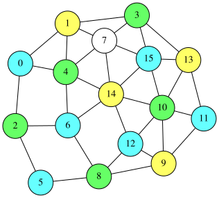
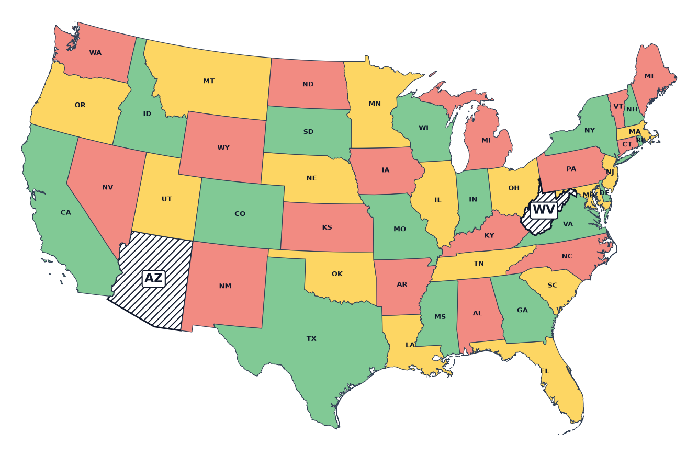
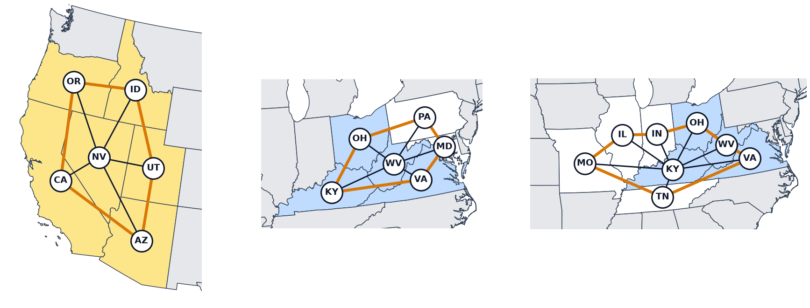

# 3-Colorable Vertex Deletion Problem
Given an undirected graph $G=(V,E)$, the **3-colorable vertex deletion problem** is to delete as few nodes as possible so that the remaining graph can be colored with 3 colors.
If the graph is already 3-colorable, no node needs to be deleted.
The minimum number of deleted nodes measures how far the graph is from being 3-colorable.

The 16-node graph of the [Graph Coloring Problem](GRAPH_COLOR) cannot be colored with 3 colors.
On this page, we first find the minimum number of nodes to delete from this graph.
Then, on the map of the 48 contiguous U.S. states, we find how many states must be removed so that the remaining states can be colored with 3 colors.



The video finds the fewest states to remove for the 48 contiguous US states, and explains all 24 pairs of 2 states to remove and why. The program in the video, chapter by chapter, is on the page [Video: 48 US States in 3 Colors](python/VIDEO_3COLOR_DELETION).

## Formulation
Let $V=\lbrace 0,1,\ldots ,n−1\rbrace$ and let the three colors be $0, 1, 2$.
We introduce an $n\times 3$ matrix $X=(x_{i,j})$ of binary variables, where $x_{i,j}=1$ means that node $i$ is colored with color $j$.
A node whose row is all 0 is not colored, and these are the nodes to delete.

### At most one color
Each node is either colored with one color or not colored.
Therefore, each row must have at most one 1.
Let $s_i=\sum_{j=0}^{2}x_{i,j}$ be the number of 1s in row $i$; this is the range constraint $0\leq s_i\leq 1$.
Since the width of the range is 1, QUBO++ turns it into the following penalty without auxiliary variables (Case 2 of [Comparison Operators](COMPARISON)):

$$
\begin{aligned}
\text{atmostone} &= \sum_{i=0}^{n-1}\Bigl(0\leq\sum_{j=0}^{2}x_{i,j}\leq 1\Bigr)\\
 &= \sum_{i=0}^{n-1}s_i(s_i-1)
\end{aligned}
$$

$s_i(s_i-1)$ is 0 for $s_i=0, 1$, 2 for $s_i=2$, and 6 for $s_i=3$.

This constraint can also be declared with `qbpp::cons()`, but here it is used as a penalty.
`qbpp::cons()` is useful for constraints that need auxiliary variables in the penalty form (see "Comparison with the penalty form" in [Nonlinear Functions and Native Constraints](CONSTRAINTS)).
This constraint needs no auxiliary variables, and since $s_i$ is the sum of 3 variables, its expansion $s_i(s_i-1)=2(x_{i,0}x_{i,1}+x_{i,0}x_{i,2}+x_{i,1}x_{i,2})$ is small: only 3 quadratic terms.
Rather than making $n$ small constraints with `qbpp::cons()`, expanding them and summing them into one QUBO expression is better suited to parallel computation on a GPU.

### Adjacent nodes have different colors
The two endpoints of an edge must not be colored with the same color:

$$
\text{different} = \sum_{(u,v)\in E}\sum_{j=0}^{2}x_{u,j}x_{v,j}
$$

This is the same expression as in the [Graph Coloring Problem](GRAPH_COLOR).
The row of a node that is not colored is all 0, so every term of the edges at that node is 0.

### Number of colored nodes
Under these constraints, we maximize the number of colored nodes.
Since each row has at most one 1, the number of colored nodes is the number of 1s:

$$
\text{colored} = \sum_{i=0}^{n-1}\sum_{j=0}^{2}x_{i,j}
$$

The number of deleted nodes is $n-\text{colored}$, so maximizing the number of colored nodes is the same as minimizing the number of deleted nodes.

## QUBO Expression
Since colored is to be maximized, we reverse its sign and minimize the following QUBO expression:

$$
f = -\text{colored} + 2\,(\text{atmostone} + \text{different})
$$

The penalties are doubled so that the constraints take priority.
In a solution that violates a constraint, changing one 1 to 0 in a row with two or more 1s, or in the row of one of two adjacent nodes with the same color, decreases colored by 1 but decreases the penalty by at least 2.
Therefore, a violating solution is never a minimum of $f$, and the minimum value of $f$ is the maximum number of colored nodes with its sign reversed.
Any weight larger than 1 is enough.

This formulation has the same form as the [maximum independent set problem](GRAPH) on a new graph in which each node is split into three copies, one per color.
In the new graph, the three copies of each node are connected to each other, and for each edge $(u,v)$ of the original graph, the copies of $u$ and $v$ with the same color are connected.
Coloring as many nodes as possible is the same as finding a maximum independent set of the new graph.

## QUBO++ Program
For the same 16-node graph as the [Graph Coloring Problem](GRAPH_COLOR), the following program finds the minimum number of nodes to delete:

```cpp
#include <qbpp/qbpp.hpp>
#include <qbpp/easy_solver.hpp>
#include <qbpp/graph.hpp>

int main() {
  const size_t n = 16;
  std::vector<std::pair<size_t, size_t>> edges = {
      {0, 1},   {0, 2},   {0, 4},   {1, 3},   {1, 4},   {1, 7},   {2, 5},
      {2, 6},   {3, 7},   {3, 13},  {3, 15},  {4, 6},   {4, 7},   {4, 14},
      {5, 8},   {6, 8},   {6, 14},  {7, 14},  {7, 15},  {8, 9},   {8, 12},
      {9, 10},  {9, 11},  {9, 12},  {10, 11}, {10, 12}, {10, 13}, {10, 14},
      {10, 15}, {11, 13}, {12, 14}, {13, 15}, {14, 15}};
  const size_t m = 3;

  auto x = qbpp::var("x", n, m);

  auto atmostone = qbpp::sum(0 <= qbpp::vector_sum(x) <= 1);
  auto different = qbpp::toExpr(0);
  for (const auto& e : edges) {
    different += qbpp::sum(x(e.first) * x(e.second));
  }
  auto colored = qbpp::sum(x);

  auto f = -colored + 2 * (atmostone + different);

  f.simplify_as_binary();
  auto solver = qbpp::EasySolver(f);
  auto sol = solver.search({{"time_limit", 1.0}});

  std::cout << "colored = " << sol(colored) << std::endl;
  std::cout << "atmostone = " << sol(atmostone) << std::endl;
  std::cout << "different = " << sol(different) << std::endl;

  auto node_color = qbpp::onehot_to_int(sol(x));
  std::cout << "deleted nodes:";
  for (size_t i = 0; i < n; ++i) {
    if (node_color[i] == -1) std::cout << " " << i;
  }
  std::cout << std::endl;

  qbpp::graph::GraphDrawer graph;
  for (size_t i = 0; i < n; ++i) {
    graph.add_node(qbpp::graph::Node(i).color(node_color[i] + 1));
  }
  for (const auto& e : edges) {
    graph.add_edge(qbpp::graph::Edge(e.first, e.second));
  }

  graph.write("3color_deletion.svg");
}
```

`qbpp::vector_sum(x)` is the array of the row sums.
Summing the array of row range constraints `0 <= qbpp::vector_sum(x) <= 1` with `qbpp::sum()` gives `atmostone`.
`different` is the same as in the [Graph Coloring Problem](GRAPH_COLOR).
`qbpp::sum(x)` is the sum of all elements of `x`, which is `colored`.
Since the minimum value is not known, no target energy is given, and the Easy Solver searches for 1 second.

`qbpp::onehot_to_int()` returns $-1$ for a row that is not one-hot, so the value of a deleted node is $-1$.
The program prints these nodes and draws each node with color number `node_color[i] + 1` using `qbpp::graph::GraphDrawer`.
Deleted nodes are drawn with color 0 (white).

The output of this program is as follows:
```
colored = 15
atmostone = 0
different = 0
deleted nodes: 7
```
15 of the 16 nodes can be colored with 3 colors.
That is, deleting one node makes the rest 3-colorable.
An exhaustive check shows that one deletion suffices only when node 7, 14, or 15 is deleted.
Which of them is deleted in the solution varies from run to run.

<p align="center">
  
</p>

## The 48 Contiguous U.S. States
In [Video: Map Coloring](python/VIDEO_MAP_COLORING), we confirmed that the 48 contiguous U.S. states can be colored with 4 colors but not with 3 colors.
Here we find how many states must be removed so that the remaining states can be colored with 3 colors.
The graph has the states as nodes and an edge between two states that share a border line: 48 nodes and 105 edges (pairs that touch only at a point are not edges).

The following program writes the state names and the edges directly.
An edge is a pair of state numbers, and the number of a state is its position in `names` (for example, `{1, 25}` is Arizona and Nevada).
The expression is the same as for the 16-node graph.
The ABS3 Solver searches for 10 seconds, and `best_energy_sols` is set to 0 to keep all solutions whose energy equals the best one.
For each kept solution, the program makes the set of the names of the deleted states and counts the solutions for each set.

```cpp
#include <map>
#include <qbpp/qbpp.hpp>
#include <qbpp/abs3_solver.hpp>

int main() {
  const std::vector<std::string> names = {
      "Alabama", "Arizona", "Arkansas", "California",
      "Colorado", "Connecticut", "Delaware", "Florida",
      "Georgia", "Idaho", "Illinois", "Indiana",
      "Iowa", "Kansas", "Kentucky", "Louisiana",
      "Maine", "Maryland", "Massachusetts", "Michigan",
      "Minnesota", "Mississippi", "Missouri", "Montana",
      "Nebraska", "Nevada", "New Hampshire", "New Jersey",
      "New Mexico", "New York", "North Carolina", "North Dakota",
      "Ohio", "Oklahoma", "Oregon", "Pennsylvania",
      "Rhode Island", "South Carolina", "South Dakota", "Tennessee",
      "Texas", "Utah", "Vermont", "Virginia",
      "Washington", "West Virginia", "Wisconsin", "Wyoming"};
  const std::vector<std::pair<size_t, size_t>> edges = {
      {0, 7}, {0, 8}, {0, 21}, {0, 39}, {1, 3}, {1, 25}, {1, 28}, {1, 41},
      {2, 15}, {2, 21}, {2, 22}, {2, 33}, {2, 39}, {2, 40}, {3, 25}, {3, 34},
      {4, 13}, {4, 24}, {4, 28}, {4, 33}, {4, 41}, {4, 47}, {5, 18}, {5, 29},
      {5, 36}, {6, 17}, {6, 35}, {7, 8}, {8, 30}, {8, 37}, {8, 39}, {9, 23},
      {9, 25}, {9, 34}, {9, 41}, {9, 44}, {9, 47}, {10, 11}, {10, 12}, {10, 14},
      {10, 22}, {10, 46}, {11, 14}, {11, 19}, {11, 32}, {12, 20}, {12, 22},
      {12, 24}, {12, 38}, {12, 46}, {13, 22}, {13, 24}, {13, 33}, {14, 22},
      {14, 32}, {14, 39}, {14, 43}, {14, 45}, {15, 21}, {15, 40}, {16, 26},
      {17, 35}, {17, 43}, {17, 45}, {18, 26}, {18, 29}, {18, 36}, {18, 42},
      {19, 32}, {19, 46}, {20, 31}, {20, 38}, {20, 46}, {21, 39}, {22, 24},
      {22, 33}, {22, 39}, {23, 31}, {23, 38}, {23, 47}, {24, 38}, {24, 47},
      {25, 34}, {25, 41}, {26, 42}, {27, 29}, {27, 35}, {28, 33}, {28, 40},
      {29, 35}, {29, 42}, {30, 37}, {30, 39}, {30, 43}, {31, 38}, {32, 35},
      {32, 45}, {33, 40}, {34, 44}, {35, 45}, {38, 47}, {39, 43}, {41, 47},
      {43, 45}, {6, 27}};
  const size_t n = names.size();
  const size_t m = 3;

  auto x = qbpp::var("x", n, m);

  auto atmostone = qbpp::sum(0 <= qbpp::vector_sum(x) <= 1);
  auto different = qbpp::toExpr(0);
  for (const auto& e : edges) {
    different += qbpp::sum(x(e.first) * x(e.second));
  }
  auto colored = qbpp::sum(x);

  auto f = -colored + 2 * (atmostone + different);

  f.simplify_as_binary();
  auto solver = qbpp::ABS3Solver(f);
  auto sol = solver.search({{"time_limit", 10.0}, {"best_energy_sols", 0}});

  std::cout << "colored = " << sol(colored) << std::endl;

  std::map<std::vector<std::string>, int> sets;
  for (const auto& s : sol) {
    auto node_color = qbpp::onehot_to_int(s(x));
    std::vector<std::string> key;
    for (size_t i = 0; i < n; ++i) {
      if (node_color[i] == -1) key.push_back(names[i]);
    }
    ++sets[key];
  }
  std::cout << "solutions = " << sol.size()
            << ", deletion sets = " << sets.size() << std::endl;
  for (const auto& [key, count] : sets) {
    for (size_t k = 0; k < key.size(); ++k) {
      std::cout << (k == 0 ? "" : " + ") << key[k];
    }
    std::cout << ": " << count << std::endl;
  }
}
```

The output of this program is as follows:
```
colored = 46
solutions = 1728, deletion sets = 24
Arizona + Kentucky: 48
Arizona + Ohio: 48
Arizona + Virginia: 24
Arizona + West Virginia: 72
California + Kentucky: 48
California + Ohio: 48
California + Virginia: 24
California + West Virginia: 72
Idaho + Kentucky: 96
Idaho + Ohio: 96
Idaho + Virginia: 48
Idaho + West Virginia: 144
Kentucky + Nevada: 96
Kentucky + Oregon: 96
Kentucky + Utah: 48
Nevada + Ohio: 96
Nevada + Virginia: 48
Nevada + West Virginia: 144
Ohio + Oregon: 96
Ohio + Utah: 48
Oregon + Virginia: 48
Oregon + West Virginia: 144
Utah + Virginia: 24
Utah + West Virginia: 72
```
At most 46 states can be colored, so the minimum number of states to delete is 2, and there are 24 pairs of states to delete.
Each pair has several ways to color the remaining 46 states (6 ways just by permuting the colors), so 1728 solutions are kept in total.
This output was obtained with a GPU.
Without a GPU, fewer solutions are kept in 10 seconds (135 with a 20-core CPU), but in this example all 24 pairs were still found.

The Easy Solver also finds the minimum of 2 states quickly.
However, the Easy Solver focuses on the neighborhood of the best solution, so it collects few of the solutions with the same energy that are far away (13 solutions, 10 pairs in 10 seconds).
The ABS3 Solver is better suited for collecting solutions with the best energy widely.

The following map shows the solution that deletes Arizona and West Virginia.
The two deleted states are hatched, and the remaining 46 states are colored with 3 colors.

<p align="center">
  
</p>

### Why 2 States, and Why 24 Pairs
If a state is surrounded by a ring of an odd number of neighboring states, that part cannot be colored with 3 colors.
An odd ring needs all 3 colors, so the state in the middle, which is adjacent to every state of the ring, needs a fourth color.
Deleting any one state of the ring or the state in the middle removes this shape.

The 48 states contain three such shapes:

- Nevada is surrounded by the 5 states California, Oregon, Idaho, Utah, and Arizona
- West Virginia is surrounded by the 5 states Ohio, Pennsylvania, Maryland, Virginia, and Kentucky
- Kentucky is surrounded by the 7 states Illinois, Indiana, Ohio, West Virginia, Virginia, Tennessee, and Missouri

<p align="center">
  
</p>

The shape at Nevada in the west shares no state with the two shapes in the east, so at least 2 states must be deleted.
In the west, one of Nevada and the 5 states around it (yellow in the figure) is deleted.
In the east, deleting one of Kentucky, West Virginia, Ohio, and Virginia (blue in the figure), which belong to both shapes, removes both shapes.
Choosing one of the 6 states in the west and one of the 4 states in the east gives $6\times 4=24$ pairs, which are exactly the 24 pairs in the output.
