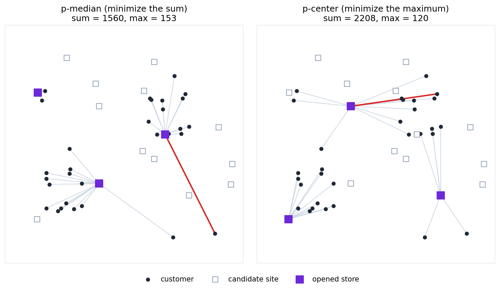

# Facility Location (p-median and p-center)
We are given the locations of customers and candidate locations for stores.
We open stores at $p$ of the candidates, and each customer uses the nearest open store.
The **facility location problem** asks for the locations of the stores so that the distances from the customers to the stores are as small as possible.
Depending on how the distances are evaluated, there are two problems:

- **p-median problem**: minimize the **sum** of the distances of all customers
- **p-center problem**: minimize the distance of the farthest customer, that is, the **maximum** of the distances

Both are known to be NP-hard.

The names come from the case of opening only one store.
When the customers are on a number line, the location minimizing the sum of the distances is the **median** of the customer locations, and the location minimizing the distance of the farthest customer is the midpoint of the two end customers, that is, the **center**.
p-median and p-center generalize these to $p$ locations.

On this page, we solve an example with 30 customers and 15 candidates, from which 3 are chosen.
The coordinates of the customers and the candidates are integers from 0 to 299, and the distance is the length of the straight line between two points (the Euclidean distance) rounded to an integer.
In the following figure, the left shows the solution of the p-median problem and the right shows the solution of the p-center problem:

<p align="center">
  
</p>

The black dots are the customers, the white squares are the candidates, and the purple squares are the opened stores.
The gray lines connect each customer with the store it uses, and the red line connects the farthest customer with its store.
The p-median solution opens stores near the two towns with many customers and near the two customers at the upper left, and the distance of the customer living apart at the lower right is 153.
The p-center solution also opens a store near the customers at the lower right, reducing the distance of the farthest customer to 120.
In exchange, the sum of the distances increases from 1560 to 2208.

## Problem
Number the customers $0,1,\ldots,N-1$ and the candidates $0,1,\ldots,S-1$, and let $d_{i,j}$ be the distance from customer $i$ to candidate $j$.
Each $d_{i,j}$ is a nonnegative integer.

Let $P$ be the set of candidates where stores are opened.
$P$ is a subset of $\lbrace 0,1,\ldots,S-1\rbrace$ with $\lvert P\rvert=p$ elements.
Since customer $i$ uses the nearest store in $P$, its distance is

$$
D_i(P) = \min_{j\in P} d_{i,j}.
$$

The p-median problem and the p-center problem ask for $P$ minimizing the following values, respectively:

$$
\begin{aligned}
\text{p-median: } & \sum_{i=0}^{N-1} D_i(P) = \sum_{i=0}^{N-1}\min_{j\in P} d_{i,j}, \\
\text{p-center: } & \max_{0\leq i\leq N-1} D_i(P) = \max_{0\leq i\leq N-1}\min_{j\in P} d_{i,j}
\end{aligned}
$$

Both contain the minimum $D_i(P)$ of each customer.
The p-median problem minimizes their sum, and the p-center problem minimizes their maximum.

## Formulation
We represent the set $P$ and the store each customer uses by the following binary variables:

- $y_j=1$: a store is opened at candidate $j$ ($j\in P$)
- $x_{i,j}=1$: customer $i$ uses store $j$

We impose the following constraints:

$$
\begin{aligned}
\sum_{j=0}^{S-1} y_j &= p, \\
\sum_{j=0}^{S-1} x_{i,j} &= 1 && (0\leq i\leq N-1), \\
x_{i,j} &\leq y_j && (0\leq i\leq N-1,\ 0\leq j\leq S-1)
\end{aligned}
$$

The first line means $\lvert P\rvert=p$, the second line means that each customer uses exactly one store, and the third line means that only open stores (elements of $P$) can be used.
The distance from customer $i$ to the store it uses is

$$
D_i = \sum_{j=0}^{S-1} d_{i,j}\,x_{i,j}.
$$

### Why the nearest store is chosen
The constraints only say "use one of the open stores"; they do not say "use the nearest one".
Therefore, $D_i$ is at least $D_i(P)=\min_{j\in P} d_{i,j}$.
Still, in a solution minimizing the objective, each customer uses the nearest store, and $D_i=D_i(P)$ holds.
If a customer switches to the nearest open store, its distance $D_i$ decreases or stays the same, and the distances of the other customers do not change.
Neither of the objectives described below increases by this switch.

In this way, the minimum $D_i(P)$ is represented by choosing the store to use with a one-hot assignment.
This is the way of minimizing a minimum described in [Minimizing and Maximizing Maxima and Minima](MAX_MIN#maximizing-the-maximum-and-minimizing-the-minimum).

### p-median problem
The objective is the sum of the distances:

$$
\text{objective} = \sum_{i=0}^{N-1} D_i
$$

We declare the constraints with [`qbpp::cons()`](CONSTRAINTS), multiply them by a weight $\lambda$, and add them to the objective:

$$
f = \text{objective} + \lambda\times\Bigl(\text{cons}\Bigl(\sum_{j} y_j=p\Bigr) + \sum_{i}\text{cons}\Bigl(\sum_{j} x_{i,j}=1\Bigr) + \sum_{i,j}\text{cons}\bigl(x_{i,j}-y_j\leq 0\bigr)\Bigr)
$$

Any assignment violating at least one constraint has energy at least $\lambda$.
On the other hand, the energy of an assignment satisfying the constraints is the sum of the distances, which is at most $N d_{\max}$, where $d_{\max}$ is the maximum of $d_{i,j}$.
Therefore, with $\lambda=N d_{\max}+1$, an assignment minimizing $f$ always satisfies the constraints.

### p-center problem
As in [minimizing the maximum](MAX_MIN#minimizing-the-maximum-and-maximizing-the-minimum), the maximum distance $\max(D_0,\ldots,D_{N-1})$ is represented by an integer variable $z$ and relu:

$$
z + 2\sum_{i=0}^{N-1}\mathrm{relu}(D_i - z)
$$

If $z$ is an integer variable from $0$ to $d_{\max}$, this expression is minimized when $z$ equals the maximum distance, and its value is the maximum distance.

With this alone, the stores not related to the farthest customer can be opened anywhere without changing the maximum.
So we also add the sum of the distances $\sum_i D_i$ to the objective, so that among layouts with the same maximum, one with a smaller sum is chosen:

$$
\text{objective} = K\Bigl(z + 2\sum_{i=0}^{N-1}\mathrm{relu}(D_i - z)\Bigr) + \sum_{i=0}^{N-1} D_i
$$

The minimum of this expression is $K\times(\text{maximum distance}) + (\text{sum of distances})$.
Since the sum of the distances is between $0$ and $N d_{\max}$, with $K=N d_{\max}+1$, reducing the maximum by 1 takes priority over any change of the sum.
That is, the maximum is minimized first, and the sum is minimized among the layouts with the same maximum.
Since the distances of all customers are reflected in the energy, the solver also has more clues for improving solutions.

The constraints are added with the same expression as in the p-median problem.
In an optimal assignment satisfying the constraints, $z$ is at most $d_{\max}$, the relu terms are 0, and the sum of the distances is at most $N d_{\max}$, so the energy is at most $(K+N)d_{\max}$.
Therefore, we set $\lambda=(K+N)d_{\max}+1$.

## QUBO++ program
The following program solves the p-median problem for the example in the figure above:

```cpp
#include <algorithm>
#include <cmath>
#include <qbpp/easy_solver.hpp>
#include <qbpp/qbpp.hpp>

int main() {
  std::vector<std::pair<int, int>> customers = {
      {69, 68},   {75, 115},  {42, 61},   {91, 64},   {74, 109},  {42, 102},
      {58, 57},   {46, 94},   {80, 60},   {62, 61},   {91, 95},   {42, 110},
      {183, 181}, {234, 219}, {228, 164}, {230, 213}, {211, 164}, {195, 163},
      {227, 171}, {203, 198}, {187, 211}, {185, 213}, {202, 210}, {239, 174},
      {40, 223},  {219, 244}, {74, 143},  {36, 210},  {275, 26},  {217, 21}};
  std::vector<std::pair<int, int>> sites = {
      {239, 79},  {191, 263}, {206, 163}, {299, 122}, {177, 223},
      {175, 140}, {115, 95},  {70, 269},  {297, 94},  {30, 221},
      {115, 202}, {191, 129}, {280, 173}, {110, 233}, {29, 46}};
  const int p = 3;
  const int N = customers.size();
  const int S = sites.size();

  std::vector<std::vector<int>> d(N, std::vector<int>(S));
  int dmax = 0;
  for (int i = 0; i < N; ++i) {
    for (int j = 0; j < S; ++j) {
      auto [cx, cy] = customers[i];
      auto [sx, sy] = sites[j];
      d[i][j] = static_cast<int>(std::lround(std::hypot(cx - sx, cy - sy)));
      dmax = std::max(dmax, d[i][j]);
    }
  }

  auto y = qbpp::var("y", S);
  auto x = qbpp::var("x", N, S);

  auto dist = qbpp::expr(N);
  for (int i = 0; i < N; ++i) {
    for (int j = 0; j < S; ++j) {
      dist[i] += d[i][j] * x[i][j];
    }
  }

  auto constraint = qbpp::cons(qbpp::sum(y) == p);
  for (int i = 0; i < N; ++i) {
    constraint += qbpp::cons(qbpp::sum(x(i)) == 1);
    for (int j = 0; j < S; ++j) {
      constraint += qbpp::cons(x[i][j] - y[j] <= 0);
    }
  }

  auto objective = qbpp::sum(dist);
  auto f = objective + (N * dmax + 1) * constraint;
  f.simplify_as_binary();

  auto solver = qbpp::EasySolver(f);
  auto sol = solver.search({{"time_limit", 5}});

  std::cout << "opened sites =";
  for (int j = 0; j < S; ++j) {
    if (sol(y[j]) == 1) {
      std::cout << " " << j;
    }
  }
  std::cout << std::endl;
  qbpp::energy_t total = 0, farthest = 0;
  for (int i = 0; i < N; ++i) {
    total += dist[i](sol);
    farthest = std::max(farthest, dist[i](sol));
  }
  std::cout << "sum = " << total << ", max = " << farthest << std::endl;
  std::cout << "violated constraints = " << f.cons(sol) << std::endl;
}
```

`customers` and `sites` are the coordinates of the customers and the candidates, `d` is the distance $d_{i,j}$, and `dmax` is its maximum.
`std::hypot(a, b)` is $\sqrt{a^2+b^2}$, which is rounded by `std::lround()`.
`qbpp::expr(N)` is an array of expressions whose values are all 0, and `dist[i]` becomes the distance $D_i$ of customer `i`.
The three kinds of constraints are added to `constraint`.
`x(i)` is row `i` of `x`, and `qbpp::sum(x(i))` is its sum $\sum_j x_{i,j}$.
There are $15+30\times 15=465$ variables, too many for exhaustive search, so we use the Easy Solver with a time limit of 5 seconds.
The program prints the opened stores, the sum and the maximum of the distances, and the number of violated constraints.

The output of this program is as follows:
```
opened sites = 2 6 9
sum = 1560, max = 153
violated constraints = 0
```

### Changing to the p-center problem
The following program solves the p-center problem.
It differs from the p-median program only in the part creating `objective` and `f`:

```cpp
#include <algorithm>
#include <cmath>
#include <qbpp/easy_solver.hpp>
#include <qbpp/qbpp.hpp>

int main() {
  std::vector<std::pair<int, int>> customers = {
      {69, 68},   {75, 115},  {42, 61},   {91, 64},   {74, 109},  {42, 102},
      {58, 57},   {46, 94},   {80, 60},   {62, 61},   {91, 95},   {42, 110},
      {183, 181}, {234, 219}, {228, 164}, {230, 213}, {211, 164}, {195, 163},
      {227, 171}, {203, 198}, {187, 211}, {185, 213}, {202, 210}, {239, 174},
      {40, 223},  {219, 244}, {74, 143},  {36, 210},  {275, 26},  {217, 21}};
  std::vector<std::pair<int, int>> sites = {
      {239, 79},  {191, 263}, {206, 163}, {299, 122}, {177, 223},
      {175, 140}, {115, 95},  {70, 269},  {297, 94},  {30, 221},
      {115, 202}, {191, 129}, {280, 173}, {110, 233}, {29, 46}};
  const int p = 3;
  const int N = customers.size();
  const int S = sites.size();

  std::vector<std::vector<int>> d(N, std::vector<int>(S));
  int dmax = 0;
  for (int i = 0; i < N; ++i) {
    for (int j = 0; j < S; ++j) {
      auto [cx, cy] = customers[i];
      auto [sx, sy] = sites[j];
      d[i][j] = static_cast<int>(std::lround(std::hypot(cx - sx, cy - sy)));
      dmax = std::max(dmax, d[i][j]);
    }
  }

  auto y = qbpp::var("y", S);
  auto x = qbpp::var("x", N, S);

  auto dist = qbpp::expr(N);
  for (int i = 0; i < N; ++i) {
    for (int j = 0; j < S; ++j) {
      dist[i] += d[i][j] * x[i][j];
    }
  }

  auto constraint = qbpp::cons(qbpp::sum(y) == p);
  for (int i = 0; i < N; ++i) {
    constraint += qbpp::cons(qbpp::sum(x(i)) == 1);
    for (int j = 0; j < S; ++j) {
      constraint += qbpp::cons(x[i][j] - y[j] <= 0);
    }
  }

  auto z = 0 <= qbpp::int_var("z") <= dmax;
  const int K = N * dmax + 1;
  auto objective = K * z + qbpp::sum(dist);
  for (int i = 0; i < N; ++i) {
    objective += 2 * K * qbpp::relu(dist[i] - z);
  }
  auto f = objective + ((K + N) * dmax + 1) * constraint;
  f.simplify_as_binary();

  auto solver = qbpp::EasySolver(f);
  auto sol = solver.search({{"time_limit", 5}});

  std::cout << "opened sites =";
  for (int j = 0; j < S; ++j) {
    if (sol(y[j]) == 1) {
      std::cout << " " << j;
    }
  }
  std::cout << std::endl;
  qbpp::energy_t total = 0, farthest = 0;
  for (int i = 0; i < N; ++i) {
    total += dist[i](sol);
    farthest = std::max(farthest, dist[i](sol));
  }
  std::cout << "sum = " << total << ", max = " << farthest << std::endl;
  std::cout << "violated constraints = " << f.cons(sol) << std::endl;
}
```

`0 <= qbpp::int_var("z") <= dmax` is an integer variable $z$ from $0$ to $d_{\max}$, and `K` and the weight are as in the [formulation](#p-center-problem).
The output of this program is as follows:
```
opened sites = 0 10 14
sum = 2208, max = 120
violated constraints = 0
```
The distance of the farthest customer decreases from 153 to 120, and the sum of the distances increases from 1560 to 2208.

### Checking by brute force
In this example, there are only 455 ways to choose 3 of the 15 candidates, so we can check the answers by examining all of them.
Add the following code at the end of the `main` function of the program above:
```cpp
  int best_sum = -1, center_max = -1, center_sum = 0;
  std::vector<int> median_sites, center_sites;
  for (int a = 0; a < S; ++a) {
    for (int b = a + 1; b < S; ++b) {
      for (int c = b + 1; c < S; ++c) {
        int total_abc = 0, farthest_abc = 0;
        for (int i = 0; i < N; ++i) {
          int v = std::min({d[i][a], d[i][b], d[i][c]});
          total_abc += v;
          farthest_abc = std::max(farthest_abc, v);
        }
        if (best_sum < 0 || total_abc < best_sum) {
          best_sum = total_abc;
          median_sites = {a, b, c};
        }
        if (center_max < 0 || farthest_abc < center_max ||
            (farthest_abc == center_max && total_abc < center_sum)) {
          center_max = farthest_abc;
          center_sum = total_abc;
          center_sites = {a, b, c};
        }
      }
    }
  }
  std::cout << "p-median: " << median_sites[0] << " " << median_sites[1] << " "
            << median_sites[2] << std::endl;
  std::cout << "p-center: " << center_sites[0] << " " << center_sites[1] << " "
            << center_sites[2] << std::endl;
```
The triple loop examines all sets `(a, b, c)` of store locations.
For each customer, `v` is the distance to its nearest store, and the sum and the maximum of these distances are computed.
`median_sites` is the set with the minimum sum of the distances, and `center_sites` is the set with the minimum maximum distance and, among those, the minimum sum.
The output is as follows and agrees with the answers of the Easy Solver:
```
p-median: 2 6 9
p-center: 0 10 14
```
There are four sets with maximum distance 120: (0, 6, 10), (0, 10, 14), (6, 8, 10), and (8, 10, 14), whose sums of the distances are 2219, 2208, 2313, and 2302, respectively.
The p-center program chooses (0, 10, 14), the one with the minimum sum, because the sum of the distances is added.

## Manhattan distance
The problems can be solved in the same way with the distance measured along the streets of a grid town (the sum of the horizontal and vertical differences, the Manhattan distance).
In the two programs above, just replace the line computing `d[i][j]` with `d[i][j] = std::abs(cx - sx) + std::abs(cy - sy);`.
The p-median problem chooses stores 2, 6, 9 (sum of the distances 1974, maximum 206), and the p-center problem chooses stores 0, 6, 13 (sum 2795, maximum 140).
The p-median problem chooses the same locations as with the Euclidean distance, while the p-center problem chooses different locations.
Both agree with the answers found by brute force.

The figure at the top was drawn with the matplotlib code on the [PyQBPP page](python/FACILITY_LOCATION#visualization-with-matplotlib).
