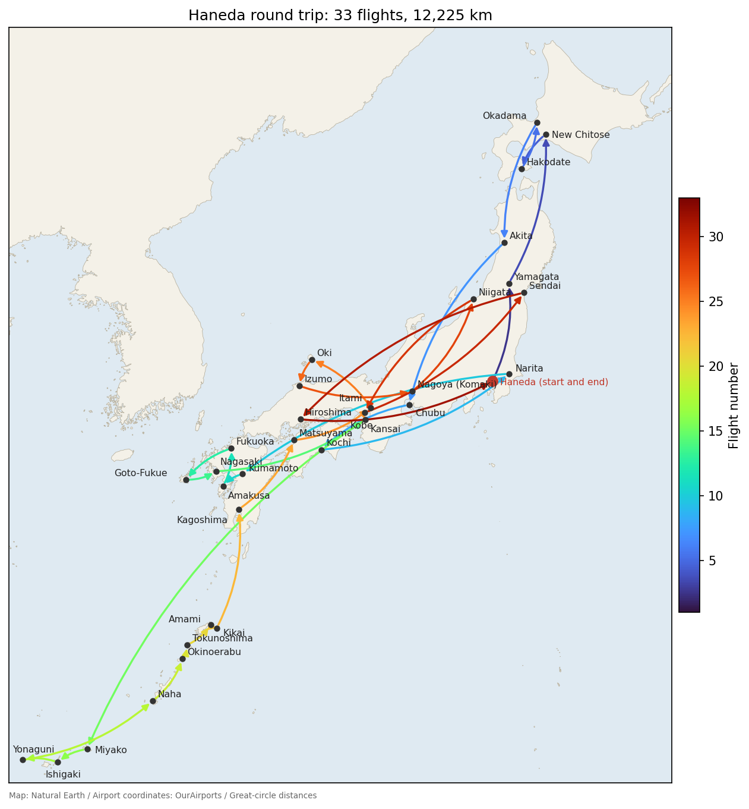
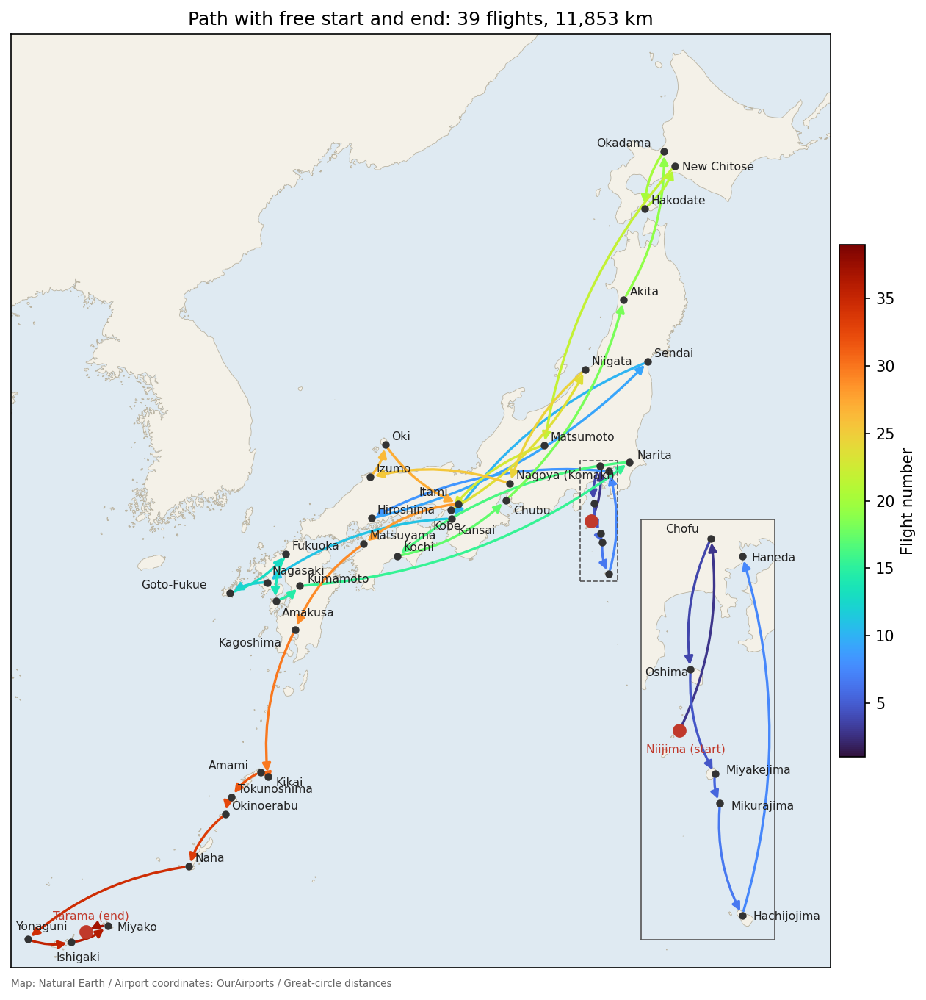

# Most Airports Tour
The **most airports tour** problem is to connect nonstop domestic flights in Japan and visit as many airports as possible without visiting any airport twice.
If two routes visit the same number of airports, we choose the one with the shorter total distance.
We consider the following two cases:

1. We always leave Haneda Airport and return to Haneda Airport.
2. The start and end airports can be any two different airports.



The video represents the problem as a directed graph, explains the constraints and the objective function, solves the two cases with the program, and follows the answers by plane. The program in the video, chapter by chapter, is on the page [Video: Most Airports Tour](python/VIDEO_LONGEST_FLIGHT).

## Data
[domestic_flights.csv](../images/domestic_flights.csv) lists the nonstop domestic flights that operate essentially every day in the 2026 winter schedule (October 25, 2026 to March 27, 2027).
It includes the helicopter flights between the Izu Islands.
It was made from the timetables of the airlines.
It has 85 airports and 458 flights, one line per flight in one direction:
```
from,to,km
AKJ,HND,931
AKJ,NRT,896
AOJ,CTS,242
...
```
`from` and `to` are the codes of the departure and arrival airports (`HND` is Haneda), and `km` is the great-circle distance between the two airports (in km, rounded to an integer).
Most airport codes have three letters, but Chofu, Niijima, and Kozushima use four-letter codes (`RJTF`, `RJAN`, and `RJAZ`), and the heliports of Aogashima and Mikurajima are written `HP_AOGASHIMA` and `HP_MIKURAJIMA`.
Most routes have flights in both directions, but Amami→Yoron and Naha→Amami have no flight in the opposite direction.
We ignore connection times (whether a connection can be made on the same day).
Since flight operations change, this data may differ from the actual flights.

## Formulation
We use the directed graph $G=(V,E)$, where $V$ is the set of airports and $E$ is the set of flights.
An edge $(u,v)\in E$ is a flight from airport $u$ to airport $v$.
For each flight $(u,v)\in E$, we introduce a binary variable $x_{u,v}$, where $x_{u,v}=1$ means that we take the flight.
Let $\text{in}(v)$ be the sum of the variables of the flights arriving at airport $v$, and $\text{out}(v)$ the sum for the flights leaving $v$:

$$
\text{in}(v)=\sum_{(u,v)\in E}x_{u,v},\qquad \text{out}(v)=\sum_{(v,w)\in E}x_{v,w}
$$

### Constraints
Let $r\in V$ denote Haneda.
We impose the following constraints:

$$
\begin{aligned}
\text{in}(v)&=\text{out}(v) && (v\in V)\\
\text{in}(v)&\leq 1 && (v\in V)\\
\text{in}(r)&=1\\
x_{u,v}+x_{v,u}&\leq 1 && ((u,v)\in E,\ (v,u)\in E)
\end{aligned}
$$

The first constraint says that we leave every airport we land at, and the second that we land at each airport at most once.
Under these two, the selected flights split into cycles that share no airport.
By the third, there is exactly one cycle through Haneda, and this cycle is the answer.
The fourth says that we do not fly a route both ways.
A cycle of the two flights of a round trip can be made anywhere, so we exclude all of them in advance.

### Objective
In a cycle, the number of airports visited equals the number of flights taken.
So we maximize the number of flights and, among those, minimize the total distance.
With $d_{u,v}$ the distance of flight $(u,v)$, the value of taking flight $(u,v)$ is

$$
w_{u,v} = M - d_{u,v}.
$$

$M$ is a number that is always larger than the total distance of a cycle: for each airport we take the longest distance of the flights arriving there, add them up, and add 1.
A cycle lands at each airport at most once, so its total distance does not exceed this sum.
A cycle of $k$ flights with total distance $D$ has total value $kM-D$.
Since $D<M$, a cycle with one more flight always has a larger total value, and for the same number of flights, a shorter cycle has a larger total value.
Therefore, maximizing the total value $\sum_{(u,v)\in E}w_{u,v}x_{u,v}$ gives the cycle we want.

Since we minimize, we flip the sign and add the constraints with weight $P$:

$$
f = -\sum_{(u,v)\in E}w_{u,v}x_{u,v} + P\cdot(\text{constraints})
$$

The constraints are declared with `qbpp::cons()`, and $P$ is the sum of all flight values plus 1.
Breaking even one constraint costs at least $P$, so a solution that breaks a constraint is never the minimum of $f$.

## Eliminating cycles not through Haneda
With the constraints above alone, the solution may contain cycles not through Haneda, besides the cycle through Haneda.
Cycles not through Haneda also satisfy all the constraints.
The condition "the selected flights form a single cycle" concerns the whole graph and cannot be written directly as a formula for each airport.

So, as in [Slitherlink](SLITHERLINK), we repeatedly look at the result and add constraints:

1. Solve $f$ with the constraints added so far.
2. Split the solution into cycles. If there is no cycle not through Haneda, the cycle through Haneda is the answer.
3. Otherwise, for the airport set $S$ of each such cycle, add the following constraints and go back to step 1.

$$
\text{enter}(S)\geq \text{in}(v)\quad (v\in S),\qquad \text{enter}(S)=\sum_{(u,v)\in E,\ u\notin S,\ v\in S}x_{u,v}
$$

$\text{enter}(S)$ is the sum of the variables of the flights from outside $S$ to an airport in $S$.
The constraints say: "if we land at an airport in $S$, we take a flight into $S$ from outside $S$."
A solution with only the cycle $S$ not through Haneda takes no flight into $S$ ($\text{enter}(S)=0$) but lands at the airports in $S$ ($\text{in}(v)=1$), so it violates the constraints.
On the other hand, the cycle through Haneda passes through Haneda, which is outside $S$, so if it lands at an airport in $S$, it enters $S$ from outside somewhere before that.
Therefore, the cycle through Haneda never violates the constraints, and the answer is never eliminated.

In Slitherlink, we added the constraint $\sum_{e\in L}x_e\leq |L|-1$, which says that not all edges of the found loop are selected.
That constraint eliminates only the solutions that select all edges of that loop.
The constraints here eliminate all solutions that land at an airport in $S$ without entering $S$ from outside, so they also eliminate cycles over the same airports in a different order and cycles over only part of $S$.

## QUBO++ program
Place [domestic_flights.csv](../images/domestic_flights.csv) in the directory where you run the program:

```cpp
#include <algorithm>
#include <fstream>
#include <iostream>
#include <map>
#include <set>
#include <sstream>
#include <string>
#include <vector>
#include <qbpp/qbpp.hpp>
#include <qbpp/abs3_solver.hpp>

struct Flight {
  int from, to, km;
};

std::vector<std::string> airports;                // airport codes
std::vector<Flight> flights;                      // flights (nonstop, one direction)
std::map<std::pair<int, int>, int> flight_index;  // (from, to) -> flight number

int airport(const std::string& code) {
  for (size_t i = 0; i < airports.size(); ++i)
    if (airports[i] == code) return i;
  airports.push_back(code);
  return airports.size() - 1;
}

void add_flight(int from, int to, int km) {
  flight_index[{from, to}] = flights.size();
  flights.push_back({from, to, km});
}

// Find a cycle through root that does not visit any airport
// twice, with the most flights and, among those, the shortest total distance
std::vector<int> longest_trip(int root) {
  const int n = airports.size(), m = flights.size();
  auto x = qbpp::var("x", m);

  // Flight value M - km. M is larger than the total distance of any cycle
  std::vector<int> max_in(n, 0);
  for (const auto& fl : flights) max_in[fl.to] = std::max(max_in[fl.to], fl.km);
  int M = 1;
  for (int km : max_in) M += km;
  auto obj = qbpp::toExpr(0);
  int P = 1;  // constraint weight: sum of flight values + 1
  for (int e = 0; e < m; ++e) {
    obj += (M - flights[e].km) * x[e];
    P += M - flights[e].km;
  }

  std::vector<qbpp::Expr> in(n), out(n);
  for (int e = 0; e < m; ++e) {
    in[flights[e].to] += x[e];
    out[flights[e].from] += x[e];
  }
  auto c = qbpp::toExpr(0);
  for (int v = 0; v < n; ++v) {
    c += qbpp::cons(in[v] - out[v] == 0);  // leave every airport you land at
    c += qbpp::cons(in[v] <= 1);           // land at each airport at most once
  }
  c += qbpp::cons(in[root] == 1);  // pass through root
  for (int e = 0; e < m; ++e) {    // do not fly a route both ways
    auto it = flight_index.find({flights[e].to, flights[e].from});
    if (it != flight_index.end() && e < it->second)
      c += qbpp::cons(x[e] + x[it->second] <= 1);
  }
  auto f = -obj + P * c;

  std::vector<int> trip;
  for (int round = 1;; ++round) {
    f.simplify_as_binary();
    auto solver = qbpp::ABS3Solver(f);
    qbpp::Params params({{"time_limit", 5}});
    if (round > 1) {  // use the previous cycle through root as a hint
      qbpp::Sol hint(f);
      for (size_t i = 0; i + 1 < trip.size(); ++i)
        hint.set(x[flight_index[{trip[i], trip[i + 1]}]], 1);
      params.hint(hint);
    }
    auto sol = solver.search(params);

    // Following the selected flights from root gives the cycle through root.
    // The other selected flights form cycles not through root
    std::vector<int> next(n, -1);
    for (int e = 0; e < m; ++e)
      if (sol(x[e]) == 1) next[flights[e].from] = flights[e].to;
    std::vector<bool> done(n, false);
    trip = {root};
    for (int v = next[root]; v != root; v = next[v]) {
      trip.push_back(v);
      done[v] = true;
    }
    trip.push_back(root);
    std::vector<std::set<int>> cycles;
    for (int s = 0; s < n; ++s) {
      if (next[s] < 0 || s == root || done[s]) continue;
      std::set<int> S;
      for (int v = s; !done[v]; v = next[v]) {
        done[v] = true;
        S.insert(v);
      }
      cycles.push_back(S);
    }
    std::cout << "round " << round << ": flights = " << trip.size() - 1
              << ", other cycles = " << cycles.size() << std::endl;
    if (cycles.empty()) return trip;

    // For the airport set S of each cycle: to land at an airport in S,
    // take a flight into S from outside S
    for (const auto& S : cycles) {
      auto enter = qbpp::toExpr(0);
      for (int e = 0; e < m; ++e)
        if (!S.count(flights[e].from) && S.count(flights[e].to)) enter += x[e];
      for (int v : S) f += P * qbpp::cons(enter - in[v] >= 0);
    }
  }
}

void print_trip(const std::vector<int>& trip) {
  int km = 0;
  for (size_t i = 0; i + 1 < trip.size(); ++i)
    km += flights[flight_index[{trip[i], trip[i + 1]}]].km;
  for (size_t i = 0; i < trip.size(); ++i)
    std::cout << (i == 0 ? "" : " ") << airports[trip[i]];
  std::cout << std::endl << "distance = " << km << " km" << std::endl;
}

int main() {
  std::ifstream ifs("domestic_flights.csv");
  std::string line;
  std::getline(ifs, line);  // header line
  while (std::getline(ifs, line)) {
    std::stringstream ss(line);
    std::string from, to, km;
    std::getline(ss, from, ',');
    std::getline(ss, to, ',');
    std::getline(ss, km);
    add_flight(airport(from), airport(to), std::stoi(km));
  }
  std::cout << airports.size() << " airports, " << flights.size() << " flights"
            << std::endl;

  print_trip(longest_trip(airport("HND")));

  // Route with no fixed start and end: add a dummy airport DMY linked to every airport
  // by flights of distance 0
  int dmy = airport("DMY");
  for (int v = 0; v < dmy; ++v) {
    add_flight(dmy, v, 0);
    add_flight(v, dmy, 0);
  }
  print_trip(longest_trip(dmy));
}
```

`airports` is the list of airport codes, and the number of an airport is its position in this list.
`flights` is the list of flights, and `flight_index` maps a pair of departure and arrival airport numbers to the flight number.
`main()` reads the CSV file and adds the flights with `add_flight()`.

`longest_trip(root)` finds a cycle through airport `root`.
`qbpp::var("x", m)` creates a variable for each flight, and `in[v]` and `out[v]` add up the variables of the flights arriving at and leaving airport `v`.
The sum of the values `M - km` is `obj`, the sum of the constraints is `c`, and `f = -obj + P * c` is minimized.

In each round of the loop, `f` is simplified, an ABS3 Solver is created again, and it searches for 5 seconds.
From the second round on, a solution that takes the flights of the previous cycle through `root` and no other flight is passed as a [solution hint](ABS3#solution-hint) with `params.hint()`.
The previous cycle through `root` also satisfies the newly added constraints.
ABS3 Solver never returns a solution with higher energy than the hint, so the energy of each solution is at most that of the previous cycle through `root`.

From the solution, the arrival airport of the selected flight is stored in `next` for each departure airport.
Following `next` from `root` until it returns to `root` gives the cycle through `root`.
Following `next` from the airports not on this cycle gives the cycles not through `root`, and their airport sets are stored in `cycles`.
If `cycles` is empty, the cycle through `root` is returned; otherwise, for each set `S`, the constraints `enter - in[v] >= 0` are added to `f` with weight `P`.

## Leaving Haneda and returning to Haneda
`longest_trip(airport("HND"))` in `main()` finds the cycle through Haneda.
An example of the output is as follows:
```
85 airports, 458 flights
round 1: flights = 7, other cycles = 6
round 2: flights = 29, other cycles = 1
round 3: flights = 29, other cycles = 1
round 4: flights = 29, other cycles = 1
round 5: flights = 29, other cycles = 1
round 6: flights = 29, other cycles = 1
round 7: flights = 29, other cycles = 1
round 8: flights = 29, other cycles = 1
round 9: flights = 29, other cycles = 1
round 10: flights = 7, other cycles = 1
round 11: flights = 7, other cycles = 1
round 12: flights = 33, other cycles = 0
HND GAJ CTS HKD OKD AXT NGO KCZ NRT KMJ AXJ FUK FUJ NGS KIX MMY ISG OGN OKA OKE TKN ASJ KKX KOJ MYJ ITM OKI IZO NKM KIJ UKB SDJ HIJ HND
distance = 12225 km
```
`flights` is the number of flights of the cycle through Haneda, and `other cycles` is the number of cycles not through Haneda.
In the first solution, the cycle through Haneda has only 7 flights, and there are 6 cycles not through Haneda.
Each round eliminates the cycles found, and in the 12th round no cycle not through Haneda remains.
In the 10th and 11th rounds, the cycle through Haneda goes back to 7 flights, but the energy including the flights of the cycle not through Haneda is at most that of the previous cycle through Haneda passed as the hint.

The cycle found visits 33 airports with 33 flights and 12,225 km, which is optimal.
It goes Haneda → Yamagata → New Chitose → Hakodate → Okadama → Akita → Chubu → Kochi → Narita → Kumamoto → Amakusa → Fukuoka → Goto-Fukue → Nagasaki → Kansai → Miyako → Ishigaki → Yonaguni → Naha → Okinoerabu → Tokunoshima → Amami → Kikai → Kagoshima → Matsuyama → Itami → Oki → Izumo → Nagoya (Komaki) → Niigata → Kobe → Sendai → Hiroshima → Haneda.

<p align="center">
  
</p>

Since the solver search uses random numbers, the intermediate solutions and the number of rounds vary from run to run.
Flying this cycle in the opposite direction also gives 33 flights and 12,225 km, so the reversed cycle may be printed.

## No fixed start and end airports
If we do not fix the start and end airports, we may be able to take more flights.
This is the problem of finding a route from a start airport to an end airport that visits no airport twice.

Adding a dummy airport `DMY` turns this problem into the same problem as above.
We add flights of distance 0 from `DMY` to every airport and from every airport to `DMY`.
A cycle through `DMY` flies from `DMY` to some airport $s$, connects from $s$ to some airport $t$, and flies from $t$ back to `DMY`.
Removing the two flights with `DMY` leaves a route from $s$ to $t$.

The value of a flight with `DMY` is $M-0=M$.
A cycle through `DMY` takes exactly two flights with `DMY`, so the total value of every cycle increases by the same amount ($2M$).
Therefore, the values of the flights with `DMY` do not change which cycle is the best.

The second half of `main()` adds `DMY` and the flights with `DMY`, and `longest_trip(dmy)` finds a cycle through `DMY`.
An example of the output is as follows:
```
round 1: flights = 27, other cycles = 2
round 2: flights = 27, other cycles = 2
round 3: flights = 37, other cycles = 1
round 4: flights = 37, other cycles = 1
round 5: flights = 37, other cycles = 1
round 6: flights = 37, other cycles = 1
round 7: flights = 37, other cycles = 1
round 8: flights = 37, other cycles = 1
round 9: flights = 37, other cycles = 1
round 10: flights = 37, other cycles = 1
round 11: flights = 41, other cycles = 0
DMY RJAN RJTF OIM MYE HP_MIKURAJIMA HAC HND HIJ SDJ KIX NGS FUJ FUK AXJ KMJ NRT KCZ NGO AXT OKD HKD CTS MMJ UKB KIJ NKM IZO OKI ITM MYJ KOJ KKX ASJ TKN OKE OKA OGN ISG MMY TRA DMY
distance = 11853 km
```
`flights = 41` includes the two flights with `DMY`, so the route visits 40 airports with 39 flights and 11,853 km, which is optimal.
It visits seven more airports than the cycle through Haneda, and its total distance is shorter.
It connects Niijima → Chofu → Oshima → Miyakejima → Mikurajima → Hachijojima → Haneda → Hiroshima → Sendai → Kansai → Nagasaki → Goto-Fukue → Fukuoka → Amakusa → Kumamoto → Narita → Kochi → Chubu → Akita → Okadama → Hakodate → New Chitose → Matsumoto → Kobe → Niigata → Nagoya (Komaki) → Izumo → Oki → Itami → Matsuyama → Kagoshima → Kikai → Amami → Tokunoshima → Okinoerabu → Naha → Yonaguni → Ishigaki → Miyako → Tarama.
Oshima → Miyakejima → Mikurajima → Hachijojima are helicopter flights.
The lower right of the map is an enlarged view around the Izu Islands.

<p align="center">
  
</p>

Flying this route in the opposite direction gives the same distance, so a route from Tarama to Niijima may be printed.

## A slightly longer route may be printed
When the start and end airports are not fixed, some runs print a route with a slightly longer total distance.
For example, the 11,856 km route visits the 14 airports between Kumamoto and Matsuyama of the route above in reverse order (Kumamoto → Itami → Oki → … → Kochi → Narita → Matsuyama).
The two routes differ only in the routes at the two ends of this section (Kumamoto–Narita and Itami–Matsuyama in the route above, Kumamoto–Itami and Narita–Matsuyama in the 11,856 km route).
The 13 routes in between are flown in the opposite direction.
However, in the directed-graph formulation, flights in different directions are different variables, so moving from one route to the other requires changing 30 variables at once.
The states in between violate the constraint that a flight must leave every airport it arrives at, so the solver rarely finds this move, and the gain is only 3 km.
A route that visits a different set of airports, such as one of 11,958 km, may also be printed.
Run the program a few times and choose the shortest route.
