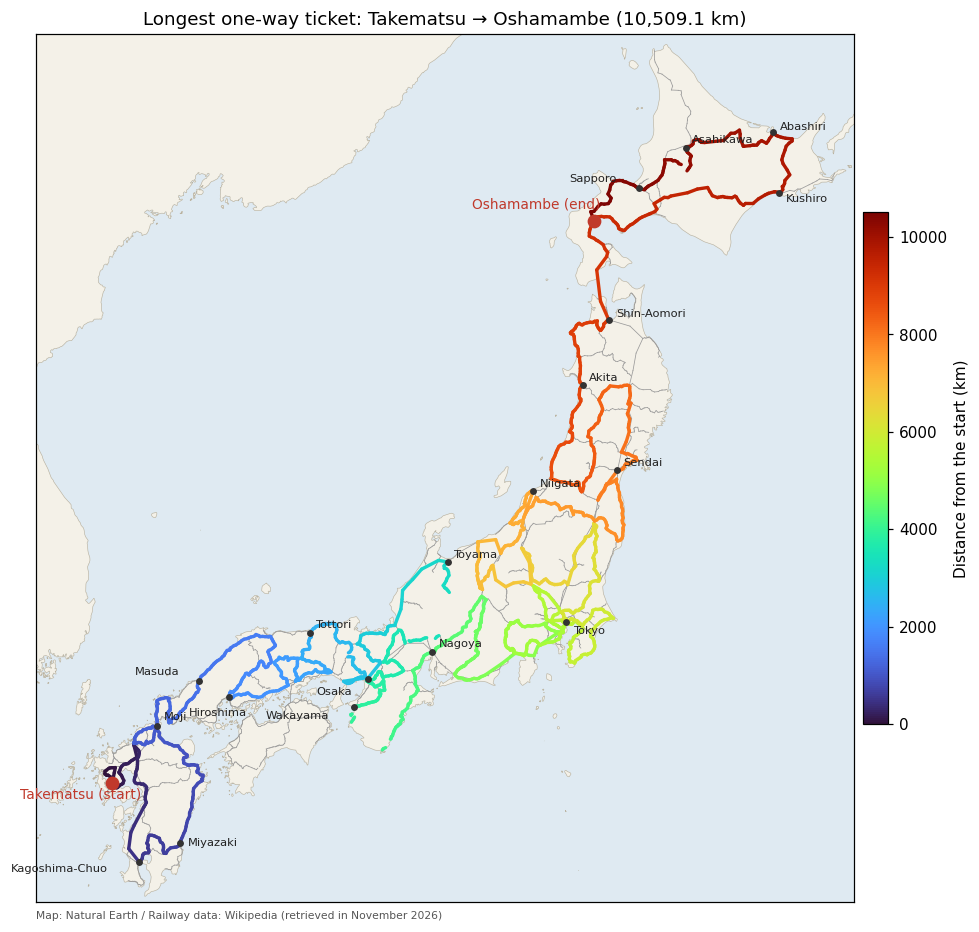

# Longest One-Way Ticket
The **longest one-way ticket** is the JR (Japan Railways) one-way ticket with the longest route.
A one-way ticket cannot use the same section twice and cannot pass the same station twice.
The only exception is the last station, which may be a station that the route has already passed.
Therefore, the route has one of the following three types:
- **Type L**: a simple path that passes no station twice
- **Type O**: a loop that ends at the starting station
- **Type P**: a route that ends at a station it passed on the way (a path followed by a loop)

Of these, type O cannot be the longest.
Type O can be the longest only when the loop passes through every station. If even one station is not on the loop, then, because the network is connected, some station that is not on the loop is next to a station of the loop. Extending the route by one section from the loop to that station gives a type P route that starts there and goes once around the loop, and it is longer than the type O route.
The JR network has no loop that passes through every station, so type O cannot be the longest. We therefore find the longest route of type L or P.



The video turns the railway network into a graph and merges sections, explains the variables, the constraints, and how detached cycles are removed, and follows the route found by the program on the map from the start. The program in the video, chapter by chapter, is on the page [Video: Longest One-Way Ticket](python/VIDEO_LONGEST_TICKET).

References:
- R. Miyashiro and T. Kasai, "Longest one-way ticket" (in Japanese), *Operations Research as a Management Science*, Vol. 49, No. 1, pp. 15–20, January 2004 (the names of types L, O, and P come from this article)
- Nue, "[最長片道切符の流儀とバリエーション](https://nue2004.info/railway/lop/)" (in Japanese)

## Data
[jr_network.csv](../images/jr_network.csv) is the JR railway network as a graph whose vertices are stations and whose edges are sections between stations.
We built it in November 2026 from the Wikipedia articles of the lines ([CC BY-SA 4.0](https://creativecommons.org/licenses/by-sa/4.0/)) and the JR passenger tariff rules (旅客営業規則), which we obtained ourselves.
It has 980 stations and 1,110 sections, one section per line:
```
線名,駅1,駅2,営業キロ,運賃計算キロ,端,組,規則
関西本線,JR難波,今宮,1.3,1.30,0,,
可部線,あき亀山,横川 (広島県),15.6,17.16,0,,
常磐線,いわき,水戸,94.1,94.10,0,1,
常磐線,いわき,勝田,88.3,88.30,1,1,
常磐線,水戸,内郷,89.7,89.70,1,1,
東北新幹線,くりこま高原,古川,21.2,21.20,0,,-規16-2_2_(8)
...
```
The columns are the line name, the two stations, the operating distance (営業キロ, km), the fare distance (運賃計算キロ, km), the end flag, the group, and the rules.
The fare distance is the operating distance multiplied by 1.1 on local lines (without the official rounding).
We built the data as follows:
- Only JR railway lines are included. BRT lines and third-sector lines transferred from JR are excluded. Suspended sections are included.
- A chain of stations without branches is merged into one section (sections with rules are not merged). Kita-Fujioka station between Shinmachi and Kuragano is a station of the Hachiko Line only, so the Takasaki Line is not split there.
- A route may end at a station inside a section. For example, if the Omura Line between Shin-Omura and Haiki is merged into one section, a route that passes Shin-Omura elsewhere, enters the Omura Line at Haiki, and ends at Takematsu cannot be made. It suffices to consider routes that end at the station just before the next branch station (Takematsu and Huis Ten Bosch in this example), because going one station further is longer. So, for each merged section u−v, we add a section from u to the station just before v and a section from v to the station just before u. We call them **end sections**; their `端` column is 1, and the route ends at the second station.
- No end sections are added for dead-end lines (such as the Sakai Line between Yonago and Sakaiminato). The stations of such a line reach other lines only through its branch station, so a route ending inside the line is longer when it goes on to the terminal.
- A chain with only one station in the middle (such as Mishima, Kannami, and Atami on the Tokaido Line) is not merged and stays as two sections.
- A merged section and its two end sections pass the same stations, so at most one of them can be used. Sections with the same value in the `組` (group) column can be used at most once in total.
- The Shinkansen sections that Article 16-2, Paragraph 1 and Article 16-3 of the tariff rules regard as the same line as the conventional line are not included (we treat Tokyo–Atami in the same way). The Shinkansen sections of Article 16-2, Paragraph 2 are included with the following rule (we treat Shinagawa–Odawara in the same way).
- `+g` and `-g` in the `規則` (rules) column mean "if all `-g` sections are used, at least one `+g` section is used." Article 16-2, Paragraph 2 (if the whole Shinkansen section is used, a conventional section of the same interval is also used) and Article 69 (sections with a specified route) are written in this form. Special fare rules for metropolitan areas and around Tokyo (such as Article 70) are not considered; the distance is always the operating distance of the route actually traveled.

## Formulation
We introduce a binary variable $x_e$ for each section $e$, where $x_e=1$ means that the section is used.
Let $\text{used}_v=\sum_{e\ni v}x_e$ be the number of sections used at station $v$ ($e\ni v$ means that section $e$ is connected to station $v$).
On a one-way ticket route, the number of sections used at a station is 0 for a station not passed, 2 for a station in the middle, 1 for an end of the route, and 3 for the station where a type P route returns (the **joint**).
We call this number the **degree** $\deg_v$ of the station and express it with variables for each kind of station.
Stations fall into three kinds by the number of sections connected to them (the **connectivity**):
- **Branch station** (connectivity 3 or more): we introduce binary variables $s_v$ (the station is passed), $a_v$ (an end), and $b_v$ (the joint), and let $\deg_v=2s_v-a_v+b_v$.
- **Middle station** (connectivity 2): at most two sections are used and it cannot be a joint, so we fix $b_v=0$ and let $\deg_v=2s_v-a_v$.
- **Leaf station** (connectivity 1: the terminal of a dead-end line, or the last station of end sections): zero or one section is used, so it gets no variables, and $\deg_v=x_e$ ($e$ is its only section).

For every station except leaf stations we impose the following constraints (at a leaf station, $\text{used}_v=\deg_v=x_e$ always holds, so no constraint is needed):

$$
\text{used}_v=\deg_v,\qquad a_v+b_v\le s_v\qquad(\text{each station } v \text{ that is not a leaf})
$$

With $T$ the set of leaf stations, the number of ends of the route is $\sum_{v\notin T}a_v+\sum_{v\in T}\deg_v$ and the number of joints is $\sum_{v\notin T}b_v$.
The numbers of ends and joints are (2, 0) for type L and (1, 1) for type P, so the following constraints cover both types:

$$
\sum_{v\notin T}a_v+\sum_{v\in T}\deg_v+\sum_{v\notin T}b_v = 2,\qquad \sum_{v\notin T}b_v \le 1
$$

From the groups and the rules, we also impose:

$$
\sum_{e\in G}x_e \le 1\quad(\text{each group } G),\qquad
\sum_{e\in +g}x_e-\sum_{e\in -g}x_e \ge 1-k_g\quad(\text{each rule } g)
$$

$k_g$ is the number of `-g` sections.
If all `-g` sections are used, $\sum_{e\in -g}x_e=k_g$, so at least one `+g` section must be used.

The objective is to maximize the sum of the operating distances $d_e$ of the used sections, so we negate it and add the constraints with weight $P$:

$$
f = -\sum_e d_ex_e + P\cdot(\text{constraints})
$$

The constraints are declared with `qbpp::cons()`, and $P$ is the total operating distance of all sections plus 1.
A solution satisfying the constraints has energy 0 or less, and a solution violating a constraint has positive energy, so a violating solution never minimizes $f$.

## Removing Separate Cycles
With the constraints above, a solution may contain, besides the route, cycles that are not connected to it (**separate cycles**).
The stations of a separate cycle have degree 2, so they satisfy all the constraints.
As in [Most Airports Tour](LONGEST_FLIGHT), we repeatedly solve and add constraints based on the result:

1. Solve $f$ with the constraints added so far.
2. Split the sections of the solution into connected parts (components). If there is only one component, it is the route.
3. Otherwise, add a constraint for each separate cycle $C$ (a component whose stations all have degree 2) and go back to 1.

The constraint for a cycle $C$ is as follows.
Let $S$ be the set of stations reachable from $C$ without passing stations of the other components, and let $w(S)$ be the total operating distance of the sections with both ends in $S$.
If $w(S)$ is at most the distance of the best route found so far, we add, for each station $u$ in $S$:

$$
\text{visit}(u) \le \text{out}(S)\qquad(u\in S)
$$

$\text{visit}(u)$ is the expression for passing station $u$ ($s_u$, or $x_e$ for a leaf station), and $\text{out}(S)$ is the sum of the variables of the sections between $S$ and the outside of $S$.
This constraint means "if a station in $S$ is passed, a section leaving $S$ is used," and it removes every choice of sections closed inside $S$.
A route closed inside $S$ cannot be longer than $w(S)$, so it does not exceed the best route found so far, and the answer is never removed.
If $w(S)$ is larger than the best distance, $S$ may hold a route longer than the best, so forbidding everything closed inside $S$ could remove the answer. We therefore forbid only the cycle $C$.
With $\delta(C)$ the set of sections between the stations of $C$ and the outside (the sections leaving the stations of $C$) and $\lvert C\rvert$ the number of sections of $C$, we add the constraint "if the same cycle $C$ appears again, at least one section of $\delta(C)$ is used":

$$
\sum_{e\in C}x_e=\lvert C\rvert\ \Rightarrow\ \sum_{e\in\delta(C)}x_e\ge 1
$$

Written as one inequality, this is the following (it restricts nothing unless all sections of $C$ are used):

$$
\sum_{e\in C}x_e-\sum_{e\in\delta(C)}x_e\le \lvert C\rvert-1
$$

A detached cycle uses no leaving section, so it violates this constraint.
A route that uses $C$ as the loop of a type P route uses a leaving section at its joint, so it satisfies the constraint; the leaving sections are subtracted to keep such routes.

Each component of a solution that has an end (a station of degree 1) can be a type L or P route by itself.
So we take every component that has an end and satisfies the rules as a candidate and record the best route.
The best route is passed as a [solution hint](ABS3#solution-hint) to the next round.
Because the solver searches for a limited time, a solution with one component is not necessarily the best.
We stop when the best route does not improve for 5 consecutive solutions with one component.

## QUBO++ Program
Place [jr_network.csv](../images/jr_network.csv) in the directory where the program runs:

```cpp
#include <algorithm>
#include <fstream>
#include <iomanip>
#include <iostream>
#include <map>
#include <sstream>
#include <string>
#include <vector>
#include <qbpp/qbpp.hpp>
#include <qbpp/abs3_solver.hpp>

struct Section {
  std::string line;
  int u, v, km;      // 駅 u, v を結ぶ区間、営業キロ（0.1 km 単位）
  double fare;       // 運賃計算キロ
  bool tail;         // 端の区間（駅 v で経路が終わる）
  std::string group;  // 同じ組の区間は高々 1 本
  std::vector<std::string> rules;
};

std::vector<std::string> stations;
std::vector<Section> sections;
std::vector<std::vector<int>> incident;  // 駅に接する区間の番号

int station(const std::string& name) {
  static std::map<std::string, int> index;
  auto [it, added] = index.emplace(name, stations.size());
  if (added) {
    stations.push_back(name);
    incident.emplace_back();
  }
  return it->second;
}

std::vector<std::string> split(const std::string& s, char sep) {
  std::vector<std::string> fields;
  std::stringstream ss(s);
  for (std::string f; std::getline(ss, f, sep);) fields.push_back(f);
  return fields;
}

std::map<std::string, int> minus_count;  // 規則 g の -g の区間の本数

// 規則 "+g" / "-g": -g の区間を全部使うなら、+g の区間を 1 本以上使う
// used[e] が区間 e を使うかどうかのとき、規則を満たすかどうか
bool rules_ok(const std::vector<bool>& used) {
  std::map<std::string, int> plus, minus;
  for (size_t e = 0; e < sections.size(); ++e)
    if (used[e])
      for (const auto& r : sections[e].rules) ++(r[0] == '+' ? plus : minus)[r.substr(1)];
  for (const auto& [g, k] : minus_count)
    if (minus[g] == k && plus[g] == 0) return false;
  return true;
}

int main() {
  std::ifstream ifs("jr_network.csv");
  std::string line;
  std::getline(ifs, line);  // 見出しの行
  while (std::getline(ifs, line)) {
    auto f = split(line, ',');
    f.resize(8);
    Section s{f[0], station(f[1]), station(f[2]), static_cast<int>(std::stod(f[3]) * 10 + 0.5),
              std::stod(f[4]), f[5] == "1", f[6], split(f[7], ' ')};
    for (const auto& r : s.rules)
      if (r[0] == '-') ++minus_count[r.substr(1)];
    incident[s.u].push_back(sections.size());
    incident[s.v].push_back(sections.size());
    sections.push_back(s);
  }
  const int n = stations.size(), m = sections.size();
  // 葉駅: 接続数が 1 の駅（行き止まりの線の終点と、端の区間の終わりの駅）
  std::vector<bool> leaf(n);
  for (int v = 0; v < n; ++v) leaf[v] = incident[v].size() == 1;
  std::cout << n << " stations, " << m << " sections" << std::endl;

  auto x = qbpp::var("x", m);
  auto s = qbpp::var("s", n);  // 駅を通る
  auto a = qbpp::var("a", n);  // 駅が経路の端
  auto b = qbpp::var("b", n);  // 駅が合流点
  std::vector<qbpp::Expr> used(n), visit(n);  // 駅で使う区間の本数、駅を通る
  auto distance = qbpp::toExpr(0), ends = qbpp::toExpr(0), joins = qbpp::toExpr(0);
  int W = 0;
  for (int e = 0; e < m; ++e) {
    distance += sections[e].km * x[e];
    W += sections[e].km;
    used[sections[e].u] += x[e];
    used[sections[e].v] += x[e];
  }
  auto c = qbpp::toExpr(0);
  for (int v = 0; v < n; ++v) {
    if (leaf[v]) {  // 葉駅の次数は、つながる 1 本の区間の変数
      visit[v] = used[v];
      ends += used[v];
      continue;
    }
    visit[v] = s[v];
    ends += a[v];
    joins += b[v];
    c += qbpp::cons(used[v] - (2 * s[v] - a[v] + b[v]) == 0);  // 次数 0, 2, 1（端）, 3（合流点）
    c += qbpp::cons(a[v] + b[v] - s[v] <= 0);
  }
  c += qbpp::cons(ends + joins == 2);  // L 型は (2, 0)、P 型は (1, 1)
  c += qbpp::cons(joins <= 1);
  std::map<std::string, qbpp::Expr> group;
  for (int e = 0; e < m; ++e)
    if (!sections[e].group.empty()) group[sections[e].group] += x[e];
  for (auto& [g, sum] : group) c += qbpp::cons(sum <= 1);
  std::map<std::string, qbpp::Expr> plus, minus;
  for (int e = 0; e < m; ++e)
    for (const auto& r : sections[e].rules) (r[0] == '+' ? plus : minus)[r.substr(1)] += x[e];
  for (auto& [g, k] : minus_count) c += qbpp::cons(plus[g] - minus[g] >= 1 - k);
  const int P = W + 1;
  auto f = -distance + P * c;
  qbpp::MapList fix;  // 中間駅（接続数 2）は合流点にならない
  for (int v = 0; v < n; ++v)
    if (incident[v].size() == 2) fix.push_back({b[v], 0});
  f = qbpp::replace(f, fix);

  int best = 0, stall = 0;
  std::vector<int> best_route, best_sections;
  for (int round = 1; stall < 5; ++round) {
    f.simplify_as_binary();
    auto solver = qbpp::ABS3Solver(f);
    qbpp::Params params({{"time_limit", 10}});
    if (best > 0) {  // 最良の経路をヒントにする
      qbpp::Sol hint(f);
      std::vector<int> d(n, 0);
      for (int e : best_sections) {
        hint.set(x[e], 1);
        ++d[sections[e].u], ++d[sections[e].v];
      }
      for (int v = 0; v < n; ++v) {
        if (leaf[v]) continue;
        hint.set(s[v], d[v] > 0), hint.set(a[v], d[v] == 1);
        if (incident[v].size() > 2) hint.set(b[v], d[v] == 3);
      }
      params.hint(hint);
    }
    auto sol = solver.search(params);

    // 使う区間を、つながった部分（成分）に分ける
    std::vector<int> comp(n, -1);
    std::vector<std::vector<int>> parts;  // 成分ごとの区間
    for (int e0 = 0; e0 < m; ++e0) {
      if (sol(x[e0]) == 0 || comp[sections[e0].u] >= 0) continue;
      std::vector<int> stack = {sections[e0].u}, part;
      comp[sections[e0].u] = parts.size();
      while (!stack.empty()) {
        int v = stack.back();
        stack.pop_back();
        for (int e : incident[v]) {
          if (sol(x[e]) == 0) continue;
          int w = sections[e].u == v ? sections[e].v : sections[e].u;
          part.push_back(e);
          if (comp[w] < 0) comp[w] = parts.size(), stack.push_back(w);
        }
      }
      std::sort(part.begin(), part.end());
      part.erase(std::unique(part.begin(), part.end()), part.end());
      parts.push_back(part);
    }
    int prev = best;
    for (const auto& part : parts) {  // 端のある成分は、それだけで L 型か P 型の経路になりうる
      std::vector<bool> in(m, false);
      int km = 0;
      for (int e : part) in[e] = true, km += sections[e].km;
      if (km <= best || !rules_ok(in)) continue;
      // 端（次数 1 の駅）から区間をたどって経路にする（端のない輪は O 型なので除く）
      std::vector<int> d(n, 0);
      for (int e : part) ++d[sections[e].u], ++d[sections[e].v];
      int v = -1;
      for (int e : part)
        for (int w : {sections[e].u, sections[e].v})
          if (d[w] == 1) v = w;
      if (v < 0) continue;
      std::vector<int> route = {v}, order;  // 駅の列と区間の列
      for (bool moved = true; moved;) {
        moved = false;
        for (int e : incident[v])
          if (in[e]) {
            in[e] = false;
            v = sections[e].u == v ? sections[e].v : sections[e].u;
            route.push_back(v);
            order.push_back(e);
            moved = true;
            break;
          }
      }
      best = km, best_route = route, best_sections = order;
    }
    std::cout << "round " << round << ": components = " << parts.size() << ", best = "
              << best / 10 << "." << best % 10 << " km" << std::endl;
    if (parts.size() == 1) {  // 1 本の経路: 最良が 5 回続けて伸びなければ終わる
      stall = best > prev ? 0 : stall + 1;
      continue;
    }
    stall = 0;

    // 離れた閉路 C（次数がすべて 2 の成分）ごとに制約を加える
    for (size_t p = 0; p < parts.size(); ++p) {
      std::vector<int> d(n, 0);
      for (int e : parts[p]) ++d[sections[e].u], ++d[sections[e].v];
      bool cycle = true;
      for (int e : parts[p])
        if (d[sections[e].u] != 2 || d[sections[e].v] != 2) cycle = false;
      if (!cycle) continue;
      // 地域 S: 他の成分の駅を通らずに C から行ける駅
      std::vector<bool> inS(n, false);
      std::vector<int> stack;
      for (int e : parts[p])
        for (int w : {sections[e].u, sections[e].v})
          if (!inS[w]) inS[w] = true, stack.push_back(w);
      while (!stack.empty()) {
        int v = stack.back();
        stack.pop_back();
        for (int e : incident[v])
          for (int w : {sections[e].u, sections[e].v})
            if (!inS[w] && (comp[w] < 0 || comp[w] == static_cast<int>(p)))
              inS[w] = true, stack.push_back(w);
      }
      int wS = 0;
      auto out = qbpp::toExpr(0);
      for (int e = 0; e < m; ++e) {
        if (inS[sections[e].u] && inS[sections[e].v]) wS += sections[e].km;
        if (inS[sections[e].u] != inS[sections[e].v]) out += x[e];
      }
      if (wS <= best) {  // S の駅を通るなら、S の外とつながる区間を使う
        for (int v = 0; v < n; ++v)
          if (inS[v]) f += P * qbpp::cons(visit[v] - out <= 0);
      } else {  // C の区間を全部使うなら、C の駅から外へ出る区間も使う
        std::vector<bool> inC(n, false);
        auto used = qbpp::toExpr(0), exits = qbpp::toExpr(0);
        for (int e : parts[p]) inC[sections[e].u] = inC[sections[e].v] = true, used += x[e];
        for (int e = 0; e < m; ++e)
          if (inC[sections[e].u] != inC[sections[e].v]) exits += x[e];
        f += P * qbpp::cons(used - exits <= static_cast<int>(parts[p].size()) - 1);
      }
    }
  }

  double fare = 0;
  for (int e : best_sections) fare += sections[e].fare;
  // 経路: 線名と、その線で着く駅を 1 行ずつ（同じ線が続く区間はまとめる）
  std::cout << stations[best_route[0]] << std::endl;
  for (size_t i = 0; i < best_sections.size(); ++i) {
    const auto& line = sections[best_sections[i]].line;
    if (i + 1 == best_sections.size() || sections[best_sections[i + 1]].line != line)
      std::cout << "  -" << line << "- " << stations[best_route[i + 1]] << std::endl;
  }
  std::cout
            << best_sections.size() << " sections, " << best / 10 << "." << best % 10 << " km"
            << " (fare " << std::fixed << std::setprecision(1) << fare << " km)" << std::endl;
}
```

`sections` is the list of sections, and `incident[v]` is the list of the sections incident to station `v`.
`leaf[v]` means that station `v` is a leaf station (connectivity 1).
`used[v]` is the number of sections used at station `v`, and `visit[v]` is the expression for passing station `v`. `b[v]` of a middle station (connectivity 2) is fixed to 0 with `replace()`.
For rule `g`, `plus[g]` and `minus[g]` hold the sums of the variables of the `+g` and `-g` sections, and `minus_count[g]` holds the number of `-g` sections.

In each round of the loop, `f` is simplified, an ABS3 Solver is created, and it searches for 10 seconds.
If there is a best route, a solution that uses its sections and no others is passed with `params.hint()`.
The used sections of the solution are split into connected parts and stored in `parts`.
`rules_ok()` checks the rules, and if a part is longer than the best, it is traced from an end station to make the station sequence `best_route` and the section sequence `best_sections`.
Finally, the route is printed as one line per run of the same line: the line name and the station reached on that line.

## Result
An example output is:
```
980 stations, 1110 sections
round 1: components = 19, best = 0.0 km
round 2: components = 11, best = 7729.6 km
round 3: components = 16, best = 7729.6 km
round 4: components = 3, best = 9301.2 km
round 5: components = 2, best = 9540.9 km
round 6: components = 5, best = 10202.7 km
round 7: components = 3, best = 10202.7 km
round 8: components = 2, best = 10202.7 km
round 9: components = 1, best = 10509.1 km
round 10: components = 1, best = 10509.1 km
round 11: components = 1, best = 10509.1 km
round 12: components = 1, best = 10509.1 km
round 13: components = 1, best = 10509.1 km
round 14: components = 1, best = 10509.1 km
竹松
  -大村線- 早岐
  -佐世保線- 武雄温泉
  -西九州新幹線- 新大村
  -大村線- 諫早
  -長崎本線- 新鳥栖
  -九州新幹線- 博多
  -鹿児島本線- 新八代
  -九州新幹線・鹿児島本線- 鹿児島中央
  ...
  -室蘭本線- 沼ノ端
  -千歳線- 南千歳
  -石勝線- 追分 (北海道)
  -根室本線・石勝線- 東釧路
  -石北本線・釧網本線- 新旭川
  -宗谷本線- 旭川
  -富良野線・根室本線- 滝川
  -函館本線- 長万部
323 sections, 10509.1 km (fare 10796.5 km)
```
`components` is the number of components of the solution, and `best` is the operating distance of the best route so far.
The first solution has many components, but the number decreases as constraints are added, and the solution becomes one route in round 9.

The route is of type P, with an operating distance of 10,509.1 km (fare distance 10,796.5 km); this is the optimal value (we confirmed the optimality by another method).
It starts at Takematsu on the Omura Line in Nagasaki Prefecture, goes around Kyushu, and enters Honshu from Moji.
It goes around Honshu, enters Hokkaido from Shin-Aomori, goes from Oshamambe once around the loop through Sapporo, Asahikawa, Abashiri, Kushiro, and Tomakomai, and ends back at Oshamambe (the direction around the loop varies from run to run).
It does not visit Shikoku. Shikoku is connected to Honshu only at Chayamachi station, so a route entering Shikoku cannot come back, and Shikoku would have to be an end of the route. A route has only two ends, and making Kyushu and Hokkaido the ends is longer.

<p align="center">
  
</p>

The references solve Hokkaido, Shikoku, Kyushu, and Honshu separately, whereas here the whole country is solved as one problem.
Because the solver uses random numbers, the intermediate solutions and the number of rounds vary from run to run.
There are other routes of 10,509.1 km, so a different route may be printed in each run.
