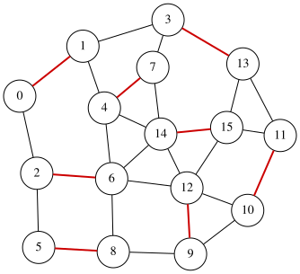

# Maximum Matching Problem

A **matching** in an undirected graph is a set of edges such that no two edges share a common node.
Given an undirected graph $G=(V,E)$, the **Maximum Matching** problem aims to find a matching $S \subseteq E$ that contains the maximum number of edges.

Assume that the graph has $n$ vertices and $m$ edges, and that the edges are labeled $0,1,\ldots,m-1$.
We introduce $m$ binary variables $x_0, x_1, \ldots, x_{m-1}$, where
$x_i=1$ if and only if edge $i$ is selected (i.e., belongs to $S$) ($0\le i\le m-1$).
The objective is to maximize the number of selected edges:

$$
\begin{aligned}
\text{objective} &= \sum_{i=0}^{m-1} x_i .
\end{aligned}
$$

To enforce the matching condition, we penalize any pair of selected edges that share a node.
Let $\mathcal{P}$ be the set of unordered pairs $(e_1,e_2)$ of distinct edges that share a common endpoint.
Then the following penalty takes value $0$ if and only if the selected edges form a matching:

$$
\begin{aligned}
\text{constraint} &= \sum_{\{e_1,e_2\}\in \mathcal{P}} x_{e_1}x_{e_2}.
\end{aligned}
$$

We construct a QUBO expression $f$ by combining the objective and the penalty as follows:

$$
\begin{aligned}
f &= -\text{objective} + 2 \times \text{constraint}.
\end{aligned}
$$

Here, the penalty term is multiplied by 2 to ensure that violating the matching constraint is more costly than increasing the objective.
An assignment minimizing $f$ therefore corresponds to a maximum matching of $G$.

## QUBO++ program for the maximum matching
Based on the formulation above, the following QUBO++ program constructs the QUBO expression $f$ for a 16-node graph and solves it using the **Exhaustive Solver**

```cpp
#include <qbpp/qbpp.hpp>
#include <qbpp/exhaustive_solver.hpp>
#include <qbpp/graph.hpp>

int main() {
  const size_t N = 16;
  std::vector<std::pair<size_t, size_t>> edges = {
      {0, 1},   {0, 2},   {1, 3},   {1, 4},   {2, 5},   {2, 6},   {3, 7},
      {3, 13},  {4, 6},   {4, 7},   {4, 14},  {5, 8},   {6, 8},   {6, 12},
      {6, 14},  {7, 14},  {8, 9},   {9, 10},  {9, 12},  {10, 11}, {10, 12},
      {11, 13}, {11, 15}, {12, 14}, {12, 15}, {13, 15}, {14, 15}};
  const size_t M = edges.size();

  auto x = qbpp::var("x", M);

  auto objective = qbpp::sum(x);

  auto constraint = qbpp::toExpr(0);
  for (size_t i = 0; i < M; ++i) {
    for (size_t j = i + 1; j < M; ++j) {
      if (edges[i].first == edges[j].first ||
          edges[i].first == edges[j].second ||
          edges[i].second == edges[j].first ||
          edges[i].second == edges[j].second) {
        constraint += x[i] * x[j];
      }
    }
  }

  auto f = -objective + 2 * constraint;
  f.simplify_as_binary();

  auto solver = qbpp::ExhaustiveSolver(f);
  auto sol = solver.search();

  std::cout << "objective = " << objective(sol) << std::endl;
  qbpp::graph::GraphDrawer graph;
  for (size_t i = 0; i < N; ++i) {
    graph.add_node(qbpp::graph::Node(i));
  }
  for (size_t i = 0; i < M; ++i) {
    auto edge = qbpp::graph::Edge(edges[i].first, edges[i].second);
    if (sol(x[i])) {
      edge.color(1).penwidth(2.0);
    }
    graph.add_edge(edge);
  }
  graph.write("maxmatching.svg");
}
```
This program creates the expressions `objective`, `constraint`, and `f`, where `f` is the negated `objective` plus a penalty term.
The Exhaustive Solver minimizes `f`, and an optimal assignment is stored in `sol`.

To visualize the solution, a `GraphDrawer` object `graph` is created and populated with nodes and edges.
In this visualization, selected edges in $S$ (i.e., edges $i$ with $x_i=1$) are highlighted.

The resulting graph is rendered and stored in the file `maxmatching.svg`:

<p align="center">
  
</p>

## Declaring the constraints with `qbpp::cons()`
The matching condition is that each vertex has at most one selected edge.
Instead of a penalty for each pair of edges, declare this condition for each vertex as a constraint with [`qbpp::cons()`](CONSTRAINTS):
```cpp
  auto constraint = qbpp::toExpr(0);
  for (size_t v = 0; v < N; ++v) {
    auto t = qbpp::toExpr(0);
    for (size_t i = 0; i < M; ++i) {
      if (edges[i].first == v || edges[i].second == v) {
        t += x[i];
      }
    }
    constraint += qbpp::cons(t <= 1);
  }
```
The original expression creates a term for each pair of edges sharing an endpoint, so for this graph it has 98 terms including the objective.
Constraints declared with `qbpp::cons()` do not add terms to the objective, so only the 27 terms of the objective remain.
The output is as follows, and a matching of the same size is obtained:
```
objective = 8
```

## Placing Dominoes on a Chessboard
We place dominoes on a board of 62 cells: an 8×8 chessboard with two diagonally opposite corner cells removed.
Each domino covers two cells that are adjacent horizontally or vertically, and dominoes must not overlap.
On the full 8×8 board, 32 dominoes fit: four horizontal ones in each row.
In the graph whose nodes are the cells and whose edges join adjacent cells (108 edges), a placement of dominoes is a matching, so the largest number of dominoes is the size of a maximum matching.

In addition to the variable $x$ for each edge, we use $N(v)$, the number of dominoes covering cell $v$ (the sum of $x$ over the edges incident to $v$).
The dominoes do not overlap if and only if $N(v) \le 1$ for every cell.
With 108 variables, not all assignments can be checked, so we solve it with [EasySolver](EASYSOLVER):

```cpp
#include <map>
#include <qbpp/qbpp.hpp>
#include <qbpp/easy_solver.hpp>

int main() {
  // 62 cells: the 8×8 board without two diagonally opposite corners
  std::vector<std::pair<int, int>> cells;
  std::map<std::pair<int, int>, size_t> index;
  for (int r = 0; r < 8; ++r) {
    for (int c = 0; c < 8; ++c) {
      if ((r == 0 && c == 0) || (r == 7 && c == 7)) continue;
      index[{r, c}] = cells.size();
      cells.push_back({r, c});
    }
  }

  // pairs of adjacent cells (the right and lower neighbors)
  std::vector<std::pair<size_t, size_t>> edges;
  for (auto [r, c] : cells) {
    for (auto cell : {std::make_pair(r, c + 1), std::make_pair(r + 1, c)}) {
      if (index.count(cell)) {
        edges.push_back({index[{r, c}], index[cell]});
      }
    }
  }

  auto x = qbpp::var("x", edges.size());

  // N[v]: the number of dominoes covering cell v
  std::vector<qbpp::Expr> N(cells.size());
  for (size_t i = 0; i < edges.size(); ++i) {
    N[edges[i].first] += x[i];
    N[edges[i].second] += x[i];
  }

  auto objective = qbpp::sum(x);

  auto constraint = qbpp::toExpr(0);
  for (size_t v = 0; v < cells.size(); ++v) {
    constraint += qbpp::cons(N[v] <= 1);
  }

  auto f = -objective + 2 * constraint;
  f.simplify_as_binary();

  auto solver = qbpp::EasySolver(f);
  auto sol = solver.search({{"time_limit", 10}});

  std::cout << "dominoes = " << objective(sol) << std::endl;
  std::cout << "violated constraints = " << f.cons(sol) << std::endl;
  std::vector<std::string> board(8, std::string(8, ' '));
  for (auto [r, c] : cells) {
    board[r][c] = '.';
  }
  for (size_t i = 0; i < edges.size(); ++i) {
    if (sol(x[i]) == 1) {
      auto [r1, c1] = cells[edges[i].first];
      auto [r2, c2] = cells[edges[i].second];
      if (r1 == r2) {
        board[r1][c1] = '<';
        board[r2][c2] = '>';
      } else {
        board[r1][c1] = '^';
        board[r2][c2] = 'v';
      }
    }
  }
  for (const auto& row : board) {
    for (size_t c = 0; c < row.size(); ++c) {
      std::cout << (c > 0 ? " " : "") << row[c];
    }
    std::cout << std::endl;
  }
}
```

A horizontal domino is shown as `<>`, a vertical one as `^` and `v`, and an empty cell as `.`.
An example of the output:
```
dominoes = 30
violated constraints = 0
  ^ ^ ^ < > ^ ^
^ v v v < > v v
v ^ ^ ^ < > ^ ^
^ v v v < > v v
v . ^ . < > ^ ^
< > v ^ < > v v
^ ^ ^ v < > < >
v v v < > < >  
```
30 dominoes are placed, and 31 are impossible.
On a chessboard, two adjacent cells have different colors, so each domino covers one white cell and one black cell.
The two removed corners have the same color (say white), so there are 30 white cells and 32 black cells, and at most 30 dominoes fit.
When 30 dominoes are placed, the two empty cells are both black.



The video solves the maximum matching of the board with two corners cut and the minimum maximal matching of the full 8×8 board with programs that use the same variables. The program in the video, chapter by chapter, is on the page [Video: Placing Dominoes on a Chessboard](python/VIDEO_DOMINOES).
