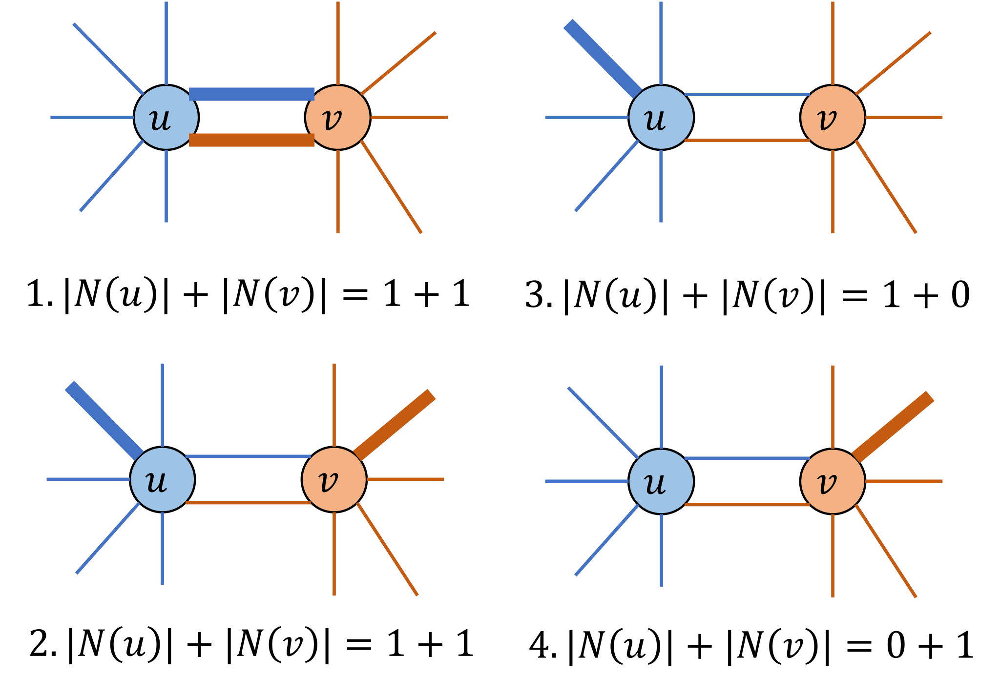
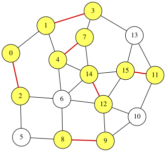

# Minimum Maximal Matching Problem

A **matching** in an undirected graph is a set of edges such that no two edges share a common endpoint.
A **maximal matching** is a matching to which no additional edge can be added without violating the matching condition.
Given an undirected graph $G=(V,E)$, the minimum maximal matching problem asks for a maximal matching $S \subseteq E$ with the minimum number of edges.

The maximality condition of a matching can be described in a compact way.
For a node $u\in V$, let $N(u)$ denote the set of edges in $S$ incident to $u$.
Then $S$ is a maximal matching if and only if, for every edge $(u,v)\in E$, the following condition holds:

$$
 1 \leq |N(u)|+|N(v)| \leq 2
$$

This condition is satisfied if and only if $S$ constitute a maximal matching. To ensure that $S$ is a maximal matching, the following cases cover all possibilities:

<p align="center">
  
</p>

We can formulate the minimum maximal matching problem as finding a subset $S$ that satisfies the above condition and has minimum cardinality.

For a formal proof, see the following paper:


> **Reference**:
> Nakahara, Y., Tsukiyama, S., Nakano, K., Parque, V., & Ito, Y. (2025). **A penalty-free QUBO formulation for the minimum maximal matching problem**. International Journal of Parallel, Emergent and Distributed Systems, 1–19. https://doi.org/10.1080/17445760.2025.2579546


## Formulation of the minimum maximal matching problem
Assume that the graph has $n$ vertices and $m$ edges, and that the edges are labeled $0,1,\ldots,m-1$.
We introduce $m$ binary variables $x_0, x_1, \ldots, x_{m-1}$, where $x_i=1$ if and only if edge $i$ is selected (i.e., belongs to $S$).
The objective is to minimize the number of selected edges:

$$
\begin{aligned}
\text{objective} &= \sum_{i=0}^{m-1} x_i .
\end{aligned}
$$

The maximality condition is the range constraint $1 \leq |N(u)|+|N(v)| \leq 2$ for each edge $(u,v)\in E$.
In QUBO++, it is enclosed in [`qbpp::cons()`](CONSTRAINTS) to declare it as a constraint, and combined with the objective to construct the expression $f$:

$$
\begin{aligned}
f &= \text{objective} + 2\times\sum_{(u,v)\in E} \text{cons}(1 \leq |N(u)|+|N(v)| \leq 2).
\end{aligned}
$$

When a constraint is violated, the square of the violation multiplied by the weight is added to the energy.
If the violation is 1, this value is 1. With the weight 1, a solution that violates a constraint can have the same energy as the solution that satisfies it by adding one edge, so solutions that violate constraints are mixed into the optimal solutions.
Therefore, the weight is 2.

## QUBO++ program
The following QUBO++ program finds a minimum maximal matching of a fixed undirected graph with $N=16$ nodes and $M=27$ edges:
```cpp
#include <qbpp/qbpp.hpp>
#include <qbpp/exhaustive_solver.hpp>
#include <qbpp/graph.hpp>

int main() {
  const size_t N = 16;
  std::vector<std::pair<size_t, size_t>> edges = {
      {0, 1},   {0, 2},   {1, 3},   {1, 4},   {2, 5},   {2, 6},   {3, 7},
      {3, 13},  {4, 6},   {4, 7},   {4, 14},  {5, 8},   {6, 8},   {6, 12},
      {6, 14},  {7, 14},  {8, 9},   {9, 10},  {9, 12},  {10, 11}, {10, 12},
      {11, 13}, {11, 15}, {12, 14}, {12, 15}, {13, 15}, {14, 15}};
  const size_t M = edges.size();

  std::vector<std::vector<size_t>> adj(N);
  for (size_t i = 0; i < M; ++i) {
    const auto& edge = edges[i];
    adj[edge.first].push_back(i);
    adj[edge.second].push_back(i);
  }

  auto x = qbpp::var("x", M);

  auto objective = qbpp::sum(x);

  auto constraint = qbpp::toExpr(0);
  for (const auto& e : edges) {
    auto u = e.first;
    auto v = e.second;
    auto t = qbpp::toExpr(0);
    for (const auto idx : adj[u]) {
      t += x[idx];
    }
    for (const auto idx : adj[v]) {
      t += x[idx];
    }
    constraint += qbpp::cons(1 <= t <= 2);
  }

  auto f = objective + 2 * constraint;

  f.simplify_as_binary();
  auto solver = qbpp::ExhaustiveSolver(f);
  auto sol = solver.search();

  std::cout << "objective = " << objective(sol) << std::endl;
  std::cout << "violated constraints = " << f.cons(sol) << std::endl;

  qbpp::graph::GraphDrawer graph;
  std::vector<int> selected_nodes(N);
  for (size_t i = 0; i < M; ++i) {
    if (sol(x[i])) {
      selected_nodes[edges[i].first] = 1;
      selected_nodes[edges[i].second] = 1;
    }
  }
  for (size_t i = 0; i < N; ++i) {
    graph.add_node(qbpp::graph::Node(i).color(selected_nodes[i]));
  }
  for (size_t i = 0; i < M; ++i) {
    auto edge = qbpp::graph::Edge(edges[i].first, edges[i].second);
    if (sol(x[i])) {
      edge.color(1).penwidth(2.0);
    }
    graph.add_edge(edge);
  }
  graph.write("minmaxmatching.svg");
}
```
We first define a vector `x` of `M` binary variables, and then define `objective`, `constraint`, and `f` based on the formulation above.
The Exhaustive Solver is used to find an optimal solution of `f`.
The objective value and the number of violated constraints `f.cons(sol)` are printed, and the resulting graph is saved in `minmaxmatching.svg`.

This program produces the following output:
```
objective = 6
violated constraints = 0
```
Therefore, $S$ contains 6 edges.
The resulting graph stored in `minmaxmatching.svg` is shown below:
<p align="center">
  
</p>
In this graph, the selected edges in $S$ and all nodes incident to these edges are highlighted.
We can see that no more edge can be added, and the maximality condition is satisfied.

## Placing Dominoes on a Chessboard
On the full 8×8 chessboard (64 cells, 112 pairs of adjacent cells), we make a placement to which no more domino can be added, using as few dominoes as possible.
A placement to which no domino can be added is a maximal matching, so the smallest number of dominoes is the size of a minimum maximal matching.
With $N(v)$, the number of dominoes covering cell $v$, the maximality condition is $1 \le N(u) + N(v) \le 2$ for every pair of adjacent cells $(u, v)$.
The program differs from the one in "Placing Dominoes on a Chessboard" of [Maximum Matching](MAX_MATCHING) (on the board with the cut corners) only in the board, which no longer removes the two corners, the constraint `qbpp::cons(1 <= N[u] + N[v] <= 2)`, and the objective:

```cpp
#include <map>
#include <qbpp/qbpp.hpp>
#include <qbpp/easy_solver.hpp>

int main() {
  // the 64 cells of the 8×8 board
  std::vector<std::pair<int, int>> cells;
  std::map<std::pair<int, int>, size_t> index;
  for (int r = 0; r < 8; ++r) {
    for (int c = 0; c < 8; ++c) {
      index[{r, c}] = cells.size();
      cells.push_back({r, c});
    }
  }

  // pairs of adjacent cells (the right and lower neighbors)
  std::vector<std::pair<size_t, size_t>> edges;
  for (auto [r, c] : cells) {
    for (auto cell : {std::make_pair(r, c + 1), std::make_pair(r + 1, c)}) {
      if (index.count(cell)) {
        edges.push_back({index[{r, c}], index[cell]});
      }
    }
  }

  auto x = qbpp::var("x", edges.size());

  // N[v]: the number of dominoes covering cell v
  std::vector<qbpp::Expr> N(cells.size());
  for (size_t i = 0; i < edges.size(); ++i) {
    N[edges[i].first] += x[i];
    N[edges[i].second] += x[i];
  }

  auto objective = qbpp::sum(x);

  auto constraint = qbpp::toExpr(0);
  for (auto [u, v] : edges) {
    constraint += qbpp::cons(1 <= N[u] + N[v] <= 2);
  }

  auto f = objective + 2 * constraint;
  f.simplify_as_binary();

  auto solver = qbpp::EasySolver(f);
  auto sol = solver.search({{"time_limit", 10}});

  std::cout << "dominoes = " << objective(sol) << std::endl;
  std::cout << "violated constraints = " << f.cons(sol) << std::endl;
  std::vector<std::string> board(8, std::string(8, ' '));
  for (auto [r, c] : cells) {
    board[r][c] = '.';
  }
  for (size_t i = 0; i < edges.size(); ++i) {
    if (sol(x[i]) == 1) {
      auto [r1, c1] = cells[edges[i].first];
      auto [r2, c2] = cells[edges[i].second];
      if (r1 == r2) {
        board[r1][c1] = '<';
        board[r2][c2] = '>';
      } else {
        board[r1][c1] = '^';
        board[r2][c2] = 'v';
      }
    }
  }
  for (const auto& row : board) {
    for (size_t c = 0; c < row.size(); ++c) {
      std::cout << (c > 0 ? " " : "") << row[c];
    }
    std::cout << std::endl;
  }
}
```

An example of the output:
```
dominoes = 22
violated constraints = 0
. ^ < > . < > .
^ v . < > ^ . ^
v . < > . v ^ v
. < > . < > v .
< > . < > . < >
. < > ^ . < > .
< > . v ^ . < >
. < > . v < > .
```
22 dominoes are placed, and no two of the 20 empty cells are adjacent, so no more domino can be added.
22 is the minimum.
As many as 32 dominoes fit (four horizontal ones in each row), so 10 fewer dominoes are enough to leave no room for another.
When dominoes are placed one at a time at a position chosen at random among the free ones until none can be added, all of 100,000 trials stop between 25 and 32 dominoes, never at 22 to 24.



The video solves the maximum matching of the board with two corners cut and the minimum maximal matching of the full 8×8 board with programs that use the same variables. The program in the video, chapter by chapter, is on the page [Video: Placing Dominoes on a Chessboard](python/VIDEO_DOMINOES).
