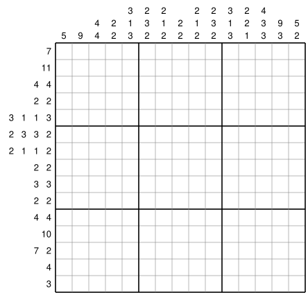

# Nonogram

A **nonogram** is a puzzle in which you complete a picture by painting some of the cells of a grid black.
To the left of each row and above each column, the lengths of the blocks of consecutive black cells in that row (column) are listed from left to right (from top to bottom).
For example, "2 5 2" means that blocks of 2, 5 and 2 black cells appear in this order, with at least one white cell between consecutive blocks.
"0" means that the row (column) has no black cells.
The goal is to decide which cells to paint so that all the clues are satisfied.

Here we solve the following $15\times 15$ puzzle ($H=15$ rows and $W=15$ columns):

<p align="center">
  
</p>

Below, we first formulate the rows; the columns are handled in the same way.

## Shifts of the Blocks

Let the clue of row $i$ be $(r_{i,0}, r_{i,1}, \ldots, r_{i,m_i-1})$,
where $r_{i,k}$ is the length of the $k$-th block of row $i$ and $m_i$ is the number of blocks.
The cells are numbered $j=0,1,\ldots,W-1$ from the left end.

If all the blocks of row $i$ are aligned to the left, block $k$ starts at position

$$
e_{i,k}=\sum_{l=0}^{k-1}(r_{i,l}+1)
$$

(for $k=0$, the sum is empty, so $e_{i,0}=0$).
Since $e_{i,k+1}=e_{i,k}+r_{i,k}+1$, the right end of block $k$ is at position $e_{i,k+1}-2$, followed by one white cell.
Using $e_{i,m_i}$, given by the same formula with $k=m_i$, the right end of the last block $m_i-1$ is at position $e_{i,m_i}-2$;
that is, the leftmost $e_{i,m_i}-1$ cells are used, so

$$
d_i=W-(e_{i,m_i}-1)=W-\sum_{l=0}^{m_i-1}r_{i,l}-(m_i-1)
$$

cells are left over on the right. We call $d_i$ the **free space**.

For example, a row with $W=10$ and clue $(2, 1, 2)$ has $m_i=3$, $r_{i,0}=2$, $r_{i,1}=1$ and $r_{i,2}=2$.
Aligning all the blocks to the left gives the following, with $e_{i,0}=0$, $e_{i,1}=3$ and $e_{i,2}=5$.
Since $e_{i,3}=8$, the free space is $d_i=10-(8-1)=3$, and the three cells on the right are left over:

```
j   0 1 2 3 4 5 6 7 8 9
    # # . # . # # . . .
```

The position of block $k$ can be expressed as $e_{i,k}+t_{i,k}$ using the value $t_{i,k}$,
which tells how far the block is shifted to the right from the configuration in which all the blocks are aligned to the left.
We call $t_{i,k}$ the **shift** of block $k$.
The shift $t_{i,k}$ takes a value from $0$ to $d_i$, and the shifts form a non-decreasing sequence, that is,

$$
0\leq t_{i,0}\leq t_{i,1}\leq\cdots\leq t_{i,m_i-1}\leq d_i
$$

Since block $k+1$ starts after block $k$ with at least one white cell in between, if block $k$ is shifted to the right, block $k+1$ is shifted at least as far.
Also, no block can be shifted further than the free space.
Conversely, every sequence of shifts satisfying this condition corresponds to exactly one painting of the row that matches the clue.

For the row above, the following shows the left-aligned placement, an example placement of the blocks, and the placement in which all the blocks are aligned to the right:

```
j   0 1 2 3 4 5 6 7 8 9
    # # . # . # # . . .    t = (0, 0, 0)
    # # . . . # . # # .    t = (0, 2, 2)
    . . . # # . # . # #    t = (3, 3, 3)
```

The first line is the left-aligned placement, where all the shifts are $0$.
The second line keeps block $0$ in place and shifts blocks $1$ and $2$ two cells to the right. Equal values such as $t_{i,1}=t_{i,2}=2$ are allowed.
The third line is the right-aligned placement, where every block is shifted by the whole free space: $t_{i,0}=t_{i,1}=t_{i,2}=d_i=3$.

## Representing an Integer with a Domain Wall

Each shift $t_{i,k}$ is an integer from $0$ to $d_i$, so it must be represented by binary variables.
Here we represent the shifts with domain walls.
As shown later, with domain walls, whether each position is covered by a block (that is, black) can be expressed by a simple linear expression of the variables.

We restrict $d$ binary variables $w_0, w_1, \ldots, w_{d-1}$ to the form $1\cdots 1\,0\cdots 0$, in which all the $1$s come before all the $0$s.
This form is called a **domain wall**, and the boundary between the $1$s and the $0$s is regarded as a "wall".
There are $d+1$ patterns of this form, and the position of the wall, that is, the number of $1$s before the wall,

$$
t=\sum_{p=0}^{d-1}w_p
$$

represents an integer $t$ from $0$ to $d$.
For example, with $d=3$, the wall of $110$ is between the second and third variables, and it represents $t=2$.

- The condition for this form is the inequality $w_p\geq w_{p+1}$ $(0\leq p\leq d-2)$ between neighbors, that is, "a $1$ never follows a $0$".
- Moving the wall by one (flipping one variable) increases or decreases the represented integer by $1$.
- Unlike representing an integer just by the number of $1$s regardless of their order (the unary encoding; with $d=3$, $101$ and $011$ also represent $2$),
  a domain wall represents each integer in exactly one way.
  Therefore, $w_p=1$ alone tells us that "$t$ is greater than $p$".

[Slice and Concat](SLICE_CONCAT) also has an example of a domain wall.

## Representing the Shifts with Domain Walls

We represent the shift $t_{i,k}$ of block $k$ of row $i$ by a domain wall of $d_i$ binary variables $y_{i,k,0}, y_{i,k,1}, \ldots, y_{i,k,d_i-1}$:

$$
t_{i,k}=\sum_{p=0}^{d_i-1}y_{i,k,p},\qquad y_{i,k,p}=1 \iff t_{i,k}>p
$$

For the second line of the example above ($t_{i,0}=0$, $t_{i,1}=2$, $t_{i,2}=2$ and $d_i=3$), the variables take the following values:

| $p$ | 0 | 1 | 2 |
|:--|:-:|:-:|:-:|
| $y_{i,0,p}$ ($t_{i,0}=0$) | 0 | 0 | 0 |
| $y_{i,1,p}$ ($t_{i,1}=2$) | 1 | 1 | 0 |
| $y_{i,2,p}$ ($t_{i,2}=2$) | 1 | 1 | 0 |

## Constraints of a Row

For row $i$, we impose the following two kinds of conditions.

- The variables of each block form a domain wall.
  That is, "a $1$ never follows a $0$", which is the same as all of the following terms being $0$
  ($\overline{y}=1-y$ is the negation of $y$):

$$
\begin{aligned}
\overline{y_{i,k,p}}\,y_{i,k,p+1}=0 && (0\leq k\leq m_i-1,\ 0\leq p\leq d_i-2)
\end{aligned}
$$

Each term is $1$ only where the form is broken and $0$ elsewhere,
so it can be added to the expression directly as a penalty term without declaring it as a constraint.

- A later block has a larger (or equal) shift, that is, $t_{i,k+1}\geq t_{i,k}$. This is imposed as a constraint:

$$
\begin{aligned}
\sum_{p=0}^{d_i-1}y_{i,k+1,p}\geq \sum_{p=0}^{d_i-1}y_{i,k,p} && (0\leq k\leq m_i-2)
\end{aligned}
$$

Since a domain wall limits each shift to the range from $0$ to $d_i$, the conditions $0\leq t_{i,0}$ and $t_{i,m_i-1}\leq d_i$ are satisfied automatically.

## Colors Seen from a Row

Extending "the shift of block $k$ is greater than $q$" to $q$ outside the range, let

$$
Y_{i,k}(q)=\begin{cases}
1 & (q<0)\\
y_{i,k,q} & (0\leq q\leq d_i-1)\\
0 & (q\geq d_i)
\end{cases}
$$

Block $k$ covers positions $e_{i,k}+t_{i,k}$ through $e_{i,k}+t_{i,k}+r_{i,k}-1$,
so it covers position $j$ exactly when $j-e_{i,k}-r_{i,k}<t_{i,k}\leq j-e_{i,k}$,
that is, when "the shift is greater than $j-e_{i,k}-r_{i,k}$ but not greater than $j-e_{i,k}$".
Therefore, the color of cell $(i,j)$ seen from row $i$ ($1$ for black, $0$ for white) is

$$
R_{i,j}=\sum_{k=0}^{m_i-1}\bigl(Y_{i,k}(j-e_{i,k}-r_{i,k})-Y_{i,k}(j-e_{i,k})\bigr)
$$

If the constraints of the row are satisfied, the blocks do not overlap, so $R_{i,j}$ is $0$ or $1$.
At position $5$ in the second line of the example, the term for block $1$ is $Y_{i,1}(1)-Y_{i,1}(2)=y_{i,1,1}-y_{i,1,2}=1-0=1$, so the cell is black.

In this way, whether a cell is black is determined by the truth values of "the shift is greater than $q$".
With domain walls, these truth values are the variables themselves, so the color of a cell is a linear expression of the variables.
If the shifts were represented by [native integer variables](INTEGER), these truth values could not be written as expressions of the integers, and the colors of the cells could not be expressed this simply.

## Handling the Columns in the Same Way

The columns are handled in the same way.
Let the clue of column $j$ be $(c_{j,0}, c_{j,1}, \ldots, c_{j,n_j-1})$,
and represent the downward shifts from the top-aligned positions by domain walls $z_{j,k,p}$.
Replacing $y$ with $z$, $r$ with $c$, $W$ with $H$ and position $j$ with $i$ in the formulas for the rows
gives the constraints of the columns and the color $C_{i,j}$ of cell $(i,j)$ seen from column $j$.

## Cell Variables

Finally, we introduce a binary variable $x_{i,j}$ for the color of cell $(i,j)$
and require that the colors seen from the row and from the column are both equal to $x_{i,j}$:

$$
\begin{aligned}
R_{i,j}=x_{i,j},\qquad C_{i,j}=x_{i,j} && (0\leq i\leq H-1,\ 0\leq j\leq W-1)
\end{aligned}
$$

The domain wall form is expressed by quadratic penalty terms and everything else by linear equality and inequality constraints, and no auxiliary variables are needed.

## QUBO++ Program

The following program declares the constraints above as
[native constraints](CONSTRAINTS) with `qbpp::cons()` and solves the puzzle with the Easy Solver:


```cpp
#include <qbpp/easy_solver.hpp>
#include <qbpp/qbpp.hpp>

#include <iostream>
#include <numeric>
#include <string>
#include <vector>

using Clue = std::vector<int>;

// Clues: ROWS[i][k] is the length of the k-th block of row i,
// and COLS[j][k] is the length of the k-th block of column j.
static const std::vector<Clue> ROWS = {
    {}, {1, 1}, {2, 2}, {3, 3}, {13}, {13}, {2, 5, 2}, {2, 5, 2},
    {13}, {6, 6}, {5, 5}, {11}, {9}, {5}, {}};
static const std::vector<Clue> COLS = {
    {}, {10}, {10}, {3, 5}, {2, 5}, {10}, {6, 3}, {5, 3},
    {6, 3}, {10}, {2, 5}, {3, 5}, {10}, {10}, {}};

// Domain walls w[k][p] of a row (column) of length n: they represent the shift
// of block k.
qbpp::Array<2, qbpp::Var> line_var(const std::string& name, const Clue& clue,
                                   int n) {
  int d = n - std::accumulate(clue.begin(), clue.end(), 0) -
          static_cast<int>(clue.size()) + 1;  // free space
  return qbpp::var(name, clue.size(), d);
}

// Expression that is 1 if the shift of block k is greater than q.
qbpp::Expr moved(const qbpp::Array<2, qbpp::Var>& w, int k, int q) {
  if (q < 0) return 1;
  if (q >= static_cast<int>(w.shape(1))) return 0;
  return w[k][q];
}

// Expression that is 1 if position j is black.
qbpp::Expr black(const qbpp::Array<2, qbpp::Var>& w, const Clue& clue, int j) {
  auto b = qbpp::toExpr(0);
  int e = 0;  // left-aligned (top-aligned) start position of block k
  for (int k = 0; k < static_cast<int>(clue.size()); ++k) {
    b += moved(w, k, j - e - clue[k]) - moved(w, k, j - e);
    e += clue[k] + 1;
  }
  return b;
}

// Constraints of one row (column).
qbpp::Expr line_cons(const qbpp::Array<2, qbpp::Var>& w) {
  size_t m = w.shape(0), d = w.shape(1);
  auto g = qbpp::toExpr(0);
  for (size_t k = 0; k < m; ++k)
    for (size_t p = 0; p + 1 < d; ++p)
      g += ~w[k][p] * w[k][p + 1];  // domain wall form (1 if a 1 follows a 0)
  for (size_t k = 0; k + 1 < m; ++k) {
    auto t0 = qbpp::sum(w(k, qbpp::all));      // expression for the shift of block k
    auto t1 = qbpp::sum(w(k + 1, qbpp::all));  // expression for the shift of block k+1
    g += qbpp::cons(t1 - t0 >= 0);
  }
  return g;
}

int main() {
  const int H = static_cast<int>(ROWS.size());
  const int W = static_cast<int>(COLS.size());

  auto x = qbpp::var("x", H, W);
  std::vector<qbpp::Array<2, qbpp::Var>> y, z;  // domain walls of row i / column j
  for (int i = 0; i < H; ++i)
    y.push_back(line_var("y" + std::to_string(i), ROWS[i], W));
  for (int j = 0; j < W; ++j)
    z.push_back(line_var("z" + std::to_string(j), COLS[j], H));

  auto f = qbpp::toExpr(0);
  for (const auto& w : y) f += line_cons(w);
  for (const auto& w : z) f += line_cons(w);
  for (int i = 0; i < H; ++i) {
    for (int j = 0; j < W; ++j) {
      f += qbpp::cons(black(y[i], ROWS[i], j) - x[i][j] == 0);  // color seen from the row
      f += qbpp::cons(black(z[j], COLS[j], i) - x[i][j] == 0);  // color seen from the column
    }
  }

  f.simplify_as_binary();
  auto solver = qbpp::EasySolver(f);
  auto sol = solver.search({{"target_energy", 0}});
  for (int i = 0; i < H; ++i) {
    for (int j = 0; j < W; ++j) std::cout << (sol(x[i][j]) ? '#' : '.');
    std::cout << std::endl;
  }
}
```


The clues are given as a vector of `std::vector<int>`: `ROWS[i][k]` is $r_{i,k}$ and `COLS[j][k]` is $c_{j,k}$.
A row (column) with clue "0" is the empty vector `{}`.

- `line_var(name, clue, n)` creates the domain walls of a row (column) of length `n` as a 2-dimensional array of binary variables `qbpp::Array<2, qbpp::Var>` of shape $(m, d)$.
  `w[k]` is the domain wall that represents the shift of block $k$.
  For a row (column) whose clue is empty, $m=0$, so the array has no elements.
- `moved(w, k, q)` returns $Y_{i,k}(q)$ (for a column, $Z_{j,k}(q)$, obtained by replacing $y$ with $z$): `1`, `0` or the variable `w[k][q]`, depending on $q$, as a `qbpp::Expr`.
- `black(w, clue, j)` returns the expression for the color of position `j`. Inside the loop, the variable `e` holds $e_{i,k}$.
- `line_cons(w)` returns, for one row (column), the sum of the penalty terms `~w[k][p] * w[k][p + 1]` for the domain wall form
  and the inequality constraints for the order of the blocks declared with `qbpp::cons()`.
  `w.shape(0)` and `w.shape(1)` are $m$ and $d$.
  `t0` and `t1` are not variables but expressions for the number of $1$s in the domain walls, that is, the shifts,
  and the order constraint is written as their difference, `t1 - t0 >= 0`.

`x` is the 2-dimensional array of variables $x_{i,j}$ for the colors of the cells.
`y` is the vector of the domain walls of the rows: `y[i]` is the 2-dimensional array of row $i$, and `y[i][k][p]` is $y_{i,k,p}$.
Since the number of blocks and the free space differ from row to row, the arrays do not have the same shape, so they are stored in a `std::vector`.
`z` is the vector of the domain walls of the columns in the same way.
`black(y[i], ROWS[i], j)` is the color $R_{i,j}$ seen from the row and `black(z[j], COLS[j], i)` is the color $C_{i,j}$ seen from the column,
and the final double loop declares the equality constraints that both are equal to `x[i][j]`.
There are 461 variables in total: 236 for $y$ and $z$, and 225 for $x$.

Since terms containing `~w[k][p]` are added to the expression directly, the program simplifies the expression with `f.simplify_as_binary()` before solving
($\overline{y}$ is expanded into $1-y$ and identical terms are merged).

This puzzle has no objective function to minimize, and the energy becomes $0$ when all the penalty terms are $0$ and all the constraints are satisfied.
`solver.search({{"target_energy", 0}})` stops the search as soon as a solution with energy $0$ is found.
Finally, the program prints black cells as `#` and white cells as `.`.

Running the program produces the following output, and the face of a cat appears:

```
...............
.#...........#.
.##.........##.
.###.......###.
.#############.
.#############.
.##..#####..##.
.##..#####..##.
.#############.
.######.######.
.#####...#####.
..###########..
...#########...
.....#####.....
...............
```

This is the only solution of this puzzle.
