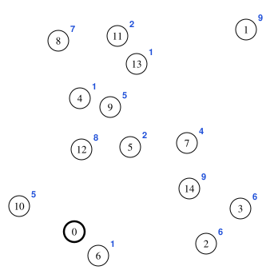
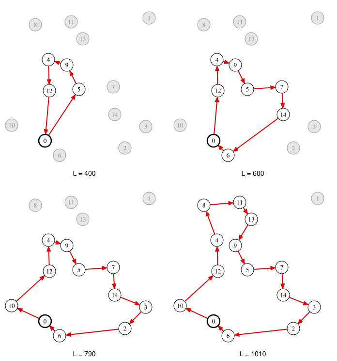
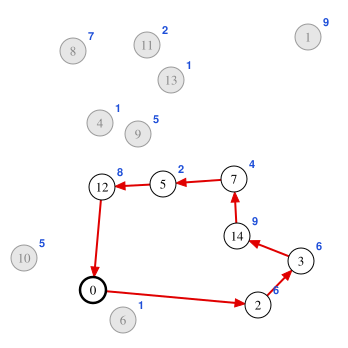

# Orienteering Problem
The **orienteering problem** asks for a tour that leaves a start vertex and returns to it, with a length of at most a limit $L$, that maximizes the sum of the prizes of the visited vertices.
The [traveling salesman problem](TSP) looks for the shortest tour through all vertices; in the orienteering problem, which vertices to visit is also part of the answer.

This page first solves the case where every prize is 1, that is, maximizing the number of visited vertices, and then the case where each vertex has its own prize.
Both use the QUBO++ [structural constraint](STRUCTURAL) `qbpp::cycle()` to represent the tour.

The figure below shows the 15 vertices used on this page.
Vertex 0 is the start, and the number at the upper right of each other vertex is its prize, used in the second half.

<p align="center">
  
</p>

## Formulation
### Variables
As in the [traveling salesman problem](TSP#formulation-with-the-structural-constraint-cycle), we use a binary variable $x_{i,j}$ that is 1 when the tour goes from vertex $i$ to vertex $j$.
Let $d_{i,j}$ be the distance between vertices $i$ and $j$.

### The tour condition
The condition that the arcs whose variables are 1 form one cycle through vertex 0 is written as `qbpp::cycle(x, qbpp::via{0})`.
`qbpp::via{0}` means "vertex 0 must be visited, and the other vertices may be skipped".
This condition is a constraint with no weight, and the solver searches while keeping the cycle.

### The number of visited vertices and the length of the tour
In a cycle, the number of visited vertices equals the number of arcs used.
So the number of visited vertices (including the start) is the sum of the variables:

$$
\text{count} = \sum_{i,j} x_{i,j}
$$

The length of the tour is

$$
\text{total} = \sum_{i,j} d_{i,j}\,x_{i,j}.
$$

### The length limit
The length limit becomes the constraint $\text{total} \leq L$ with [`qbpp::cons()`](CONSTRAINTS).
Breaking the constraint adds the square of the excess times the weight to the energy.
Since the distances are integers, exceeding the limit by even 1 adds at least the weight to the energy.
With a weight of 100, visiting more vertices (at most 15) cannot make up for it, so a tour over the limit is never the minimum.

### The whole expression
QUBO++ minimizes, so we negate the number of visited vertices and make the following expression:

$$
f = -\text{count} + 100\cdot\text{cons}(\text{total} \leq L) + \text{cycle}(x, \text{via}\{0\})
$$

## QUBO++ Program
The following program solves the problem with the limit $L = 600$:

```cpp
#include <cmath>
#include <iostream>
#include <utility>
#include <vector>

#include <qbpp/qbpp.hpp>
#include <qbpp/easy_solver.hpp>

int main() {
  std::vector<std::pair<int, int>> nodes = {
      {69, 34},   {284, 287}, {234, 19},  {277, 63},  {76, 201},
      {139, 140}, {99, 4},    {210, 145}, {49, 273},  {114, 190},
      {0, 66},    {123, 279}, {78, 137},  {147, 244}, {213, 88}};
  const int n = static_cast<int>(nodes.size());
  std::vector<std::vector<int>> dist(n, std::vector<int>(n));
  for (int i = 0; i < n; ++i)
    for (int j = 0; j < n; ++j)
      dist[i][j] = static_cast<int>(std::lround(
          std::hypot(nodes[i].first - nodes[j].first,
                     nodes[i].second - nodes[j].second)));
  auto d = qbpp::array(dist);
  const int L = 600;

  auto x = qbpp::var("x", n, n);
  auto count = qbpp::sum(x);
  auto total = qbpp::sum(d * x);
  auto f = -count + 100 * qbpp::cons(total <= L) + qbpp::cycle(x, qbpp::via{0});
  f.simplify_as_binary();

  qbpp::EasySolver solver(f);
  auto sol = solver.search({{"time_limit", 1.0}});
  std::cout << "visited = " << sol(count) << ", length = " << sol(total)
            << std::endl;
  int v = 0;
  std::cout << "tour: 0";
  do {
    for (int j = 0; j < n; ++j)
      if (j != v && sol(x[v][j]) == 1) {
        v = j;
        break;
      }
    std::cout << " -> " << v;
  } while (v != 0);
  std::cout << std::endl;
}
```

`dist` holds the distances between the vertices (rounded to integers), and `qbpp::array(dist)` turns it into the QUBO++ array `d`. `d * x` is the element-wise product.
`count` and `total` are the expressions above for the number of visited vertices and the length of the tour.
The arcs to themselves `x[i][i]` are also in `qbpp::sum(x)`, but they are always 0 in a solution of `qbpp::cycle()`, so they do not change the count.
The solution `sol` evaluates `count` and `total` to print the number of visited vertices and the length.
The tour is found by following the arcs with value 1 from vertex 0.

This program produces the following output:
```
visited = 8, length = 575
tour: 0 -> 12 -> 4 -> 9 -> 5 -> 7 -> 14 -> 6 -> 0
```
Within a length of 600, at most 8 vertices including the start can be visited, and the length of the tour is 575.
Since the distances are symmetric, the tour may be printed in the reverse direction.

## Changing the Limit
Solving with other values of `L` in the program gives the following:

| Limit $L$ | Visited vertices | Length |
|:---:|:---:|:---:|
| 400 | 5 | 390 |
| 600 | 8 | 575 |
| 790 | 11 | 778 |
| 1010 | 14 | 994 |

<p align="center">
  
</p>

For each limit, the tour with the most visited vertices is unique up to its direction.
A larger limit lets the tour reach vertices farther from the start.

## Orienteering with Prizes
Vertex $j$ has a prize $s_j$, and we maximize the sum of the prizes of the visited vertices (the prize of the start is 0).
The sum of the variables of the arcs into vertex $j$, $\sum_i x_{i,j}$, is 1 if vertex $j$ is visited and 0 otherwise.
So the sum of the prizes is

$$
\text{score} = \sum_j s_j \sum_i x_{i,j}.
$$

In QUBO++, `qbpp::vector_sum(x, 0)` is the array of the column sums $\sum_i x_{i,j}$, so the score is the sum of its element-wise product with the array of prizes `prize`.
The expression is the previous one with `count` replaced by `score`.
The weight 100 is larger than the total of the prizes (66), so a tour over the limit is never the minimum.


```cpp
#include <cmath>
#include <iostream>
#include <utility>
#include <vector>

#include <qbpp/qbpp.hpp>
#include <qbpp/easy_solver.hpp>

int main() {
  std::vector<std::pair<int, int>> nodes = {
      {69, 34},   {284, 287}, {234, 19},  {277, 63},  {76, 201},
      {139, 140}, {99, 4},    {210, 145}, {49, 273},  {114, 190},
      {0, 66},    {123, 279}, {78, 137},  {147, 244}, {213, 88}};
  auto prize = qbpp::array({0, 9, 6, 6, 1, 2, 1, 4, 7, 5, 5, 2, 8, 1, 9});
  const int n = static_cast<int>(nodes.size());
  std::vector<std::vector<int>> dist(n, std::vector<int>(n));
  for (int i = 0; i < n; ++i)
    for (int j = 0; j < n; ++j)
      dist[i][j] = static_cast<int>(std::lround(
          std::hypot(nodes[i].first - nodes[j].first,
                     nodes[i].second - nodes[j].second)));
  auto d = qbpp::array(dist);
  const int L = 600;

  auto x = qbpp::var("x", n, n);
  auto score = qbpp::sum(qbpp::vector_sum(x, 0) * prize);
  auto total = qbpp::sum(d * x);
  auto f = -score + 100 * qbpp::cons(total <= L) + qbpp::cycle(x, qbpp::via{0});
  f.simplify_as_binary();

  qbpp::EasySolver solver(f);
  auto sol = solver.search({{"time_limit", 1.0}});
  std::cout << "score = " << sol(score) << ", length = " << sol(total)
            << std::endl;
  int v = 0;
  std::cout << "tour: 0";
  do {
    for (int j = 0; j < n; ++j)
      if (j != v && sol(x[v][j]) == 1) {
        v = j;
        break;
      }
    std::cout << " -> " << v;
  } while (v != 0);
  std::cout << std::endl;
}
```


This program produces the following output:
```
score = 35, length = 589
tour: 0 -> 2 -> 3 -> 14 -> 7 -> 5 -> 12 -> 0
```

<p align="center">
  
</p>

The tour visits 7 vertices, one fewer than the previous answer that maximized the number of vertices (8), but its score is 35.
The previous answer scores 30, so visiting the high-prize vertices 2, 3, and 14 gives a larger score.

Structural constraints work with EasySolver and ABS3Solver. ExhaustiveSolver does not support them.
