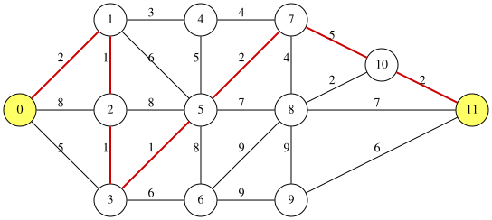
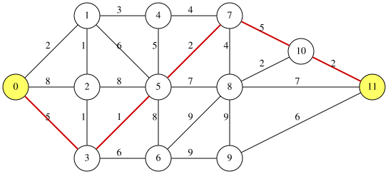

# Shortest Path Problem
Given an undirected graph $G=(V,E)$ with edge weights and two nodes $s$ and $t$, the **shortest path problem** asks for a path from $s$ to $t$ whose total edge weight (the length of the path) is minimum.
All edge weights are assumed to be positive.

The figure below shows a graph with 12 nodes and 24 edges, and the shortest path (red) from node 0 to node 11.
The numbers on the edges are their weights.

<p align="center">
  
</p>

Shortest paths can be found efficiently by Dijkstra's algorithm.
This page formulates the shortest path problem in two ways.
With either of them, conditions that Dijkstra's algorithm cannot handle as is can be added simply as constraints.

- [Formulation with the structural constraint `cycle()`](#formulation-with-the-structural-constraint-cycle): a binary variable is used for each direction of each edge, one arrow from $t$ back to $s$ is added, and the condition that the chosen arrows form one cycle through $s$ and $t$ is added with the [structural constraint](STRUCTURAL) `qbpp::cycle(arcs, qbpp::via{s, t})` of QUBO++.
- [Formulation with degree constraints](#formulation-with-degree-constraints): a binary variable is used for each edge, and constraints on the node degrees are written with `qbpp::cons()`. It can also be solved by the ExhaustiveSolver.

## Formulation with the structural constraint `cycle()`
For each edge $\lbrace a, b\rbrace$, we consider the two arrows $a\to b$ and $b\to a$ of opposite directions and use a binary variable for each of them.
We also add one arrow from $t$ back to $s$.
A path from $s$ to $t$ together with the return arrow forms a cycle through $s$ and $t$.
Conversely, removing the return arrow from a cycle through $s$ and $t$ that uses it leaves a path from $s$ to $t$.
Therefore, the condition that the arrows of the variables with value 1 form one cycle through $s$ and $t$ is written with the structural constraint `qbpp::cycle(arcs, qbpp::via{s, t})`.
So that the cycle always uses the return arrow, no arrow into $s$ and no arrow out of $t$ is created.
The expression to minimize is the total weight of the chosen arrows; the return arrow has weight 0.


```cpp
#include <qbpp/qbpp.hpp>
#include <qbpp/easy_solver.hpp>

int main() {
  const uint32_t s = 0, t = 11;
  std::vector<std::tuple<uint32_t, uint32_t, int>> edges = {
      {0, 1, 2},  {0, 2, 8},  {0, 3, 5},  {1, 2, 1},   {1, 4, 3},  {1, 5, 6},
      {2, 3, 1},  {2, 5, 8},  {3, 5, 1},  {3, 6, 6},   {4, 5, 5},  {4, 7, 4},
      {5, 6, 8},  {5, 7, 2},  {5, 8, 7},  {6, 8, 9},   {6, 9, 9},  {7, 8, 4},
      {7, 10, 5}, {8, 9, 9},  {8, 10, 2}, {8, 11, 7},  {9, 11, 6}, {10, 11, 2}};
  const size_t M = edges.size();

  auto x = qbpp::var("x", M, 2);  // x[i][0]: a -> b, x[i][1]: b -> a
  auto r = qbpp::var("r");        // the arrow from t back to s

  std::vector<qbpp::Arc> arcs;
  auto f = qbpp::toExpr(0);
  for (size_t i = 0; i < M; ++i) {
    auto [a, b, w] = edges[i];
    if (b != s && a != t) {
      arcs.push_back({a, b, x[i][0]});
      f += w * x[i][0];
    }
    if (a != s && b != t) {
      arcs.push_back({b, a, x[i][1]});
      f += w * x[i][1];
    }
  }
  arcs.push_back({t, s, r});
  f += qbpp::cycle(arcs, qbpp::via{s, t});
  f.simplify_as_binary();

  auto solver = qbpp::EasySolver(f);
  auto sol = solver.search({{"time_limit", 1.0}});

  std::cout << "length = " << sol.energy() << std::endl;
  std::cout << "path: " << s;
  for (uint32_t v = s; v != t;) {
    for (const auto& arc : arcs)
      if (arc.from == v && sol(arc.var) == 1) {
        v = arc.to;
        break;
      }
    std::cout << " -> " << v;
  }
  std::cout << std::endl;
}
```


`x[i][0]` is the arrow `a -> b` of edge `i`, `x[i][1]` is the arrow `b -> a`, and `r` is the return arrow.
The loop puts the arrows, except those into $s$ and those out of $t$, into the list `arcs` of `qbpp::Arc{from, to, variable}` and adds their weights to `f`.
Finally the return arrow is added, and `qbpp::cycle(arcs, qbpp::via{s, t})` is added to `f`.
The energy of the solution is the length of the path. The path is found by following the arrows with value 1 from $s$.
Structural constraints cannot be used with the ExhaustiveSolver, so the problem is solved with the EasySolver.

The output of this program is as follows:
```
length = 14
path: 0 -> 1 -> 2 -> 3 -> 5 -> 7 -> 10 -> 11
```

Conditions are easy to add in this formulation as well.
To use at most 5 edges, limit the number of arrows of the cycle (including the return arrow) to at most 6 with `qbpp::length{2, 6}`. Change the line that adds the structural constraint to `f` as follows:
```cpp
  f += qbpp::cycle(arcs, qbpp::via{s, t}, qbpp::length{2, 6});
```
The output of this program is as follows:
```
length = 15
path: 0 -> 3 -> 5 -> 7 -> 10 -> 11
```
The shortest path that must visit node 9 is found simply by adding 9 to `qbpp::via`:
```cpp
  f += qbpp::cycle(arcs, qbpp::via{s, t, 9});
```
The output of this program is as follows:
```
length = 25
path: 0 -> 1 -> 2 -> 3 -> 6 -> 9 -> 11
```
In the formulation with degree constraints in the next section, the condition "must visit a node" cannot be written correctly (see the end of [Limiting the number of edges](#limiting-the-number-of-edges)).

## Formulation with degree constraints
Number the edges $0,1,\ldots,m-1$, and let $w_i$ be the weight of edge $i$.
We introduce $m$ binary variables $x_0, x_1, \ldots, x_{m-1}$, where $x_i=1$ means that edge $i$ is selected for the path.

The number of selected edges incident to node $v$ is called the degree of $v$ and denoted by $\deg(v)$:

$$
\deg(v) = \sum_{i\,:\,v \text{ is an endpoint of edge } i} x_i
$$

To make the selected edges form a path from $s$ to $t$, we impose the following constraints:

$$
\begin{aligned}
\deg(s) &= 1, \quad \deg(t) = 1, \\
\deg(v) &\in \lbrace 0, 2\rbrace && (v \neq s, t)
\end{aligned}
$$

Since $s$ and $t$ are the ends of the path, exactly one selected edge is incident to each of them.
Every other node has two selected edges if the path passes through it, and none otherwise.

The objective is the total weight of the selected edges:

$$
\text{objective} = \sum_{i=0}^{m-1} w_i x_i
$$

### Why no cycles appear
A selection of edges satisfying the constraints above is not necessarily just a path from $s$ to $t$.
Since every degree is at most 2, the selected edges split into paths and cycles.
Since $s$ and $t$ are the only nodes of degree 1, there is exactly one path, and its ends are $s$ and $t$.
In other words, a selection satisfying the constraints is one path from $s$ to $t$ plus some cycles that share no node with the path.

Since the total weight of a cycle is positive, removing a cycle keeps the constraints satisfied and decreases the objective.
Therefore, a selection minimizing the objective contains no cycle and is a shortest path from $s$ to $t$.

### The expression
We declare the constraints with [`qbpp::cons()`](CONSTRAINTS), multiply them by a weight $P$, and add them to the objective:

$$
\begin{aligned}
f &= \text{objective} + P\times\Bigl(\text{cons}\bigl(\deg(s)=1\bigr) + \text{cons}\bigl(\deg(t)=1\bigr) + \sum_{v\neq s,t}\text{cons}\bigl(\deg(v)\in\lbrace 0,2\rbrace\bigr)\Bigr)
\end{aligned}
$$

When a constraint is violated, the square of the violation times the weight is added to the energy.
Since a violation is at least 1, any assignment violating at least one constraint has energy at least $P$.
On the other hand, the energy of an assignment satisfying the constraints is the total weight of the selected edges, which is at most the total weight of all edges.
Therefore, if $P$ is set to "the total weight of all edges + 1", an assignment minimizing $f$ always satisfies the constraints.

## QUBO++ program
The following QUBO++ program finds the shortest path from node 0 to node 11 in the graph shown above:

```cpp
#include <qbpp/qbpp.hpp>
#include <qbpp/exhaustive_solver.hpp>
#include <qbpp/graph.hpp>

int main() {
  const size_t N = 12;
  const size_t s = 0, t = 11;
  std::vector<std::pair<int, int>> pos = {
      {0, 150},   {100, 250}, {100, 150}, {100, 50},  {200, 250}, {200, 150},
      {200, 50},  {300, 250}, {300, 150}, {300, 50},  {400, 200}, {500, 150}};
  std::vector<std::tuple<size_t, size_t, int>> edges = {
      {0, 1, 2},  {0, 2, 8},  {0, 3, 5},  {1, 2, 1},   {1, 4, 3},  {1, 5, 6},
      {2, 3, 1},  {2, 5, 8},  {3, 5, 1},  {3, 6, 6},   {4, 5, 5},  {4, 7, 4},
      {5, 6, 8},  {5, 7, 2},  {5, 8, 7},  {6, 8, 9},   {6, 9, 9},  {7, 8, 4},
      {7, 10, 5}, {8, 9, 9},  {8, 10, 2}, {8, 11, 7},  {9, 11, 6}, {10, 11, 2}};
  const size_t M = edges.size();

  auto x = qbpp::var("x", M);

  auto objective = qbpp::toExpr(0);
  int total = 0;
  for (size_t i = 0; i < M; ++i) {
    auto [a, b, w] = edges[i];
    objective += w * x[i];
    total += w;
  }

  auto constraint = qbpp::toExpr(0);
  for (size_t v = 0; v < N; ++v) {
    auto deg = qbpp::toExpr(0);
    for (size_t i = 0; i < M; ++i) {
      auto [a, b, w] = edges[i];
      if (a == v || b == v) {
        deg += x[i];
      }
    }
    if (v == s || v == t) {
      constraint += qbpp::cons(deg == 1);
    } else {
      constraint += qbpp::cons(deg == qbpp::equal{0, 2});
    }
  }

  auto f = objective + (total + 1) * constraint;
  f.simplify_as_binary();

  auto solver = qbpp::ExhaustiveSolver(f);
  auto sol = solver.search();

  std::cout << "length = " << objective(sol) << std::endl;
  std::cout << "violated constraints = " << f.cons(sol) << std::endl;
  std::cout << "selected edges:";
  for (size_t i = 0; i < M; ++i) {
    auto [a, b, w] = edges[i];
    if (sol(x[i]) == 1) {
      std::cout << " (" << a << "," << b << ")";
    }
  }
  std::cout << std::endl;

  qbpp::graph::GraphDrawer graph;
  for (size_t v = 0; v < N; ++v) {
    auto node = qbpp::graph::Node(v).position(pos[v].first, pos[v].second);
    if (v == s || v == t) {
      node.color(1);
    }
    graph.add_node(node);
  }
  for (size_t i = 0; i < M; ++i) {
    auto [a, b, w] = edges[i];
    auto edge = qbpp::graph::Edge(a, b).label(std::to_string(w));
    if (sol(x[i]) == 1) {
      edge.color(1).penwidth(2.0);
    }
    graph.add_edge(edge);
  }
  graph.write("shortest_path.svg");
}
```

In this program, each edge is stored in `edges` as a tuple (endpoint, endpoint, weight).
`pos` holds the coordinates of the nodes for drawing the figure.
The first loop builds the objective `objective` and the total weight `total`.
The second loop builds the degree `deg` of each node `v` and adds `qbpp::cons(deg == 1)` to `constraint` if `v` is `s` or `t`, and `qbpp::cons(deg == qbpp::equal{0, 2})` otherwise.
`qbpp::equal{0, 2}` is a [set of allowed values](CONSTRAINTS#discrete-allowed-value-sets) that is satisfied only when the value is 0 or 2.

Since the Exhaustive Solver checks all assignments, the solution obtained is optimal.
The program prints the length of the path `objective(sol)`, the number of violated constraints `f.cons(sol)`, and the selected edges, and saves the graph to `shortest_path.svg` (the figure at the top of this page).

This program produces the following output:
```
length = 14
violated constraints = 0
selected edges: (0,1) (1,2) (2,3) (3,5) (5,7) (7,10) (10,11)
```
The selected edges form the path 0 → 1 → 2 → 3 → 5 → 7 → 10 → 11 of length 2+1+1+1+2+5+2 = 14.
From node 0 to node 3, going around nodes 1 and 2 (weight 4) is shorter than the direct edge (weight 5), so the path zigzags up and down.

Constraints declared with `qbpp::cons()` do not add terms to the expression, so `f` has only the 24 terms of the objective.
With the classic penalty form, $\deg(v)\in\lbrace 0,2\rbrace$ cannot be written directly; a binary variable $y_v$ must be added for each node to write it as $(\deg(v)-2y_v)^2$.

For graphs with many edges, exhaustive search does not finish, so use `qbpp::EasySolver` instead of `qbpp::ExhaustiveSolver` and give `search()` a time limit.
For this graph, the Easy Solver with a time limit of 1 second also finds the same shortest path.

## Limiting the number of edges
The shortest path above uses 7 edges.
Let us find the shortest path that uses at most 5 edges.
Since the number of selected edges is $\sum_i x_i$, we only need to add the following line before building `f`:
```cpp
  constraint += qbpp::cons(qbpp::sum(x) <= 5);
```
This program produces the following output:
```
length = 15
violated constraints = 0
selected edges: (0,3) (3,5) (5,7) (7,10) (10,11)
```
Instead of the three edges around nodes 1 and 2, the path now takes the direct edge 0 → 3, and its length is 15:

<p align="center">
  
</p>

Dijkstra's algorithm cannot handle such a condition as is, but in this formulation it is just one more constraint.
The limit on the number of edges stays satisfied when a cycle is removed, so the argument in [Why no cycles appear](#why-no-cycles-appear) still holds.
The weight $P$ does not need to be changed either.

However, if you add a constraint that may become violated when a cycle is removed, the solution may contain cycles.
For example, if "the path must pass through node $v$" is written as $\deg(v)=2$, it is also satisfied by selecting a cycle through $v$ separately from the path from $s$ to $t$.
In the [formulation with the structural constraint `cycle()`](#formulation-with-the-structural-constraint-cycle), this condition is written correctly by adding the node to `qbpp::via`.
