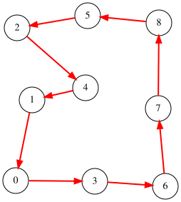

# Traveling Salesman Problem
The Traveling Salesman Problem (TSP) asks for the shortest tour that visits every node exactly once and returns to the start.
We assume that the nodes are placed on a plane and that the tour length is measured using the Euclidean distance.

In the figure below, an example of nine nodes and an optimal tour is shown:

<p align="center">
  
</p>


This page formulates the TSP in two ways.

- [Formulation with the structural constraint `cycle()`](#formulation-with-the-structural-constraint-cycle): a binary variable is used for each move (arc) from a node to another node, and the condition that the chosen arcs form one tour is added with the [structural constraint](STRUCTURAL) `qbpp::cycle(x)` of QUBO++. The expression is only the tour length, and no penalty weight has to be chosen. This is the simpler way when the problem is solved with the EasySolver or the ABS3Solver of QUBO++.
- [QUBO formulation of the TSP](#qubo-formulation-of-the-tsp): the order in which the nodes are visited is represented by a permutation matrix, and the constraints are written as penalty terms. The expression is a quadratic polynomial (QUBO), so it can also be given to other solvers that accept QUBO, such as quantum annealers.

## Formulation with the structural constraint `cycle()`
We use binary variables $x_{i,j}$ ($i \neq j$) that are 1 when the tour goes from node $i$ to node $j$.
With the distance $d_{i,j}$ between nodes $i$ and $j$, the tour length is

$$
\sum_{i\neq j} d_{i,j}\,x_{i,j} .
$$

The condition that the arcs $i\to j$ of the variables with value 1 form one tour visiting every node exactly once is written with `qbpp::cycle(x)`.
This condition is a constraint without a weight, and the solver searches while keeping the tour.


```cpp
#include <cmath>
#include <qbpp/qbpp.hpp>
#include <qbpp/easy_solver.hpp>

class Nodes {
  std::vector<std::pair<int, int>> nodes{{10, 12},  {33, 125},  {12, 226},
                                         {121, 11}, {108, 142}, {111, 243},
                                         {220, 4},  {210, 113}, {211, 233}};

 public:
  std::size_t size() const { return nodes.size(); }

  int dist(std::size_t i, std::size_t j) const {
    auto [x1, y1] = nodes[i];
    auto [x2, y2] = nodes[j];
    const int dx = x1 - x2;
    const int dy = y1 - y2;
    return static_cast<int>(
        std::llround(std::sqrt(static_cast<double>(dx * dx + dy * dy))));
  }
};

int main() {
  auto nodes = Nodes{};
  const size_t n = nodes.size();
  auto x = qbpp::var("x", n, n);

  auto f = qbpp::toExpr(0);
  for (size_t i = 0; i < n; ++i)
    for (size_t j = 0; j < n; ++j)
      if (i != j) f += nodes.dist(i, j) * x[i][j];
  f += qbpp::cycle(x);
  f.simplify_as_binary();

  auto solver = qbpp::EasySolver(f);
  auto sol = solver.search({{"time_limit", 1.0}});

  std::cout << "length = " << sol.energy() << std::endl;
  size_t v = 0;
  std::cout << "tour: 0";
  do {
    for (size_t j = 0; j < n; ++j)
      if (j != v && sol(x[v][j]) == 1) {
        v = j;
        break;
      }
    std::cout << " -> " << v;
  } while (v != 0);
  std::cout << std::endl;
}
```


The element `x[i][j]` of the variable array `x` stands for the arc $i\to j$.
The double loop adds $d_{i,j}\,x_{i,j}$ to build the tour length, and `qbpp::cycle(x)` is added to it.
The arcs `x[i][i]` from a node to itself are always 0 in a solution, so they need not appear in the expression.
In the solution, the energy is the tour length.
The tour is found by following the arcs with value 1 from node 0.

This program produces the following output:
```
length = 959
tour: 0 -> 3 -> 6 -> 7 -> 8 -> 5 -> 2 -> 4 -> 1 -> 0
```
Because the distances are symmetric, the same tour may be printed in the reverse direction.

Structural constraints are supported by the EasySolver and the ABS3Solver. The ExhaustiveSolver does not support them.
To give the expression to a quantum annealer or another QUBO solver, use the formulation in the following sections.

## QUBO formulation of the TSP
From this section on, the same problem is written as a QUBO. Note that the variables $x$ have a different meaning from those in the previous section.

A tour can be represented by a permutation of the nodes.
Accordingly, we use a [permutation matrix](PERMUTATION) to encode a TSP solution.

Let $X=(x_{i,j})$ ($0\leq i,j\leq n-1$) be a matrix of $n\times n$ binary values.
The matrix $X$ is a **permutation matrix** each row and each column contains exactly one entry equal to 1, as illustrated below.

<p align="center">
  
</p>

We interpret  $x_{k,i}$ as "the $k$-th position in the tour is node $i$".
Therefore, every row and every column of $X$ must be one-hot, i.e., the following constraints must hold:

$$
\begin{aligned}
{\rm row}:& \sum_{j=0}^{n-1}x_{i,j}=1 & (0\leq i\leq n-1)\\
{\rm column}:& \sum_{i=0}^{n-1}x_{i,j}=1 & (0\leq j\leq n-1)
\end{aligned}
$$

Let $d_{i,j}$ denote the distance between nodes $i$ and $j$.
Then the tour length for a permutation matrix $X$ can be written as:

$$
\begin{aligned}
{\rm objective}: &\sum_{k=0}^{n-1}\sum_{i=0}^{n-1}\sum_{j=0}^{n-1} d_{i,j}x_{k,i}x_{(k+1)\bmod n,j}
\end{aligned}
$$

This expression adds $d_{i,j}$ exactly when node $i$ is visited at position $k$ and node
$j$ is visited next (at position $(k+1)\bmod n$), so it equals the total length of the tour.

## QUBO++ program for TSP
Using the permutation-matrix formulation above, we can write a QUBO++ program for the TSP as follows:

```cpp
#include <cmath>
#include <qbpp/qbpp.hpp>
#include <qbpp/easy_solver.hpp>
#include <qbpp/graph.hpp>

class Nodes {
  std::vector<std::pair<int, int>> nodes{{10, 12},  {33, 125},  {12, 226},
                                         {121, 11}, {108, 142}, {111, 243},
                                         {220, 4},  {210, 113}, {211, 233}};

 public:
  const std::pair<int, int>& operator[](std::size_t index) const {
    return nodes[index];
  }

  std::size_t size() const { return nodes.size(); }

  int dist(std::size_t i, std::size_t j) const {
    auto [x1, y1] = nodes[i];
    auto [x2, y2] = nodes[j];
    const int dx = x1 - x2;
    const int dy = y1 - y2;
    return static_cast<int>(
        std::llround(std::sqrt(static_cast<double>(dx * dx + dy * dy))));
  }
};

int main() {
  auto nodes = Nodes{};
  auto x = qbpp::var("x", nodes.size(), nodes.size());

  auto constraint = qbpp::sum(qbpp::vector_sum(x, 1) == 1) +
                    qbpp::sum(qbpp::vector_sum(x, 0) == 1);

  auto objective = qbpp::toExpr(0);
  for (size_t i = 0; i < nodes.size(); ++i) {
    auto next_i = (i + 1) % nodes.size();
    for (size_t j = 0; j < nodes.size(); ++j) {
      for (size_t k = 0; k < nodes.size(); ++k) {
        if (k != j) {
          objective += nodes.dist(j, k) * x[i][j] * x[next_i][k];
        }
      }
    }
  }

  auto f = objective + constraint * 1000;
  f.simplify_as_binary();

  auto solver = qbpp::EasySolver(f);
  auto sol = solver.search({{"time_limit", 1.0}});
  auto tour = qbpp::onehot_to_int(sol(x));

  std::cout << "Tour: " << tour << "\n";
  auto graph = qbpp::graph::GraphDrawer();
  for (size_t i = 0; i < nodes.size(); ++i) {
    graph.add(qbpp::graph::Node(i).position(nodes[i].first, nodes[i].second));
  }
  for (size_t i = 0; i < nodes.size(); ++i) {
    auto from = tour[i];
    auto to = tour[(i + 1) % nodes.size()];
    graph.add(qbpp::graph::Edge(from, to).color("red").penwidth(2).directed());
  }
  graph.write("tsp_solution.svg");
}
```

In this program, the coordinates of nodes `0` through `8` are stored in a `Nodes` object named `nodes`.
We create a 2D array `x` of binary variables and construct the one-hot constraints together with the tour-length objective.
These terms are combined into a single QUBO expression `f` by adding the constraints with a penalty weight (here, `1000`) to prioritize feasibility.

We then solve `f` using EasySolver with a 1.0-second time limit.
The resulting assignment `sol(x)` forms a permutation matrix.
This matrix is converted into a list of integers (a permutation) called `tour` using `qbpp::onehot_to_int()`, and then printed.
Finally, the computed `tour` is rendered as a directed graph and saved to the file `tsp_solution.svg`.

This program produces the following output:
```
Tour: {7,8,5,2,4,1,0,3,6}
```

### Optimizing exact (double) distances

The `dist` function above rounds each Euclidean distance to the nearest integer with `std::llround`,
because the default `coeff_t` is an integer type. To optimize the **exact** tour length without rounding,
use the [double frontend](VAREXPR#real-double-coefficients): define `DOUBLE_TYPE` before including the
header and let `dist` return a `double`:


```cpp
#define DOUBLE_TYPE          // before #include <qbpp/qbpp.hpp>

  double dist(std::size_t i, std::size_t j) const {
    auto [x1, y1] = nodes[i];
    auto [x2, y2] = nodes[j];
    const double dx = x1 - x2, dy = y1 - y2;
    return std::sqrt(dx * dx + dy * dy);   // no rounding
  }
```


The rest of the program is unchanged. The solver finds the same optimal tour, and `sol.energy()` now
returns the exact tour length as a `double` (e.g. `960.443`) instead of the sum of rounded distances.

## A more concise objective using `slice`, `concat`, and `einsum`

The triple for-loop that builds `objective` is a direct translation of the formula
$\sum_{i,j,k} d_{j,k}\, x_{i,j}\, x_{(i+1) \bmod n, k}$,
but it can also be written as a single call to
[`qbpp::einsum`](EINSUM) once two auxiliary arrays are prepared:

1. a distance matrix `d` of shape $n \times n$ with `d[j][k] = nodes.dist(j, k)`,
2. a cyclically-shifted variable matrix `x_next` defined by
   `x_next[i][k] = x[(i+1) % n][k]`, built with [slice and concat](SLICE_CONCAT).

The objective then becomes the single line
`qbpp::einsum<0>("jk,ij,ik->", d, x, x_next)`, replacing the entire triple
loop:


```cpp
  // Distance matrix as a 2-D integer-constant array
  auto d = qbpp::array<qbpp::coeff_t>(nodes.size(), nodes.size());
  for (size_t j = 0; j < nodes.size(); ++j)
    for (size_t k = 0; k < nodes.size(); ++k)
      d[j][k] = nodes.dist(j, k);

  // Cyclic shift of x along axis 0:
  //   x_next[i, k] = x[(i+1) % n, k]
  auto x_next = qbpp::concat(
      x(qbpp::slice(1, qbpp::end), qbpp::all),
      x(qbpp::slice(0),            qbpp::all));

  // Σ_{i,j,k} d[j,k] * x[i,j] * x_next[i,k]
  auto objective = qbpp::einsum<0>("jk,ij,ik->", d, x, x_next);
```


`qbpp::array<qbpp::coeff_t>(nodes.size(), nodes.size())` allocates a 2-D
`Array<2, coeff_t>` filled with zeros, into which the runtime distance values
are stored. `slice` and `concat` move the first row of `x` to the end,
producing the cyclically-shifted matrix `x_next`. The subscript `"jk,ij,ik->"`
then shares `j` between `d` and `x`, `k` between `d` and `x_next`, and `i`
between `x` and `x_next`, summing over `i, j, k` to yield the scalar objective.

The diagonal-skipping `if (k != j)` from the loop version is no longer needed:
`nodes.dist(j, j)` is always 0, so those terms vanish automatically.

The resulting QUBO expression has the same set of terms as the for-loop
version, but the construction is much shorter and `einsum` builds it in
parallel using multiple CPU threads internally.

## Fixing the first node
Without loss of generality, we can assume that node 0 is the starting node of the tour.
Because the TSP tour is invariant under cyclic shifts, fixing the start position does not change the optimal tour length.

By fixing the start node, we can reduce the number of binary variables in the QUBO expression.
Specifically, we enforce that node 0 is assigned to position 0 in the permutation matrix.
To do this, we fix the following binary variables:

$$
\begin{aligned}
x_{0,0} &= 1\\
x_{i,0} &= 0& (i\geq 1)\\
x_{0,j} &= 0& (j\geq 1)
\end{aligned}
$$

These assignments ensure that node 0 appears only at position 0, and that no other node is assigned to position 0.
As a result, the effective problem size is reduced, which generally makes the QUBO easier to solve for local-search–based solvers.

## QUBO++ program for fixing the first node
In QUBO++, fixed variable assignments can be applied using the `qbpp::replace()` function:

```cpp
  qbpp::MapList ml;
  ml.push_back({x[0][0], 1});
  for (size_t i = 1; i < nodes.size(); ++i) {
    ml.push_back({x[i][0], 0});
    ml.push_back({x[0][i], 0});
  }

  auto g = qbpp::replace(f, ml);
  g.simplify_as_binary();

  auto solver = qbpp::EasySolver(g);
  auto sol = solver.search({{"time_limit", 1.0}});

  auto full_sol = qbpp::Sol(f).set(sol, ml);
  auto tour = qbpp::onehot_to_int(full_sol(x));
  std::cout << "Tour: " << tour << "\n";
```

First, we create a `qbpp::MapList` object `ml`, which stores fixed assignments of variables.
Each assignment is added using the `push_back()` member function.

Next, we call `qbpp::replace(f, ml)`, which returns a new expression obtained by substituting the fixed values specified in `ml` into the original QUBO expression `f`.
The resulting expression is stored in `g` and simplified.

We then create a solver for `g` and obtain a solution `sol`.
Since `sol` corresponds to the reduced problem, we create a `qbpp::Sol` object for `f` and set both the solver output `sol` and the fixed assignments `ml`.
The resulting `full_sol` stores the complete assignment for all variables in `x`.

Finally, the permutation matrix represented by `full_sol(x)` is converted into a permutation using `qbpp::onehot_to_int()` and printed.

This program produces the following tour starting from node 0:
```
Tour: {0,3,6,7,8,5,2,4,1}
```

## Declaring the constraints with `qbpp::cons()`
The row and column one-hot constraints can also be declared as constraints with [`qbpp::cons()`](CONSTRAINTS).
Change `constraint` in the first program as follows:
```cpp
  auto constraint = qbpp::cons(qbpp::vector_sum(x, 1) == 1) +
                    qbpp::cons(qbpp::vector_sum(x, 0) == 1);
```
The weight 1000 is unchanged. Constraints declared with `qbpp::cons()` are passed to the solver without being expanded into penalty expressions, and the solver searches for solutions that satisfy them.
The output is as follows, and the same tour as the first program is obtained, except for the starting vertex and the direction:
```
Tour: {1,4,2,5,8,7,6,3,0}
```
