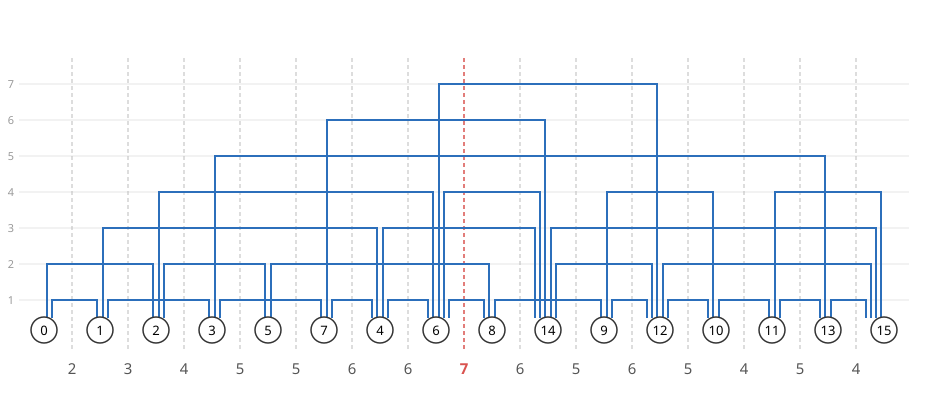

# Cutwidth Problem
Arrange the nodes of an undirected graph $G=(V,E)$ in a row and route the edges above the nodes.
Edges placed at the same height (layer) must not overlap (sharing only an endpoint node is allowed).
The **cutwidth problem** asks for an arrangement of the nodes that minimizes the number of layers needed.



The video takes the 4-dimensional hypercube as its example and finds the cutwidth together with the max cut and the bisection width. The programs in the video, chapter by chapter, are on the page [Video: Graph Partitioning](VIDEO_CUTWIDTH).

The figure below routes the 16-node graph used in [Max-Cut](MAXCUT) and [Minimum Graph Bisection](BISECTION) with 7 layers.
The numbers at the bottom are the numbers of edges passing through each gap between adjacent nodes.

<p align="center">
  
</p>

At every gap, the edges passing through it lie on different layers, so at least as many layers as the maximum number of edges passing through a gap are needed.
Conversely, placing the edges in order of their left ends, each on the lowest free layer, routes them with exactly this maximum number of layers.
So, for a fixed arrangement $\pi$, we call the maximum, over the $n-1$ gaps, of the number of edges passing through the gap the **cutwidth of the arrangement $\pi$**, and the minimum over all arrangements the **cutwidth of the graph $G$**.
The arrangement in the figure has cutwidth 7, and the cutwidth of this graph is also 7.

Cutwidth is used as the number of wiring tracks when circuit elements are placed in a row, and as a measure of the complexity of graph layouts.

## Formulation
Assume the nodes are labeled $0,1,\ldots,n-1$.
Arranging the nodes in a row means assigning to each node its number $0,1,\ldots,n-1$ counted from the left, all different.
The $k$-th gap ($k=0,1,\ldots,n-2$) lies between the nodes numbered $k$ and $k+1$.

### Representing the numbers with domain walls
We represent the number $t_i$ of node $i$ by a [domain wall](NONOGRAM#representing-an-integer-with-a-domain-wall) of $n-1$ binary variables $x_{i,0}, x_{i,1}, \ldots, x_{i,n-2}$:

$$
t_i=\sum_{k=0}^{n-2}x_{i,k},\qquad x_{i,k}=1 \iff t_i>k
$$

The variables $x$ form an $n\times(n-1)$ two-dimensional array, and row $x_i$ is the domain wall of node $i$.
We impose the following two constraints:

$$
\begin{aligned}
x_{i,k} &\ge x_{i,k+1} && (0\le i\le n-1,\ 0\le k\le n-3)\\
\sum_{i=0}^{n-1} x_{i,k} &= n-1-k && (0\le k\le n-2)
\end{aligned}
$$

The first makes each row of the form $1\cdots 1\,0\cdots 0$ (a domain wall).
The second makes the numbers all different.
If the numbers are all different, each of $0,1,\ldots,n-1$ is used once, so $n-1-k$ nodes have a number larger than $k$ (the nodes with $x_{i,k}=1$).
Conversely, if this count is $n-1-k$ for every $k$, then $n-k$ nodes have a number larger than $k-1$ (all $n$ nodes when $k=0$), so exactly one node has the number $k$, and the numbers are all different.

For example, with $n=4$ and the arrangement $2, 0, 3, 1$, the numbers are $t_0=1$, $t_1=3$, $t_2=0$, $t_3=2$, and the variables take the following values:

| | $k=0$ | $k=1$ | $k=2$ | number $t_i$ |
|---|---|---|---|---|
| node 0 | 1 | 0 | 0 | 1 |
| node 1 | 1 | 1 | 1 | 3 |
| node 2 | 0 | 0 | 0 | 0 |
| node 3 | 1 | 1 | 0 | 2 |

The numbers of 1s in the columns are 3, 2, 1 from the left.

### The cut of each column
Column $k$ splits the nodes into those numbered $k$ or less ($x_{i,k}=0$, to the left of the $k$-th gap) and those numbered more than $k$ ($x_{i,k}=1$, to the right).
The number of edges split between the two sides is counted by the same expression as in [Max-Cut](MAXCUT):

$$
\text{cut}_k = \sum_{(i,j)\in E}\Bigl(x_{i,k}\overline{x_{j,k}} + \overline{x_{i,k}}x_{j,k}\Bigr)
$$

This is the number of edges passing through the $k$-th gap.
In other words, each column of $x$ represents a split of the nodes into two, just like the variables of Max-Cut and [Minimum Graph Bisection](BISECTION), and cutwidth uses $n-1$ such splits.

### Minimizing the largest cut
Instead of minimizing the maximum $\max_k \text{cut}_k$ directly, we introduce an integer variable $w$ ($0\le w\le m$, where $m$ is the number of edges), impose the following constraints, and minimize $w$:

$$
\text{cut}_k \le w \qquad (0\le k\le n-2)
$$

$w$ is a "ceiling" that bounds the cuts at all gaps from above; minimizing $w$ makes $w=\max_k \text{cut}_k$.
This is the same technique as the makespan in [Machine Scheduling](MACHINE_SCHEDULING).

### The expression
We declare the three kinds of constraints with [`qbpp.cons()`](CONSTRAINTS) and add them, multiplied by a weight $P$, to the objective $w$:

$$
\begin{aligned}
f &= w + P\times\Bigl(\sum_{i,k}\text{cons}\bigl(x_{i,k+1}-x_{i,k}\le 0\bigr) + \sum_{k}\text{cons}\Bigl(\sum_i x_{i,k}=n-1-k\Bigr) + \sum_{k}\text{cons}\bigl(\text{cut}_k-w\le 0\bigr)\Bigr)
\end{aligned}
$$

A violated constraint adds its weight times the square of the violation to the energy.
Since the violation is an integer of at least 1, violating even one constraint raises the energy by at least $P$.
On the other hand, violating constraints can gain at most the decrease of $w$, which is at most $m$.
So with $P=m+1$, the assignment that minimizes $f$ always satisfies the constraints, and the value of $f$ then equals the cutwidth.

`qbpp.cons()` handles the quadratic body $\text{cut}_k-w$ as it is, so no auxiliary variables are introduced.
The only variables are the $n(n-1)$ binary variables and one integer variable.

## PyQBPP program
The following PyQBPP program computes the cutwidth of the graph in the figure above:
```python
import pyqbpp as qbpp

N = 16
edges = [
    (0, 1),  (0, 2),  (1, 3),  (1, 4),  (2, 5),  (2, 6),  (3, 7),
    (3, 13), (4, 6),  (4, 7),  (4, 14), (5, 8),  (6, 8),  (6, 12),
    (6, 14), (7, 14), (8, 9),  (9, 10), (9, 12), (10, 11),(10, 12),
    (11, 13),(11, 15),(12, 14),(12, 15),(13, 15),(14, 15)]
M = len(edges)

x = qbpp.var("x", shape=(N, N - 1))
w = qbpp.var("w", integer=(0, M))

constraint = 0
# each row is a domain wall
for i in range(N):
    for k in range(N - 2):
        constraint += qbpp.cons(x[i][k + 1] - x[i][k] <= 0)
# the numbers are all different: column k has N-1-k ones
for k in range(N - 1):
    count = 0
    for i in range(N):
        count += x[i][k]
    constraint += qbpp.cons(count == N - 1 - k)
# the cut at the k-th gap is at most w
cut = []
for k in range(N - 1):
    c = 0
    for u, v in edges:
        c += x[u][k] * ~x[v][k] + ~x[u][k] * x[v][k]
    cut.append(c)
    constraint += qbpp.cons(c - w <= 0)

f = w + (M + 1) * constraint
f.simplify_as_binary()

solver = qbpp.EasySolver(f)
sol = solver.search(time_limit=1.0)

print("cutwidth =", sol(w))
print("violated constraints =", f.cons(sol))
order = [0] * N
for i in range(N):
    t = 0
    for k in range(N - 1):
        t += sol(x[i][k])
    order[t] = i
print("order:", *order)
print("cuts:", *[sol(cut[k]) for k in range(N - 1)])
```
`qbpp.var("x", shape=(N, N - 1))` creates the $16\times 15$ variables $x_{i,k}$, and `qbpp.var("w", integer=(0, M))` creates the integer variable $w$.
The three loops add the three kinds of constraints above to `constraint`.
The cut expressions are kept in the list `cut` so that the cut sizes can be read from the solution.

There are 240 variables, too many for exhaustive search, so the Easy Solver searches for 1 second.
The number of node $i$ (its position in the arrangement) is the number of 1s in row $i$.
The program prints the cutwidth `sol(w)`, the number of violated constraints `f.cons(sol)`, the arrangement, and the cut at each gap.

An example output of this program is shown below:
```
cutwidth = 7
violated constraints = 0
order: 0 1 2 3 5 7 4 6 8 14 9 12 10 11 13 15
cuts: 2 3 4 5 5 6 6 7 6 5 6 5 4 5 4
```
The figure at the top of this page draws this arrangement.
Many arrangements have cutwidth 7, so each run may print a different arrangement, but the cutwidth is 7.
We confirmed that the cutwidth of this graph is 7 by computing it exactly with dynamic programming over subsets of nodes.

## Relation to Max-Cut and Minimum Bisection
All three problems split the nodes into two and count the edges split between the two sides (the cut).
They differ in how many splits they use, what conditions they impose, and what they optimize:

| Problem | Splits | Conditions | Optimization | This graph |
|---|---|---|---|---|
| [Max-Cut](MAXCUT) | 1 | none | maximize the cut | 22 |
| [Minimum Graph Bisection](BISECTION) | 1 | $n/2$ nodes on each side | minimize the cut | 6 |
| Cutwidth | $n-1$ | each row a domain wall; column $k$ has $n-1-k$ ones | minimize the largest cut | 7 |

Column $n/2-1$ of cutwidth (the middle gap) has $n/2$ nodes on each side, so it is a bisection.
Therefore the cutwidth of any arrangement is at least the minimum bisection cut (the bisection width), and so the cutwidth of a graph is at least its bisection width.
For this graph, a bisection alone can be reduced to 6 edges, but cutwidth, which must keep all gaps small at once, is 7.

## Checking with hypercubes
The $d$-dimensional hypercube $Q_d$ has $2^d$ nodes $0$ to $2^d-1$, and two nodes are joined by an edge if their binary representations differ in exactly one bit.
The cutwidth of $Q_d$ is $\lfloor 2^{d+1}/3\rfloor$, and arranging the nodes in numerical order attains this value
(K. Nakano, Linear layouts of generalized hypercubes, WG 1993, LNCS 790, pp. 364–375, 1994).
The bisection width is $2^{d-1}$, so for large $d$ the cutwidth is about $4/3$ of the bisection width.

Changing `N` and `edges` in the program above as follows computes the cutwidth of $Q_d$:
```python
D = 9
N = 2 ** D
edges = []
for i in range(N):
    for b in range(D):
        j = i ^ (1 << b)
        if i < j:
            edges.append((i, j))
```
We switch to the GPU-based [ABS3 Solver](ABS3) and give the optimal value as `target_energy`, so that the search stops when an optimal solution is found:
```python
solver = qbpp.ABS3Solver(f)
sol = solver.search(time_limit=60.0, target_energy=341)
print(f"TTS = {sol.tts}s")
```
On a machine with 8 A100 GPUs, the ABS3 Solver found an arrangement of cutwidth 341 within 10 seconds even for $d=9$ (512 nodes, 261,632 binary variables; building the expression takes about 5 seconds):

| $d$ | Nodes | Edges | Binary variables | Cutwidth | Time to find |
|---|---|---|---|---|---|
| 6 | 64 | 192 | 4,032 | 42 | within 0.3 s |
| 7 | 128 | 448 | 16,256 | 85 | within 0.2 s |
| 8 | 256 | 1,024 | 65,280 | 170 | within 6 s |
| 9 | 512 | 2,304 | 261,632 | 341 | within 10 s |

## Visualization with matplotlib
The following code arranges the nodes in a row in the obtained order and draws the edges routed on layers:
```python
import matplotlib.pyplot as plt

pos = {v: p for p, v in enumerate(order)}
intervals = sorted((min(pos[u], pos[v]), max(pos[u], pos[v])) for u, v in edges)
right_end = []
fig, ax = plt.subplots(figsize=(12, 4))
for a, b in intervals:
    layer = next((L for L, r in enumerate(right_end) if r <= a), len(right_end))
    if layer == len(right_end):
        right_end.append(b)
    else:
        right_end[layer] = b
    y = layer + 1
    ax.plot([a + 0.1, a + 0.1, b - 0.1, b - 0.1], [0, y, y, 0], color="#2c6fbb")
for v, p in pos.items():
    ax.text(p, 0, str(v), ha="center", va="center",
            bbox=dict(boxstyle="circle", fc="white", ec="black"))
cuts = [sol(cut[k]) for k in range(N - 1)]
for k in range(N - 1):
    ax.text(k + 0.5, -0.8, str(cuts[k]), ha="center",
            color="red" if cuts[k] == max(cuts) else "black")
ax.set_title(f"Cutwidth = {len(right_end)}")
ax.axis("off")
plt.savefig("cutwidth.png", dpi=150, bbox_inches="tight")
plt.show()
```
The edges are taken in order of their left ends, and each is placed on the lowest layer whose right end is at most the edge's left end (a free layer).
`right_end[L]` is the right end of the last edge placed on layer `L`.
If no layer is free, a new layer is added on top.
In this way the number of layers used equals the maximum cut over the gaps (the cutwidth of the arrangement).
The numbers at the bottom are the cuts at the gaps, and the largest ones are shown in red.
