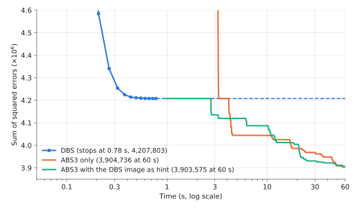

# Image Halftoning

**Halftoning** converts a grayscale image into an image of black and white dots.
It is used to show shades on media that can only display two levels, such as newspaper photographs and monochrome printers.
Viewed from a distance, the fine black and white dots are averaged by the eye and look like intermediate brightness.

A well-known way to binarize an image so that the error seen by the eye is small is **DBS** (Direct Binary Search).
The error that DBS reduces can be written directly as the energy of a QUBO.
On this page, we binarize a $256\times 256$ photo of a cat with DBS and with the QUBO solver ABS3, and compare the results.



The programs in the video, chapter by chapter, are on the page [Video: Image Halftoning](VIDEO_HALFTONING).

## The Error Seen by the Eye

Suppose an $n_r \times n_c$ grayscale image $I$ (pixel values $0 \le I_{ij} \le 255$) is given.
We assign a binary variable $x_{ij} \in \lbrace0,1\rbrace$ to each pixel of the binary image ($1$ = white, $0$ = black).

The blur of the eye is a convolution with a $(2M{+}1)\times(2M{+}1)$ filter $G$
(this page uses $M=3$ and a $7\times 7$ integer Gaussian whose coefficients sum to $255$).
The blurred binary image $x$ is

$$(G * x)_{ij} = \sum_{k=0}^{2M} \sum_{l=0}^{2M} G_{kl}\, x_{i+k-M,\, j+l-M}$$

where pixels outside the image are treated as $0$. Because the coefficients of $G$ sum to $255$, $(G * x)_{ij}$ ranges over $0$–$255$ in the interior of the image and gives the brightness of the binary image as seen by the eye.

The target is the original image itself:

$$T_{ij} = \mathrm{round}\!\left(\frac{I_{ij}\, m_{ij}}{255}\right),
\qquad m_{ij} = (G * \mathbf{1})_{ij}$$

where $m_{ij}$ is the total of the filter coefficients reaching pixel $(i,j)$ ($\mathbf{1}$ is the all-ones image).
In the interior $m_{ij} = 255$, so $T_{ij} = I_{ij}$.
At the border the filter window sticks out of the image and the largest blurred value drops to $m_{ij}$, so the target is scaled down by the same ratio.
One could also blur the original image to make the target, but using the original image as it is gives a binary image with sharper edges.

The error seen by the eye is the sum of squared differences between the blurred binary image and the target:

$$E(x) = \sum_{i,j} \bigl( (G * x)_{ij} - T_{ij} \bigr)^2$$

## DBS

DBS finds a binary image with a small $E(x)$ as follows.

1. Start from the image in which each pixel is white if it is brighter than a random threshold ($0$–$254$), and black otherwise.
2. Visit the pixels from the top left to the bottom right (in raster order). At each pixel, try **flipping** it and **swapping** it with each of its 8 neighbors of the other color, and carry out the one that lowers $E(x)$ the most. If none of them lowers it, do nothing.
3. Repeat the sweep over the image until no pixel lowers $E(x)$.

For the cat photo, DBS stopped after 10 sweeps with the program on this page (13 sweeps, about 0.2 seconds, with the program of the [C++ version](../HALFTONING), whose random thresholds differ).
With flips only and no swaps, $E(x)$ stops at $7.0$–$7.3 \times 10^6$, much worse than $4.2 \times 10^6$ with swaps.
Moving a white dot to the next pixel takes two flips, and the first flip increases the error.

## As a QUBO

$(G * x)_{ij}$ is a linear expression in the variables, so $E(x)$ is quadratic in the variables: an unconstrained QUBO.
The energy of the QUBO is exactly the sum of squared errors seen by the eye.
DBS is a local search on this QUBO: it changes one variable (a flip) or two (a swap) at a time until the energy no longer goes down.
Give the same QUBO to a QUBO solver, and it searches for a better binary image by the same measure as DBS.

## Variables and Terms

For a $256\times 256$ image, there are $65{,}536$ variables, one per pixel.
A product of two variables $x_{ij}\, x_{kl}$ appears in the expansion of the squares only if pixels $(i,j)$ and $(k,l)$ share a filter window.
A pixel in the interior has $128$ partners: the pixels within $2M = 6$ pixels vertically and horizontally whose windows of $G$ overlap with its own. The QUBO has $4{,}171{,}656$ terms.
The number of terms is proportional to the number of pixels: the QUBO is sparse.

## PyQBPP Program

Put the input image [halftone_cat.pgm](../../images/halftone_cat.pgm) (PGM format, $256 \times 256$ pixels) in the directory where you run the program.
The program computes three binary images: the one from DBS, the one from ABS3 alone, and the one from ABS3 given the DBS image as a hint:

```python
import random

import pyqbpp as qbpp

M = 3                                        # filter radius (7x7 filter)
G = [[0, 0, 1, 1, 1, 0, 0],
     [0, 1, 5, 7, 5, 1, 0],
     [1, 5, 14, 21, 14, 5, 1],
     [1, 7, 21, 31, 21, 7, 1],
     [1, 5, 14, 21, 14, 5, 1],
     [0, 1, 5, 7, 5, 1, 0],
     [0, 0, 1, 1, 1, 0, 0]]                  # integer Gaussian (sum 255)

# input: a grayscale image in PGM (P2) format
with open("halftone_cat.pgm") as fp:
    tokens = fp.read().split()
COLS, ROWS = int(tokens[1]), int(tokens[2])
img = [[int(v) for v in tokens[4 + i * COLS:4 + (i + 1) * COLS]] for i in range(ROWS)]


def inside(i, j):
    return 0 <= i < ROWS and 0 <= j < COLS


def blur(a):
    # convolution with G (pixels outside the image are 0)
    out = [[0] * COLS for _ in range(ROWS)]
    for i in range(ROWS):
        for j in range(COLS):
            for k in range(2 * M + 1):
                for l in range(2 * M + 1):
                    if inside(i + k - M, j + l - M):
                        out[i][j] += G[k][l] * a[i + k - M][j + l - M]
    return out


# target T: the original image (scaled by the filter mass reaching each border pixel)
mass = blur([[1] * COLS for _ in range(ROWS)])
target = [[round(img[i][j] * mass[i][j] / 255) for j in range(COLS)]
          for i in range(ROWS)]

# E = sum(((G * x) - T)^2)
x = qbpp.var("x", ROWS, COLS)
xp = qbpp.concat([0] * M + [x] + [0] * M, axis=1)   # zeros on the left and right
xp = qbpp.concat([0] * M + [xp] + [0] * M, axis=0)  # zeros above and below
conv = qbpp.expr(ROWS, COLS)                         # (G * x)
for k in range(2 * M + 1):
    for l in range(2 * M + 1):
        if G[k][l]:
            conv += G[k][l] * xp[k:k + ROWS, l:l + COLS]
f = qbpp.sum((conv - qbpp.array(target)).sqr())
f.simplify_as_binary()


def overlap(i, j, i2, j2):
    # how much the blurs of pixels (i, j) and (i2, j2) overlap: the sum of G(q - p) G(q - p2) over q in the image
    s = 0
    for k in range(2 * M + 1):
        for l in range(2 * M + 1):
            k2, l2 = i + k - i2, j + l - j2
            if inside(i + k - M, j + l - M) and 0 <= k2 <= 2 * M and 0 <= l2 <= 2 * M:
                s += G[k][l] * G[k2][l2]
    return s


# for pixels whose blurs stay inside the image, overlap depends only on their offset: compute it once
INNER = {(di, dj): overlap(2 * M, 2 * M, 2 * M + di, 2 * M + dj)
         for di in range(-2 * M, 2 * M + 1) for dj in range(-2 * M, 2 * M + 1)}


def ov(i, j, i2, j2):
    if M <= min(i, i2) and max(i, i2) < ROWS - M and M <= min(j, j2) and max(j, j2) < COLS - M:
        return INNER[(i2 - i, j2 - j)]
    return overlap(i, j, i2, j2)


def dbs(seed=1):
    # DBS: of the flip and the swaps with the 8 neighbors, take the one that lowers the sum of squared errors most;
    # repeat raster-order sweeps until no pixel lowers it
    rng = random.Random(seed)
    b = [[1 if img[i][j] > rng.randrange(255) else 0 for j in range(COLS)]
         for i in range(ROWS)]                       # start from random thresholds
    blurred = blur(b)
    err = [[blurred[i][j] - target[i][j] for j in range(COLS)] for i in range(ROWS)]
    c = blur(err)                                    # c[i][j]: inner product of the blur of pixel (i, j) and the error

    def delta(i, j):                                 # change of E when pixel (i, j) is flipped
        return 2 * (1 - 2 * b[i][j]) * c[i][j] + ov(i, j, i, j)

    def flip(i, j):
        d = 1 - 2 * b[i][j]
        b[i][j] ^= 1
        for i2 in range(max(0, i - 2 * M), min(ROWS, i + 2 * M + 1)):
            for j2 in range(max(0, j - 2 * M), min(COLS, j + 2 * M + 1)):
                c[i2][j2] += d * ov(i, j, i2, j2)

    while True:
        changed = 0
        for i in range(ROWS):
            for j in range(COLS):
                d0 = delta(i, j)
                best, partner = d0, None             # flip
                for i2 in range(i - 1, i + 2):       # swap with a neighbor of the other color
                    for j2 in range(j - 1, j + 2):
                        if inside(i2, j2) and b[i2][j2] != b[i][j]:
                            de = d0 + delta(i2, j2) - 2 * ov(i, j, i2, j2)
                            if de < best:
                                best, partner = de, (i2, j2)
                if best < 0:
                    flip(i, j)
                    if partner:
                        flip(*partner)
                    changed += 1
        if changed == 0:
            return b


# the DBS binary image, used as a hint
dbs_img = dbs()
hint = qbpp.Sol(f).set({x[i][j]: dbs_img[i][j] for i in range(ROWS) for j in range(COLS)})
print("DBS energy =", f(hint))

solver = qbpp.ABS3Solver(f)
sol = solver.search(time_limit=60)
print("variables =", sol.info["var_count"], " terms =", sol.info["term_count"])
print("ABS3 energy =", sol.energy)
sol_hint = solver.search(time_limit=60, hint=hint)
print("ABS3 + hint energy =", sol_hint.energy)


def save(name, bits):
    # save a binary image in PGM (P2) format
    with open(name, "w") as fp:
        fp.write(f"P2\n{COLS} {ROWS}\n255\n")
        for row in bits:
            fp.write(" ".join(str(255 * int(v)) for v in row) + "\n")


save("dbs.pgm", dbs_img)
save("abs3.pgm", sol(x))
save("abs3_hint.pgm", sol_hint(x))
```

### Building the QUBO

`f` is built with array operations.

1. `qbpp.concat` pads `x` with zeros of width $M$ on all four sides, making the $(n_r{+}2M) \times (n_c{+}2M)$ array `xp` (the scalar `0` in the list becomes a row or column of zeros along the axis being concatenated).
2. The $n_r \times n_c$ subarray `xp[k:k + ROWS, l:l + COLS]`, shifted by $k, l$, is multiplied by $G_{kl}$ and added to `conv`. After the double loop, `conv` is the array of linear expressions $(G * x)$.
3. Subtracting the target array `qbpp.array(target)`, squaring each element with `sqr()`, and summing with `qbpp.sum` gives $E(x)$. `simplify_as_binary()` merges like terms and applies the rule $x^2 = x$.

### DBS

Inside DBS, $E(x)$ is not recomputed each time; only its change when a pixel is flipped is computed.
Let $g_p$ be the blur of pixel $p$ (the blurred image in which only $p$ is white), and let $e = (G * x) - T$ be the error image.
Changing pixel $p$ by $d = \pm 1$ changes the error by $d\, g_p$, so

$$\Delta E = 2d\, \langle g_p, e\rangle + \langle g_p, g_p\rangle$$

where $\langle\cdot,\cdot\rangle$ is the sum of products over the pixels in the image.
`c[i][j]` is $\langle g_p, e\rangle$, and `overlap(p, p2)` is $\langle g_p, g_{p_2}\rangle$.
A swap flips two pixels of different colors, so its change is the sum of the changes of the two flips minus the overlap, $2\langle g_p, g_{p_2}\rangle$.
After a change is carried out, `flip()` updates `c` within $2M$ pixels vertically and horizontally.

### The Hint

`qbpp.Sol(f).set(...)` makes the solution `hint` whose variable values are the DBS binary image.
`f(hint)` is the sum of squared errors of the DBS binary image.
`search(hint=hint)` starts the search from the hint.

### Output

```
DBS energy = 4206279
variables = 65536  terms = 4171656
ABS3 energy = 3908646
ABS3 + hint energy = 3896835
```

ABS3 is a randomized search, so the energies change from run to run (an example on a machine with two NVIDIA RTX 3090 GPUs).
This Python DBS takes about 19 seconds (the same procedure in C++ takes about 0.2 seconds).

## Comparing the Three

We compared how the sum of squared errors (the energy) decreases over time for DBS, ABS3 alone, and ABS3 given the DBS image as a hint (on the same machine; one of several runs of each). The DBS in the graph was measured with a C++ implementation that recomputes each change within the filter window, which is slower than the program on this page and takes 0.78 seconds.
ABS3 with the hint starts its search after DBS finishes:

<p align="center">
  
</p>

- DBS stops at 0.78 seconds. It cannot lower the error any further.
- ABS3 alone gets below the error of DBS in a little over 3 seconds and keeps going down.
- With the hint, ABS3 starts from the DBS solution, so it has better solutions than ABS3 alone for the first few seconds. After 60 seconds, both reached almost the same value.

## Comparing the Images

The original image and the three binary images:

<p align="center">
  
  
  
  
</p>

From the left: the original image, DBS (sum of squared errors 4,207,803), ABS3 alone (3,904,736), and ABS3 with the DBS image as hint (3,903,575) (the images and these values come from a separate run and differ slightly from the output above).
Zooming in on the eye ($40\times 40$ pixels):

<p align="center">
  
  
  
  
</p>

The sum of squared errors of ABS3 is about 7% smaller, but the three images look almost the same.
In practice, the fast DBS is good enough.

## Summary

The halftoning QUBO has one variable per pixel, and its number of terms is proportional to the number of pixels: a sparse QUBO.
Its size can be changed freely by changing the image size, and it can be compared with DBS, a fast method that gives good solutions. This makes it an interesting benchmark for QUBO solvers.

In [clustered-dot halftoning](CLUSTER_HALFTONING), where the dots are placed in clusters, the same error is minimized with constraints added.
