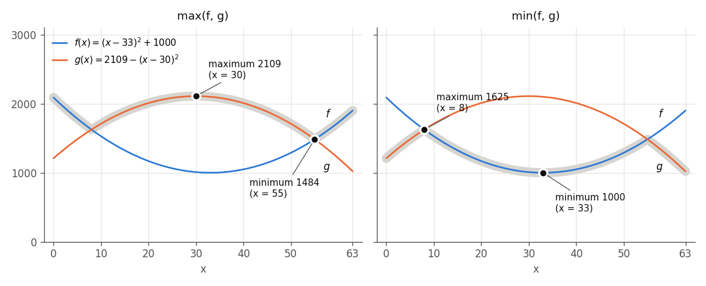
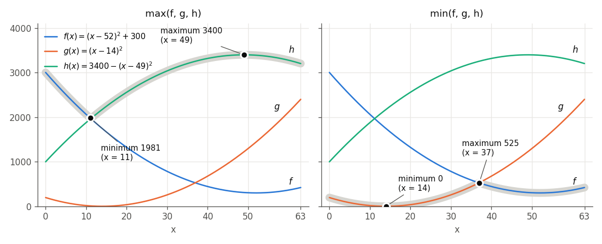

# Minimizing and Maximizing Maxima and Minima

`qbpp.max(f, g)` and `qbpp.min(f, g)` ([Nonlinear Functions and Native Constraints](CONSTRAINTS))
represent the maximum and the minimum of two expressions. Since the solvers minimize the energy,
adding them to the objective with a positive coefficient works toward minimizing, and with a
negative coefficient toward maximizing, which gives four uses:

| Term added to the objective | Meaning |
|---|---|
| `qbpp.max(f, g)` | minimize the maximum |
| `-qbpp.max(f, g)` | maximize the maximum |
| `qbpp.min(f, g)` | minimize the minimum |
| `-qbpp.min(f, g)` | maximize the minimum |

This page first explains these four uses for two expressions with graphs, and then explains
how to handle the maximum or minimum of three or more expressions.

## Two expressions

Consider an [integer variable](INTEGER) $x$ that takes values from 0 to 63 and the following
two functions:

$$
f(x) = (x - 33)^2 + 1000, \qquad g(x) = 2109 - (x - 30)^2
$$

$f$ is a parabola opening upward and $g$ a parabola opening downward; they cross at $x = 8$ and
$x = 55$. In the following figure, the wide gray line shows $\max(f, g)$ on the left and
$\min(f, g)$ on the right:

<p align="center">
  
</p>

The four answers are the lowest and highest points of the gray lines:

- minimizing `qbpp.max(f, g)`: the lowest point of the left line, the crossing at $x = 55$, 1484
- minimizing `-qbpp.max(f, g)` (maximizing the maximum): the highest point of the left line, the vertex of $g$ at $x = 30$, 2109
- minimizing `qbpp.min(f, g)`: the lowest point of the right line, the vertex of $f$ at $x = 33$, 1000
- minimizing `-qbpp.min(f, g)` (maximizing the minimum): the highest point of the right line, the other crossing at $x = 8$, 1625

The following program solves these four cases in turn:

```python
import pyqbpp as qbpp

x = qbpp.var("x", integer=(0, 63))
f = qbpp.sqr(x - 33) + 1000
g = 2109 - qbpp.sqr(x - 30)


def solve(name, obj):
    obj.simplify()
    sol = qbpp.ExhaustiveSolver(obj).search()
    print(f"{name}: energy = {sol.energy}, x = {sol(x)}, f = {sol(f)}, g = {sol(g)}")


solve("+max", qbpp.max(f, g))
solve("-max", -qbpp.max(f, g))
solve("+min", qbpp.min(f, g))
solve("-min", -qbpp.min(f, g))
```

- `solve` simplifies the objective `obj`, finds its exact minimum with `ExhaustiveSolver`, and prints it.
- `-qbpp.max(f, g)` and `-qbpp.min(f, g)` are the terms multiplied by the negative coefficient $-1$.

The output of the program is as follows:

```
+max: energy = 1484, x = 55, f = 1484, g = 1484
-max: energy = -2109, x = 30, f = 1009, g = 2109
+min: energy = 1000, x = 33, f = 1000, g = 2100
-min: energy = -1625, x = 8, f = 1625, g = 1625
```

For the terms with a negative coefficient, the energy is the maximum (minimum) with the sign
reversed.

With two expressions, all four cases are written directly with `qbpp.max` and `qbpp.min`,
without auxiliary variables. The bundled solvers handle all four correctly. MIP solvers, however,
accept only two of them: minimizing the maximum and maximizing the minimum
([Nonlinear Functions and Native Constraints](CONSTRAINTS)).

## Three or more expressions

`qbpp.max` and `qbpp.min` accept only two expressions; passing three or more (or a list or array
of expressions) raises a `TypeError`. Nonlinear functions cannot be nested either, so nesting
them as in `qbpp.max(qbpp.max(f, g), h)` raises a `RuntimeError`.

The maximum or minimum of three or more expressions $f_1, \ldots, f_n$ is expressed by adding
auxiliary variables. Which variables to add depends on the case:

| | Minimize | Maximize |
|---|---|---|
| Maximum $\max(f_1, \ldots, f_n)$ | an integer variable $z$ with relu (or cons) | select one with a one-hot |
| Minimum $\min(f_1, \ldots, f_n)$ | select one with a one-hot | an integer variable $z$ with relu (or cons) |

The maximum is at most $t$ exactly when **every** $f_i$ is at most $t$.
So to make the maximum small, we use an integer variable $z$ that bounds every $f_i$ from above.
On the other hand, the maximum is at least $t$ exactly when **at least one** $f_i$ is at least $t$.
So to make the maximum large, we choose which $f_i$ to use with a one-hot.
The minimum is the other way around. Each method works only for its two cases in the table.

This section uses the following three functions, different from those of the previous section
($x$ is again an integer variable from 0 to 63):

$$
f(x) = (x - 52)^2 + 300, \qquad g(x) = (x - 14)^2, \qquad h(x) = 3400 - (x - 49)^2
$$

<p align="center">
  
</p>

### Minimizing the maximum and maximizing the minimum

To minimize $\max(f_1, \ldots, f_n)$, minimize the following expression instead:

$$
z + 2\sum_{i=1}^{n} \operatorname{relu}(f_i - z)
$$

$\operatorname{relu}(f_i - z)$ is the amount by which $f_i$ exceeds $z$.
If $z$ is at least the maximum, all relu terms are 0 and the value of the expression is $z$.
Lowering $z$ by 1 below the maximum decreases the $z$ part by 1, but the largest expression
then exceeds $z$, so the relu terms increase by at least 2. Therefore, this expression is
minimized when $z$ is exactly the maximum, and its minimum value equals the maximum.

With weight 1, the minimum value of the expression still equals the maximum, but it is
attained for any $z$ between the second largest value and the maximum, so the value of $z$
does not tell the maximum. With a weight larger than 1, $z$ becomes exactly the maximum.

To maximize $\min(f_1, \ldots, f_n)$, minimize the following expression in the same way:

$$
-z + 2\sum_{i=1}^{n} \operatorname{relu}(z - f_i)
$$

$z$ bounds the minimum from below. The expression is minimized when $z$ is exactly the minimum,
and its value is then the minimum with the sign reversed.

The following program solves these two cases for the three functions:

```python
import pyqbpp as qbpp

x = qbpp.var("x", integer=(0, 63))
f = qbpp.sqr(x - 52) + 300
g = qbpp.sqr(x - 14)
h = 3400 - qbpp.sqr(x - 49)
z = qbpp.var("z", integer=(0, 4000))


def solve(name, obj):
    obj.simplify()
    sol = qbpp.ExhaustiveSolver(obj).search()
    print(f"{name}: energy = {sol.energy}, z = {sol(z)}, x = {sol(x)}, "
          f"f = {sol(f)}, g = {sol(g)}, h = {sol(h)}")


solve("+max", z + 2 * qbpp.relu(f - z) + 2 * qbpp.relu(g - z) + 2 * qbpp.relu(h - z))
solve("-min", -z + 2 * qbpp.relu(z - f) + 2 * qbpp.relu(z - g) + 2 * qbpp.relu(z - h))
```

- The values of $f$, $g$, and $h$ are at most 4000, so the range of $z$ is 0 to 4000.

The output of the program is as follows:

```
+max: energy = 1981, z = 1981, x = 11, f = 1981, g = 9, h = 1956
-min: energy = -525, z = 525, x = 37, f = 525, g = 529, h = 3256
```

The minimum of the maximum is 1981, the lowest point of the gray line on the left of the figure,
at $x = 11$ near where $f$ and $h$ cross; since $x$ is an integer, the minimum is at an integer
near the crossing rather than at the crossing itself. The maximum of the minimum is 525, the
highest point of the gray line on the right, at $x = 37$ near where $f$ and $g$ cross. In both
cases, $z$ takes that value.

#### Writing it with cons

Alternatively, you can write "every $f_i$ is at most $z$" as constraints and minimize $z$:

$$
z + 2\sum_{i=1}^{n} \operatorname{cons}(f_i - z \le 0)
$$

In the program above, just replace the relu terms of the `"+max"` line with
`2 * qbpp.cons(f - z <= 0)` and so on to get the same result (energy 1981, $z = 1981$).
To maximize the minimum, replace the relu terms of the `"-min"` line with
`2 * qbpp.cons(f - z >= 0)` and so on.

The value of `qbpp.cons()` is the square of the violation, so lowering $z$ by $d$ below the
maximum increases it by at least $2d^2$. This is more than the decrease $d$ of the $z$ part,
so this expression is also minimized when $z$ is exactly the maximum, and its minimum value
equals the maximum.

Minimizing the makespan (the time at which the last machine finishes) in
[Machine Scheduling with Due Dates](MACHINE_SCHEDULING) is an example of this form.
The coefficient of $z$ is 100, and the constraint of each machine is written with
`qbpp.cons()` with weight 100000.

#### Differences between relu and cons

With either method, the minimum is attained when $z$ is exactly the maximum, and the energy
there equals the maximum. They differ in two points.

**How violations are counted**: The part written with `qbpp.cons()` is treated as constraints.
For a solution where $z$ is smaller than the maximum, `f.cons(sol)`, `f.violations(sol)`, and
`f.is_feasible(sol)` count it as a violation, and a search with `target_energy` does not stop
until all constraints are satisfied.
The part written with `qbpp.relu()` is part of the objective and is not counted as constraints.
$f_i \le z$ is a condition for expressing the maximum, not a requirement that must be met,
so when you only use the maximum in the objective, `qbpp.relu()` matches the meaning better.
`qbpp.cons()` reads "at most $z$" as a constraint, which is a common way of writing it in
mathematical programming.

**Shape of the value and the weight**: The value of `qbpp.cons(f_i - z <= 0)` is the same as
`qbpp.relu(f_i - z, 2)`, the square of the excess. `qbpp.relu(f_i - z)` is the excess itself
(linear). In both cases, the property above holds if the weight is larger than the coefficient
of $z$.
The difference shows up in intermediate states of the search where $z$ is slightly smaller than
the maximum. When one expression attains the maximum, lowering $z$ by $d$ below the maximum
increases the energy by $(\lambda - 1)d$ with relu and by $\lambda d^2 - d$ with cons,
where $\lambda$ is the weight.
If this increase is small, the solver can try lowering $z$ slightly below the maximum, and every
expression exceeding $z$ gets a direction in which "making it smaller lowers the energy".
With a large weight, this state becomes expensive, and the solver mostly moves in the region
where $z$ is at least every expression. There the energy depends only on $z$ (that is, on the
maximum), so if two or more expressions attain the maximum, making one of them smaller does not
change the energy, and the search can become slow for some problems.
A weight larger than the coefficient of $z$ is enough (this page uses twice the coefficient).

### Maximizing the maximum and minimizing the minimum

To maximize $\max(f_1, \ldots, f_n)$, add binary variables $s_1, \ldots, s_n$ that indicate
which $f_i$ to use, and minimize the following expression:

$$
-\sum_{i=1}^{n} s_i f_i + \lambda \cdot \operatorname{cons}\Bigl(\sum_{i=1}^{n} s_i = 1\Bigr)
$$

The value of the one selected $f_i$ is used, and minimization selects the largest $f_i$.
To minimize $\min(f_1, \ldots, f_n)$, make the sign of $\sum s_i f_i$ positive; minimization
then selects the smallest $f_i$.
Choose the weight $\lambda$ larger than the absolute value of any value $f_i$ can take
(so that selecting two or more, or selecting none, never pays off).
The products $s_i f_i$ raise the degree of the expression by 1.

The following program solves these two cases for the three functions:

```python
import pyqbpp as qbpp

x = qbpp.var("x", integer=(0, 63))
f = qbpp.sqr(x - 52) + 300
g = qbpp.sqr(x - 14)
h = 3400 - qbpp.sqr(x - 49)
s = qbpp.var("s", shape=3)
picked = s[0] * f + s[1] * g + s[2] * h
one_hot = 10000 * qbpp.cons(qbpp.sum(s) == 1)


def solve(name, obj):
    obj.simplify_as_binary()
    sol = qbpp.ExhaustiveSolver(obj).search()
    print(f"{name}: energy = {sol.energy}, s = {sol(s)}, x = {sol(x)}, "
          f"f = {sol(f)}, g = {sol(g)}, h = {sol(h)}")


solve("-max", -picked + one_hot)
solve("+min", picked + one_hot)
```

- `picked` is $\sum s_i f_i$, and `one_hot` is the constraint that makes $s$ one-hot; its weight
  10000 is larger than the values of $f$, $g$, and $h$ (at most 4000).
- The expression contains the binary variables $s$, so it is simplified with `simplify_as_binary()`.

The output of the program is as follows:

```
-max: energy = -3400, s = [0, 0, 1], x = 49, f = 309, g = 1225, h = 3400
+min: energy = 0, s = [0, 1, 0], x = 14, f = 1744, g = 0, h = 2175
```

The maximum of the maximum is 3400 at the vertex of $h$ ($x = 49$), the minimum of the minimum
is 0 at the vertex of $g$ ($x = 14$), and $s$ selects that function.

In these two cases, the maximum of the maximum is "the largest of the maxima of the functions",
and the minimum of the minimum is "the smallest of the minima of the functions", so solving each
function separately and comparing gives the same answer. The one-hot form is useful when the
maximum (minimum) appears in the objective together with other terms.
Note that if you use the form with the integer variable $z$ in this direction, $z$ sticks to an
end of its range, and the energy has nothing to do with the maximum or minimum.

### Coefficients and other terms

To minimize $\max(f_1, \ldots, f_n)$ multiplied by a positive coefficient $c$, set the
coefficient of $z$ to $c$ and make the weight of relu (or cons) larger than $c$
(for example, $2c$):

$$
c\,z + 2c\sum_{i=1}^{n} \operatorname{relu}(f_i - z)
$$

Since $z$ appears only in this part, for every assignment of the other variables the minimum of
this part equals $c \max(f_1, \ldots, f_n)$, even when other terms are present.
The same holds for the one-hot form: multiply $\sum s_i f_i$ by a coefficient and add it to the
other terms.
If there are several maxima or minima, use a separate $z$ (or separate $s_1, \ldots, s_n$)
for each.

### Using a maximum or minimum inside other expressions

Even with two expressions, the terms of `qbpp.max` and `qbpp.min` can only be multiplied by
scalars and added. Multiplying them by an expression, using them in `qbpp.sqr()`, or putting them
inside `qbpp.abs()` or `qbpp.relu()` raises an error. To use the maximum inside such an
expression, use an integer variable $z$ that represents the maximum. $z$ is an ordinary integer
variable, so it can be used directly in `qbpp.sqr(z - 2500)`, `qbpp.abs(z - 2500)`, or products
with other variables.

The conditions to impose on $z$, however, depend on the direction of the function $G$ that wraps
the maximum:

- If $G$ is increasing (for example, $G = z^2$ with a nonnegative maximum): as before, imposing
  "every $f_i$ is at most $z$" is enough, because minimization lowers $z$ down to the maximum.
  Make the weight larger than the slope of $G$ (the change of $G$ when $z$ changes by 1).
- If $G$ is decreasing: this is the same direction as maximizing the maximum, so set
  $z = \sum s_i f_i$ with a one-hot.
- Otherwise: fix $z$ to exactly the maximum. Imposing both "every $f_i$ is at most $z$" and
  "$z$ equals one of the $f_i$" makes $z = \max(f_1, \ldots, f_n)$ regardless of the direction:

$$
\sum_{i=1}^{n} \lambda \cdot \operatorname{cons}(f_i - z \le 0)
+ \lambda \cdot \operatorname{cons}\Bigl(z = \sum_{i=1}^{n} s_i f_i\Bigr)
+ \lambda \cdot \operatorname{cons}\Bigl(\sum_{i=1}^{n} s_i = 1\Bigr)
$$

These two are requirements that must be met, so write them with `qbpp.cons()` and make the weight
$\lambda$ sufficiently larger than the slope of $G$. For the minimum, reverse the inequality.

The following program brings the maximum of the three functions above close to 2500, that is, it
minimizes $(\max(f, g, h) - 2500)^2$. $G = (z - 2500)^2$ is neither increasing nor decreasing, so
$z$ is fixed to the maximum:

```python
import pyqbpp as qbpp

x = qbpp.var("x", integer=(0, 63))
f = qbpp.sqr(x - 52) + 300
g = qbpp.sqr(x - 14)
h = 3400 - qbpp.sqr(x - 49)
z = qbpp.var("z", integer=(0, 4000))
s = qbpp.var("s", shape=3)
upper = (1000000 * qbpp.cons(f - z <= 0) + 1000000 * qbpp.cons(g - z <= 0)
         + 1000000 * qbpp.cons(h - z <= 0))
pick = (1000000 * qbpp.cons(s[0] * f + s[1] * g + s[2] * h - z == 0)
        + 1000000 * qbpp.cons(qbpp.sum(s) == 1))
obj = qbpp.sqr(z - 2500) + upper + pick
obj.simplify_as_binary()
sol = qbpp.ExhaustiveSolver(obj).search()
print(f"energy = {sol.energy}, z = {sol(z)}, s = {sol(s)}, x = {sol(x)}, "
      f"f = {sol(f)}, g = {sol(g)}, h = {sol(h)}")
```

- `upper` is "every $f_i$ is at most $z$", and `pick` is "$z$ equals one of the $f_i$".
- The weight 1000000 is sufficiently larger than the slope of $(z - 2500)^2$ (about 5000 for $z$
  from 0 to 4000).

The output of the program is as follows:

```
energy = 0, z = 2500, s = [0, 0, 1], x = 19, f = 1389, g = 25, h = 2500
```

At $x = 19$, the maximum ($h$) is exactly 2500.
If you remove `pick` and keep only `upper`, $z$ can also take values larger than the maximum, so
every $x$ whose maximum is at most 2500 ($x = 6$ to 19) gets energy 0 with $z = 2500$, and the
answer is not correct. For example, the maximum at $x = 6$ is 2416.

### The range of z

If the range of $z$ does not contain the maximum, the value of the expression becomes larger
than the maximum (if the maximum exceeds the upper end of the range, the excess terms remain;
if the lower end of the range exceeds the maximum, $z$ itself is larger).
Since the value of the expression is never smaller than the maximum, it is enough for the range
of $z$ to contain the maximum at the optimal solution.
For example, in the example above $f \ge 300$, so the maximum is at least 300, and
`qbpp.var("z", integer=(300, 4000))` works as well.
The same applies to maximizing the minimum: the range of $z$ only needs to contain the minimum
at the optimal solution.

### Binary-encoded integer variables

The same can be written with $x$ as a [binary-encoded integer variable](BINARY_INTEGER).
In the programs on this page, replacing the declaration of $x$ with
`qbpp.var("x", between=(0, 63))` and `obj.simplify()` with `obj.simplify_as_binary()` gives the
same results. Then $f$, $g$, and $h$ are expanded into polynomials of 6 binary variables.
