# Optical Flow

Given two consecutive frames of a video, the set of vectors that tell how far and in which direction each pixel moved is called the **optical flow**.
It is used in video compression, object tracking, autonomous driving, and more.
On this page, we formulate the problem as choosing the motion of each pixel from 25 candidates and solve it with QUBO++.
At the end, we also show how to solve a $256 \times 256$-pixel image (1.6 million variables) in two stages, using a coarse solution as a hint.

The images are a photo of a cat shrunk to $20 \times 20$ pixels (left) and a second frame made from it (right).
The second frame was made by translating the background and the area around the face (an elliptic region) separately on the original photo ($256 \times 256$ pixels) and then shrinking it in the same way.
In units of the $20 \times 20$ pixels, the background moves 1.15 to the left and 0.2 up, and the face moves 1.8 to the right and 0.85 down.
Because the motion is applied before shrinking, the motion in the shrunk images is not a whole number of pixels, and the pixels on the edge of the face mix the face and the background.
Uniform noise of ±4 is added to both images.

<p align="center">
  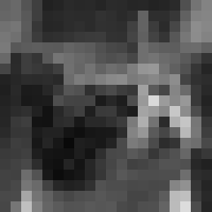
  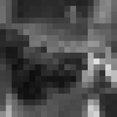
</p>

We want to find the motion shown below (left).
The motion is shown by colors (legend on the right).
Horizontal motion goes from blue (to the left) to yellow (to the right), and vertical motion is brightness (brighter upward, darker downward).
Motions that differ by 1 have similar colors, so a small error looks like a small difference in color.
The background moves to the left, so it is bluish gray; the face moves to the lower right, so it is dark yellow.
The true motion is not a whole number, so its colors lie between the colors of the legend.

<p align="center">
  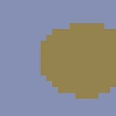
  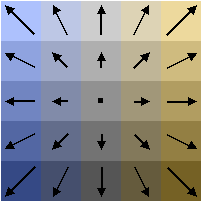
</p>

## Formulation

Let $I_0(i,j)$ be the pixel values of the previous image and $I_1(i,j)$ those of the current image ($i$ is the row and $j$ the column).
The motion $(u, v)$ of each pixel ($u$ is the horizontal and $v$ the vertical component; right and down are positive) is chosen from 25 candidates $u, v \in \lbrace -2, -1, 0, 1, 2 \rbrace$.
We number the candidates $k = 0, 1, \ldots, 24$ and let the $k$-th candidate be $u_k = (k \bmod 5) - 2$, $v_k = \lfloor k / 5 \rfloor - 2$.
Let $x_{i,j,k}$ be a binary variable that is 1 if pixel $(i,j)$ takes the $k$-th candidate and 0 otherwise.

If pixel $(i,j)$ moved by $(u_k, v_k)$, then $I_1(i,j)$ should be close to $I_0(i - v_k, j - u_k)$, the value at the position before the motion.
Comparing single pixels is easily fooled by noise and by pixels of similar brightness, so we compare the sum of absolute differences over the surrounding $3 \times 3$ pixels (the **window**):

$$
c_{i,j,k} = \sum_{s=-1}^{1} \sum_{t=-1}^{1} \bigl| I_1(i+s, j+t) - I_0(i+s-v_k,\ j+t-u_k) \bigr|
$$

The value of a pixel outside the image is the value of the nearest edge pixel.
The horizontal and vertical components of the motion of pixel $(i,j)$ are linear expressions of the variables:

$$
u_{i,j} = \sum_{k=0}^{24} u_k\, x_{i,j,k}, \qquad v_{i,j} = \sum_{k=0}^{24} v_k\, x_{i,j,k}
$$

The objective function to minimize is:

$$
E(x) = \sum_{i,j} \sum_{k=0}^{24} c_{i,j,k}\, x_{i,j,k} + \alpha \sum_{\text{neighboring } (i,j),\,(i',j')} \bigl( |u_{i,j} - u_{i',j'}| + |v_{i,j} - v_{i',j'}| \bigr)
$$

The constraint is that exactly one candidate is chosen for each pixel (one-hot constraint):

$$
\sum_{k=0}^{24} x_{i,j,k} = 1 \qquad (\text{for all } (i,j))
$$

- **The first term (data term)** is how much the windows disagree under the chosen motion.
- **The second term (smoothing term)** is the sum of the absolute differences of the motions of vertically and horizontally neighboring pixels. Pixels of the same object usually move in the same way, so this term is smaller when neighbors have the same motion.
  Where the motion cannot be determined by the window alone, because of noise or little texture, a pixel can follow the motion of its neighbors.
  As in [Image Denoising](DENOISING), we use absolute differences rather than squared differences, so places where the motion changes sharply, such as the border between the face and the background, are kept.

Below, we use $\alpha = 27$. A motion that differs by 1 from a neighbor weighs as much as a brightness difference of 3 on average over the 9 pixels of a window.
The one-hot constraint is written with [`qbpp.cons()`](CONSTRAINTS) with weight 4000.
The largest decrease one pixel can gain by breaking the constraint is the maximum data term $9 \times 255 = 2295$ plus the maximum smoothing term with its four neighbors $4 \times 8\alpha = 864$, which is 3159. This is less than 4000, so a solution that breaks the constraint never pays off.

## PyQBPP Program

Put the two input images [optical_flow_prev.pgm](../../images/optical_flow_prev.pgm) and [optical_flow_cur.pgm](../../images/optical_flow_cur.pgm) (PGM format, $20 \times 20$ pixels) in the working directory and run:


```python
import pyqbpp as qbpp

ALPHA = 27  # weight of the smoothing term
P = 4000    # weight of the one-hot constraint


def read_pgm(file):
    # Read a PGM image (pixel values 0 to 255)
    tok = open(file).read().split()
    W, H = int(tok[1]), int(tok[2])
    return [[int(tok[4 + i * W + j]) for j in range(W)] for i in range(H)]


def pixel(img, i, j):
    # Pixel value (outside the image, the value of the nearest edge pixel)
    i = min(max(i, 0), len(img) - 1)
    j = min(max(j, 0), len(img[0]) - 1)
    return img[i][j]


prev = read_pgm("optical_flow_prev.pgm")
cur = read_pgm("optical_flow_cur.pgm")
H, W = len(cur), len(cur[0])

# x[i][j][k]: 1 if the motion of pixel (i, j) is the k-th candidate (k % 5 - 2, k // 5 - 2)
x = qbpp.var("x", H, W, 25)

f = 0
# Horizontal component u and vertical component v of the motion of each pixel
u = [[0] * W for _ in range(H)]
v = [[0] * W for _ in range(H)]
for i in range(H):
    for j in range(W):
        for k in range(25):
            uk, vk = k % 5 - 2, k // 5 - 2
            # Data term: sum over a 3x3 window of |current pixel - pixel before the motion|
            c = sum(abs(pixel(cur, i + s, j + t) - pixel(prev, i + s - vk, j + t - uk))
                    for s in (-1, 0, 1) for t in (-1, 0, 1))
            f += c * x[i][j][k]
            u[i][j] += uk * x[i][j][k]
            v[i][j] += vk * x[i][j][k]
# One-hot constraint: choose exactly one candidate for each pixel
f += P * qbpp.cons(qbpp.vector_sum(x) == 1)
# Smoothing term: absolute differences of the motion from the right and lower neighbors
for i in range(H):
    for j in range(W):
        if j + 1 < W:
            f += ALPHA * (qbpp.abs(u[i][j] - u[i][j + 1]) + qbpp.abs(v[i][j] - v[i][j + 1]))
        if i + 1 < H:
            f += ALPHA * (qbpp.abs(u[i][j] - u[i + 1][j]) + qbpp.abs(v[i][j] - v[i + 1][j]))
f.simplify_as_binary()

sol = qbpp.EasySolver(f).search(time_limit=10)
print("energy =", sol.energy)

# Save the motion as a color image in PPM format
# Horizontal motion: blue (left) to yellow (right); vertical motion: brightness (brighter upward)
with open("optical_flow_out.ppm", "w") as fp:
    fp.write(f"P3\n{W} {H}\n255\n")
    for i in range(H):
        for j in range(W):
            for k in range(25):
                if sol(x[i][j][k]):
                    uk, vk = k % 5 - 2, k // 5 - 2
                    fp.write(f"{145 + 16 * uk - 30 * vk} {145 + 6 * uk - 30 * vk} "
                             f"{145 - 24 * uk - 30 * vk}\n")
```


- `qbpp.var("x", H, W, 25)` creates 25 binary variables for each pixel ($20 \times 20 \times 25 = 10{,}000$ variables).
- The data-term coefficient $c_{i,j,k}$ is computed as an ordinary integer, multiplied by the variable `x[i][j][k]`, and added.
  In the same loop, the horizontal component `u[i][j]` and the vertical component `v[i][j]` of the motion are built as linear expressions of the variables.
- `qbpp.vector_sum(x)` is the sum over the last dimension, a $20 \times 20$ array of the sums of the 25 variables of each pixel.
  `qbpp.cons(... == 1)` declares all of the constraints that each of them is 1 (400 constraints) at once.
- The smoothing term wraps linear expressions such as `u[i][j] - u[i][j + 1]` with `qbpp.abs` and adds them.
- `EasySolver` searches for 10 seconds; the motion of each pixel is read from the variable whose value is 1 and saved in `optical_flow_out.ppm` in the same colors as the legend.

The number of variables is exactly 10,000, so the program also runs with a Trial license (up to 10,000 variables).

### Output

The program prints, for example:

```
energy = 32766
```

`EasySolver` is randomized, so the energy may differ from run to run.
Building the expression takes about 1 seconds, and the remaining 10 seconds are the search.

The true motion (left) and the motion found (right):

<p align="center">
  
  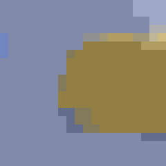
</p>

The face and the background are cleanly separated into two regions.
The true motion is not a whole number, so we compare with the candidate obtained by rounding the true motion: 86.8% of the pixels agree.
Most of the pixels that differ are on the edge of the face.

## Comparison with local methods

We compare with the following two methods, which use the same data term and smoothing term.

- **Choosing the best candidate at each pixel**: ignoring the smoothing term, each pixel takes the candidate with the smallest data term $c_{i,j,k}$.
- **ICM** (Iterated Conditional Modes): starting from the result above, each pixel's motion is replaced by the candidate that minimizes $E$ while the motions of its neighbors are fixed, and this is repeated until nothing changes.

From the left, the results of choosing the best candidate at each pixel, ICM, and QUBO++:

<p align="center">
  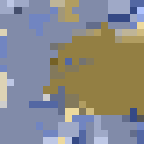
  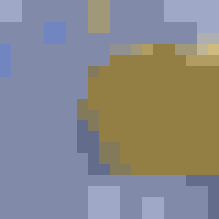
  
</p>

The true motion is not a whole number, so we compare the percentage of pixels that agree with the rounded true motion, and the average length of the difference vector between the motion found and the true motion ("average error", in pixels).
The candidates are integers, so even the rounded true motion has an average error of 0.25.

| Method | Energy $E$ | Pixels agreeing with the rounded true motion | Average error |
|---|---:|---:|---:|
| Best candidate at each pixel | 42,789 | 65.5% | 0.74 |
| ICM | 33,910 | 78.0% | 0.49 |
| QUBO++ (`EasySolver`, 10 seconds) | 32,766 | 86.8% | 0.40 |
| Rounded true motion | 34,513 | 100% | 0.25 |

Choosing the best candidate at each pixel gives scattered motions, because of places with little texture and of the noise.
ICM corrects one pixel at a time, so it cannot move a whole region of errors and stops, leaving scattered errors.
QUBO++ has the smallest $E$ of the three methods, and most of the errors disappear.

### The optimal solution is not the true motion

In the table, the energy of the rounded true motion (34,513) is larger than the energy of the QUBO++ solution (32,766).
That is, the minimum of this objective function is not the true motion, and finding the optimal solution does not give the true motion itself.
Even if ICM is started from the rounded true motion, the motions of pixels change as $E$ decreases, and only 91.8% of them keep the true motion.

The differences appear at pixels whose motion cannot be determined from the images alone.
The 53 pixels that differ in the QUBO++ solution are:

- **The edge of the face (39 pixels)**: When the $3 \times 3$ window straddles the face and the background, the motion of the side that occupies most of the window can give a smaller sum of differences, so the edge of the face shifts by 1 or 2 pixels.
- **A vertically elongated pattern (the upper right corner, 10 pixels)**: The pattern hardly changes in the vertical direction, so the window differences are about the same whether the vertical motion is 0 or −1 (this is called the **aperture problem**). For the true vertical motion −0.2, −1 is chosen.
- **The left edge of the image (3 pixels) and others**: Part of the window goes outside the image, so the part filled with edge pixel values does not match the actual image.

Thus, the remaining errors are due not to a lack of search but to the limits of the objective function (the model).
With QUBO++, the given objective function can be minimized well.
Any further accuracy has to come from improving the objective function.

## Large images (256×256 pixels)

We now compute the same scene on a $256 \times 256$-pixel image, without shrinking it.
In units of the $256 \times 256$ pixels, the background moves 1.15 to the left and 0.2 up, and the face moves 1.8 to the right and 0.85 down (the same numbers as in the $20 \times 20$ example).
Each pixel value is made by dividing the pixel into $4 \times 4$ points, reading the brightness at the position before the motion of each point from the original photo by interpolation, and averaging.
So the pixels on the edge of the face mix the face and the background.
The previous image is made by the same $4 \times 4$ averaging, and uniform noise of ±4 is added to both images.

From the left, the previous image, the current image, and the true motion:

<p align="center">
  
  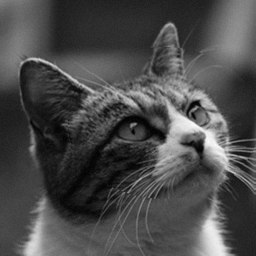
  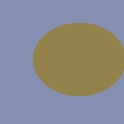
</p>

The number of variables is $256 \times 256 \times 25 = 1{,}638{,}400$, which exceeds the limit of the Trial license (10,000 variables).

### Solving it directly

Solving it with the PyQBPP program above, with the input file names changed and a search time of 60 seconds, gave an energy of 2,259,684.
From the left, the results of choosing the best candidate at each pixel, ICM, and QUBO++ solving it directly:

<p align="center">
  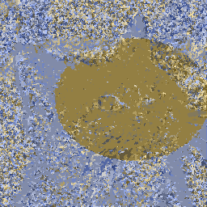
  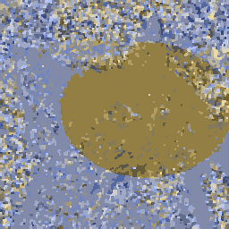
  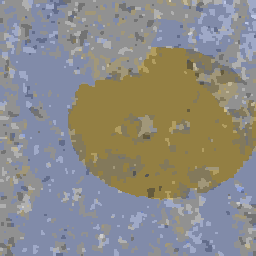
</p>

The QUBO++ solution has a much smaller energy than ICM, but it does not reach the energy of the rounded true motion (1,931,015), and patches of wrong motion remain all over the image.
To correct a patch of errors, the motions of all of its pixels must change together.
With 1.6 million variables, a 60-second search cannot do this over the whole image.

### Solving it in two stages

So we first solve it coarsely and then finely.
We divide the image into blocks of $8 \times 8$ pixels and solve it in the following two stages:

1. **Stage 1**: Assuming that all pixels in a block have the same motion, find the motion of each block. There are $32 \times 32$ blocks, so the number of variables is 25,600.
2. **Stage 2**: Spread the stage-1 solution over the pixels, pass it as a [hint](ABS3#solution-hint), and find the motion of each pixel.

The stage-1 problem can be written with an objective function of the same form as the $20 \times 20$ problem.
If a block takes the $k$-th candidate, its data term is the sum of $c_{i,j,k}$ over the 64 pixels in the block.
The smoothing term is 0 inside a block, because neighboring pixels have the same motion.
On the border with a neighboring block, 8 pairs of pixels are adjacent and every pair has the same difference, so the weight becomes $8\alpha$.
The weight of the one-hot constraint is multiplied by $8^2 = 64$, because what one block can gain by breaking the constraint is also at most 64 times what one pixel can gain.
Then the energy of a stage-1 solution equals $E$ of that solution spread over the pixels.

Put the two input images [optical_flow256_prev.pgm](../../images/optical_flow256_prev.pgm) and [optical_flow256_cur.pgm](../../images/optical_flow256_cur.pgm) in the working directory and run:


```python
import pyqbpp as qbpp

ALPHA = 27  # weight of the smoothing term
P = 4000    # weight of the one-hot constraint
B = 8       # block size of stage 1 (B x B pixels)


def read_pgm(file):
    # Read a PGM image (pixel values 0 to 255)
    tok = open(file).read().split()
    W, H = int(tok[1]), int(tok[2])
    return [[int(tok[4 + i * W + j]) for j in range(W)] for i in range(H)]


def pixel(img, i, j):
    # Pixel value (outside the image, the value of the nearest edge pixel)
    i = min(max(i, 0), len(img) - 1)
    j = min(max(j, 0), len(img[0]) - 1)
    return img[i][j]


def save_flow(file, sol, x, H, W):
    # Save the motion of each pixel in sol as a PPM color image (same colors as the 20x20 program)
    with open(file, "w") as fp:
        fp.write(f"P3\n{W} {H}\n255\n")
        for i in range(H):
            for j in range(W):
                for k in range(25):
                    if sol(x[i][j][k]):
                        uk, vk = k % 5 - 2, k // 5 - 2
                        fp.write(f"{145 + 16 * uk - 30 * vk} {145 + 6 * uk - 30 * vk} "
                                 f"{145 - 24 * uk - 30 * vk}\n")


def flow_expr(x, c, alpha, P):
    # Objective function from data-term coefficients c, smoothing weight alpha, and one-hot weight P
    H, W = len(c), len(c[0])
    f = 0
    # Horizontal component u and vertical component v of the motion of each pixel
    u = [[0] * W for _ in range(H)]
    v = [[0] * W for _ in range(H)]
    for i in range(H):
        for j in range(W):
            for k in range(25):
                f += c[i][j][k] * x[i][j][k]  # data term
                u[i][j] += (k % 5 - 2) * x[i][j][k]
                v[i][j] += (k // 5 - 2) * x[i][j][k]
    # One-hot constraint: choose exactly one candidate for each pixel
    f += P * qbpp.cons(qbpp.vector_sum(x) == 1)
    # Smoothing term: absolute differences of the motion from the right and lower neighbors
    for i in range(H):
        for j in range(W):
            if j + 1 < W:
                f += alpha * (qbpp.abs(u[i][j] - u[i][j + 1]) + qbpp.abs(v[i][j] - v[i][j + 1]))
            if i + 1 < H:
                f += alpha * (qbpp.abs(u[i][j] - u[i + 1][j]) + qbpp.abs(v[i][j] - v[i + 1][j]))
    f.simplify_as_binary()
    return f


prev = read_pgm("optical_flow256_prev.pgm")
cur = read_pgm("optical_flow256_cur.pgm")
H, W = len(cur), len(cur[0])

# Data-term coefficients: sum over a 3x3 window of |current pixel - pixel before the motion|
c = [[[sum(abs(pixel(cur, i + s, j + t) - pixel(prev, i + s - (k // 5 - 2), j + t - (k % 5 - 2)))
           for s in (-1, 0, 1) for t in (-1, 0, 1))
       for k in range(25)] for j in range(W)] for i in range(H)]

# Stage 1: choose one motion for each block of B x B pixels
cb = [[[0] * 25 for _ in range(W // B)] for _ in range(H // B)]
for i in range(H):
    for j in range(W):
        for k in range(25):
            cb[i // B][j // B][k] += c[i][j][k]
y = qbpp.var("y", H // B, W // B, 25)
g = flow_expr(y, cb, B * ALPHA, B * B * P)
sol1 = qbpp.EasySolver(g).search(time_limit=10)
print("stage 1: energy =", sol1.energy)

# Stage 2: spread the stage-1 solution over the pixels as a hint and find the motion of each pixel
x = qbpp.var("x", H, W, 25)
f = flow_expr(x, c, ALPHA, P)
hint = qbpp.Sol(f)
for i in range(H):
    for j in range(W):
        for k in range(25):
            hint.set(x[i][j][k], sol1(y[i // B][j // B][k]))
print("hint:    energy =", f(hint))
sol = qbpp.EasySolver(f).search(time_limit=60, hint=hint)
print("stage 2: energy =", sol.energy)

# Save the stage-1 solution (the hint) and the stage-2 solution as images
save_flow("optical_flow256_stage1.ppm", hint, x, H, W)
save_flow("optical_flow256_out.ppm", sol, x, H, W)
```


- `flow_expr` is the part of the $20 \times 20$ program that builds the objective function, made into a function. It takes the data-term coefficients `c` and the weights of the smoothing term and of the constraint as arguments.
- The data-term coefficients are computed in advance in `c[i][j][k]`. In stage 1, `cb[i // B][j // B][k] += c[i][j][k]` adds up the coefficients of the pixels in each block, and the same `flow_expr` builds the expression with the smoothing weight multiplied by `B` and the constraint weight by `B * B`.
- In stage 2, `qbpp.Sol(f)` creates a solution for the variables of `f`, the stage-1 solution of the block containing each pixel is copied to that pixel, and the hint is passed with the `hint=` argument of `search()`. `f(hint)` is the energy of the hint.
- `save_flow` saves the motion of a solution as an image in the same colors as the $20 \times 20$ program. For stage 1, it saves the hint, that is, the stage-1 solution spread over the pixels.

### Output

The program prints, for example:

```
stage 1: energy = 1973335
hint:    energy = 1973335
stage 2: energy = 1924950
```

The energy of the stage-1 solution and that of the hint spread over the pixels are the same.
`EasySolver` never returns a solution worse than the hint, so the stage-2 energy is never larger than the stage-1 energy.
Over several runs, the stage-2 energy was between 1,924,289 and 1,925,107.
The whole run took about 2 minutes (70 seconds of which are the search) and used about 4 GB of memory.

The figures and the table below are from a run whose stage-1 and stage-2 energies were 1,973,598 and 1,925,107.
From the left, the stage-1 solution, the stage-2 solution, and the true motion:

<p align="center">
  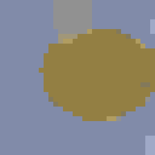
  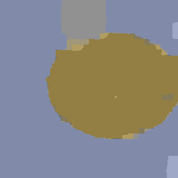
  
</p>

In the stage-1 solution, the edge of the face is a staircase along the grid of blocks.
Stage 2 corrects the edge pixel by pixel.

| Method | Energy $E$ | Pixels agreeing with the rounded true motion | Average error |
|---|---:|---:|---:|
| Best candidate at each pixel | 5,798,810 | 40.5% | 1.15 |
| ICM | 3,179,052 | 49.9% | 0.90 |
| QUBO++, solving directly (60 seconds) | 2,259,684 | 56.5% | 0.68 |
| QUBO++, stage 1 (blocks of $8 \times 8$ pixels, 10 seconds) | 1,973,598 | 90.4% | 0.36 |
| QUBO++, stage 2 (60 seconds) | 1,925,107 | 90.8% | 0.34 |
| Rounded true motion | 1,931,015 | 100% | 0.25 |

Solving in two stages gives a much smaller energy than solving directly, smaller even than that of the rounded true motion.
Stage 2 decreases the energy by about 48,000, but the motion changes at only about 1,000 pixels near the edge of the face, so the percentage of agreeing pixels hardly changes.
With blocks of 4 or 16 pixels, the stage-2 energy was 1,940,761 and 1,942,853, respectively, larger than with 8.

The pixels that differ from the true motion (about 6,000 pixels) are mainly in the following places.

- **The background between the ears and the top of the face below it (upper center, about 4,000 pixels)**: The horizontal motion of the background is 0 (the true motion is −1.15). The background is blurred and has almost no texture, so changing the motion hardly changes the window differences.
- **Places with little texture at the right edge (about 900 pixels)**: The background moves to the left, so the pixels at the right edge show parts that came in from outside the previous image, and the wrong motion spreads from there along the background without texture.
- **The edge of the face (about 900 pixels)**: As in the $20 \times 20$ case, these are pixels whose window straddles the face and the background.

Changing the regions of errors at the upper center or at the right edge to the rounded true motion makes $E$ larger in both cases.
As in the $20 \times 20$ case, these errors are due to the limits of the objective function (the model).

When ICM is started from the rounded true motion, 99.2% of the pixels keep the true motion, and $E$ becomes 1,923,751.
This is slightly (0.07%) smaller than the energy of the QUBO++ solution.
The difference is mainly on the edge of the face: in some places, the edge in the QUBO++ solution is off by 1 or 2 pixels.
Changing the motions of a band of pixels along the edge together would decrease $E$, so for this image some errors also remain that the search did not remove.

For large problems, using the solution of a smaller problem as a hint in this way reaches a much better solution than solving the problem directly.
Solving at a coarse resolution first and then at a fine resolution is also a common technique for computing optical flow.
