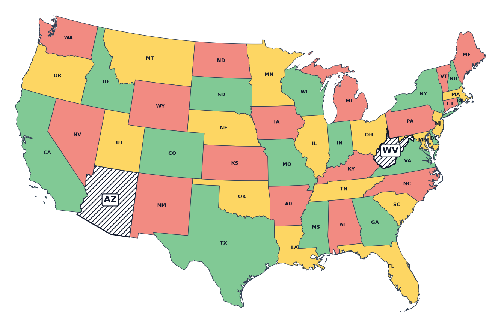
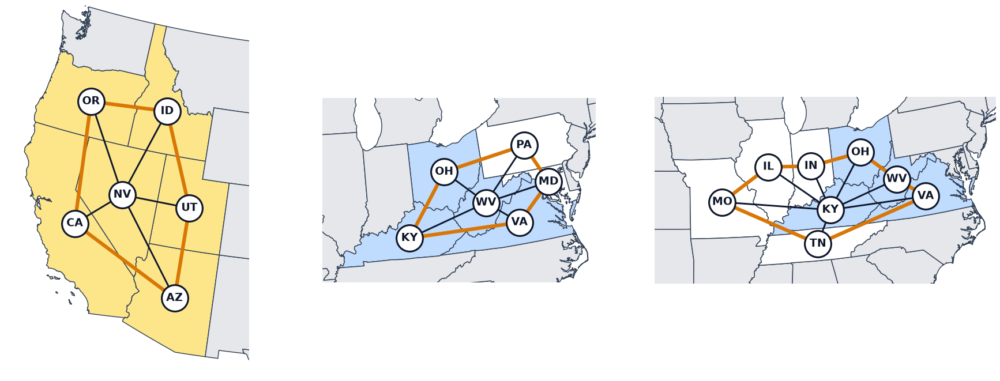

# Video: 48 US States in 3 Colors (Python)

A guide to the video "QUBO++ Case Study: 48 US States in 3 Colors (Python)".
For each chapter it gives the main points, the program and output shown in the video, and links to the pages with the details.
Click "▶ Play the video from …" to play from that scene.



What the video covers:

- The 48 contiguous US states can be colored with 4 colors but not with 3
- **3-colorable vertex deletion**: removing states in the way and coloring the rest with 3 colors, with binary variables $x_{i,j}$ for state × color
- Writing the two constraints, at most one color per state and different colors for neighbors, as penalty expressions, and maximizing the number of colored states (why the weight is 2)
- Collecting all the solutions with the best energy with ABS3Solver, which give the 24 pairs of states to remove
- Why 2 states are needed and why these 24 pairs (the 3 shapes in which an odd ring of states surrounds a middle state)

The written explanation is on the [3-Colorable Vertex Deletion](3COLOR_DELETION) page. Back to the [Videos (case studies)](../VIDEO_CASE_STUDIES) list

## The Problem



- Map coloring is seen as graph coloring: the states are vertices, and two states that share a border line are joined by an edge, 105 edges for the 48 states. States that touch only at a point, like Arizona and Colorado at the Four Corners, are not joined.
- In graph coloring, the two ends of an edge get different colors. By the four color theorem any map can be colored with 4 colors, but with 3 colors the 48 states always leave neighbors with the same color.
- Removing a state removes its vertex and the edges to it. Making the rest 3-colorable by removing as few vertices as possible is the **3-colorable vertex deletion problem**.

## Variables



- Each state has 3 variables, one for each color: 144 for the 48 states. $x_{i,j} = 1$ means state $i$ gets color $j$.
- In the table, the rows are states and the columns colors. The position of the 1 in a row is the state's color, and a state whose row is all 0 is not colored: it is a removed state.

## At Most One Color



- Each state is colored with one color or not at all, so each row has 0 or 1 ones. With the row sum $s_i$ of state $i$, $s_i(s_i - 1)$ is 0 for $s_i = 0, 1$, 2 for $s_i = 2$, and 6 for $s_i = 3$.

$$
\text{atmostone} = \sum_{i} s_i(s_i - 1)
$$

- Every term is 0 or more, and the sum is 0 only when every $s_i$ is 0 or 1; otherwise it is at least 1. Expanded, it is twice the sum of the 3 products of two variables in the same row.

## Neighbors Get Different Colors



- For each edge, the products of the same-color variables of its two ends are added; the product is 1 when both ends have that color. The sum over the 105 edges is different.

$$
\text{different} = \sum_{(u,v)\in E} \sum_{j=0}^{2} x_{u,j}\, x_{v,j}
$$

- The row of an uncolored state is all 0, so the terms of the edges to a removed state are all 0: a removed state does not care about the colors of its neighbors.

## Colored States and the Weight



- Each row has at most one 1, so the number of colored states is the sum of the variables, colored. The number of removed states is 48 − colored, so colored is maximized. The expression to minimize is:

$$
f = -\text{colored} + 2\,(\text{atmostone} + \text{different})
$$

- Why the weight 2: in a solution that breaks a constraint, turning one 1 into 0 reduces the violation. colored drops by 1, so $f$ rises by 1, but the penalty drops by at least 1, so with the weight $f$ drops by at least 2. Overall $f$ goes down, so the constraints come first. Any weight above 1 is enough.

## The Formulas Together



- The variables are the 144 $x$ for 48 states × 3 colors, the constraints are atmostone and different, and the goal is to maximize colored. When $f$ is minimal, the most states are colored, that is, the fewest states are removed.

## The Program



The state names and edges are in [usa48.json](../../images/usa48.json); put the file in the directory where you run the program.
The program in the video writes atmostone as `qbpp.sum(s * (s - 1))` (the written page uses `qbpp.constrain()`; the expression is the same).

```python
import json
import pyqbpp as qbpp

data = json.load(open("usa48.json"))
names, edges = data["names"], data["edges"]
n, m = len(names), 3

x = qbpp.var("x", shape=(n, m))

s = qbpp.vector_sum(x)
atmostone = qbpp.sum(s * (s - 1))
different = 0
for u, v in edges:
    different += qbpp.sum(x[u] * x[v])
colored = qbpp.sum(x)

f = -colored + 2 * (atmostone + different)

f.simplify_as_binary()
solver = qbpp.ABS3Solver(f)
sol = solver.search(time_limit=10, best_energy_sols=0)

print(f"colored = {sol(colored)}")

sets = {}
for t in sol.sols:
    key = tuple(names[i] for i in range(n) if t(s[i]) == 0)
    sets[key] = sets.get(key, 0) + 1
print(f"solutions = {len(sol.sols)}, deletion sets = {len(sets)}")
for key in sorted(sets):
    print(f"{' + '.join(key)}: {sets[key]}")
```

- `x` is an array of 48 rows and 3 columns, a row for each state and a column for each color. `qbpp.vector_sum(x)` is the array `s` of the row sums, and `s * (s - 1)` is computed element by element.
- `x[u] * x[v]` multiplies the rows of states `u` and `v` element by element, giving the 3 products of same-color variables. `qbpp.sum(x)` is the sum of all elements, colored.
- `ABS3Solver` searches for 10 seconds, and `best_energy_sols=0` returns all the solutions with the best energy (`sol.sols`).
- For each solution `t`, the names of the states whose row sum `t(s[i])` is 0 (no color) make a `tuple` key, and the dictionary `sets` counts the solutions for each pair.

## Results



```
colored = 46
solutions = 1728, deletion sets = 24
Arizona + Kentucky: 48
Arizona + Ohio: 48
Arizona + Virginia: 24
Arizona + West Virginia: 72
California + Kentucky: 48
California + Ohio: 48
California + Virginia: 24
California + West Virginia: 72
Idaho + Kentucky: 96
Idaho + Ohio: 96
Idaho + Virginia: 48
Idaho + West Virginia: 144
Kentucky + Nevada: 96
Kentucky + Oregon: 96
Kentucky + Utah: 48
Nevada + Ohio: 96
Nevada + Virginia: 48
Nevada + West Virginia: 144
Ohio + Oregon: 96
Ohio + Utah: 48
Oregon + Virginia: 48
Oregon + West Virginia: 144
Utah + Virginia: 24
Utah + West Virginia: 72
```

- colored is 46, so the fewest states to remove is 2: removing one state is not enough for 3 colors.
- Using a GPU, ABS3Solver found all 1728 solutions with the best energy. They make 24 pairs of states to remove. Each pair has many colorings of the other 46 states; swapping the colors alone gives 6.

## All 24 Pairs to Remove



- The 24 pairs take one of 6 western states and one of 4 eastern states. Each cell is the number of solutions for the pair.

| West \ East | Kentucky | West Virginia | Ohio | Virginia |
|:---|---:|---:|---:|---:|
| Nevada | 96 | 144 | 96 | 48 |
| California | 48 | 72 | 48 | 24 |
| Oregon | 96 | 144 | 96 | 48 |
| Idaho | 96 | 144 | 96 | 48 |
| Utah | 48 | 72 | 48 | 24 |
| Arizona | 48 | 72 | 48 | 24 |

<p align="center">
  
</p>

## Why 2 States and 24 Pairs



- The 5 neighbors of Nevada (California, Oregon, Idaho, Utah, Arizona) form a ring. An odd ring cannot alternate between 2 colors, so it uses all 3, and Nevada, next to every state of the ring, needs a fourth color.
- The 48 states have 3 such shapes of an odd ring around a middle state: Nevada with 5 states in the west, West Virginia with 5 states (Kentucky, Ohio, Pennsylvania, Maryland, Virginia), and Kentucky with 7 states (Illinois, Indiana, Ohio, West Virginia, Virginia, Tennessee, Missouri) in the east. Removing a state of the ring or the middle state removes the shape.

<p align="center">
  
</p>

- The western shape of Nevada shares no state with the two eastern shapes, so one state cannot remove both: at least 2 states must be removed.
- In the west, remove Nevada or one of its 5 ring states (6 choices). In the east, Kentucky, West Virginia, Ohio, and Virginia are in both shapes, so removing one of them removes both (4 choices). 6 × 4 = 24 pairs, exactly the 24 pairs the solver found.

## Summary



- For a map that cannot be colored with 3 colors, QUBO++ found the fewest states to remove. The two constraints, at most one color per state and different colors for neighbors, were written as penalty expressions.
- The number of colored states was added with its sign flipped, and the penalties got the weight 2. ABS3Solver collected all the best solutions, giving the 24 pairs of 2 states to remove.
- The 24 pairs are explained by the 3 shapes made by odd rings of states.
