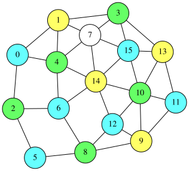
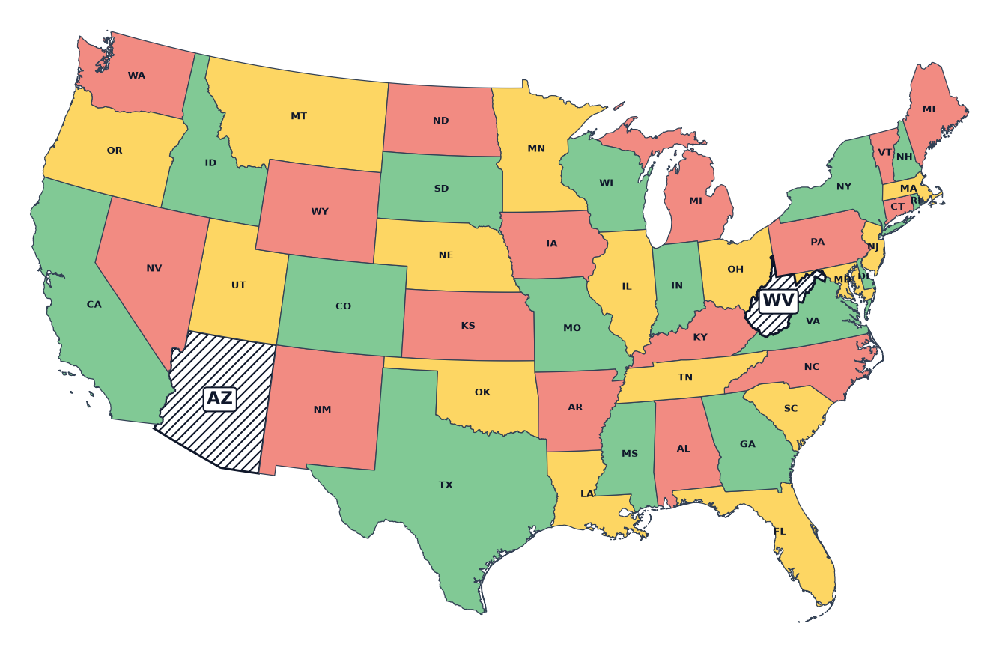
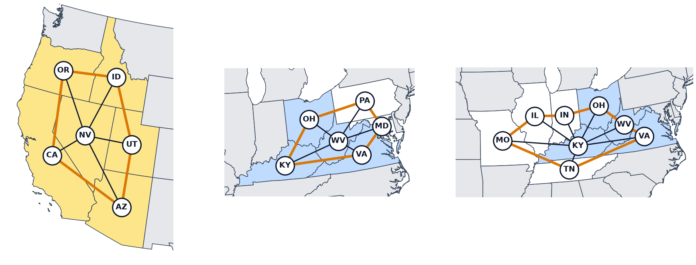

# 3 彩色可能頂点削除問題
無向グラフ $G=(V,E)$ が与えられたとき、**3 彩色可能頂点削除問題**は、できるだけ少ないノードを削除して、残りのグラフを 3 色で彩色できるようにする問題です。
グラフがもともと 3 色で彩色できれば、削除するノードは 0 個です。
削除するノードの最小数は、グラフが 3 色の彩色からどれだけ離れているかを表します。

[グラフ彩色問題](GRAPH_COLOR)の 16 ノードのグラフは、3 色では彩色できません。
このページでは、まずこのグラフで削除するノードの最小数を求めます。
次に、アメリカ本土の 48 州の地図で、何州を除けば残りの州を 3 色で塗り分けられるかを求めます。



動画では、アメリカ本土の 48 州で除く州の最小数を求め、除く 2 州の全 24 組と、その理由を説明します。動画のプログラムと章ごとの説明は[動画：アメリカ 48 州を 3 色で塗り分ける](python/VIDEO_3COLOR_DELETION)のページにあります。

## 定式化
$V=\lbrace 0,1,\ldots ,n−1\rbrace$ とし、3 つの色を $0, 1, 2$ とします。
$n\times 3$ のバイナリ変数行列 $X=(x_{i,j})$ を導入し、$x_{i,j}=1$ はノード $i$ を色 $j$ で塗ることを表します。
行がすべて 0 のノードは色を塗らないノードで、これが削除するノードです。

### 色は高々 1 つ
各ノードは、1 つの色で塗るか、塗らないかのどちらかです。
そのため、各行の 1 は高々 1 個でなければなりません。
行 $i$ の 1 の個数を $s_i=\sum_{j=0}^{2}x_{i,j}$ とすると、これは範囲制約 $0\leq s_i\leq 1$ です。
範囲の幅が 1 なので、QUBO++ はこれを補助変数のない次のペナルティにします（[比較演算子](COMPARISON)の場合 2）：

$$
\begin{aligned}
\text{atmostone} &= \sum_{i=0}^{n-1}\Bigl(0\leq\sum_{j=0}^{2}x_{i,j}\leq 1\Bigr)\\
 &= \sum_{i=0}^{n-1}s_i(s_i-1)
\end{aligned}
$$

$s_i(s_i-1)$ は、$s_i=0, 1$ のとき 0、$s_i=2$ のとき 2、$s_i=3$ のとき 6 です。

この制約は `qbpp::cons()` で宣言することもできますが、ここではペナルティ式のまま使います。
`qbpp::cons()` が役立つのは、ペナルティ式にすると補助変数が要る制約です（[非線形関数とネイティブ制約](CONSTRAINTS)の「ペナルティ式との比較」）。
この制約は補助変数が要らず、$s_i$ が 3 変数の和なので、展開しても $s_i(s_i-1)=2(x_{i,0}x_{i,1}+x_{i,0}x_{i,2}+x_{i,1}x_{i,2})$ という 2 次の項 3 つの小さな式です。
`qbpp::cons()` で小さな制約を $n$ 個作るより、展開して 1 つの QUBO 式にまとめたほうが、GPU での並列計算に向いています。

### 隣接ノードは異なる色
辺の両端のノードを、同じ色で塗ってはいけません：

$$
\text{different} = \sum_{(u,v)\in E}\sum_{j=0}^{2}x_{u,j}x_{v,j}
$$

これは[グラフ彩色問題](GRAPH_COLOR)と同じ式です。
塗らないノードの行はすべて 0 なので、そのノードにつながる辺の項はすべて 0 になります。

### 塗るノードの数
これらの制約を守って、色を塗るノードの数を最大にします。
各行の 1 は高々 1 個なので、塗るノードの数は 1 の個数です：

$$
\text{colored} = \sum_{i=0}^{n-1}\sum_{j=0}^{2}x_{i,j}
$$

削除するノードの数は $n-\text{colored}$ なので、塗るノードの数を最大にすることは、削除するノードの数を最小にすることです。

## QUBO 目的関数
colored を最大にするので、符号を反転して、次の QUBO 式を最小化します：

$$
f = -\text{colored} + 2\,(\text{atmostone} + \text{different})
$$

制約を優先するため、ペナルティを 2 倍しています。
制約を破っている解で、1 が 2 個以上ある行か、同じ色で隣り合う 2 ノードの一方の行の 1 を 1 つ 0 にすると、colored は 1 減りますが、ペナルティは 2 以上減ります。
そのため、制約を破った解が $f$ の最小になることはなく、$f$ の最小値は塗るノードの最大数の符号を反転した値になります。
重みは 1 より大きければ十分です。

この定式化は、各ノードを色ごとに 3 つに分けた新しいグラフでの[最大独立集合問題](GRAPH)と同じ形です。
新しいグラフでは、同じノードの 3 つを互いに結び、元のグラフの辺 $(u,v)$ ごとに $u$ と $v$ の同じ色どうしを結びます。
塗るノードを最大にすることは、新しいグラフの独立集合を最大にすることです。

## QUBO++ プログラム
[グラフ彩色問題](GRAPH_COLOR)と同じ 16 ノードのグラフで、削除するノードの最小数を求めます：

```cpp
#include <qbpp/qbpp.hpp>
#include <qbpp/easy_solver.hpp>
#include <qbpp/graph.hpp>

int main() {
  const size_t n = 16;
  std::vector<std::pair<size_t, size_t>> edges = {
      {0, 1},   {0, 2},   {0, 4},   {1, 3},   {1, 4},   {1, 7},   {2, 5},
      {2, 6},   {3, 7},   {3, 13},  {3, 15},  {4, 6},   {4, 7},   {4, 14},
      {5, 8},   {6, 8},   {6, 14},  {7, 14},  {7, 15},  {8, 9},   {8, 12},
      {9, 10},  {9, 11},  {9, 12},  {10, 11}, {10, 12}, {10, 13}, {10, 14},
      {10, 15}, {11, 13}, {12, 14}, {13, 15}, {14, 15}};
  const size_t m = 3;

  auto x = qbpp::var("x", n, m);

  auto atmostone = qbpp::sum(0 <= qbpp::vector_sum(x) <= 1);
  auto different = qbpp::toExpr(0);
  for (const auto& e : edges) {
    different += qbpp::sum(x(e.first) * x(e.second));
  }
  auto colored = qbpp::sum(x);

  auto f = -colored + 2 * (atmostone + different);

  f.simplify_as_binary();
  auto solver = qbpp::EasySolver(f);
  auto sol = solver.search({{"time_limit", 1.0}});

  std::cout << "colored = " << sol(colored) << std::endl;
  std::cout << "atmostone = " << sol(atmostone) << std::endl;
  std::cout << "different = " << sol(different) << std::endl;

  auto node_color = qbpp::onehot_to_int(sol(x));
  std::cout << "deleted nodes:";
  for (size_t i = 0; i < n; ++i) {
    if (node_color[i] == -1) std::cout << " " << i;
  }
  std::cout << std::endl;

  qbpp::graph::GraphDrawer graph;
  for (size_t i = 0; i < n; ++i) {
    graph.add_node(qbpp::graph::Node(i).color(node_color[i] + 1));
  }
  for (const auto& e : edges) {
    graph.add_edge(qbpp::graph::Edge(e.first, e.second));
  }

  graph.write("3color_deletion.svg");
}
```

`qbpp::vector_sum(x)` は各行の和の配列です。
各行の範囲制約の配列 `0 <= qbpp::vector_sum(x) <= 1` を `qbpp::sum()` で足すと `atmostone` になります。
`different` は[グラフ彩色問題](GRAPH_COLOR)と同じです。
`qbpp::sum(x)` は `x` のすべての要素の和で、`colored` になります。
最小値は分からないので、目標エネルギーは指定せず、Easy Solver で 1 秒探索します。

`qbpp::onehot_to_int()` は、行がワンホットでないとき $-1$ を返すので、削除したノードの値は $-1$ になります。
その番号を出力し、`qbpp::graph::GraphDrawer` で各ノードを色番号 `node_color[i] + 1` で描画します。
削除したノードは色 0（白）で描かれます。

このプログラムの出力は次のとおりです：
```
colored = 15
atmostone = 0
different = 0
deleted nodes: 7
```
16 ノードのうち 15 ノードを 3 色で塗れます。
つまり、ノードを 1 つ削除すれば、残りは 3 色で彩色できます。
総当たりで調べると、1 つの削除で 3 色の彩色ができるのは、ノード 7・14・15 のどれかを削除したときだけです。
どれを削除する解が得られるかは、実行ごとに変わります。

<p align="center">
  
</p>

## アメリカ本土 48 州
[動画：地図の塗り分け](python/VIDEO_MAP_COLORING)では、アメリカ本土の 48 州が 4 色で塗り分けられ、3 色では塗り分けられないことを確かめました。
ここでは、何州を除けば残りの州を 3 色で塗り分けられるかを求めます。
州をノードとし、境界線を共有する 2 州を辺で結んだ、48 ノード・105 辺のグラフです（点で接するだけの組は辺にしません）。

次のプログラムは、州の名前と辺を直接書いています。
辺は州の番号の組で、州の番号は `names` の位置です（たとえば `{1, 25}` はアリゾナとネバダ）。
式は 16 ノードのグラフと同じです。
ABS3 Solver で 10 秒探索し、`best_energy_sols` を 0 にして、最良と同じエネルギーの解をすべて保持します。
保持した解ごとに、削除した州の名前の組を作り、組ごとに解の数を数えます。

```cpp
#include <map>
#include <qbpp/qbpp.hpp>
#include <qbpp/abs3_solver.hpp>

int main() {
  const std::vector<std::string> names = {
      "Alabama", "Arizona", "Arkansas", "California",
      "Colorado", "Connecticut", "Delaware", "Florida",
      "Georgia", "Idaho", "Illinois", "Indiana",
      "Iowa", "Kansas", "Kentucky", "Louisiana",
      "Maine", "Maryland", "Massachusetts", "Michigan",
      "Minnesota", "Mississippi", "Missouri", "Montana",
      "Nebraska", "Nevada", "New Hampshire", "New Jersey",
      "New Mexico", "New York", "North Carolina", "North Dakota",
      "Ohio", "Oklahoma", "Oregon", "Pennsylvania",
      "Rhode Island", "South Carolina", "South Dakota", "Tennessee",
      "Texas", "Utah", "Vermont", "Virginia",
      "Washington", "West Virginia", "Wisconsin", "Wyoming"};
  const std::vector<std::pair<size_t, size_t>> edges = {
      {0, 7}, {0, 8}, {0, 21}, {0, 39}, {1, 3}, {1, 25}, {1, 28}, {1, 41},
      {2, 15}, {2, 21}, {2, 22}, {2, 33}, {2, 39}, {2, 40}, {3, 25}, {3, 34},
      {4, 13}, {4, 24}, {4, 28}, {4, 33}, {4, 41}, {4, 47}, {5, 18}, {5, 29},
      {5, 36}, {6, 17}, {6, 35}, {7, 8}, {8, 30}, {8, 37}, {8, 39}, {9, 23},
      {9, 25}, {9, 34}, {9, 41}, {9, 44}, {9, 47}, {10, 11}, {10, 12}, {10, 14},
      {10, 22}, {10, 46}, {11, 14}, {11, 19}, {11, 32}, {12, 20}, {12, 22},
      {12, 24}, {12, 38}, {12, 46}, {13, 22}, {13, 24}, {13, 33}, {14, 22},
      {14, 32}, {14, 39}, {14, 43}, {14, 45}, {15, 21}, {15, 40}, {16, 26},
      {17, 35}, {17, 43}, {17, 45}, {18, 26}, {18, 29}, {18, 36}, {18, 42},
      {19, 32}, {19, 46}, {20, 31}, {20, 38}, {20, 46}, {21, 39}, {22, 24},
      {22, 33}, {22, 39}, {23, 31}, {23, 38}, {23, 47}, {24, 38}, {24, 47},
      {25, 34}, {25, 41}, {26, 42}, {27, 29}, {27, 35}, {28, 33}, {28, 40},
      {29, 35}, {29, 42}, {30, 37}, {30, 39}, {30, 43}, {31, 38}, {32, 35},
      {32, 45}, {33, 40}, {34, 44}, {35, 45}, {38, 47}, {39, 43}, {41, 47},
      {43, 45}, {6, 27}};
  const size_t n = names.size();
  const size_t m = 3;

  auto x = qbpp::var("x", n, m);

  auto atmostone = qbpp::sum(0 <= qbpp::vector_sum(x) <= 1);
  auto different = qbpp::toExpr(0);
  for (const auto& e : edges) {
    different += qbpp::sum(x(e.first) * x(e.second));
  }
  auto colored = qbpp::sum(x);

  auto f = -colored + 2 * (atmostone + different);

  f.simplify_as_binary();
  auto solver = qbpp::ABS3Solver(f);
  auto sol = solver.search({{"time_limit", 10.0}, {"best_energy_sols", 0}});

  std::cout << "colored = " << sol(colored) << std::endl;

  std::map<std::vector<std::string>, int> sets;
  for (const auto& s : sol) {
    auto node_color = qbpp::onehot_to_int(s(x));
    std::vector<std::string> key;
    for (size_t i = 0; i < n; ++i) {
      if (node_color[i] == -1) key.push_back(names[i]);
    }
    ++sets[key];
  }
  std::cout << "solutions = " << sol.size()
            << ", deletion sets = " << sets.size() << std::endl;
  for (const auto& [key, count] : sets) {
    for (size_t k = 0; k < key.size(); ++k) {
      std::cout << (k == 0 ? "" : " + ") << key[k];
    }
    std::cout << ": " << count << std::endl;
  }
}
```

このプログラムの出力は次のとおりです：
```
colored = 46
solutions = 1728, deletion sets = 24
Arizona + Kentucky: 48
Arizona + Ohio: 48
Arizona + Virginia: 24
Arizona + West Virginia: 72
California + Kentucky: 48
California + Ohio: 48
California + Virginia: 24
California + West Virginia: 72
Idaho + Kentucky: 96
Idaho + Ohio: 96
Idaho + Virginia: 48
Idaho + West Virginia: 144
Kentucky + Nevada: 96
Kentucky + Oregon: 96
Kentucky + Utah: 48
Nevada + Ohio: 96
Nevada + Virginia: 48
Nevada + West Virginia: 144
Ohio + Oregon: 96
Ohio + Utah: 48
Oregon + Virginia: 48
Oregon + West Virginia: 144
Utah + Virginia: 24
Utah + West Virginia: 72
```
塗れる州の最大数は 46、つまり削除する州の最小数は 2 で、削除する 2 州の組は 24 組あります。
残りの 46 州の塗り方は組ごとに複数あり（色の入れ替えだけでも 6 通り）、保持された解は全部で 1728 個です。
この出力は GPU を使ったときのものです。
GPU を使わないと 10 秒で保持できる解は少なくなります（20 コアの CPU で 135 個）が、この例では 24 組はすべて得られました。

Easy Solver でも最小の 2 州はすぐに見つかります。
ただし Easy Solver は最良解の近くを重点的に探すので、離れたところにある同じエネルギーの解はあまり集まりません（10 秒で 13 個の解、10 組）。
最良と同じエネルギーの解を広く集めるには、ABS3 Solver が向いています。

次の地図は、アリゾナとウェストバージニアを削除した解です。
削除した 2 州を斜線で示し、残りの 46 州を 3 色で塗っています。

<p align="center">
  
</p>

### なぜ 2 州で、なぜ 24 組か
真ん中の州を、隣の州が奇数個の輪のように囲んでいると、その部分は 3 色では塗れません。
輪を 3 色で塗るとき、奇数個の輪では 3 色すべてを使うので、輪のすべての州と隣り合う真ん中の州には 4 色目が要ります。
輪の州か真ん中の州のどれか 1 つを削除すれば、この形はなくなります。

48 州には、この形が 3 つあります。

- ネバダを、カリフォルニア・オレゴン・アイダホ・ユタ・アリゾナの 5 州が囲む
- ウェストバージニアを、オハイオ・ペンシルベニア・メリーランド・バージニア・ケンタッキーの 5 州が囲む
- ケンタッキーを、イリノイ・インディアナ・オハイオ・ウェストバージニア・バージニア・テネシー・ミズーリの 7 州が囲む

<p align="center">
  
</p>

西のネバダの形と東の 2 つの形は州を共有しないので、少なくとも 2 州は削除しなければなりません。
西では、ネバダと、それを囲む 5 州（図の黄色）のどれか 1 州を削除します。
東では、2 つの形の両方に入っているケンタッキー・ウェストバージニア・オハイオ・バージニア（図の青）のどれか 1 州を削除すれば、両方の形がなくなります。
西の 6 州から 1 州、東の 4 州から 1 州を選ぶので $6\times 4=24$ 組で、出力の 24 組はちょうどこの組み合わせです。
