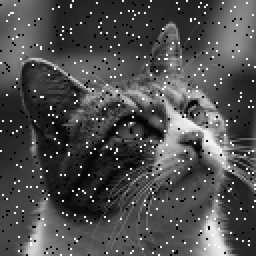
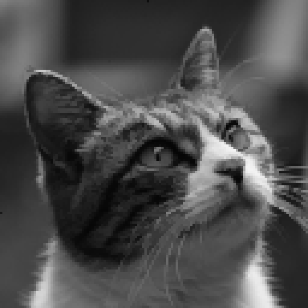
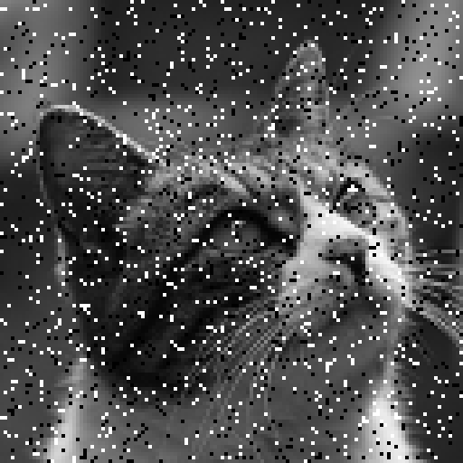
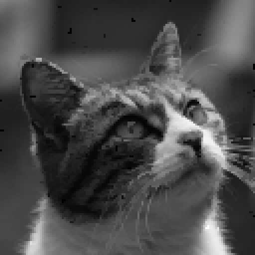

# 画像のノイズ除去

画素の一部が白（255）や黒（0）に置き換わってしまうノイズを**ごま塩ノイズ**（salt-and-pepper noise）といいます。
このページでは、ごま塩ノイズを加えた写真から元の画像を復元します。
各画素の明るさを 0〜255 の[整数変数](INTEGER)で表し、
「ノイズ画像に近く、隣り合う画素どうしの差が小さい」画像を求める最適化問題として解きます。

<p align="center">
  
  
</p>

左が元の画像（$128 \times 128$ 画素）、右はその画素の 5%（20 画素に 1 個）をランダムに白か黒に置き換えた画像です。

## 定式化

ノイズ画像の画素 $(i,j)$ の値を $y_{ij}$、復元する画像の画素値を整数変数 $x_{ij} \in \lbrace 0, 1, \ldots, 255 \rbrace$ とします。
最小化する目的関数は次のとおりです:

$$
E(x) = A \sum_{i,j} \min\bigl(|x_{ij} - y_{ij}|,\ D\bigr) + \lambda \sum_{\text{隣接する } (i,j),\,(k,l)} |x_{ij} - x_{kl}|
$$

- **第 1 項（データ項）** は、復元画像がノイズ画像から離れるほど大きくなります。ただし、ずれが $D$ を超えると $AD$ で頭打ちになります。
  ごま塩ノイズの画素は元の値から大きくずれているので、元の値に戻しても罰金は $AD$ で済みます。つまり、大きくずれた画素は「外れ値」として扱われます。
- **第 2 項（平滑化項）** は、上下左右に隣り合う画素の差の絶対値の和です。差の 2 乗と違って大きな差を過大に罰しないので、明るさが急に変わる輪郭をぼかさずに残せます。

以下では $A=3$、$D=60$、$\lambda=1$ とします。重みの比は、ノイズの点を消し、細い線を残すように選んでいます:

- 周りと値の違う 1 画素だけの点は、上下左右の 4 画素から引っ張られます。値を周りに $\delta$ 近づけると、データ項は高々 $A\delta = 3\delta$ 増えますが、平滑化項は $4\lambda\delta = 4\delta$ 減るので、点は周りの値になじんで消えます。
- 幅 1 画素の線（猫のヒゲなど）は、線ごと周りに $\delta$ 近づけても、平滑化項の減りは 1 画素あたり $2\lambda\delta = 2\delta$ で、データ項の増え $3\delta$ に届きません。そのため線は残ります。

### $\min$ を QUBO++ の式で書く

$\min(\lvert r \rvert, D)$ は `qbpp::min(qbpp::abs(r), D)` と書くのが自然ですが、
[非線形関数](CONSTRAINTS)（`abs`・`relu`・`max`・`min`）の中にさらに非線形関数を入れる（ネストする）ことはできず、
実行するとエラーになります（[式の演算規則](CONSTRAINTS#式の演算規則)を参照）。
そこで、`qbpp::abs`（絶対値）と `qbpp::relu`（$\max(0, \cdot)$）を足し引きした次の形で書きます:

$$
\min(|r|, D) = |r| - \mathrm{relu}(r - D) - \mathrm{relu}(-r - D)
$$

実際、$\lvert r \rvert \le D$ なら relu はどちらも 0 で、$r > D$ なら $r - (r - D) = D$、$r < -D$ なら $-r - (-r - D) = D$ になります。

データ項に上限を付けたので、この目的関数は凸関数ではありません（非凸）。
非凸な目的関数は一般に最小化が難しく、凸関数向けの効率のよい解法は使えません。
QUBO++ では、整数変数と `qbpp::abs` / `qbpp::relu` で書いた式をそのままソルバーに渡せます。

## QUBO++ プログラム

入力のノイズ画像 [denoise_noisy.pgm](../images/denoise_noisy.pgm)（PGM 形式、$128 \times 128$ 画素）を、実行するディレクトリに置いて実行します:


```cpp
#include <qbpp/qbpp.hpp>
#include <qbpp/abs3_solver.hpp>

#include <fstream>
#include <string>
#include <vector>

int main() {
  const int A = 3, D = 60, LAM = 1;  // データ項の重み、ずれの上限、平滑化項の重み

  // ノイズ画像を読み込む（PGM 形式、画素値 0〜255）
  std::ifstream ifs("denoise_noisy.pgm");
  std::string magic;
  int W, H, maxval;
  ifs >> magic >> W >> H >> maxval;
  std::vector<std::vector<int>> y(H, std::vector<int>(W));
  for (auto& row : y)
    for (auto& v : row) ifs >> v;

  // 各画素の値を表す整数変数
  auto x = 0 <= qbpp::int_var("x", H, W) <= 255;

  auto f = qbpp::toExpr(0);
  for (int i = 0; i < H; ++i)
    for (int j = 0; j < W; ++j) {
      // データ項: A * min(|x - y|, D)
      auto r = x[i][j] - y[i][j];
      f += A * (qbpp::abs(r) - qbpp::relu(r - D) - qbpp::relu(-r - D));
      // 平滑化項: 右隣と下隣との差の絶対値
      if (j + 1 < W) f += LAM * qbpp::abs(x[i][j] - x[i][j + 1]);
      if (i + 1 < H) f += LAM * qbpp::abs(x[i][j] - x[i + 1][j]);
    }
  f.simplify();

  auto sol = qbpp::ABS3Solver(f).search({{"time_limit", 10}});
  std::cout << "energy = " << sol.energy() << std::endl;

  // 結果を PGM 形式で保存
  std::ofstream ofs("denoise_out.pgm");
  ofs << "P2\n" << W << " " << H << "\n255\n";
  for (int i = 0; i < H; ++i) {
    for (int j = 0; j < W; ++j) ofs << sol(x[i][j]) << " ";
    ofs << "\n";
  }
}
```


- `0 <= qbpp::int_var("x", H, W) <= 255` で、画素ごとに 0〜255 の整数変数を作ります（$16{,}384$ 個）。
- データ項は上の式のとおり `qbpp::abs` と `qbpp::relu` で書きます。`r` は整数変数から定数を引いた式です。
- 平滑化項は、各画素と右隣・下隣の画素との差の絶対値を足して作ります。
- `ABS3Solver` で 10 秒探索し、結果を PGM 形式の画像ファイル `denoise_out.pgm` に保存します。

### 出力結果

プログラムの出力は、例えば次のようになります:

```
energy = 415120
```

`ABS3Solver` は乱択的なので、エネルギーの値は実行ごとに変わります。
式の構築は 1 秒ほどで、残りの 10 秒が探索です。

入力のノイズ画像（左）と復元した画像（右）:

<p align="center">
  
  
</p>

ノイズの点はほぼ消え、目の中や毛並み、ヒゲまで元の画像に近く戻っています。

### ノイズの量を変える

同じプログラムで、ノイズの割合を 2%（上）と 10%（下）にした結果です（左が入力、右が復元した画像）:

<p align="center">
  
  
</p>
<p align="center">
  
  
</p>

2% ではほぼ元の画像どおりに戻ります。
10% でも目の中や毛並みまで戻り、残る点はわずかです。
