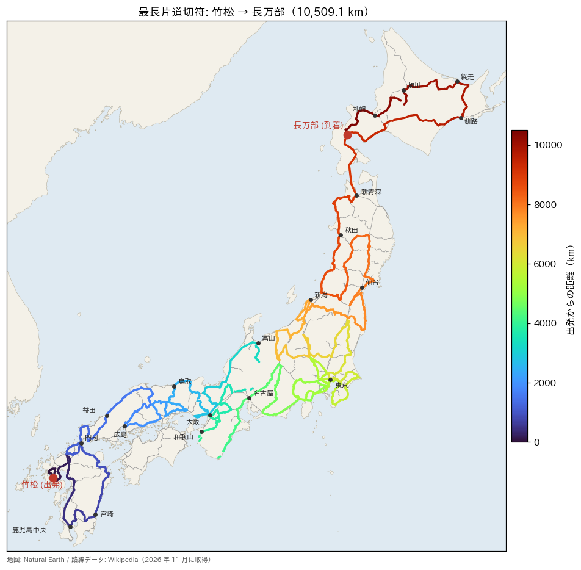

# 最長片道切符
**最長片道切符**は、JR の片道乗車券 1 枚で乗れる、最も長い経路の切符です。
片道乗車券では、同じ区間を 2 度通れず、同じ駅も 2 度通れません。
ただし、最後の駅だけは、それまでに通った駅でもかまいません。
そのため、経路の形は次の 3 つの型のどれかになります：
- **L 型**: 同じ駅を通らない一本道
- **O 型**: 出発した駅に戻って終わる環状の経路
- **P 型**: 途中で通った駅に戻って終わる経路（一本道の先に環状の部分が付いた形）

このうち O 型は、最長になりません。
O 型が最長になりうるのは、輪がすべての駅を通る場合だけです。輪の上にない駅が 1 つでもあれば、路線網はつながっているので、輪の駅と隣り合う、輪の上にない駅があります。輪の駅からその駅へ 1 区間延ばし、その駅から出発して輪を 1 周する P 型の経路は、O 型より長くなります。
JR の路線網には、すべての駅を通る輪はないので、O 型は最長になりません。そこで、L 型と P 型の中で最も長い経路を求めます。



動画では、路線網をグラフにして区間をまとめ、変数と制約、離れた閉路を除く方法を説明し、プログラムで解いた経路を地図で出発から順にたどります。動画のプログラムと章ごとの説明は[動画：最長片道切符](python/VIDEO_LONGEST_TICKET)のページにあります。

参考にしたもの：
- 宮代隆平・葛西隆也「最長片道切符」『オペレーションズ・リサーチ』2004 年 1 月号、49 巻 1 号、pp.15–20（L・O・P 型の名前はこの文献による）
- 鵺「[最長片道切符の流儀とバリエーション](https://nue2004.info/railway/lop/)」

## データ
[jr_network.csv](../images/jr_network.csv) は、JR の路線網を、駅を頂点、駅と駅を結ぶ区間を辺とするグラフにしたものです。
2026 年 11 月に、Wikipedia の各路線の記事（[CC BY-SA 4.0](https://creativecommons.org/licenses/by-sa/4.0/)）と JR の旅客営業規則を独自に取得して作りました。
980 駅と 1,110 区間があり、1 行が 1 つの区間です：
```
線名,駅1,駅2,営業キロ,運賃計算キロ,端,組,規則
関西本線,JR難波,今宮,1.3,1.30,0,,
可部線,あき亀山,横川 (広島県),15.6,17.16,0,,
常磐線,いわき,水戸,94.1,94.10,0,1,
常磐線,いわき,勝田,88.3,88.30,1,1,
常磐線,水戸,内郷,89.7,89.70,1,1,
東北新幹線,くりこま高原,古川,21.2,21.20,0,,-規16-2_2_(8)
...
```
営業キロと運賃計算キロの単位は km で、運賃計算キロは地方交通線の営業キロを 1.1 倍した値です（端数の処理はしていません）。
次のように作りました：
- JR の鉄道の路線だけを含めます。BRT や、JR から移管された第三セクターの路線は含めません。運休中の区間は含めます。
- 途中で枝分かれしない駅の並びは、まとめて 1 つの区間にします（規則の付いた区間はまとめません）。高崎線の新町・倉賀野間の北藤岡駅は八高線だけの駅なので、高崎線はこの駅で分けません。
- 経路は、区間の途中の駅で終わることもあります。たとえば大村線の新大村・早岐間を 1 本の区間にまとめると、新大村を経路のほかのところで通り、早岐から大村線に入って竹松で終わる経路が作れません。途中の駅で終わる経路は、隣の分岐駅の手前の駅（この例では竹松とハウステンボス）で終わるものだけを考えれば十分です（その先の駅まで行く方が長いからです）。そこで、まとめた区間 u−v ごとに、u から v の手前の駅までの区間と、v から u の手前の駅までの区間を加えます。この区間を**端の区間**と呼び、`端` の列が 1 です。駅2 で経路が終わります。
- 行き止まりの線（米子・境港間の境線など）には、端の区間を加えません。この線の駅は分岐駅を通らないとほかの路線とつながらないので、途中の駅で終わる経路は、終点まで行くほうが長くなります。
- 途中の駅が 1 つだけの並び（東海道本線の三島・函南・熱海など）は、まとめずに 2 本の区間のままにします。
- まとめた区間と、その端の区間 2 本は、同じ区間の駅を通るので、同時には 1 本しか使えません。`組` の列が同じ区間は、高々 1 本しか使えないことを表します。
- 新幹線は、旅客営業規則の第 16 条の 2 第 1 項と第 16 条の 3 で在来線と同じ線路とみなす区間には含めません（東京・熱海間も同じ扱いとしました）。第 16 条の 2 第 2 項の区間では、新幹線を含め、次の規則を付けます（品川・小田原間も同じ扱いとしました）。
- `規則` の列の `+g` と `-g` は、「`-g` の区間を全部使うなら、`+g` の区間を 1 本以上使う」ことを表します。第 16 条の 2 第 2 項（新幹線の区間を全部使うなら、同じ区間の在来線にも乗る）と、第 69 条（経路特定区間）をこの形で表します。大都市近郊区間や東京付近の運賃計算の特例（第 70 条など）は考えず、どの区間でも、実際にたどる経路の営業キロで距離を計算します。

## 定式化
区間 $e$ ごとにバイナリ変数 $x_e$ を導入し、$x_e=1$ はその区間を使うことを表します。
駅 $v$ で使う区間の本数を $\text{used}_v=\sum_{e\ni v}x_e$ とします（$e\ni v$ は駅 $v$ につながる区間 $e$ です）。
片道切符の経路では、駅で使う区間の本数は、通らない駅で 0、途中の駅で 2、経路の端の駅で 1、P 型で戻ってくる駅（**合流点**）で 3 です。
この本数を駅の**次数** $\deg_v$ として、駅の種類ごとに変数で表します。
駅は、つながる区間の本数（**接続数**）で次の 3 種類に分かれます：
- **分岐駅**（接続数 3 以上）: バイナリ変数 $s_v$（駅を通る）、$a_v$（経路の端）、$b_v$（合流点）を導入し、$\deg_v=2s_v-a_v+b_v$ とします。
- **中間駅**（接続数 2）: 使う区間は 2 本以下で合流点にならないので、$b_v=0$ として $\deg_v=2s_v-a_v$ とします。
- **葉駅**（接続数 1。行き止まりの線の終点と、端の区間の終わりの駅）: 使う区間は 0 本か 1 本なので変数を置かず、$\deg_v=x_e$（$e$ はつながる 1 本の区間）とします。

葉駅以外の駅には、次の制約を課します（葉駅では $\text{used}_v=\deg_v=x_e$ が常に成り立つので、制約は要りません）：

$$
\text{used}_v=\deg_v,\qquad a_v+b_v\le s_v\qquad(\text{葉駅以外の駅 } v)
$$

葉駅の集合を $T$ とすると、経路の端の個数は $\sum_{v\notin T}a_v+\sum_{v\in T}\deg_v$、合流点の個数は $\sum_{v\notin T}b_v$ です。
端と合流点の個数は、L 型で (2, 0)、P 型で (1, 1) なので、次の制約で 2 つの型をまとめて表せます：

$$
\sum_{v\notin T}a_v+\sum_{v\in T}\deg_v+\sum_{v\notin T}b_v = 2,\qquad \sum_{v\notin T}b_v \le 1
$$

データの組と規則から、次の制約も課します：

$$
\sum_{e\in G}x_e \le 1\quad(\text{各組 } G),\qquad
\sum_{e\in +g}x_e-\sum_{e\in -g}x_e \ge 1-k_g\quad(\text{各規則 } g)
$$

$k_g$ は `-g` の区間の本数です。
`-g` の区間を全部使うと $\sum_{e\in -g}x_e=k_g$ なので、`+g` の区間を 1 本以上使う必要があります。

目的関数は、使う区間の営業キロ $d_e$ の和を最大にするので、符号を反転して制約を重み $P$ で加えます：

$$
f = -\sum_e d_ex_e + P\cdot(\text{制約})
$$

制約は `qbpp::cons()` で宣言し、$P$ は全区間の営業キロの和に 1 を加えた値にします。
制約を満たす解のエネルギーは 0 以下で、制約を破る解のエネルギーは正になるので、制約を破った解が $f$ の最小になることはありません。

## 離れた閉路を除く
上の制約だけでは、経路のほかに、経路とつながらない閉路（**離れた閉路**）が解に混ざることがあります。
離れた閉路の駅も次数が 2 なので、制約をすべて満たします。
QUBO++ の構造制約 `cycle()` を使うと、経路が 1 本につながっているという条件を直接書けます。その方法は[最後の節](#構造制約-cycle-で経路を表す)で説明します。
[最多空港めぐり](LONGEST_FLIGHT)と同じように、解いた結果を見て制約を加えることを繰り返します：

1. 制約を加えた $f$ を解く。
2. 解の区間を、つながった部分（成分）に分ける。成分が 1 つなら、それが経路。
3. 成分が 2 つ以上なら、離れた閉路（次数がすべて 2 の成分）$C$ ごとに制約を加えて、1 に戻る。

閉路 $C$ に加える制約は次のとおりです。
他の成分の駅を通らずに $C$ から行ける駅の集合を $S$ とし、両端が $S$ の駅である区間の営業キロの和を $w(S)$ とします。
$w(S)$ がこれまでに見つかった最良の経路の距離以下なら、$S$ の駅 $u$ ごとに次の制約を加えます：

$$
\text{visit}(u) \le \text{out}(S)\qquad(u\in S)
$$

$\text{visit}(u)$ は駅 $u$ を通ることを表す式（$s_u$ か、葉駅なら $x_e$）、$\text{out}(S)$ は $S$ の駅と $S$ の外の駅を結ぶ区間の変数の和です。
この制約は、「$S$ の駅を通るなら、$S$ の外とつながる区間を使う」ことを表し、$S$ の中で閉じた区間の選び方をすべて除きます。
$S$ の中だけで閉じた経路は $w(S)$ より長くなれず、これまでの最良の経路を超えないので、答えを除いてしまうことはありません。
$w(S)$ が最良の経路の距離より大きいときは、$S$ の中に最良より長い経路があるかもしれないので、$S$ の中をまとめて禁じると答えを除くおそれがあります。そこで、閉路 $C$ だけを禁じます。
$C$ の駅と $C$ の外の駅を結ぶ区間（$C$ の駅から外へ出る区間）の集合を $\delta(C)$、$C$ の区間の数を $\lvert C\rvert$ として、「同じ閉路 $C$ がもう一度現れるなら、$\delta(C)$ の区間を 1 本以上使う」という制約を加えます：

$$
\sum_{e\in C}x_e=\lvert C\rvert\ \Rightarrow\ \sum_{e\in\delta(C)}x_e\ge 1
$$

これを 1 本の不等式で書いたものが次の式です（$C$ の区間を 1 本でも使わなければ、何も制限しません）：

$$
\sum_{e\in C}x_e-\sum_{e\in\delta(C)}x_e\le \lvert C\rvert-1
$$

離れた閉路は外へ出る区間を使わないので、この制約に違反します。
一方、$C$ を P 型の輪として使う経路は、合流点から外へ出る区間を使うので、この制約を満たします。外へ出る区間を引くのは、このような経路を残すためです。

解の成分のうち端（次数 1 の駅）のあるものは、それだけで L 型か P 型の経路になりえます。
そこで、毎回の解の成分のうち、端があり規則を満たすものを経路の候補とし、最良の経路を記録します。
最良の経路は、次の回の[ヒント解](ABS3#solution-hint)として渡します。
ソルバーは時間を区切って探索するので、成分が 1 つになっても最良とは限りません。
そこで、成分が 1 つの解で最良の経路が 5 回続けて伸びなくなったら終わります。

## QUBO++ プログラム
[jr_network.csv](../images/jr_network.csv) を、実行するディレクトリに置いて実行します：

```cpp
#include <algorithm>
#include <fstream>
#include <iomanip>
#include <iostream>
#include <map>
#include <sstream>
#include <string>
#include <vector>
#include <qbpp/qbpp.hpp>
#include <qbpp/abs3_solver.hpp>

struct Section {
  std::string line;
  int u, v, km;      // 駅 u, v を結ぶ区間、営業キロ（0.1 km 単位）
  double fare;       // 運賃計算キロ
  bool tail;         // 端の区間（駅 v で経路が終わる）
  std::string group;  // 同じ組の区間は高々 1 本
  std::vector<std::string> rules;
};

std::vector<std::string> stations;
std::vector<Section> sections;
std::vector<std::vector<int>> incident;  // 駅に接する区間の番号

int station(const std::string& name) {
  static std::map<std::string, int> index;
  auto [it, added] = index.emplace(name, stations.size());
  if (added) {
    stations.push_back(name);
    incident.emplace_back();
  }
  return it->second;
}

std::vector<std::string> split(const std::string& s, char sep) {
  std::vector<std::string> fields;
  std::stringstream ss(s);
  for (std::string f; std::getline(ss, f, sep);) fields.push_back(f);
  return fields;
}

std::map<std::string, int> minus_count;  // 規則 g の -g の区間の本数

// 規則 "+g" / "-g": -g の区間を全部使うなら、+g の区間を 1 本以上使う
// used[e] が区間 e を使うかどうかのとき、規則を満たすかどうか
bool rules_ok(const std::vector<bool>& used) {
  std::map<std::string, int> plus, minus;
  for (size_t e = 0; e < sections.size(); ++e)
    if (used[e])
      for (const auto& r : sections[e].rules) ++(r[0] == '+' ? plus : minus)[r.substr(1)];
  for (const auto& [g, k] : minus_count)
    if (minus[g] == k && plus[g] == 0) return false;
  return true;
}

int main() {
  std::ifstream ifs("jr_network.csv");
  std::string line;
  std::getline(ifs, line);  // 見出しの行
  while (std::getline(ifs, line)) {
    auto f = split(line, ',');
    f.resize(8);
    Section s{f[0], station(f[1]), station(f[2]), static_cast<int>(std::stod(f[3]) * 10 + 0.5),
              std::stod(f[4]), f[5] == "1", f[6], split(f[7], ' ')};
    for (const auto& r : s.rules)
      if (r[0] == '-') ++minus_count[r.substr(1)];
    incident[s.u].push_back(sections.size());
    incident[s.v].push_back(sections.size());
    sections.push_back(s);
  }
  const int n = stations.size(), m = sections.size();
  // 葉駅: 接続数が 1 の駅（行き止まりの線の終点と、端の区間の終わりの駅）
  std::vector<bool> leaf(n);
  for (int v = 0; v < n; ++v) leaf[v] = incident[v].size() == 1;
  std::cout << n << " stations, " << m << " sections" << std::endl;

  auto x = qbpp::var("x", m);
  auto s = qbpp::var("s", n);  // 駅を通る
  auto a = qbpp::var("a", n);  // 駅が経路の端
  auto b = qbpp::var("b", n);  // 駅が合流点
  std::vector<qbpp::Expr> used(n), visit(n);  // 駅で使う区間の本数、駅を通る
  auto distance = qbpp::toExpr(0), ends = qbpp::toExpr(0), joins = qbpp::toExpr(0);
  int W = 0;
  for (int e = 0; e < m; ++e) {
    distance += sections[e].km * x[e];
    W += sections[e].km;
    used[sections[e].u] += x[e];
    used[sections[e].v] += x[e];
  }
  auto c = qbpp::toExpr(0);
  for (int v = 0; v < n; ++v) {
    if (leaf[v]) {  // 葉駅の次数は、つながる 1 本の区間の変数
      visit[v] = used[v];
      ends += used[v];
      continue;
    }
    visit[v] = s[v];
    ends += a[v];
    joins += b[v];
    c += qbpp::cons(used[v] - (2 * s[v] - a[v] + b[v]) == 0);  // 次数 0, 2, 1（端）, 3（合流点）
    c += qbpp::cons(a[v] + b[v] - s[v] <= 0);
  }
  c += qbpp::cons(ends + joins == 2);  // L 型は (2, 0)、P 型は (1, 1)
  c += qbpp::cons(joins <= 1);
  std::map<std::string, qbpp::Expr> group;
  for (int e = 0; e < m; ++e)
    if (!sections[e].group.empty()) group[sections[e].group] += x[e];
  for (auto& [g, sum] : group) c += qbpp::cons(sum <= 1);
  std::map<std::string, qbpp::Expr> plus, minus;
  for (int e = 0; e < m; ++e)
    for (const auto& r : sections[e].rules) (r[0] == '+' ? plus : minus)[r.substr(1)] += x[e];
  for (auto& [g, k] : minus_count) c += qbpp::cons(plus[g] - minus[g] >= 1 - k);
  const int P = W + 1;
  auto f = -distance + P * c;
  qbpp::MapList fix;  // 中間駅（接続数 2）は合流点にならない
  for (int v = 0; v < n; ++v)
    if (incident[v].size() == 2) fix.push_back({b[v], 0});
  f = qbpp::replace(f, fix);

  int best = 0, stall = 0;
  std::vector<int> best_route, best_sections;
  for (int round = 1; stall < 5; ++round) {
    f.simplify_as_binary();
    auto solver = qbpp::ABS3Solver(f);
    qbpp::Params params({{"time_limit", 10}});
    if (best > 0) {  // 最良の経路をヒントにする
      qbpp::Sol hint(f);
      std::vector<int> d(n, 0);
      for (int e : best_sections) {
        hint.set(x[e], 1);
        ++d[sections[e].u], ++d[sections[e].v];
      }
      for (int v = 0; v < n; ++v) {
        if (leaf[v]) continue;
        hint.set(s[v], d[v] > 0), hint.set(a[v], d[v] == 1);
        if (incident[v].size() > 2) hint.set(b[v], d[v] == 3);
      }
      params.hint(hint);
    }
    auto sol = solver.search(params);

    // 使う区間を、つながった部分（成分）に分ける
    std::vector<int> comp(n, -1);
    std::vector<std::vector<int>> parts;  // 成分ごとの区間
    for (int e0 = 0; e0 < m; ++e0) {
      if (sol(x[e0]) == 0 || comp[sections[e0].u] >= 0) continue;
      std::vector<int> stack = {sections[e0].u}, part;
      comp[sections[e0].u] = parts.size();
      while (!stack.empty()) {
        int v = stack.back();
        stack.pop_back();
        for (int e : incident[v]) {
          if (sol(x[e]) == 0) continue;
          int w = sections[e].u == v ? sections[e].v : sections[e].u;
          part.push_back(e);
          if (comp[w] < 0) comp[w] = parts.size(), stack.push_back(w);
        }
      }
      std::sort(part.begin(), part.end());
      part.erase(std::unique(part.begin(), part.end()), part.end());
      parts.push_back(part);
    }
    int prev = best;
    for (const auto& part : parts) {  // 端のある成分は、それだけで L 型か P 型の経路になりうる
      std::vector<bool> in(m, false);
      int km = 0;
      for (int e : part) in[e] = true, km += sections[e].km;
      if (km <= best || !rules_ok(in)) continue;
      // 端（次数 1 の駅）から区間をたどって経路にする（端のない輪は O 型なので除く）
      std::vector<int> d(n, 0);
      for (int e : part) ++d[sections[e].u], ++d[sections[e].v];
      int v = -1;
      for (int e : part)
        for (int w : {sections[e].u, sections[e].v})
          if (d[w] == 1) v = w;
      if (v < 0) continue;
      std::vector<int> route = {v}, order;  // 駅の列と区間の列
      for (bool moved = true; moved;) {
        moved = false;
        for (int e : incident[v])
          if (in[e]) {
            in[e] = false;
            v = sections[e].u == v ? sections[e].v : sections[e].u;
            route.push_back(v);
            order.push_back(e);
            moved = true;
            break;
          }
      }
      best = km, best_route = route, best_sections = order;
    }
    std::cout << "round " << round << ": components = " << parts.size() << ", best = "
              << best / 10 << "." << best % 10 << " km" << std::endl;
    if (parts.size() == 1) {  // 1 本の経路: 最良が 5 回続けて伸びなければ終わる
      stall = best > prev ? 0 : stall + 1;
      continue;
    }
    stall = 0;

    // 離れた閉路 C（次数がすべて 2 の成分）ごとに制約を加える
    for (size_t p = 0; p < parts.size(); ++p) {
      std::vector<int> d(n, 0);
      for (int e : parts[p]) ++d[sections[e].u], ++d[sections[e].v];
      bool cycle = true;
      for (int e : parts[p])
        if (d[sections[e].u] != 2 || d[sections[e].v] != 2) cycle = false;
      if (!cycle) continue;
      // 地域 S: 他の成分の駅を通らずに C から行ける駅
      std::vector<bool> inS(n, false);
      std::vector<int> stack;
      for (int e : parts[p])
        for (int w : {sections[e].u, sections[e].v})
          if (!inS[w]) inS[w] = true, stack.push_back(w);
      while (!stack.empty()) {
        int v = stack.back();
        stack.pop_back();
        for (int e : incident[v])
          for (int w : {sections[e].u, sections[e].v})
            if (!inS[w] && (comp[w] < 0 || comp[w] == static_cast<int>(p)))
              inS[w] = true, stack.push_back(w);
      }
      int wS = 0;
      auto out = qbpp::toExpr(0);
      for (int e = 0; e < m; ++e) {
        if (inS[sections[e].u] && inS[sections[e].v]) wS += sections[e].km;
        if (inS[sections[e].u] != inS[sections[e].v]) out += x[e];
      }
      if (wS <= best) {  // S の駅を通るなら、S の外とつながる区間を使う
        for (int v = 0; v < n; ++v)
          if (inS[v]) f += P * qbpp::cons(visit[v] - out <= 0);
      } else {  // C の区間を全部使うなら、C の駅から外へ出る区間も使う
        std::vector<bool> inC(n, false);
        auto used = qbpp::toExpr(0), exits = qbpp::toExpr(0);
        for (int e : parts[p]) inC[sections[e].u] = inC[sections[e].v] = true, used += x[e];
        for (int e = 0; e < m; ++e)
          if (inC[sections[e].u] != inC[sections[e].v]) exits += x[e];
        f += P * qbpp::cons(used - exits <= static_cast<int>(parts[p].size()) - 1);
      }
    }
  }

  double fare = 0;
  for (int e : best_sections) fare += sections[e].fare;
  // 経路: 線名と、その線で着く駅を 1 行ずつ（同じ線が続く区間はまとめる）
  std::cout << stations[best_route[0]] << std::endl;
  for (size_t i = 0; i < best_sections.size(); ++i) {
    const auto& line = sections[best_sections[i]].line;
    if (i + 1 == best_sections.size() || sections[best_sections[i + 1]].line != line)
      std::cout << "  -" << line << "- " << stations[best_route[i + 1]] << std::endl;
  }
  std::cout
            << best_sections.size() << " sections, " << best / 10 << "." << best % 10 << " km"
            << " (fare " << std::fixed << std::setprecision(1) << fare << " km)" << std::endl;
}
```

`sections` は区間の一覧で、`incident[v]` は駅 `v` に接する区間の番号の一覧です。
`leaf[v]` は、駅 `v` が葉駅（接続数 1）であることを表します。
`used[v]` が駅 `v` で使う区間の本数、`visit[v]` が駅 `v` を通ることを表す式です。中間駅（接続数 2）の `b[v]` は、`replace()` で 0 にします。
規則 `g` の `+g` の区間の変数の和を `plus[g]`、`-g` の区間の変数の和を `minus[g]`、`-g` の区間の本数を `minus_count[g]` に入れます。

反復のループでは、毎回 `f` を簡約して ABS3 Solver を作り直し、10 秒探索します。
最良の経路があれば、その区間を使い、それ以外の区間を使わない解を作って、`params.hint()` で渡します。
解から使う区間を集め、つながった部分ごとに `parts` に入れます。
`rules_ok()` で規則を満たすか調べ、最良より長ければ、端の駅から区間をたどって経路の駅の列 `best_route` と区間の列 `best_sections` を作ります。
最後に、経路を、駅と線名を交互に並べて出力します（同じ線が続く区間はまとめます）。

## 結果
出力の例は次のとおりです：
```
980 stations, 1110 sections
round 1: components = 19, best = 0.0 km
round 2: components = 11, best = 7729.6 km
round 3: components = 16, best = 7729.6 km
round 4: components = 3, best = 9301.2 km
round 5: components = 2, best = 9540.9 km
round 6: components = 5, best = 10202.7 km
round 7: components = 3, best = 10202.7 km
round 8: components = 2, best = 10202.7 km
round 9: components = 1, best = 10509.1 km
round 10: components = 1, best = 10509.1 km
round 11: components = 1, best = 10509.1 km
round 12: components = 1, best = 10509.1 km
round 13: components = 1, best = 10509.1 km
round 14: components = 1, best = 10509.1 km
竹松
  -大村線- 早岐
  -佐世保線- 武雄温泉
  -西九州新幹線- 新大村
  -大村線- 諫早
  -長崎本線- 新鳥栖
  -九州新幹線- 博多
  -鹿児島本線- 新八代
  -九州新幹線・鹿児島本線- 鹿児島中央
  ...
  -室蘭本線- 沼ノ端
  -千歳線- 南千歳
  -石勝線- 追分 (北海道)
  -根室本線・石勝線- 東釧路
  -石北本線・釧網本線- 新旭川
  -宗谷本線- 旭川
  -富良野線・根室本線- 滝川
  -函館本線- 長万部
323 sections, 10509.1 km (fare 10796.5 km)
```
`components` は解の成分の数、`best` はそれまでの最良の経路の営業キロです。
最初の解は多くの成分に分かれていますが、制約を加えるたびに成分が減り、9 回目に 1 本の経路になりました。

得られた経路は営業キロ 10,509.1 km（運賃計算キロ 10,796.5 km）の P 型で、これが最適値です（最適であることは別の方法で確認しました）。
長崎県の大村線の竹松を出発し、九州を回って門司から本州に入ります。
本州を回って新青森から北海道に入り、長万部から、札幌・旭川・網走・釧路・苫小牧を通る輪を 1 周して長万部に戻って終わります（輪を回る向きは実行ごとに変わります）。
四国には寄りません。四国は本州と茶屋町の 1 駅だけでつながっていて、入ると戻れないので、寄るなら四国が経路の端になります。端は 2 つしかなく、九州と北海道を端にするほうが長くなります。

<p align="center">
  
</p>

参考にした文献とページでは、北海道・四国・九州と本州を分けて解いていますが、ここでは全国をまとめて 1 つの問題として解きました。
ソルバーの探索は乱数を使うので、途中の解と反復の回数は実行ごとに変わります。
10,509.1 km の経路はほかにもあり、実行ごとに違う経路が出力されることがあります。

## 構造制約 `cycle()` で経路を表す

「経路が 1 本につながっている」という条件は、QUBO++ の[構造制約](STRUCTURAL) `qbpp::cycle()` でも書けます。
こうすると、駅の次数を表す変数と制約も、離れた閉路を除く反復も要りません。

`qbpp::cycle()` は閉路を表す制約なので、仮の駅 D を加えて、経路を「D → 出発駅 → … → 最後の駅 → D」という閉路で表します:

- 区間 $e$（駅 $u$–$v$）ごとに、向きの違う 2 本の矢印 $u\to v$（`fw[e]`）と $v\to u$（`bw[e]`）を用意します。
- D から各駅への矢印（`st[v]`、出発）と、各駅から D への矢印（`en[v]`、L 型の終わり）を用意します。
- P 型の最後の区間は、それまでに通った駅に着くので、閉路の矢印では表せません（閉路は同じ駅を 2 度通りません）。
  そこで区間と向きごとに点 $h$ を置き、「最後に区間 $e$ を $u$ から $v$ の向きに乗って合流する」を $u\to h\to D$ の 2 本の矢印（`hu[e]` と `gu[e]`）で表します。
  合流する駅 $v$ には、それまでに別の駅から着いている必要があるので、制約 `hu[e] <= entered[v]` を加えます（`entered[v]` は駅 $v$ に別の駅から着く矢印の和です。D からの矢印は数えないので、出発駅に戻る O 型は除かれます）。
  端の区間は駅 $v$ で経路が終わる区間なので、合流の点は作りません。
- 閉路は同じ 2 頂点の間に同じ向きの矢印を 1 本しか持てないので、同じ 2 駅を結ぶ 2 本目の区間は、途中に点 $p$ を置いて 2 本の矢印に分けます。
- 区間を使うことを `use[e]`（`fw[e]`・`bw[e]`・`hu[e]`・`hv[e]` の和）で表し、同じ区間は 1 度だけ、組と規則の制約も `use[e]` で書きます。
- 選んだ矢印が D を通る 3 本以上の 1 つの閉路になるという条件を `qbpp::cycle(arcs, qbpp::via{D}, qbpp::length{3, qbpp::inf})` で加えます（D → 駅 → D だけの閉路を除くために 3 本以上とします）。

構造制約は重みのない制約で、ソルバーは 1 本につながった経路を保ったまま探索します。
次のプログラムは、この形で 1 回だけ 60 秒探索します:


```cpp
#include <algorithm>
#include <fstream>
#include <iomanip>
#include <iostream>
#include <map>
#include <set>
#include <sstream>
#include <string>
#include <vector>
#include <qbpp/qbpp.hpp>
#include <qbpp/abs3_solver.hpp>

struct Section {
  std::string line;
  int u, v, km;      // 駅 u, v を結ぶ区間、営業キロ（0.1 km 単位）
  double fare;       // 運賃計算キロ
  bool tail;         // 端の区間（駅 v で経路が終わる）
  std::string group;  // 同じ組の区間は高々 1 本
  std::vector<std::string> rules;
};

std::vector<std::string> stations;
std::vector<Section> sections;

int station(const std::string& name) {
  static std::map<std::string, int> index;
  auto [it, added] = index.emplace(name, stations.size());
  if (added) stations.push_back(name);
  return it->second;
}

std::vector<std::string> split(const std::string& s, char sep) {
  std::vector<std::string> fields;
  std::stringstream ss(s);
  for (std::string f; std::getline(ss, f, sep);) fields.push_back(f);
  return fields;
}

std::map<std::string, int> minus_count;  // 規則 g の -g の区間の本数

int main() {
  std::ifstream ifs("jr_network.csv");
  std::string line;
  std::getline(ifs, line);  // 見出しの行
  while (std::getline(ifs, line)) {
    auto f = split(line, ',');
    f.resize(8);
    Section s{f[0], station(f[1]), station(f[2]), static_cast<int>(std::stod(f[3]) * 10 + 0.5),
              std::stod(f[4]), f[5] == "1", f[6], split(f[7], ' ')};
    for (const auto& r : s.rules)
      if (r[0] == '-') ++minus_count[r.substr(1)];
    sections.push_back(s);
  }
  const int n = stations.size(), m = sections.size();
  std::cout << n << " stations, " << m << " sections" << std::endl;

  // 頂点: 駅 0, ..., n - 1、仮の駅 D = n、そのあとに区間ごとの点
  const uint32_t D = n;
  uint32_t next_node = D + 1;
  auto st = qbpp::var("st", n), en = qbpp::var("en", n);  // D -> 駅（出発）、駅 -> D（終点）
  auto fw = qbpp::var("fw", m), bw = qbpp::var("bw", m);  // 区間 e を u -> v / v -> u に乗る
  auto fw2 = qbpp::var("fw2", m), bw2 = qbpp::var("bw2", m);  // 中間点 p を通る区間の後半
  auto hu = qbpp::var("hu", m), hv = qbpp::var("hv", m);  // 最後に u -> v / v -> u に乗って合流
  auto gu = qbpp::var("gu", m), gv = qbpp::var("gv", m);  // 合流のあと D に戻る
  std::vector<qbpp::Arc> arcs;
  for (int v = 0; v < n; ++v) {
    arcs.push_back({D, static_cast<uint32_t>(v), st[v]});
    arcs.push_back({static_cast<uint32_t>(v), D, en[v]});
  }
  std::set<std::pair<int, int>> joined;  // 区間でつないだ駅の組
  std::vector<qbpp::Expr> entered(n), use(m);  // 駅に別の駅から着く、区間を使う
  int W = 0;
  for (int e = 0; e < m; ++e) {
    const uint32_t u = sections[e].u, v = sections[e].v;
    W += sections[e].km;
    if (joined.insert({std::min(u, v), std::max(u, v)}).second) {
      arcs.push_back({u, v, fw[e]});
      arcs.push_back({v, u, bw[e]});
    } else {  // 同じ 2 駅を結ぶ 2 本目の区間は、中間点 p を通る
      const uint32_t p = next_node++;
      arcs.push_back({u, p, fw[e]});
      arcs.push_back({p, v, fw2[e]});
      arcs.push_back({v, p, bw[e]});
      arcs.push_back({p, u, bw2[e]});
    }
    entered[v] += fw[e];
    entered[u] += bw[e];
    use[e] = fw[e] + bw[e];
  }
  auto c = qbpp::toExpr(0), distance = qbpp::toExpr(0);
  for (int e = 0; e < m; ++e) {
    if (!sections[e].tail) {  // P 型の最後の区間: 着く駅は、それまでに通った駅
      const uint32_t u = sections[e].u, v = sections[e].v;
      const uint32_t h1 = next_node++, h2 = next_node++;
      arcs.push_back({u, h1, hu[e]});
      arcs.push_back({h1, D, gu[e]});
      arcs.push_back({v, h2, hv[e]});
      arcs.push_back({h2, D, gv[e]});
      c += qbpp::cons(hu[e] - entered[v] <= 0);
      c += qbpp::cons(hv[e] - entered[u] <= 0);
      use[e] += hu[e] + hv[e];
    }
    c += qbpp::cons(use[e] <= 1);  // 同じ区間は 1 度だけ
    distance += sections[e].km * use[e];
  }
  std::map<std::string, qbpp::Expr> group, plus, minus;
  for (int e = 0; e < m; ++e) {
    if (!sections[e].group.empty()) group[sections[e].group] += use[e];
    for (const auto& r : sections[e].rules) (r[0] == '+' ? plus : minus)[r.substr(1)] += use[e];
  }
  for (auto& [g, sum] : group) c += qbpp::cons(sum <= 1);
  for (auto& [g, k] : minus_count) c += qbpp::cons(plus[g] - minus[g] >= 1 - k);
  const int P = W + 1;
  // 選んだ矢印は D を通る 3 本以上の 1 つの閉路
  auto f = -distance + P * c + qbpp::cycle(arcs, qbpp::via{D}, qbpp::length{3, qbpp::inf});
  f.simplify_as_binary();

  auto solver = qbpp::ABS3Solver(f);
  auto sol = solver.search({{"time_limit", 60}});

  // 出発駅から、使った区間をたどる
  std::vector<int> route, order;  // 駅の列と区間の列
  for (int v = 0; v < n; ++v)
    if (sol(st[v]) == 1) route.push_back(v);
  for (bool moved = true; moved;) {
    moved = false;
    const int v = route.back();
    for (int e = 0; e < m; ++e) {
      const bool tail = sections[e].tail;  // 端の区間には hu, hv がない
      const bool join_u = !tail && sol(hu[e]) == 1, join_v = !tail && sol(hv[e]) == 1;
      const bool from_u = sections[e].u == v && (sol(fw[e]) == 1 || join_u);
      const bool from_v = sections[e].v == v && (sol(bw[e]) == 1 || join_v);
      if (!from_u && !from_v) continue;
      route.push_back(from_u ? sections[e].v : sections[e].u);
      order.push_back(e);
      moved = !join_u && !join_v;  // 合流したら終わり
      break;
    }
  }

  int km = 0;
  double fare = 0;
  for (int e : order) km += sections[e].km, fare += sections[e].fare;
  std::cout << "violated constraints = " << f.cons(sol) << std::endl;
  // 経路: 線名と、その線で着く駅を 1 行ずつ（同じ線が続く区間はまとめる）
  std::cout << stations[route[0]] << std::endl;
  for (size_t i = 0; i < order.size(); ++i) {
    const auto& name = sections[order[i]].line;
    if (i + 1 == order.size() || sections[order[i + 1]].line != name)
      std::cout << "  -" << name << "- " << stations[route[i + 1]] << std::endl;
  }
  std::cout << order.size() << " sections, " << km / 10 << "." << km % 10 << " km"
            << " (fare " << std::fixed << std::setprecision(1) << fare << " km)" << std::endl;
}
```


出力の例は次のとおりです:
```
980 stations, 1110 sections
violated constraints = 0
竹松
  -大村線- 早岐
  -佐世保線- 武雄温泉
  -西九州新幹線- 新大村
  -大村線- 諫早
  -長崎本線- 新鳥栖
  -九州新幹線- 博多
  -鹿児島本線- 新八代
  -九州新幹線・鹿児島本線- 鹿児島中央
  ...
  -函館本線- 滝川
  -富良野線・根室本線- 旭川
  -宗谷本線- 新旭川
  -石北本線・釧網本線- 東釧路
  -根室本線・石勝線- 追分 (北海道)
  -石勝線- 南千歳
  -千歳線- 沼ノ端
  -室蘭本線- 長万部
320 sections, 10501.4 km (fare 10788.8 km)
```
1 回の探索で、最適値 10,509.1 km の経路が得られることも、それより少し短い経路（10,499.4 km、10,501.4 km など）が得られることもあります。
構造制約は EasySolver と ABS3Solver で使えます。外部の QUBO ソルバーで解くときは、前の節の方法を使います。
