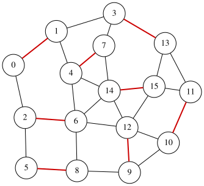

# 最大マッチング問題

無向グラフにおける**マッチング**とは、どの2つの辺も共通のノードを持たないような辺の集合です。
無向グラフ $G=(V,E)$ が与えられたとき、**最大マッチング**問題は、辺の数が最大となるマッチング $S \subseteq E$ を求めることを目的とします。

グラフが $n$ 個の頂点と $m$ 本の辺を持ち、辺に $0,1,\ldots,m-1$ のラベルが付いているとします。
$m$ 個のバイナリ変数 $x_0, x_1, \ldots, x_{m-1}$ を導入し、$x_i=1$ は辺 $i$ が選択されている（つまり $S$ に属する）ことを表します ($0\le i\le m-1$)。
目的は、選択された辺の数を最大化することです：

$$
\begin{aligned}
\text{objective} &= \sum_{i=0}^{m-1} x_i .
\end{aligned}
$$

マッチング条件を強制するために、共通のノードを持つ選択された辺のペアにペナルティを課します。
$\mathcal{P}$ を、共通の端点を持つ異なる辺の順序なしペア $(e_1,e_2)$ の集合とします。
すると、以下のペナルティは、選択された辺がマッチングを形成する場合にのみ値 $0$ をとります：

$$
\begin{aligned}
\text{constraint} &= \sum_{\{e_1,e_2\}\in \mathcal{P}} x_{e_1}x_{e_2}.
\end{aligned}
$$

目的関数とペナルティを組み合わせて QUBO 式 $f$ を構築します：

$$
\begin{aligned}
f &= -\text{objective} + 2 \times \text{constraint}.
\end{aligned}
$$

ここで、ペナルティ項に 2 を掛けることで、マッチング制約の違反が目的関数の増加よりもコストが高くなるようにしています。
$f$ を最小化する割り当ては、$G$ の最大マッチングに対応します。

## 最大マッチングの QUBO++ プログラム
上記の定式化に基づき、以下の QUBO++ プログラムは 16 ノードのグラフに対する QUBO 式 $f$ を構築し、**Exhaustive Solver** を用いて解きます。

```cpp
#include <qbpp/qbpp.hpp>
#include <qbpp/exhaustive_solver.hpp>
#include <qbpp/graph.hpp>

int main() {
  const size_t N = 16;
  std::vector<std::pair<size_t, size_t>> edges = {
      {0, 1},   {0, 2},   {1, 3},   {1, 4},   {2, 5},   {2, 6},   {3, 7},
      {3, 13},  {4, 6},   {4, 7},   {4, 14},  {5, 8},   {6, 8},   {6, 12},
      {6, 14},  {7, 14},  {8, 9},   {9, 10},  {9, 12},  {10, 11}, {10, 12},
      {11, 13}, {11, 15}, {12, 14}, {12, 15}, {13, 15}, {14, 15}};
  const size_t M = edges.size();

  auto x = qbpp::var("x", M);

  auto objective = qbpp::sum(x);

  auto constraint = qbpp::toExpr(0);
  for (size_t i = 0; i < M; ++i) {
    for (size_t j = i + 1; j < M; ++j) {
      if (edges[i].first == edges[j].first ||
          edges[i].first == edges[j].second ||
          edges[i].second == edges[j].first ||
          edges[i].second == edges[j].second) {
        constraint += x[i] * x[j];
      }
    }
  }

  auto f = -objective + 2 * constraint;
  f.simplify_as_binary();

  auto solver = qbpp::ExhaustiveSolver(f);
  auto sol = solver.search();

  std::cout << "objective = " << objective(sol) << std::endl;
  qbpp::graph::GraphDrawer graph;
  for (size_t i = 0; i < N; ++i) {
    graph.add_node(qbpp::graph::Node(i));
  }
  for (size_t i = 0; i < M; ++i) {
    auto edge = qbpp::graph::Edge(edges[i].first, edges[i].second);
    if (sol(x[i])) {
      edge.color(1).penwidth(2.0);
    }
    graph.add_edge(edge);
  }
  graph.write("maxmatching.svg");
}
```
このプログラムは式 `objective`、`constraint`、`f` を作成します。`f` は `objective` の符号反転にペナルティ項を加えたものです。
Exhaustive Solver が `f` を最小化し、最適な割り当てが `sol` に格納されます。

解を可視化するために、`GraphDrawer` オブジェクト `graph` を作成し、ノードと辺を追加します。
この可視化では、$S$ に属する選択された辺（つまり $x_i=1$ の辺 $i$）が強調表示されます。

結果のグラフは描画され、ファイル `maxmatching.svg` に保存されます：

<p align="center">
  
</p>

## 制約を `qbpp::cons()` で宣言する
マッチングの条件は、各頂点に接続する選択辺が1本以下であることです。
辺の組ごとのペナルティの代わりに、頂点ごとにこの条件を [`qbpp::cons()`](CONSTRAINTS) で制約として宣言します:
```cpp
  auto constraint = qbpp::toExpr(0);
  for (size_t v = 0; v < N; ++v) {
    auto t = qbpp::toExpr(0);
    for (size_t i = 0; i < M; ++i) {
      if (edges[i].first == v || edges[i].second == v) {
        t += x[i];
      }
    }
    constraint += qbpp::cons(t <= 1);
  }
```
元の式は、共通の端点を持つ辺の組ごとに項を作るので、このグラフでは目的関数と合わせて98項になります。
`qbpp::cons()` で宣言した制約は目的関数の項に加わらないので、項は目的関数の27項だけです。
出力は次のとおりで、同じ大きさのマッチングが得られます:
```
objective = 8
```

## チェス盤にドミノを置く
8×8 のチェス盤から、対角にある 2 つの隅のマスを切り取った 62 マスの盤に、ドミノを置きます。
ドミノ 1 枚は縦か横に隣り合う 2 つのマスを覆い、ドミノどうしは重ねて置けません。
角を切らない 8×8 の盤なら、各行に横向きに 4 枚ずつ並べて 32 枚置けます。
マスを頂点、隣り合う 2 つのマスを辺とするグラフ（辺は 108 本）では、ドミノの置き方はマッチングなので、置けるドミノの最大の枚数は最大マッチングの辺の数です。

辺ごとの変数 $x$ に加えて、マス $v$ を覆うドミノの数 $N(v)$（$v$ に接する辺の $x$ の和）を使います。
ドミノが重ならない条件は、すべてのマスで $N(v) \le 1$ です。
変数が 108 個あり、すべての割り当てを調べることはできないので、[EasySolver](EASYSOLVER) で解きます：

```cpp
#include <map>
#include <qbpp/qbpp.hpp>
#include <qbpp/easy_solver.hpp>

int main() {
  // 8×8 の盤から対角の 2 隅を除いた 62 マス
  std::vector<std::pair<int, int>> cells;
  std::map<std::pair<int, int>, size_t> index;
  for (int r = 0; r < 8; ++r) {
    for (int c = 0; c < 8; ++c) {
      if ((r == 0 && c == 0) || (r == 7 && c == 7)) continue;
      index[{r, c}] = cells.size();
      cells.push_back({r, c});
    }
  }

  // 隣り合う 2 マス（右隣と下隣）
  std::vector<std::pair<size_t, size_t>> edges;
  for (auto [r, c] : cells) {
    for (auto cell : {std::make_pair(r, c + 1), std::make_pair(r + 1, c)}) {
      if (index.count(cell)) {
        edges.push_back({index[{r, c}], index[cell]});
      }
    }
  }

  auto x = qbpp::var("x", edges.size());

  // N[v]: マス v を覆うドミノの数
  std::vector<qbpp::Expr> N(cells.size());
  for (size_t i = 0; i < edges.size(); ++i) {
    N[edges[i].first] += x[i];
    N[edges[i].second] += x[i];
  }

  auto objective = qbpp::sum(x);

  auto constraint = qbpp::toExpr(0);
  for (size_t v = 0; v < cells.size(); ++v) {
    constraint += qbpp::cons(N[v] <= 1);
  }

  auto f = -objective + 2 * constraint;
  f.simplify_as_binary();

  auto solver = qbpp::EasySolver(f);
  auto sol = solver.search({{"time_limit", 10}});

  std::cout << "dominoes = " << objective(sol) << std::endl;
  std::cout << "violated constraints = " << f.cons(sol) << std::endl;
  std::vector<std::string> board(8, std::string(8, ' '));
  for (auto [r, c] : cells) {
    board[r][c] = '.';
  }
  for (size_t i = 0; i < edges.size(); ++i) {
    if (sol(x[i]) == 1) {
      auto [r1, c1] = cells[edges[i].first];
      auto [r2, c2] = cells[edges[i].second];
      if (r1 == r2) {
        board[r1][c1] = '<';
        board[r2][c2] = '>';
      } else {
        board[r1][c1] = '^';
        board[r2][c2] = 'v';
      }
    }
  }
  for (const auto& row : board) {
    for (size_t c = 0; c < row.size(); ++c) {
      std::cout << (c > 0 ? " " : "") << row[c];
    }
    std::cout << std::endl;
  }
}
```

横のドミノを `<>`、縦のドミノを `^` と `v`、空いたマスを `.` で表示します。
出力の例です：
```
dominoes = 30
violated constraints = 0
  ^ ^ ^ < > ^ ^
^ v v v < > v v
v ^ ^ ^ < > ^ ^
^ v v v < > v v
v . ^ . < > ^ ^
< > v ^ < > v v
^ ^ ^ v < > < >
v v v < > < >  
```
30 枚置けました。31 枚は置けません。
チェス盤では隣り合う 2 つのマスは違う色なので、ドミノ 1 枚は白いマスと黒いマスを 1 つずつ覆います。
切り取った 2 つの隅はどちらも同じ色（白とします）なので、白いマスは 30 個、黒いマスは 32 個で、置けるドミノは 30 枚までです。
30 枚置いたときに空く 2 つのマスは、どちらも黒いマスです。



動画では、角を切った盤の最大マッチングと、角を切らない 8×8 の盤の最小極大マッチングを、同じ変数のプログラムで解きます。動画のプログラムと章ごとの説明は[動画：チェス盤にドミノを置く](python/VIDEO_DOMINOES)のページにあります。
