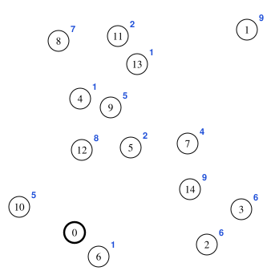
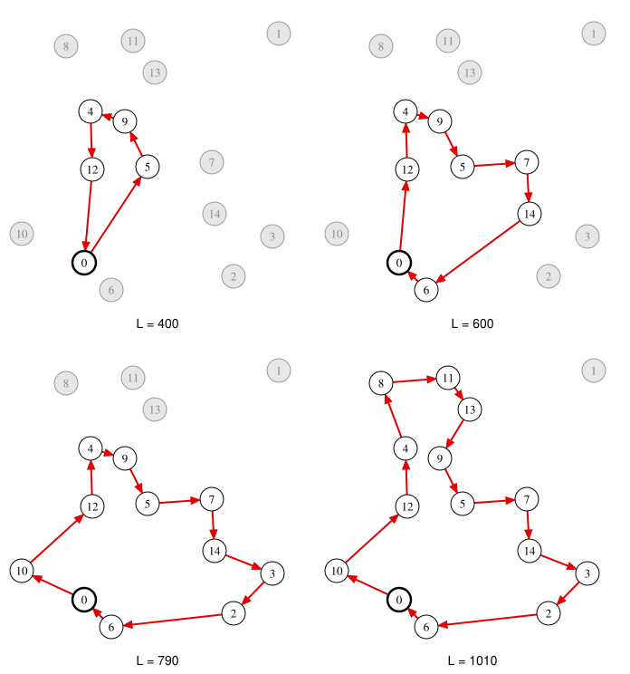
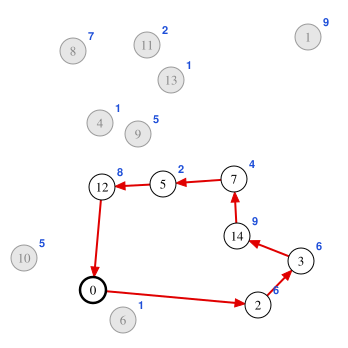

# オリエンテーリング問題
**オリエンテーリング問題**は、出発点から出て出発点に戻る巡回路のうち、長さが上限 $L$ 以下のものの中から、訪れた頂点の得点の和が最大のものを求める問題です。
[巡回セールスマン問題](TSP)はすべての頂点を回る最短の巡回路を求めますが、オリエンテーリング問題では、どの頂点を回るかを選ぶところから決めます。

このページでは、まず得点がすべて 1、つまり訪れる頂点の数を最大にする場合を解き、次に頂点ごとに得点がある場合を解きます。
どちらも、QUBO++ の[構造制約](STRUCTURAL) `qbpp::cycle()` で巡回路を表します。

以下の図は、このページで使う 15 個の頂点です。
頂点 0 が出発点で、ほかの頂点の右上の数は、後半で使う得点です。

<p align="center">
  
</p>

## 定式化
### 変数
[巡回セールスマン問題](TSP#構造制約-cycle-を使う定式化)と同じく、頂点 $i$ から頂点 $j$ へ進むとき 1 になるバイナリ変数 $x_{i,j}$ を使います。
頂点 $i$ と $j$ の距離を $d_{i,j}$ とします。

### 巡回路の条件
値が 1 の変数の辺が、頂点 0 を通る 1 つの閉路になるという条件は、`qbpp::cycle(x, qbpp::via{0})` で表します。
`qbpp::via{0}` は「頂点 0 は必ず通り、ほかの頂点は通らなくてもよい」という意味です。
この条件は重みのない制約で、ソルバーは閉路を保ったまま探索します。

### 訪れた頂点の数と巡回路の長さ
閉路では、訪れた頂点の数と、使う辺の数が等しくなります。
そのため、訪れた頂点の数（出発点を含む）は変数の和

$$
\text{count} = \sum_{i,j} x_{i,j}
$$

で表せます。巡回路の長さは

$$
\text{total} = \sum_{i,j} d_{i,j}\,x_{i,j}
$$

です。

### 長さの上限
長さの上限は、[`qbpp::cons()`](CONSTRAINTS) で $\text{total} \leq L$ という制約にします。
制約を破ると、上限を超えた量の 2 乗に重みを掛けた値がエネルギーに加わります。
距離は整数なので、上限を 1 でも超えると重み以上のエネルギーが加わります。
重みを 100 にすると、訪れる頂点の数（高々 15）を増やしても取り戻せないので、上限を超えた解は最小になりません。

### まとめた式
QUBO++ は最小化するので、訪れた頂点の数の符号を反転して、次の式を作ります:

$$
f = -\text{count} + 100\cdot\text{cons}(\text{total} \leq L) + \text{cycle}(x, \text{via}\{0\})
$$

## QUBO++ プログラム
上限を $L = 600$ として解くプログラムです:

```cpp
#include <cmath>
#include <iostream>
#include <utility>
#include <vector>

#include <qbpp/qbpp.hpp>
#include <qbpp/easy_solver.hpp>

int main() {
  std::vector<std::pair<int, int>> nodes = {
      {69, 34},   {284, 287}, {234, 19},  {277, 63},  {76, 201},
      {139, 140}, {99, 4},    {210, 145}, {49, 273},  {114, 190},
      {0, 66},    {123, 279}, {78, 137},  {147, 244}, {213, 88}};
  const int n = static_cast<int>(nodes.size());
  std::vector<std::vector<int>> dist(n, std::vector<int>(n));
  for (int i = 0; i < n; ++i)
    for (int j = 0; j < n; ++j)
      dist[i][j] = static_cast<int>(std::lround(
          std::hypot(nodes[i].first - nodes[j].first,
                     nodes[i].second - nodes[j].second)));
  auto d = qbpp::array(dist);
  const int L = 600;

  auto x = qbpp::var("x", n, n);
  auto count = qbpp::sum(x);
  auto total = qbpp::sum(d * x);
  auto f = -count + 100 * qbpp::cons(total <= L) + qbpp::cycle(x, qbpp::via{0});
  f.simplify_as_binary();

  qbpp::EasySolver solver(f);
  auto sol = solver.search({{"time_limit", 1.0}});
  std::cout << "visited = " << sol(count) << ", length = " << sol(total)
            << std::endl;
  int v = 0;
  std::cout << "tour: 0";
  do {
    for (int j = 0; j < n; ++j)
      if (j != v && sol(x[v][j]) == 1) {
        v = j;
        break;
      }
    std::cout << " -> " << v;
  } while (v != 0);
  std::cout << std::endl;
}
```

`dist` は頂点どうしの距離（丸めた整数）で、`qbpp::array(dist)` で QUBO++ の配列 `d` にします。`d * x` は要素ごとの積です。
`count` と `total` は、上の訪れた頂点の数と巡回路の長さの式です。
自分自身への辺 `x[i][i]` も `qbpp::sum(x)` に入りますが、`qbpp::cycle()` の解では常に 0 なので、数には影響しません。
得られた解 `sol` で `count` と `total` を評価して、訪れた頂点の数と長さを表示します。
巡回路は、頂点 0 から値が 1 の辺をたどって求めます。

このプログラムは以下の出力を生成します:
```
visited = 8, length = 575
tour: 0 -> 12 -> 4 -> 9 -> 5 -> 7 -> 14 -> 6 -> 0
```
長さ 600 以下で回れる頂点は、出発点を含めて 8 個までで、長さは 575 です。
距離は対称なので、逆向きの巡回路が出力されることもあります。

## 上限を変える
プログラムの `L` を変えて解くと、次のようになります:

| 上限 $L$ | 訪れた頂点の数 | 長さ |
|:---:|:---:|:---:|
| 400 | 5 | 390 |
| 600 | 8 | 575 |
| 790 | 11 | 778 |
| 1010 | 14 | 994 |

<p align="center">
  
</p>

どの上限でも、訪れる頂点の数が最大の巡回路は、向きを除いて 1 つだけです。
上限を増やすと、出発点から遠い頂点まで回れるようになります。

## 得点つきのオリエンテーリング問題
頂点 $j$ に得点 $s_j$ があり、訪れた頂点の得点の和を最大にします（出発点の得点は 0 とします）。
頂点 $j$ に入る辺の変数の和 $\sum_i x_{i,j}$ は、頂点 $j$ を訪れれば 1、訪れなければ 0 です。
したがって、得点の和は

$$
\text{score} = \sum_j s_j \sum_i x_{i,j}
$$

です。QUBO++ では、`qbpp::vector_sum(x, 0)` が各列の和 $\sum_i x_{i,j}$ の配列なので、得点の配列 `prize` との要素ごとの積の和で表せます。
式は、前の式の `count` を `score` に替えるだけです。
重み 100 は得点の合計（66）より大きいので、上限を超えた解は最小になりません。


```cpp
#include <cmath>
#include <iostream>
#include <utility>
#include <vector>

#include <qbpp/qbpp.hpp>
#include <qbpp/easy_solver.hpp>

int main() {
  std::vector<std::pair<int, int>> nodes = {
      {69, 34},   {284, 287}, {234, 19},  {277, 63},  {76, 201},
      {139, 140}, {99, 4},    {210, 145}, {49, 273},  {114, 190},
      {0, 66},    {123, 279}, {78, 137},  {147, 244}, {213, 88}};
  auto prize = qbpp::array({0, 9, 6, 6, 1, 2, 1, 4, 7, 5, 5, 2, 8, 1, 9});
  const int n = static_cast<int>(nodes.size());
  std::vector<std::vector<int>> dist(n, std::vector<int>(n));
  for (int i = 0; i < n; ++i)
    for (int j = 0; j < n; ++j)
      dist[i][j] = static_cast<int>(std::lround(
          std::hypot(nodes[i].first - nodes[j].first,
                     nodes[i].second - nodes[j].second)));
  auto d = qbpp::array(dist);
  const int L = 600;

  auto x = qbpp::var("x", n, n);
  auto score = qbpp::sum(qbpp::vector_sum(x, 0) * prize);
  auto total = qbpp::sum(d * x);
  auto f = -score + 100 * qbpp::cons(total <= L) + qbpp::cycle(x, qbpp::via{0});
  f.simplify_as_binary();

  qbpp::EasySolver solver(f);
  auto sol = solver.search({{"time_limit", 1.0}});
  std::cout << "score = " << sol(score) << ", length = " << sol(total)
            << std::endl;
  int v = 0;
  std::cout << "tour: 0";
  do {
    for (int j = 0; j < n; ++j)
      if (j != v && sol(x[v][j]) == 1) {
        v = j;
        break;
      }
    std::cout << " -> " << v;
  } while (v != 0);
  std::cout << std::endl;
}
```


このプログラムは以下の出力を生成します:
```
score = 35, length = 589
tour: 0 -> 2 -> 3 -> 14 -> 7 -> 5 -> 12 -> 0
```

<p align="center">
  
</p>

訪れる頂点は 7 個で、頂点の数を最大にした前の答え（8 個）より 1 つ少ないですが、得点の和は 35 です。
前の答えの得点の和は 30 なので、得点の高い頂点 2・3・14 を回るほうが得点が大きくなります。

構造制約は EasySolver と ABS3Solver で使えます。ExhaustiveSolver は構造制約に対応していません。
