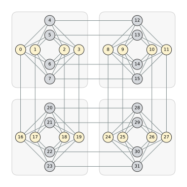
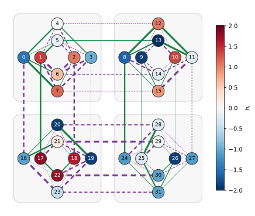
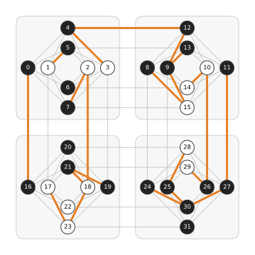

# 量子アニーラーのシミュレーション
量子アニーラーは、量子ビットの間の結合が決まった形のグラフの上で、**イジングモデル**のエネルギーが小さくなるスピンの割り当てを探す装置です。
同じイジングモデルを QUBO++ で式にして解けば、量子アニーラーが返すはずの解が得られます。
つまり、実機を使わずに量子アニーラーの動作をシミュレーションできます。
実機に問題を送る前にプログラムを確かめたり、実機が返した解を最適解と比べたりするのに使えます。

このページでは、D-Wave の量子アニーラー 2000Q の結合の形であるキメラグラフの上で、実機と同じ範囲の乱数の係数を与えたイジングモデルを解きます。
2000Q はすでに提供が終わっていて、現在の D-Wave の量子アニーラーは Advantage2 です。
ここでは構造が分かりやすい 2000Q のキメラグラフを使いますが、Advantage2 にも同じ方法で対応できます（[Advantage2 の場合](#advantage2-の場合)）。

## イジングモデル
量子ビット $i$ はスピン $s_i\in\lbrace -1,+1\rbrace$ を表します。
量子ビットを頂点、結合を辺とするグラフの辺の集合を $E$ とすると、イジングモデルのエネルギーは次の式です：

$$
E(s) = \sum_{i} h_i s_i + \sum_{(i,j)\in E} J_{ij}\, s_i s_j
$$

$h_i$ は量子ビット $i$ にかかる外場、$J_{ij}$ は量子ビット $i$ と $j$ の結合の強さで、どちらも実数です。
$J_{ij}<0$ の結合は $s_i$ と $s_j$ が同じとき、$J_{ij}>0$ の結合は異なるときに、エネルギーを下げます。
利用者は $h_i$ と $J_{ij}$ を与え、量子アニーラーは $E(s)$ の小さいスピンの割り当てを返します。
2000Q で与えられる値の範囲は、$-2\le h_i\le 2$、$-1\le J_{ij}\le 1$ です。

## キメラグラフ
2000Q の量子ビットは、**キメラグラフ**の形に結合しています。
キメラグラフは、8 量子ビットからなるセルを格子状に並べたグラフです。
セルの 8 量子ビットは 4 個ずつの 2 組（0 組目と 1 組目）に分かれていて、次のように結合します：
- セルの中では、0 組目の各量子ビットが 1 組目の 4 量子ビットすべてと結合します。
- 0 組目の量子ビットは、下のセルの 0 組目の同じ位置の量子ビットと結合します。
- 1 組目の量子ビットは、右のセルの 1 組目の同じ位置の量子ビットと結合します。

2000Q は 16×16 個のセル（2048 量子ビット）でした。
このページでは、2×2 個のセル（32 量子ビット、80 個の結合）を使います：

<p align="center">
  
</p>

薄い灰色の四角がセルで、黄色の 4 量子ビットが 0 組目、灰色の 4 量子ビットが 1 組目です。
0 組目は横に並べてあり、下のセルと縦の辺で結合します。
1 組目は縦に並べてあり、右のセルと横の辺で結合します。

$i$ 行 $j$ 列のセルの $u$ 組目の $k$ 番目（$k=0,1,2,3$）の量子ビットには、番号 $((i\cdot C+j)\cdot 2+u)\cdot 4+k$ を付けます（$C$ はセルの列数）。
この番号の付け方は、D-Wave の Ocean SDK が作るキメラグラフと同じです。

## QUBO への変換
QUBO++ のソルバーは、値が 0 か 1 のバイナリ変数の式を解きます。
スピン $s_i$ とバイナリ変数 $x_i$ を $s_i=2x_i-1$ で対応させると（$x_i=1$ のとき $s_i=+1$、$x_i=0$ のとき $s_i=-1$）、$E(s)$ はバイナリ変数の式になります。
QUBO++ では、スピン変数で $E(s)$ を書いて [`spin_to_binary()`](QR_OPERATION) を呼ぶと、この置き換えができます。
置き換えた式の値は元の $E(s)$ と同じなので、ソルバーが返すエネルギーはそのままイジングモデルのエネルギーです。

## QUBO++ プログラム
以下の QUBO++ プログラムは、2×2 個のセルのキメラグラフで、乱数の係数を与えたイジングモデルを解きます：

```cpp
#define DOUBLE_TYPE
#include <qbpp/qbpp.hpp>
#include <qbpp/easy_solver.hpp>

#include <iomanip>
#include <map>
#include <random>

struct Graph {
  std::vector<int> nodes;
  std::vector<std::pair<int, int>> edges;
};

Graph chimera(int rows, int cols) {
  const int L = 4;  // セルの各組の量子ビット数
  auto q = [&](int i, int j, int u, int k) {
    return ((i * cols + j) * 2 + u) * L + k;
  };
  Graph g;
  for (int v = 0; v < rows * cols * 2 * L; ++v) {
    g.nodes.push_back(v);
  }
  for (int i = 0; i < rows; ++i) {
    for (int j = 0; j < cols; ++j) {
      for (int k = 0; k < L; ++k) {
        for (int l = 0; l < L; ++l) {
          g.edges.push_back({q(i, j, 0, k), q(i, j, 1, l)});
        }
        if (i + 1 < rows) {
          g.edges.push_back({q(i, j, 0, k), q(i + 1, j, 0, k)});
        }
        if (j + 1 < cols) {
          g.edges.push_back({q(i, j, 1, k), q(i, j + 1, 1, k)});
        }
      }
    }
  }
  return g;
}

int main() {
  const int ROWS = 2, COLS = 2;  // セルの行数と列数
  auto [nodes, edges] = chimera(ROWS, COLS);

  std::mt19937 rng(1);
  std::uniform_real_distribution<double> h_dist(-2.0, 2.0);
  std::uniform_real_distribution<double> J_dist(-1.0, 1.0);
  std::map<int, double> h;
  std::map<std::pair<int, int>, double> J;
  for (int v : nodes) {
    h[v] = h_dist(rng);
  }
  for (const auto& e : edges) {
    J[e] = J_dist(rng);
  }

  auto s = qbpp::var("s", nodes.size());
  auto f = qbpp::toExpr(0);
  for (int v : nodes) {
    f += h[v] * s[v];
  }
  for (const auto& [e, w] : J) {
    f += w * s[e.first] * s[e.second];
  }
  f.spin_to_binary();
  f.simplify_as_binary();

  auto solver = qbpp::EasySolver(f);
  auto sol = solver.search({{"time_limit", 1}});

  std::map<int, int> spin;
  for (int v : nodes) {
    spin[v] = sol(s[v]) == 1 ? 1 : -1;
  }
  double E = 0;
  for (int v : nodes) {
    E += h[v] * spin[v];
  }
  for (const auto& [e, w] : J) {
    E += w * spin[e.first] * spin[e.second];
  }
  std::cout << std::fixed << std::setprecision(4);
  std::cout << "energy = " << sol.energy() << std::endl;
  std::cout << "E(s)   = " << E << std::endl;
  for (int i = 0; i < ROWS; ++i) {
    for (int j = 0; j < COLS; ++j) {
      int v = (i * COLS + j) * 8;
      std::cout << "cell (" << i << "," << j << "):";
      for (int k = 0; k < 8; ++k) {
        std::cout << (spin[v + k] == 1 ? " +1" : " -1");
        if (k == 3) {
          std::cout << " |";
        }
      }
      std::cout << std::endl;
    }
  }
}
```

このプログラムでは、次のことを行っています：
- `#define DOUBLE_TYPE` で、式の係数を実数（`double`）にしています（[実数（double）係数](VAREXPR#実数double係数)）。
- 関数 `chimera(rows, cols)` は、`rows` 行 `cols` 列のセルからなるキメラグラフを作り、ノード（量子ビットの番号）のリスト `nodes` と辺のリスト `edges` を返します。
  中の `q(i, j, u, k)` が量子ビットの番号を計算し、セルの中の結合、下のセルとの結合、右のセルとの結合の 3 種類の辺を `edges` に入れます。
- 外場 `h[v]` を $-2$ 以上 $2$ 以下、結合 `J[e]` を $-1$ 以上 $1$ 以下の一様乱数で決めます。
  どちらも、ノードと辺ごとの値を `std::map` で持ちます。
- スピン変数 `s` で $E(s)$ を式 `f` にし、`f.spin_to_binary()` でバイナリ変数の式に変えてから、`f.simplify_as_binary()` で簡約します。
  式を作る部分は、`nodes` と係数 `h`、`J` しか使っていません。
- EasySolver で、制限時間を 1 秒として解きます。
- `sol(s[v])` はバイナリ変数の値（0 か 1）なので、スピン `spin[v]`（$+1$ か $-1$）に戻します。
  そのスピンで $E(s)$ を計算し直し、ソルバーのエネルギー `sol.energy()` と並べて表示します。
- 最後に、セルごとのスピンを表示します。$i$ 行 $j$ 列のセルの量子ビットは、$8(i\cdot C+j)$ 番からの 8 個です。

このプログラムの出力は以下のとおりです：
```
energy = -45.8064
E(s)   = -45.8064
cell (0,0): -1 -1 +1 -1 | +1 +1 +1 -1
cell (0,1): -1 -1 +1 -1 | +1 +1 +1 -1
cell (1,0): -1 -1 -1 -1 | -1 -1 +1 -1
cell (1,1): -1 -1 -1 +1 | +1 -1 -1 -1
```
`energy` と `E(s)` が一致していて、ソルバーのエネルギーがイジングモデルのエネルギーそのものであることが分かります。
各行は 1 つのセルのスピンで、`|` の左が 0 組目、右が 1 組目です。
量子アニーラーと同じように、各量子ビットのスピンと、そのエネルギーが得られました。

次の 2 つの図は、Python 版のプログラムで作った問題とその解です（乱数が異なるので、このプログラムの係数と出力とは一致しません）。
1 つ目の図は問題、つまり乱数で決めた $h_i$ と $J_{ij}$ を表しています：

<p align="center">
  
</p>

- 量子ビットの色は $h_i$ を表します。赤は $h_i>0$、青は $h_i<0$ で、色が濃いほど $|h_i|$ が大きくなります。
  項 $h_is_i$ は $s_i$ が $h_i$ と逆の符号のときに負になるので、赤い量子ビットは $-1$ に、青い量子ビットは $+1$ になろうとします。
- 緑の実線は $J_{ij}<0$ の結合で、両端のスピンをそろえようとします（引き合う）。
  紫の破線は $J_{ij}>0$ の結合で、両端のスピンを逆向きにしようとします（反発する）。
  線の太さは $|J_{ij}|$ の大きさを表します。

2 つ目の図は、この問題の解です：

<p align="center">
  
</p>

黒がスピン $+1$、白がスピン $-1$ の量子ビットです。
32 量子ビットのうち 23 個は $h_i$ が望む向き（赤なら白、青なら黒）になっていますが、量子ビット 7 や 12 のように、結合の影響で逆向きになっているものもあります。
橙の太線は満たされない結合、つまり $J_{ij}s_is_j>0$ となっていて、その項だけを見るとエネルギーを上げている結合です。
すべての結合を同時に満たす割り当ては、一般には存在しません。
たとえば閉路をたどりながら、結合ごとに望む関係（同じか異なるか）になるようにスピンを決めていくと、1 周して戻ったときに向きが食い違うことがあります。
外場 $h_i$ が望む向きと、結合が望む向きがぶつかることもあります。
最適解は、こうした損の合計が最小になる割り当てで、この例では 80 個の結合のうち 22 個が満たされていません。

## 全探索で確かめる
32 量子ビットのスピンの割り当ては $2^{32}$（約 43 億）通りなので、[Exhaustive Solver](EXHAUSTIVE) ですべて調べられます。
`#include <qbpp/exhaustive_solver.hpp>` を加え、ソルバーを作って解く 2 行を次のように変えます：
```cpp
  auto solver = qbpp::ExhaustiveSolver(f);
  auto sol = solver.search();
```
出力は EasySolver のときと同じで、EasySolver の解がエネルギー最小の割り当て（最適解）であることが確かめられます。
理想的な量子アニーラーが返すのも、この最適解です。
全探索にかかる時間は、GPU（A100）1 枚で約 2 秒、CPU 8 コアだけで約 30 秒でした。

## 大きなキメラグラフ
`ROWS` と `COLS` を 16 にすると、2000Q と同じ 2048 量子ビット、6016 個の結合になります。
この大きさでは全探索はできませんが、EasySolver でそのまま解けます。
ただし、制限時間 1 秒では最適解に届かないことがあり、制限時間を延ばすとよりエネルギーの小さい解が得られることがあります。

## Advantage2 の場合
Advantage2 の量子ビットは、キメラグラフより結合の多い **Zephyr グラフ**の形に結合しています（1 量子ビットあたりの結合は、キメラグラフでは最大 6 個、Zephyr グラフでは最大 20 個）。
$h_i$ と $J_{ij}$ の範囲も 2000Q とは異なります。

このプログラムで式を作って解く部分は、`chimera()` が返す `nodes`、`edges` と係数 `h`、`J` しか使っていません。
そのため、`chimera()` の代わりに Zephyr グラフの `nodes` と `edges` を使い、乱数の範囲を Advantage2 の範囲に変えれば、同じプログラムで Advantage2 のシミュレーションになります。
D-Wave の Ocean SDK には、キメラグラフや Zephyr グラフのノードと辺のリストを作る関数があります。
実機には使えない量子ビットや結合があることもあるので、実機の量子ビットと結合の一覧と $h_i$、$J_{ij}$ の範囲を Ocean SDK で取得して使えば、その実機と同じ形の問題を QUBO++ で解けます。
このとき量子ビットの番号は飛び飛びになるので、変数の配列 `s` は「最大の番号 + 1」の大きさで作ります（式に現れない変数は解に影響しません）。
