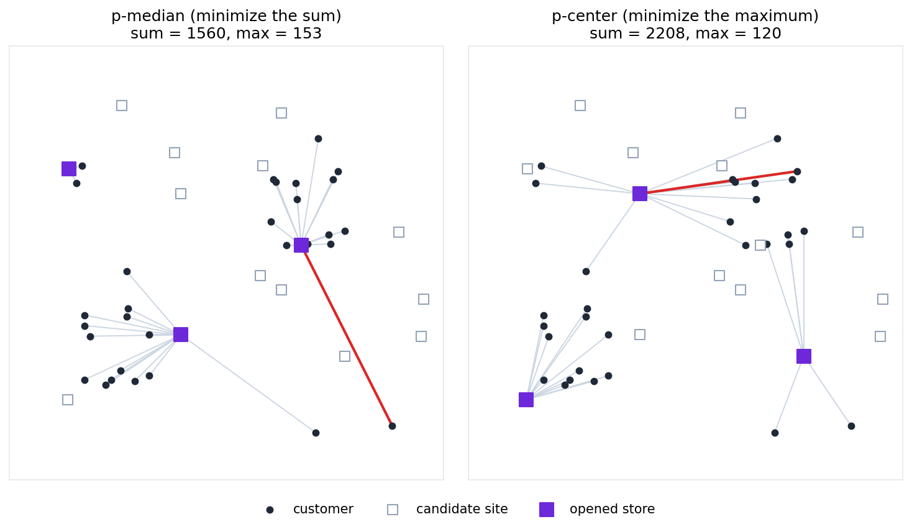

# 施設配置問題（p-median と p-center）
客の住む場所と、店を開く場所の候補が与えられています。
候補の中から $p$ か所を選んで店を開き、各客は開いた店のうち最も近い店を利用します。
**施設配置問題**は、客から店までの距離ができるだけ小さくなるように、店を開く場所を選ぶ問題です。
距離の評価の仕方によって、次の 2 つの問題があります：

- **p-median 問題**: すべての客の距離の**合計**を最小にする
- **p-center 問題**: 最も遠い客の距離、つまり距離の**最大値**を最小にする

どちらも NP 困難であることが知られています。

名前は、店を 1 か所だけ開く場合に由来します。
数直線上に客が並んでいるとき、距離の合計を最小にする場所は客の位置の**中央値（median）**で、最も遠い客の距離を最小にする場所は、両端の客のちょうど真ん中、つまり**中心（center）**です。
p-median と p-center は、これを $p$ か所に一般化した問題です。

このページでは、客 30 人と候補 15 か所から 3 か所を選ぶ例を解きます。
客と候補の座標は 0 から 299 の整数で、距離は 2 点を結ぶ直線の長さ（ユークリッド距離）を四捨五入した整数とします。
次の図の左は p-median 問題、右は p-center 問題の答えです：

<p align="center">
  
</p>

黒い点が客、白い四角が候補、紫の四角が開いた店です。
灰色の線は各客と利用する店を結び、赤い線は最も遠い客と利用する店を結んでいます。
p-median 問題の答えは、客の多い 2 つの町と左上の 2 人の近くに店を開き、右下に離れて住む客の距離は 153 です。
p-center 問題の答えは右下の客の近くにも店を開き、最も遠い客の距離を 120 にしています。
その代わり、距離の合計は 1560 から 2208 に増えています。

## 問題
客に $0,1,\ldots,N-1$、候補に $0,1,\ldots,S-1$ の番号を付け、客 $i$ から候補 $j$ までの距離を $d_{i,j}$ とします。
$d_{i,j}$ は 0 以上の整数です。

店を開く候補の集合を $P$ とします。
$P$ は $\lbrace 0,1,\ldots,S-1\rbrace$ の部分集合で、要素の数は $\lvert P\rvert=p$ です。
客 $i$ は $P$ の中で最も近い店を利用するので、その距離は

$$
D_i(P) = \min_{j\in P} d_{i,j}
$$

です。
p-median 問題と p-center 問題は、それぞれ次の値を最小にする $P$ を求める問題です：

$$
\begin{aligned}
\text{p-median: } & \sum_{i=0}^{N-1} D_i(P) = \sum_{i=0}^{N-1}\min_{j\in P} d_{i,j}, \\
\text{p-center: } & \max_{0\leq i\leq N-1} D_i(P) = \max_{0\leq i\leq N-1}\min_{j\in P} d_{i,j}
\end{aligned}
$$

どちらも、客ごとの最小値 $D_i(P)$ を含みます。
p-median 問題はその合計を、p-center 問題はその最大値を最小にします。

## 定式化
集合 $P$ と各客が利用する店を、次のバイナリ変数で表します：

- $y_j=1$: 候補 $j$ に店を開く（$j\in P$）
- $x_{i,j}=1$: 客 $i$ は店 $j$ を利用する

次の制約を課します：

$$
\begin{aligned}
\sum_{j=0}^{S-1} y_j &= p, \\
\sum_{j=0}^{S-1} x_{i,j} &= 1 && (0\leq i\leq N-1), \\
x_{i,j} &\leq y_j && (0\leq i\leq N-1,\ 0\leq j\leq S-1)
\end{aligned}
$$

1 行目は $\lvert P\rvert=p$、2 行目は各客がちょうど 1 つの店を利用すること、3 行目は開いた店（$P$ の要素）しか利用できないことを表します。
客 $i$ から利用する店までの距離は

$$
D_i = \sum_{j=0}^{S-1} d_{i,j}\,x_{i,j}
$$

です。

### 最も近い店が選ばれる理由
制約は「開いた店のどれか 1 つを利用する」と言っているだけで、最も近い店を利用するとは言っていません。
そのため $D_i$ は、$D_i(P)=\min_{j\in P} d_{i,j}$ 以上の値になります。
それでも、目的関数を最小にする解では、各客は最も近い店を利用し、$D_i=D_i(P)$ となります。
ある客が利用する店を、開いている店のうち最も近い店に替えると、その客の距離 $D_i$ は小さくなるか変わらず、ほかの客の距離は変わりません。
このとき、後で説明するどちらの目的関数も大きくならないからです。

このように、最小値 $D_i(P)$ を、どの店を利用するかをワンホットで選ぶことで表しています。
これは[最大値・最小値の最小化と最大化](MAX_MIN#最大値の最大化と最小値の最小化)の、最小値を最小化する書き方です。

### p-median 問題
目的関数は距離の合計です：

$$
\text{objective} = \sum_{i=0}^{N-1} D_i
$$

制約を [`qbpp.cons()`](CONSTRAINTS) で宣言し、重み $\lambda$ を掛けて目的関数に加えます：

$$
f = \text{objective} + \lambda\times\Bigl(\text{cons}\Bigl(\sum_{j} y_j=p\Bigr) + \sum_{i}\text{cons}\Bigl(\sum_{j} x_{i,j}=1\Bigr) + \sum_{i,j}\text{cons}\bigl(x_{i,j}-y_j\leq 0\bigr)\Bigr)
$$

制約を 1 つでも破る割り当てのエネルギーは $\lambda$ 以上です。
一方、制約を満たす割り当てのエネルギーは距離の合計なので、$d_{\max}$ を $d_{i,j}$ の最大値として $N d_{\max}$ 以下です。
そこで $\lambda=N d_{\max}+1$ とすれば、$f$ を最小にする割り当ては必ず制約を満たします。

### p-center 問題
距離の最大値 $\max(D_0,\ldots,D_{N-1})$ は、[最大値の最小化](MAX_MIN#最大値の最小化と最小値の最大化)と同じく、整数変数 $z$ と relu で表します：

$$
z + 2\sum_{i=0}^{N-1}\mathrm{relu}(D_i - z)
$$

$z$ を $0$ から $d_{\max}$ の整数変数とすると、この式は $z$ が距離の最大値に等しいときに最小になり、その値は距離の最大値です。

これだけでは、最も遠い客に関係しない店は、どこに開いても最大値が変わりません。
そこで、距離の合計 $\sum_i D_i$ も目的関数に加え、最大値が同じなら合計の小さい配置が選ばれるようにします：

$$
\text{objective} = K\Bigl(z + 2\sum_{i=0}^{N-1}\mathrm{relu}(D_i - z)\Bigr) + \sum_{i=0}^{N-1} D_i
$$

この式の最小値は $K\times(\text{距離の最大値}) + (\text{距離の合計})$ です。
距離の合計は $0$ 以上 $N d_{\max}$ 以下なので、$K=N d_{\max}+1$ とすると、最大値を 1 小さくすることが合計のどんな変化よりも優先されます。
つまり、まず最大値を最小にし、最大値が同じ配置の中で合計を最小にします。
すべての客の距離がエネルギーに反映されるので、ソルバーが解を改善する手がかりも増えます。

制約は p-median 問題と同じ式で加えます。
制約を満たす最適な割り当てでは $z$ は $d_{\max}$ 以下、relu の項は 0、距離の合計は $N d_{\max}$ 以下なので、エネルギーは $(K+N)d_{\max}$ 以下です。
そこで $\lambda=(K+N)d_{\max}+1$ とします。

## PyQBPPプログラム
以下のプログラムは、上の図の例で p-median 問題を解きます：
```python
import math

import pyqbpp as qbpp

customers = [(69, 68), (75, 115), (42, 61), (91, 64), (74, 109), (42, 102), (58, 57), (46, 94),
             (80, 60), (62, 61), (91, 95), (42, 110), (183, 181), (234, 219), (228, 164), (230, 213),
             (211, 164), (195, 163), (227, 171), (203, 198), (187, 211), (185, 213), (202, 210),
             (239, 174), (40, 223), (219, 244), (74, 143), (36, 210), (275, 26), (217, 21)]
sites = [(239, 79), (191, 263), (206, 163), (299, 122), (177, 223), (175, 140), (115, 95),
         (70, 269), (297, 94), (30, 221), (115, 202), (191, 129), (280, 173), (110, 233), (29, 46)]
p = 3
N = len(customers)
S = len(sites)

d = [[round(math.hypot(cx - sx, cy - sy)) for sx, sy in sites] for cx, cy in customers]
dmax = max(max(row) for row in d)

y = qbpp.var("y", shape=S)
x = qbpp.var("x", shape=(N, S))

dist = []
for i in range(N):
    e = 0
    for j in range(S):
        e += d[i][j] * x[i][j]
    dist.append(e)

constraint = qbpp.cons(qbpp.sum(y) == p)
for i in range(N):
    constraint += qbpp.cons(qbpp.sum(x[i]) == 1)
    for j in range(S):
        constraint += qbpp.cons(x[i][j] - y[j] <= 0)

objective = qbpp.sum(dist)
f = objective + (N * dmax + 1) * constraint
f.simplify_as_binary()

solver = qbpp.EasySolver(f)
sol = solver.search(time_limit=5)

opened = [j for j in range(S) if sol(y[j]) == 1]
values = [sol(dist[i]) for i in range(N)]
print(f"opened sites = {opened}")
print(f"sum = {sum(values)}, max = {max(values)}")
print(f"violated constraints = {f.cons(sol)}")
```
`customers` と `sites` は客と候補の座標、`d` は距離 $d_{i,j}$、`dmax` はその最大値です。
`math.hypot(a, b)` は $\sqrt{a^2+b^2}$ で、それを `round()` で四捨五入しています。
`dist[i]` が客 `i` の距離 $D_i$ で、`constraint` に 3 種類の制約を加えています。
`qbpp.sum(x[i])` は `x` の `i` 行目の和 $\sum_j x_{i,j}$ です。
変数は $15+30\times 15=465$ 個で、全探索はできないので、Easy Solver を制限時間 5 秒で使います。
開いた店の番号、距離の合計と最大値、破った制約の本数を表示します。

このプログラムの出力は以下のとおりです：
```
opened sites = [2, 6, 9]
sum = 1560, max = 153
violated constraints = 0
```

### p-center 問題に変える
以下は p-center 問題を解くプログラムです。
p-median 問題のプログラムとは、`objective` と `f` を作る部分だけが違います：
```python
import math

import pyqbpp as qbpp

customers = [(69, 68), (75, 115), (42, 61), (91, 64), (74, 109), (42, 102), (58, 57), (46, 94),
             (80, 60), (62, 61), (91, 95), (42, 110), (183, 181), (234, 219), (228, 164), (230, 213),
             (211, 164), (195, 163), (227, 171), (203, 198), (187, 211), (185, 213), (202, 210),
             (239, 174), (40, 223), (219, 244), (74, 143), (36, 210), (275, 26), (217, 21)]
sites = [(239, 79), (191, 263), (206, 163), (299, 122), (177, 223), (175, 140), (115, 95),
         (70, 269), (297, 94), (30, 221), (115, 202), (191, 129), (280, 173), (110, 233), (29, 46)]
p = 3
N = len(customers)
S = len(sites)

d = [[round(math.hypot(cx - sx, cy - sy)) for sx, sy in sites] for cx, cy in customers]
dmax = max(max(row) for row in d)

y = qbpp.var("y", shape=S)
x = qbpp.var("x", shape=(N, S))

dist = []
for i in range(N):
    e = 0
    for j in range(S):
        e += d[i][j] * x[i][j]
    dist.append(e)

constraint = qbpp.cons(qbpp.sum(y) == p)
for i in range(N):
    constraint += qbpp.cons(qbpp.sum(x[i]) == 1)
    for j in range(S):
        constraint += qbpp.cons(x[i][j] - y[j] <= 0)

z = qbpp.var("z", integer=(0, dmax))
K = N * dmax + 1
objective = K * z + qbpp.sum(dist)
for i in range(N):
    objective += 2 * K * qbpp.relu(dist[i] - z)
f = objective + ((K + N) * dmax + 1) * constraint
f.simplify_as_binary()

solver = qbpp.EasySolver(f)
sol = solver.search(time_limit=5)

opened = [j for j in range(S) if sol(y[j]) == 1]
values = [sol(dist[i]) for i in range(N)]
print(f"opened sites = {opened}")
print(f"sum = {sum(values)}, max = {max(values)}")
print(f"violated constraints = {f.cons(sol)}")
```
`z` は $0$ から $d_{\max}$ の整数変数で、`K` と重みは[定式化](#p-center-問題)のとおりです。
このプログラムの出力は以下のとおりです：
```
opened sites = [0, 10, 14]
sum = 2208, max = 120
violated constraints = 0
```
最も遠い客の距離が 153 から 120 に下がり、距離の合計は 1560 から 2208 に増えています。

### 総当たりで確かめる
この例では、15 か所から 3 か所を選ぶ選び方は 455 通りしかないので、すべて調べて答えを確かめられます。
上のプログラムの後に次のコードを加えます：
```python
import itertools

def nearest(T):
    return [min(d[i][j] for j in T) for i in range(N)]

all_sets = list(itertools.combinations(range(S), p))
print(min(all_sets, key=lambda T: sum(nearest(T))))
print(min(all_sets, key=lambda T: (max(nearest(T)), sum(nearest(T)))))
```
`nearest(T)` は、店を開く場所の組 `T` に対する各客の最も近い店までの距離です。
1 行目は距離の合計が最小の組、2 行目は距離の最大値が最小で、その中で合計が最小の組を表示します。
出力は以下のとおりで、Easy Solver の答えと一致します：
```
(2, 6, 9)
(0, 10, 14)
```
距離の最大値が 120 になる組は (0, 6, 10)、(0, 10, 14)、(6, 8, 10)、(8, 10, 14) の 4 つあり、距離の合計はそれぞれ 2219、2208、2313、2302 です。
p-center 問題のプログラムでは、距離の合計を加えたことで、合計が最小の (0, 10, 14) が選ばれています。

## マンハッタン距離の場合
碁盤の目の町で道に沿って測る距離（横の差と縦の差の和、マンハッタン距離）でも、同じように解けます。
上の 2 つのプログラムで、`d` を作る行の `round(math.hypot(cx - sx, cy - sy))` を `abs(cx - sx) + abs(cy - sy)` に替えるだけです。
p-median 問題は店 [2, 6, 9]（距離の合計 1974、最大値 206）、p-center 問題は店 [0, 6, 13]（距離の合計 2795、最大値 140）を選びます。
p-median 問題はユークリッド距離と同じ場所を選び、p-center 問題は違う場所を選んでいます。
どちらも総当たりで求めた答えと一致します。

## matplotlib による可視化
以下のコードは、開いた店と各客が利用する店を表示します：
```python
import matplotlib.pyplot as plt

for i, (cx, cy) in enumerate(customers):
    j = min(opened, key=lambda j: d[i][j])
    sx, sy = sites[j]
    plt.plot([cx, sx], [cy, sy], color="#cbd5e1", linewidth=0.8, zorder=1)
plt.scatter([c[0] for c in customers], [c[1] for c in customers], color="#1f2937", s=20, zorder=2)
plt.scatter([s[0] for s in sites], [s[1] for s in sites], marker="s", facecolors="white",
            edgecolors="#94a3b8", s=50, zorder=2)
plt.scatter([sites[j][0] for j in opened], [sites[j][1] for j in opened], marker="s",
            color="#6d28d9", s=100, zorder=3)
plt.gca().set_aspect("equal")
plt.title(f"sum = {sum(values)}, max = {max(values)}")
plt.savefig("facility_location.png", dpi=150, bbox_inches="tight")
plt.show()
```
各客と、開いた店のうち最も近い店を灰色の線で結びます。
黒い点が客、白い四角が候補、紫の四角が開いた店です。
