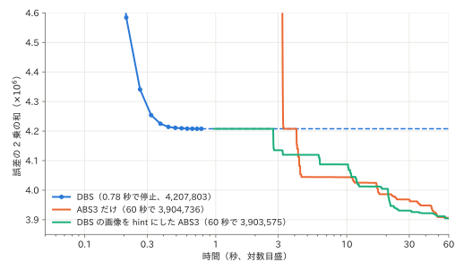
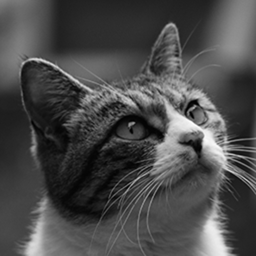
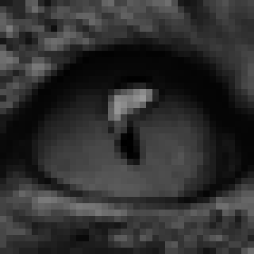
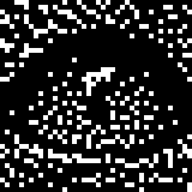
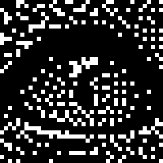
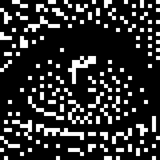

# 画像のハーフトーン化

**ハーフトーン化**（halftoning）は、グレースケール画像を白黒2値の点の画像に変換する画像処理です。
新聞の写真やモノクロプリンタの印刷など、白か黒かの2値しか表現できない媒体で濃淡を表現するために使われています。
細かい白黒の点は、離れて見ると目の中で平均され、中間の明るさに見えます。

人の目に見える誤差を小さくする2値化の方法として、**DBS**（Direct Binary Search）がよく知られています。
DBS が小さくする誤差は、そのまま QUBO のエネルギーとして書けます。
このページでは、$256\times 256$ 画素の猫の写真を、DBS と QUBO ソルバー ABS3 で2値化して比べます。



動画のプログラムと章ごとの説明は[動画：画像のハーフトーン化](VIDEO_HALFTONING)のページにあります。

## 目で見た誤差

$n_r \times n_c$ 画素のグレースケール画像 $I$（画素値 $0 \le I_{ij} \le 255$）が与えられたとします。
2値画像の各画素にバイナリ変数 $x_{ij} \in \lbrace0,1\rbrace$ を割り当てます（$1$ が白、$0$ が黒）。

人の目のぼけは、$(2M{+}1)\times(2M{+}1)$ のフィルタ $G$ との畳み込みで表します
（このページでは $M=3$、係数の総和が $255$ の $7\times 7$ 整数ガウシアンを使います）。
2値画像 $x$ をぼかした値は

$$(G * x)_{ij} = \sum_{k=0}^{2M} \sum_{l=0}^{2M} G_{kl}\, x_{i+k-M,\, j+l-M}$$

です（画像の外側の画素は $0$ とみなします）。$G$ の係数の総和が $255$ なので、画像の内部では $(G * x)_{ij}$ は $0$〜$255$ の値をとり、目で見た2値画像の明るさを表します。

目標値には元の画像そのものを使います:

$$T_{ij} = \mathrm{round}\!\left(\frac{I_{ij}\, m_{ij}}{255}\right),
\qquad m_{ij} = (G * \mathbf{1})_{ij}$$

ここで $m_{ij}$ は画素 $(i,j)$ に届くフィルタ係数の合計（$\mathbf{1}$ は全画素が $1$ の画像）です。
画像の内部では $m_{ij} = 255$、すなわち $T_{ij} = I_{ij}$ です。
画像の端ではフィルタの窓が画像からはみ出し、ぼかした値の最大が $m_{ij}$ に下がるので、目標も同じ比率で縮めています。
元の画像もぼかして目標にする方法も考えられますが、ぼかさずにそのまま目標にする方が、輪郭のはっきりした2値画像になります。

目で見た誤差は、ぼかした2値画像と目標値の差の2乗の和です:

$$E(x) = \sum_{i,j} \bigl( (G * x)_{ij} - T_{ij} \bigr)^2$$

## DBS

DBS は、$E(x)$ を小さくする2値画像を次の手順で求めます。

1. 各画素の値を、ランダムなしきい値（$0$〜$254$）より明るければ白、そうでなければ黒にした画像から始めます。
2. 画素を左上から右下へ順に（ラスタ順に）見て、その画素の**反転**と、色の違う隣の 8 画素との**入れ替え**を試し、$E(x)$ が一番下がるものを選んで実行します。どれでも下がらなければ何もしません。
3. 画像全体の走査を、どの画素でも $E(x)$ が下がらなくなるまで繰り返します。

猫の写真では、このページのプログラムで走査 10 回で止まりました（しきい値の乱数が違う [C++ 版](../HALFTONING)のプログラムでは 13 回、約 0.2 秒）。
入れ替えを使わず反転だけで同じことをすると、$E(x)$ は $7.0$〜$7.3 \times 10^6$ で止まり、入れ替えありの $4.2 \times 10^6$ よりずっと悪くなります。
白い点を隣へずらすには反転が2回要り、1回目の反転では誤差が増えてしまうからです。

## QUBO として表す

$(G * x)_{ij}$ は変数の1次式なので、$E(x)$ は変数の2次式、すなわち制約のない QUBO です。
QUBO のエネルギーが、目で見た誤差の2乗の和そのものになります。
DBS は、この QUBO の解を、1変数（反転）または2変数（入れ替え）ずつ変えて、エネルギーが下がらなくなるまで探す局所探索です。
同じ QUBO を QUBO ソルバーに渡せば、DBS と同じ基準で、より良い2値画像を探せます。

## 変数と項

$256\times 256$ の画像では、変数は画素の数と同じ $65{,}536$ 個です。
2乗を展開して現れる2つの変数の積 $x_{ij}\, x_{kl}$ は、画素 $(i,j)$ と $(k,l)$ が同じフィルタの窓に入る組だけです。
内部の画素の相手は、上下左右に $2M = 6$ 画素以内のうち $G$ の窓が重なる $128$ 個で、QUBO の項は $4{,}171{,}656$ 個になります。
項の数は画素の数に比例する、疎な QUBO です。

## PyQBPP プログラム

入力の画像 [halftone_cat.pgm](../../images/halftone_cat.pgm)（PGM 形式、$256 \times 256$ 画素）を、実行するディレクトリに置いて実行します。
このプログラムは、DBS の2値画像、ABS3 だけで探した2値画像、DBS の2値画像を hint（ヒント解）として ABS3 に与えて探した2値画像の3つを求めます:

```python
import random

import pyqbpp as qbpp

M = 3                                        # フィルタ半径（7x7 フィルタ）
G = [[0, 0, 1, 1, 1, 0, 0],
     [0, 1, 5, 7, 5, 1, 0],
     [1, 5, 14, 21, 14, 5, 1],
     [1, 7, 21, 31, 21, 7, 1],
     [1, 5, 14, 21, 14, 5, 1],
     [0, 1, 5, 7, 5, 1, 0],
     [0, 0, 1, 1, 1, 0, 0]]                  # 整数ガウシアン（総和 255）

# 入力画像: PGM（P2 形式）のグレースケール画像
with open("halftone_cat.pgm") as fp:
    tokens = fp.read().split()
COLS, ROWS = int(tokens[1]), int(tokens[2])
img = [[int(v) for v in tokens[4 + i * COLS:4 + (i + 1) * COLS]] for i in range(ROWS)]


def inside(i, j):
    return 0 <= i < ROWS and 0 <= j < COLS


def blur(a):
    # G との畳み込み（画像の外側の画素は 0 とみなす）
    out = [[0] * COLS for _ in range(ROWS)]
    for i in range(ROWS):
        for j in range(COLS):
            for k in range(2 * M + 1):
                for l in range(2 * M + 1):
                    if inside(i + k - M, j + l - M):
                        out[i][j] += G[k][l] * a[i + k - M][j + l - M]
    return out


# 目標値 T: 元画像そのもの（境界は届くフィルタ質量に合わせて縮小）
mass = blur([[1] * COLS for _ in range(ROWS)])
target = [[round(img[i][j] * mass[i][j] / 255) for j in range(COLS)]
          for i in range(ROWS)]

# E = sum(((G * x) - T)^2)
x = qbpp.var("x", ROWS, COLS)
xp = qbpp.concat([0] * M + [x] + [0] * M, axis=1)   # 左右にゼロを連結
xp = qbpp.concat([0] * M + [xp] + [0] * M, axis=0)  # 上下にゼロを連結
conv = qbpp.expr(ROWS, COLS)                         # (G * x)
for k in range(2 * M + 1):
    for l in range(2 * M + 1):
        if G[k][l]:
            conv += G[k][l] * xp[k:k + ROWS, l:l + COLS]
f = qbpp.sum((conv - qbpp.array(target)).sqr())
f.simplify_as_binary()


def overlap(i, j, i2, j2):
    # 画素 (i, j) と (i2, j2) のぼけが重なる量: 画像の中の q についての G(q - p) G(q - p2) の和
    s = 0
    for k in range(2 * M + 1):
        for l in range(2 * M + 1):
            k2, l2 = i + k - i2, j + l - j2
            if inside(i + k - M, j + l - M) and 0 <= k2 <= 2 * M and 0 <= l2 <= 2 * M:
                s += G[k][l] * G[k2][l2]
    return s


# ぼけが画像からはみ出さない画素どうしの overlap は位置の差だけで決まるので、先に求めておく
INNER = {(di, dj): overlap(2 * M, 2 * M, 2 * M + di, 2 * M + dj)
         for di in range(-2 * M, 2 * M + 1) for dj in range(-2 * M, 2 * M + 1)}


def ov(i, j, i2, j2):
    if M <= min(i, i2) and max(i, i2) < ROWS - M and M <= min(j, j2) and max(j, j2) < COLS - M:
        return INNER[(i2 - i, j2 - j)]
    return overlap(i, j, i2, j2)


def dbs(seed=1):
    # DBS: 反転と隣の 8 画素との入れ替えのうち、誤差の 2 乗の和が一番下がるものを選ぶ。
    # どの画素でも下がらなくなるまで、ラスタ順の走査を繰り返す
    rng = random.Random(seed)
    b = [[1 if img[i][j] > rng.randrange(255) else 0 for j in range(COLS)]
         for i in range(ROWS)]                       # ランダムなしきい値で始める
    blurred = blur(b)
    err = [[blurred[i][j] - target[i][j] for j in range(COLS)] for i in range(ROWS)]
    c = blur(err)                                    # c[i][j]: 画素 (i, j) のぼけと誤差の内積

    def delta(i, j):                                 # 画素 (i, j) を反転したときの E の変化
        return 2 * (1 - 2 * b[i][j]) * c[i][j] + ov(i, j, i, j)

    def flip(i, j):
        d = 1 - 2 * b[i][j]
        b[i][j] ^= 1
        for i2 in range(max(0, i - 2 * M), min(ROWS, i + 2 * M + 1)):
            for j2 in range(max(0, j - 2 * M), min(COLS, j + 2 * M + 1)):
                c[i2][j2] += d * ov(i, j, i2, j2)

    while True:
        changed = 0
        for i in range(ROWS):
            for j in range(COLS):
                d0 = delta(i, j)
                best, partner = d0, None             # 反転
                for i2 in range(i - 1, i + 2):       # 色の違う隣の画素との入れ替え
                    for j2 in range(j - 1, j + 2):
                        if inside(i2, j2) and b[i2][j2] != b[i][j]:
                            de = d0 + delta(i2, j2) - 2 * ov(i, j, i2, j2)
                            if de < best:
                                best, partner = de, (i2, j2)
                if best < 0:
                    flip(i, j)
                    if partner:
                        flip(*partner)
                    changed += 1
        if changed == 0:
            return b


# DBS の 2 値画像を求め、hint にする
dbs_img = dbs()
hint = qbpp.Sol(f).set({x[i][j]: dbs_img[i][j] for i in range(ROWS) for j in range(COLS)})
print("DBS energy =", f(hint))

solver = qbpp.ABS3Solver(f)
sol = solver.search(time_limit=60)
print("variables =", sol.info["var_count"], " terms =", sol.info["term_count"])
print("ABS3 energy =", sol.energy)
sol_hint = solver.search(time_limit=60, hint=hint)
print("ABS3 + hint energy =", sol_hint.energy)


def save(name, bits):
    # 2 値画像を PGM（P2 形式）で保存
    with open(name, "w") as fp:
        fp.write(f"P2\n{COLS} {ROWS}\n255\n")
        for row in bits:
            fp.write(" ".join(str(255 * int(v)) for v in row) + "\n")


save("dbs.pgm", dbs_img)
save("abs3.pgm", sol(x))
save("abs3_hint.pgm", sol_hint(x))
```

### QUBO の組み立て

`f` は配列演算で組み立てています。

1. `qbpp.concat` で `x` の上下左右に幅 $M$ のゼロを連結し、$(n_r{+}2M) \times (n_c{+}2M)$ の配列 `xp` を作ります（リストの中のスカラー `0` は、連結する軸に沿ったゼロの行・列になります）。
2. `xp` から縦横に $k, l$ だけずらした $n_r \times n_c$ の部分配列 `xp[k:k + ROWS, l:l + COLS]` を $G_{kl}$ 倍して `conv` に足します。二重ループが終わると、`conv` は1次式の配列 $(G * x)$ になります。
3. 目標値の配列 `qbpp.array(target)` を引いて要素ごとに `sqr()` で2乗し、`qbpp.sum` で合計すると $E(x)$ になります。`simplify_as_binary()` が同類項をまとめ、$x^2 = x$ の規則で式を整理します。

### DBS

DBS の中では $E(x)$ を毎回計算し直さず、画素を反転したときの変化だけを求めます。
画素 $p$ のぼけ（$p$ だけが白の画像をぼかしたもの）を $g_p$、誤差の画像を $e = (G * x) - T$ とします。
画素 $p$ を $d = \pm 1$ だけ変えると誤差は $d\, g_p$ だけ変わるので、

$$\Delta E = 2d\, \langle g_p, e\rangle + \langle g_p, g_p\rangle$$

です（$\langle\cdot,\cdot\rangle$ は画像の中の画素についての積の和）。
`c[i][j]` が $\langle g_p, e\rangle$、`overlap(p, p2)` が $\langle g_p, g_{p_2}\rangle$ です。
入れ替えは色の違う2画素の反転なので、2つの反転の変化の和から重なりの分 $2\langle g_p, g_{p_2}\rangle$ を引いたものが変化になります。
変更を実行したら、`flip()` が上下左右 $2M$ 画素以内の `c` を直します。

### hint

`qbpp.Sol(f).set(...)` で、DBS の2値画像を変数の値にした解 `hint` を作ります。
`f(hint)` は DBS の2値画像の誤差の2乗の和です。
`search(hint=hint)` は、hint を出発点にして探索します。

### 出力結果

```
DBS energy = 4206279
variables = 65536  terms = 4171656
ABS3 energy = 3908646
ABS3 + hint energy = 3896835
```

ABS3 は乱択の探索なので、energy の値は実行ごとに変わります（NVIDIA RTX 3090 を 2 枚積んだ計算機での例）。
この Python の DBS は約 19 秒かかります（同じ処理の C++ 版は約 0.2 秒です）。

## 3 つの比較

時間と誤差の2乗の和（エネルギー）の変化を、DBS、ABS3 だけ、DBS の2値画像を hint にした ABS3 で比べました（上と同じ計算機。それぞれ何回か実行したうちの1回です）。グラフの DBS は、変化を毎回フィルタの窓の中で計算し直す C++ の実装で測っていて、このページのプログラムより遅く 0.78 秒かかっています。
hint を与えた ABS3 は、DBS が終わった後から探索を始めます:

<p align="center">
  
</p>

- DBS は 0.78 秒で止まります。それ以上は誤差を下げられません。
- ABS3 だけの探索は、3 秒あまりで DBS の誤差を下回り、その後も下がり続けます。
- hint を与えると、DBS の解から探し始められるので、最初の数秒は ABS3 だけより良い解が得られます。60 秒後には、どちらもほぼ同じ値になりました。

## 画像の比較

元の画像と、3 つの2値画像です:

<p align="center">
  
  
  
  
</p>

左から、元の画像、DBS（誤差の2乗の和 4,207,803）、ABS3 だけ（3,904,736）、DBS の画像を hint にした ABS3（3,903,575）です（画像とこれらの値は別の実行で求めたもので、上の出力結果とは少し違います）。
目の部分（$40\times 40$ 画素）を拡大すると:

<p align="center">
  
  
  
  
</p>

誤差の2乗の和は ABS3 の方が 7% ほど小さいのですが、見た目では3つの差はほとんど分かりません。
実用には、速い DBS で十分です。

## まとめ

ハーフトーン化の QUBO は、変数が画素の数だけあり、項の数が画素の数に比例する疎な QUBO です。
画像を大きくすれば規模を自由に変えられ、DBS という速くて良い解を出す方法とも比べられるので、QUBO ソルバーのベンチマークとして興味深い問題です。

点をまとめて打つ [クラスタドット・ハーフトーン](CLUSTER_HALFTONING) では、同じ誤差に制約を加えて解きます。
