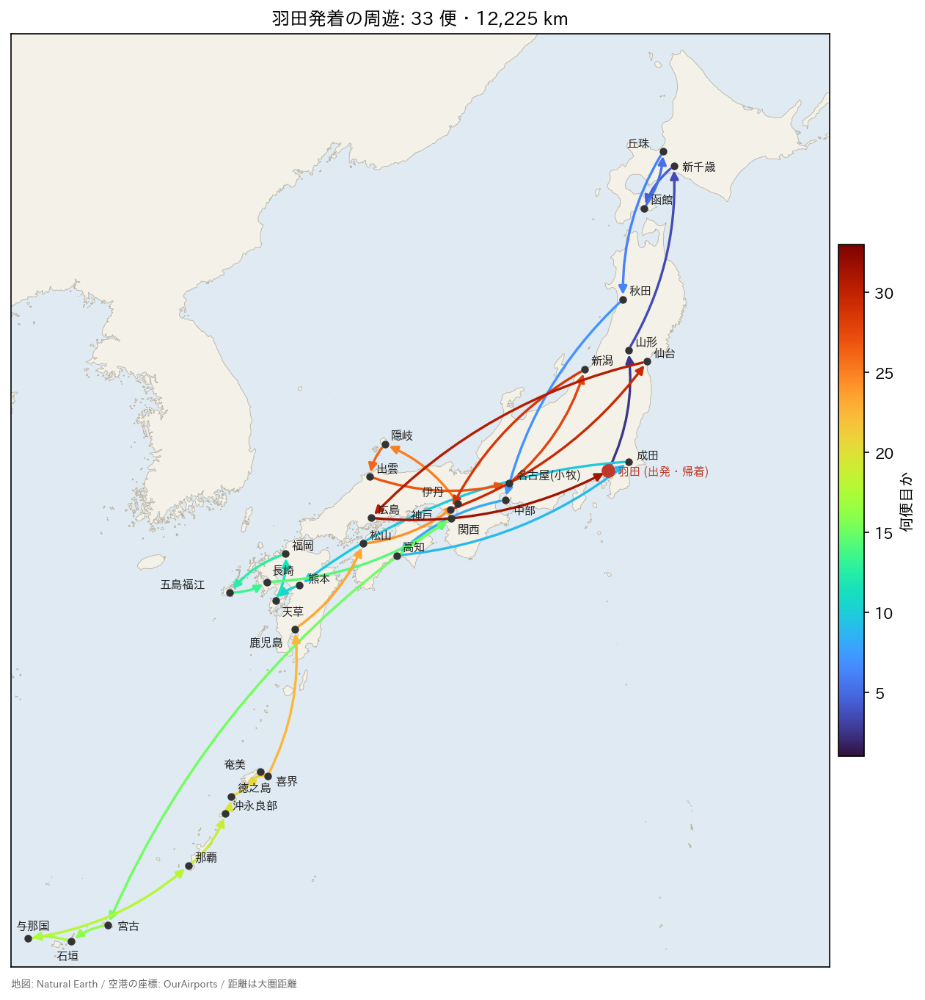
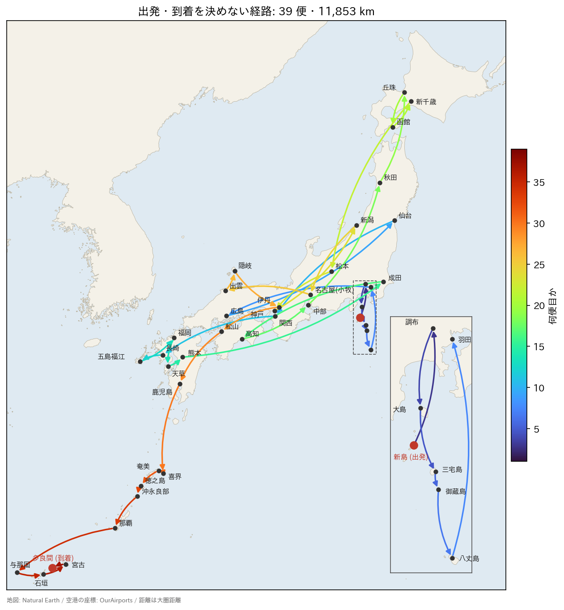

# 最多空港めぐり
**最多空港めぐり**は、日本の国内線の直行便を乗り継いで、同じ空港を 2 度通らずに、できるだけ多くの空港を回る問題です。
回る空港の数が同じなら、総距離が短いほうを選びます。
次の 2 つの場合を考えます：

1. 必ず羽田空港から出発して、羽田空港に戻る。
2. 出発空港と到着空港を、互いに異なる任意の空港にできる。



動画では、問題を有向グラフで表して制約と目的関数を説明し、プログラムで 2 つの場合を解いて、答えを飛行機でたどります。動画のプログラムと章ごとの説明は[動画：最多空港めぐり](VIDEO_LONGEST_FLIGHT)のページにあります。

## データ
[domestic_flights.csv](../../images/domestic_flights.csv) は、2026 年の冬ダイヤ（2026 年 10 月 25 日〜2027 年 3 月 27 日）で、基本的に毎日運航する国内線の直行便の一覧です。
伊豆諸島を結ぶヘリコプターの便も含みます。
各航空会社の時刻表をもとに作りました。
85 空港と 458 便があり、1 行が 1 つの向きの便です：
```
from,to,km
AKJ,HND,931
AKJ,NRT,896
AOJ,CTS,242
...
```
`from` と `to` は出発空港と到着空港のコード（`HND` は羽田）、`km` は 2 つの空港の間の大圏距離（km、整数に丸めた値）です。
空港のコードはほとんどが 3 文字ですが、調布・新島・神津島は 4 文字のコード（`RJTF`・`RJAN`・`RJAZ`）、青ヶ島と御蔵島のヘリポートは `HP_AOGASHIMA`・`HP_MIKURAJIMA` としました。
ほとんどの路線は両方の向きに便がありますが、奄美→与論と那覇→奄美は、逆の向きの便がありません。
乗り継ぎの時刻（同じ日に乗り継げるか）は考えません。
運航の状況は変わるので、このデータは実際の運航と違うことがあります。

## 定式化
空港の集合を $V$、便の集合を $E$ とする有向グラフ $G=(V,E)$ で考えます。
辺 $(u,v)\in E$ は、空港 $u$ から空港 $v$ への便です。
便 $(u,v)\in E$ ごとにバイナリ変数 $x_{u,v}$ を導入し、$x_{u,v}=1$ はその便に乗ることを表します。
空港 $v$ に着く便の変数の和を $\text{in}(v)$、$v$ を出る便の変数の和を $\text{out}(v)$ とします：

$$
\text{in}(v)=\sum_{(u,v)\in E}x_{u,v},\qquad \text{out}(v)=\sum_{(v,w)\in E}x_{v,w}
$$

### 制約
羽田を $r\in V$ と書きます。
次の制約を課します：

$$
\begin{aligned}
\text{in}(v)&=\text{out}(v) && (v\in V)\\
\text{in}(v)&\leq 1 && (v\in V)\\
\text{in}(r)&=1\\
x_{u,v}+x_{v,u}&\leq 1 && ((u,v)\in E,\ (v,u)\in E)
\end{aligned}
$$

1 つめは、着いた空港からは出発すること、2 つめは、同じ空港には 1 度しか着かないことを表します。
この 2 つを満たすと、乗る便はいくつかの閉路に分かれ、閉路どうしは空港を共有しません。
3 つめで、羽田を含む閉路がちょうど 1 つでき、これが答えになります。
4 つめは、同じ路線を往復しないことを表します。
往復の 2 便だけでできる閉路はどこにでも作れるので、あらかじめまとめて除いておきます。

### 目的関数
閉路では、回る空港の数と乗る便の数は同じです。
そこで、乗る便の数を最大にし、その中で総距離を最短にします。
便 $(u,v)$ の距離を $d_{u,v}$ として、便 $(u,v)$ に乗ることの価値を次のようにします：

$$
w_{u,v} = M - d_{u,v}
$$

$M$ は閉路の総距離より必ず大きい数で、空港ごとに「その空港に着く便の距離の最大値」を足して 1 を加えたものにします。
閉路は各空港に高々 1 度着くので、閉路の総距離はこの和を超えません。
$k$ 便の閉路で総距離が $D$ なら、価値の和は $kM-D$ です。
$D<M$ なので、便が 1 つ多い閉路の価値の和は必ず大きく、便の数が同じなら総距離の短い閉路の価値の和が大きくなります。
したがって、価値の和 $\sum_{(u,v)\in E}w_{u,v}x_{u,v}$ を最大にすれば、求める閉路が得られます。

最小化するので符号を反転し、制約を重み $P$ で加えます：

$$
f = -\sum_{(u,v)\in E}w_{u,v}x_{u,v} + P\cdot(\text{制約})
$$

制約は `qbpp::cons()` で宣言し、$P$ は便の価値の総和に 1 を加えた値にします。
制約を 1 つでも破ると $P$ 以上損をするので、制約を破った解が $f$ の最小になることはありません。

## 羽田を含まない閉路を除く
上の制約だけでは、羽田を含む閉路のほかに、羽田を含まない閉路が解に混ざることがあります。
羽田を含まない閉路も、制約をすべて満たしています。
「乗る便が 1 つの閉路になる」という条件はグラフ全体にかかわる条件で、空港ごとの式では直接書けません。

そこで、[スリザーリンク](SLITHERLINK)と同じように、解いた結果を見て制約を加えることを繰り返します：

1. 制約を加えた $f$ を解く。
2. 解を閉路に分ける。羽田を含まない閉路がなければ、羽田を含む閉路が答え。
3. 羽田を含まない閉路があれば、その閉路の空港の集合 $S$ ごとに次の制約を加えて、1 に戻る。

$$
\text{enter}(S)\geq \text{in}(v)\quad (v\in S),\qquad \text{enter}(S)=\sum_{(u,v)\in E,\ u\notin S,\ v\in S}x_{u,v}
$$

$\text{enter}(S)$ は、$S$ の外から $S$ の空港に着く便の変数の和です。
この制約は、「$S$ のどれかの空港に着くなら、$S$ の外から $S$ に入る便に乗る」ことを表します。
羽田を含まない閉路 $S$ だけに乗る解は、$S$ に入る便がない（$\text{enter}(S)=0$）のに $S$ の空港に着く（$\text{in}(v)=1$）ので、この制約に違反します。
一方、羽田を含む閉路は $S$ の外にある羽田を通るので、$S$ の空港に着くなら、その前にどこかで $S$ の外から $S$ に入ります。
そのため、羽田を含む閉路がこの制約に違反することはなく、答えを除いてしまうことはありません。

スリザーリンクでは、見つかったループの辺を全部は選ばないという制約 $\sum_{e\in L}x_e\leq |L|-1$ を加えました。
この制約が除くのは、そのループの辺を全部選んだ解だけです。
ここでの制約は、$S$ に外から入らずに $S$ の空港に着く解をすべて除くので、同じ空港の集合で順番を変えた閉路や、$S$ の一部だけを回る閉路もまとめて除けます。

## QUBO++ プログラム
[domestic_flights.csv](../../images/domestic_flights.csv) を、実行するディレクトリに置いて実行します：
```python
import csv
import pyqbpp as qbpp

airports = []      # 空港コード
flights = []       # 便 (出発, 到着, 距離)。1 つの向きの直行便
flight_index = {}  # (出発, 到着) から便の番号


def airport(code):
    if code not in airports:
        airports.append(code)
    return airports.index(code)


def add_flight(u, v, km):
    flight_index[(u, v)] = len(flights)
    flights.append((u, v, km))


# root を含み、同じ空港を 2 度通らない閉路で、
# 便の数が最大で、その中で総距離が最短のものを求める
def longest_trip(root):
    n, m = len(airports), len(flights)
    x = qbpp.var("x", shape=m)

    # 便の価値 M - km。M は閉路の総距離より必ず大きい
    max_in = [0] * n
    for u, v, km in flights:
        max_in[v] = max(max_in[v], km)
    M = sum(max_in) + 1
    obj = qbpp.sum([(M - km) * x[e] for e, (u, v, km) in enumerate(flights)])
    P = sum(M - km for u, v, km in flights) + 1  # 制約の重み: 便の価値の総和 + 1

    into = [0] * n
    out = [0] * n
    for e, (u, v, km) in enumerate(flights):
        into[v] += x[e]
        out[u] += x[e]
    c = 0
    for v in range(n):
        c += qbpp.cons(into[v] - out[v] == 0)  # 着いた空港からは出発する
        c += qbpp.cons(into[v] <= 1)           # 同じ空港には 1 度だけ
    c += qbpp.cons(into[root] == 1)  # root を通る
    for e, (u, v, km) in enumerate(flights):  # 同じ路線を往復しない
        r = flight_index.get((v, u))
        if r is not None and e < r:
            c += qbpp.cons(x[e] + x[r] <= 1)
    f = -obj + P * c

    trip = []
    rnd = 0
    while True:
        rnd += 1
        f.simplify_as_binary()
        solver = qbpp.ABS3Solver(f)
        hint = None
        if rnd > 1:  # 前回の root を含む閉路をヒントにする
            hint = qbpp.Sol(f)
            for a, b in zip(trip, trip[1:]):
                hint.set(x[flight_index[(a, b)]], 1)
        sol = solver.search(time_limit=5, hint=hint)

        # root から選んだ便をたどると root を含む閉路。残りは root を含まない閉路
        nxt = [-1] * n
        for e, (u, v, km) in enumerate(flights):
            if sol(x[e]) == 1:
                nxt[u] = v
        done = [False] * n
        trip = [root]
        v = nxt[root]
        while v != root:
            trip.append(v)
            done[v] = True
            v = nxt[v]
        trip.append(root)
        cycles = []
        for s in range(n):
            if nxt[s] < 0 or s == root or done[s]:
                continue
            S = set()
            v = s
            while not done[v]:
                done[v] = True
                S.add(v)
                v = nxt[v]
            cycles.append(S)
        print(f"round {rnd}: flights = {len(trip) - 1}, other cycles = {len(cycles)}")
        if not cycles:
            return trip

        # 閉路の空港の集合 S ごとに: S の空港に着くなら、S の外から S に入る便に乗る
        for S in cycles:
            enter = qbpp.sum([x[e] for e, (u, v, km) in enumerate(flights)
                              if u not in S and v in S])
            for v in S:
                f += P * qbpp.cons(enter - into[v] >= 0)


def print_trip(trip):
    km = sum(flights[flight_index[(a, b)]][2] for a, b in zip(trip, trip[1:]))
    print(" ".join(airports[v] for v in trip))
    print(f"distance = {km} km")


with open("domestic_flights.csv") as file:
    for row in csv.DictReader(file):
        add_flight(airport(row["from"]), airport(row["to"]), int(row["km"]))
print(f"{len(airports)} airports, {len(flights)} flights")

print_trip(longest_trip(airport("HND")))

# 出発空港と到着空港を決めない経路: どの空港とも距離 0 の便で結ばれたダミーの空港 DMY を加える
dmy = airport("DMY")
for v in range(dmy):
    add_flight(dmy, v, 0)
    add_flight(v, dmy, 0)
print_trip(longest_trip(dmy))
```
`airports` は空港コードのリストで、空港の番号はこの中の位置です。
`flights` は便（出発空港、到着空港、距離）のリストで、`flight_index` は出発空港と到着空港の番号の組から便の番号を引く辞書です。
最後の部分で CSV ファイルを読み、`add_flight()` で便を加えます。

`longest_trip(root)` が、空港 `root` を含む閉路を求めます。
`qbpp.var("x", shape=m)` で便ごとの変数を作り、`into[v]` と `out[v]` に空港 `v` に着く便と出る便の変数を足します（`in` は Python の予約語なので `into` にしています）。
価値 `M - km` の和が `obj`、制約の和が `c` で、`f = -obj + P * c` を最小化します。

反復のループでは、毎回 `f` を簡約して ABS3 Solver を作り直し、5 秒探索します。
2 回目からは、前回の `root` を含む閉路の便に乗り、それ以外の便に乗らない解を `qbpp.Sol(f)` から作って、`hint=` で[ヒント解](ABS3#solution-hint)として渡します。
前回の `root` を含む閉路は、新しく加えた制約も満たします。
ABS3 Solver はヒント解よりエネルギーの高い解を返さないので、毎回の解のエネルギーは、前回の `root` を含む閉路のエネルギー以下になります。

解から、出発空港ごとに選んだ便の到着空港を `nxt` に入れます。
`root` から `nxt` をたどって `root` に戻るまでが、`root` を含む閉路です。
この閉路に入らなかった空港からも `nxt` をたどると、`root` を含まない閉路が得られ、その空港の集合を `cycles` に入れます。
`cycles` が空なら `root` を含む閉路を返し、そうでなければ集合 `S` ごとに制約 `enter - into[v] >= 0` を重み `P` で `f` に加えます。

## 羽田を出て羽田に戻る場合
`longest_trip(airport("HND"))` が、羽田を含む閉路を求めます。
出力の例は次のとおりです：
```
85 airports, 458 flights
round 1: flights = 7, other cycles = 6
round 2: flights = 29, other cycles = 1
round 3: flights = 29, other cycles = 1
round 4: flights = 29, other cycles = 1
round 5: flights = 29, other cycles = 1
round 6: flights = 29, other cycles = 1
round 7: flights = 29, other cycles = 1
round 8: flights = 29, other cycles = 1
round 9: flights = 29, other cycles = 1
round 10: flights = 7, other cycles = 1
round 11: flights = 7, other cycles = 1
round 12: flights = 33, other cycles = 0
HND GAJ CTS HKD OKD AXT NGO KCZ NRT KMJ AXJ FUK FUJ NGS KIX MMY ISG OGN OKA OKE TKN ASJ KKX KOJ MYJ ITM OKI IZO NKM KIJ UKB SDJ HIJ HND
distance = 12225 km
```
`flights` は羽田を含む閉路の便の数、`other cycles` は羽田を含まない閉路の数です。
1 回目の解では、羽田を含む閉路は 7 便だけで、羽田を含まない閉路が 6 つあります。
反復ごとに見つかった閉路が除かれ、12 回目に羽田を含まない閉路がなくなりました。
10 回目と 11 回目では羽田を含む閉路が 7 便に戻っていますが、羽田を含まない閉路の便も合わせたエネルギーは、ヒントとして渡した前回の羽田を含む閉路のエネルギー以下です。

得られた閉路は 33 空港・33 便・12,225 km で、これが最適値です。
羽田 → 山形 → 新千歳 → 函館 → 丘珠 → 秋田 → 中部 → 高知 → 成田 → 熊本 → 天草 → 福岡 → 五島福江 → 長崎 → 関西 → 宮古 → 石垣 → 与那国 → 那覇 → 沖永良部 → 徳之島 → 奄美 → 喜界 → 鹿児島 → 松山 → 伊丹 → 隠岐 → 出雲 → 名古屋（小牧） → 新潟 → 神戸 → 仙台 → 広島 → 羽田 と回ります。

<p align="center">
  
</p>

ソルバーの探索は乱数を使うので、途中の解と反復の回数は実行ごとに変わります。
この閉路を逆の向きに回っても 33 便・12,225 km なので、逆の向きの閉路が出力されることもあります。

## 出発空港と到着空港を決めない場合
出発空港と到着空港を決めなければ、もっと多くの便に乗れるかもしれません。
これは、出発空港から到着空港への、同じ空港を 2 度通らない経路を求める問題です。

この問題は、ダミーの空港 `DMY` を加えると、上と同じ問題になります。
`DMY` から各空港への便と、各空港から `DMY` への便を、距離 0 で加えます。
`DMY` を含む閉路は、`DMY` からある空港 $s$ に飛び、$s$ から空港 $t$ まで乗り継いで、$t$ から `DMY` に戻る閉路です。
`DMY` との 2 便を除くと、$s$ から $t$ への経路になります。

`DMY` との便の価値は $M-0=M$ です。
`DMY` を含む閉路は、`DMY` との便にちょうど 2 つ乗るので、どの閉路も価値の和が同じだけ（$2M$）増えます。
そのため、`DMY` との便の価値は、どの閉路が最良かを変えません。

プログラムの最後では、`DMY` と、`DMY` との便を加えて、`longest_trip(dmy)` で `DMY` を含む閉路を求めます。
出力の例は次のとおりです：
```
round 1: flights = 27, other cycles = 2
round 2: flights = 27, other cycles = 2
round 3: flights = 37, other cycles = 1
round 4: flights = 37, other cycles = 1
round 5: flights = 37, other cycles = 1
round 6: flights = 37, other cycles = 1
round 7: flights = 37, other cycles = 1
round 8: flights = 37, other cycles = 1
round 9: flights = 37, other cycles = 1
round 10: flights = 37, other cycles = 1
round 11: flights = 41, other cycles = 0
DMY RJAN RJTF OIM MYE HP_MIKURAJIMA HAC HND HIJ SDJ KIX NGS FUJ FUK AXJ KMJ NRT KCZ NGO AXT OKD HKD CTS MMJ UKB KIJ NKM IZO OKI ITM MYJ KOJ KKX ASJ TKN OKE OKA OGN ISG MMY TRA DMY
distance = 11853 km
```
`flights = 41` は `DMY` との 2 便を含むので、経路は 40 空港・39 便・11,853 km で、これが最適値です。
羽田を含む閉路より 7 空港多く、総距離は短くなりました。
新島 → 調布 → 大島 → 三宅島 → 御蔵島 → 八丈島 → 羽田 → 広島 → 仙台 → 関西 → 長崎 → 五島福江 → 福岡 → 天草 → 熊本 → 成田 → 高知 → 中部 → 秋田 → 丘珠 → 函館 → 新千歳 → 松本 → 神戸 → 新潟 → 名古屋（小牧） → 出雲 → 隠岐 → 伊丹 → 松山 → 鹿児島 → 喜界 → 奄美 → 徳之島 → 沖永良部 → 那覇 → 与那国 → 石垣 → 宮古 → 多良間 と乗り継ぎます。
大島 → 三宅島 → 御蔵島 → 八丈島 はヘリコプターの便です。
地図の右下は、伊豆諸島のあたりの拡大図です。

<p align="center">
  
</p>

この経路を逆の向きに乗っても同じ距離なので、多良間から新島への経路が出力されることもあります。

## 少し長い経路が出力されることがある
出発空港と到着空港を決めない場合は、実行によって、総距離の少し長い経路が出力されることがあります。
たとえば 11,856 km の経路は、上の経路の熊本と松山の間の 14 空港を逆の順に回る経路です（熊本 → 伊丹 → 隠岐 → … → 高知 → 成田 → 松山）。
2 つの経路で違う路線は、区間の両端だけです（上の経路は熊本–成田と伊丹–松山、11,856 km の経路は熊本–伊丹と成田–松山）。
間の 13 路線は、同じ路線を逆の向きに乗るだけです。
しかし有向グラフの定式化では、向きの違う便は別の変数なので、一方の経路から他方の経路に移るには 30 個の変数を同時に変える必要があります。
途中の状態は「着いた空港からは出発する」制約を破るので、ソルバーはこの移動を見つけにくく、しかも得は 3 km だけです。
11,958 km のように、回る空港の組が違う経路が出力されることもあります。
何回か実行して、最も短い経路を選んでください。
