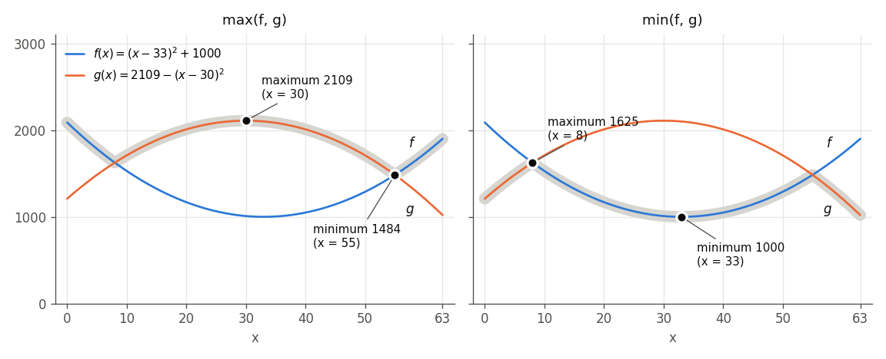
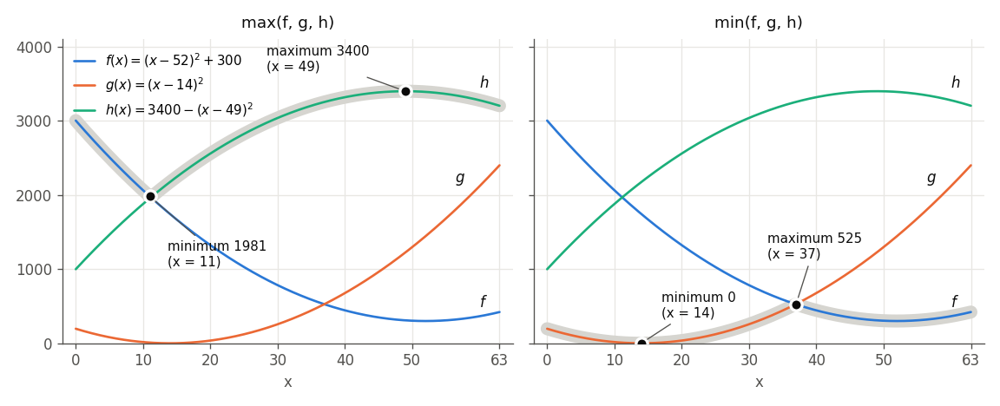

# 最大値・最小値の最小化と最大化

`qbpp.max(f, g)`・`qbpp.min(f, g)`（[非線形関数とネイティブ制約](CONSTRAINTS)）は，
2 つの式の最大値・最小値を表します．ソルバーはエネルギーを最小化するので，
目的関数に正の係数で足すと最小化，負の係数で足すと最大化の向きに働き，
次の 4 通りの使い方があります:

| 目的関数に足す項 | 意味 |
|---|---|
| `qbpp.max(f, g)` | 最大値を最小化する |
| `-qbpp.max(f, g)` | 最大値を最大化する |
| `qbpp.min(f, g)` | 最小値を最小化する |
| `-qbpp.min(f, g)` | 最小値を最大化する |

このページでは，まず 2 つの式についてこの 4 通りをグラフで説明し，
次に 3 つ以上の式の最大値・最小値を扱う方法を説明します．

## 2 つの式の場合

0 から 63 の値をとる[整数変数](INTEGER) $x$ と，次の 2 つの関数を考えます:

$$
f(x) = (x - 33)^2 + 1000, \qquad g(x) = 2109 - (x - 30)^2
$$

$f$ は下に凸，$g$ は上に凸の放物線で，$x = 8$ と $x = 55$ で交わります．
次の図の左は $\max(f, g)$，右は $\min(f, g)$ を灰色の太い線で示しています:

<p align="center">
  
</p>

4 通りの答えは，灰色の線の最も低い点と最も高い点です:

- `qbpp.max(f, g)` の最小: 左の線の最も低い点，つまり交点 $x = 55$ での 1484
- `-qbpp.max(f, g)` の最小（最大値の最大化）: 左の線の最も高い点，$g$ の頂点 $x = 30$ での 2109
- `qbpp.min(f, g)` の最小: 右の線の最も低い点，$f$ の頂点 $x = 33$ での 1000
- `-qbpp.min(f, g)` の最小（最小値の最大化）: 右の線の最も高い点，もう 1 つの交点 $x = 8$ での 1625

次のプログラムは，この 4 通りを順に解きます:

```python
import pyqbpp as qbpp

x = qbpp.var("x", integer=(0, 63))
f = qbpp.sqr(x - 33) + 1000
g = 2109 - qbpp.sqr(x - 30)


def solve(name, obj):
    obj.simplify()
    sol = qbpp.ExhaustiveSolver(obj).search()
    print(f"{name}: energy = {sol.energy}, x = {sol(x)}, f = {sol(f)}, g = {sol(g)}")


solve("+max", qbpp.max(f, g))
solve("-max", -qbpp.max(f, g))
solve("+min", qbpp.min(f, g))
solve("-min", -qbpp.min(f, g))
```

- `solve` は，目的関数 `obj` を簡約し，`ExhaustiveSolver` で厳密な最小解を求めて表示します．
- `-qbpp.max(f, g)` と `-qbpp.min(f, g)` は負の係数 $-1$ を掛けた項です．

プログラムの出力は次の通りです:

```
+max: energy = 1484, x = 55, f = 1484, g = 1484
-max: energy = -2109, x = 30, f = 1009, g = 2109
+min: energy = 1000, x = 33, f = 1000, g = 2100
-min: energy = -1625, x = 8, f = 1625, g = 1625
```

負の係数の項では，エネルギーは最大値（最小値）の符号を反転した値になります．

2 つの式なら，4 通りとも `qbpp.max`・`qbpp.min` をそのまま書くだけで，補助の変数は要りません．
バンドルされているソルバーは 4 通りのどれでも正しく扱います．
ただし MIP ソルバーで使えるのは，最大値の最小化と最小値の最大化の 2 通りだけです
（[非線形関数とネイティブ制約](CONSTRAINTS)）．

## 3 つ以上の式の場合

`qbpp.max`・`qbpp.min` が受け付けるのは 2 つの式だけで，3 つ以上の式（や式のリスト・配列）を
渡すと `TypeError` になります．また，非線形関数はネストできないので，
`qbpp.max(qbpp.max(f, g), h)` のように入れ子にすると `RuntimeError` になります．

3 つ以上の式 $f_1, \ldots, f_n$ の最大値・最小値は，補助の変数を加えて表します．
加える変数は，4 通りのどれかで次のように変わります:

| | 最小化する | 最大化する |
|---|---|---|
| 最大値 $\max(f_1, \ldots, f_n)$ | 整数変数 $z$ と relu（または cons） | ワンホットで 1 つ選ぶ |
| 最小値 $\min(f_1, \ldots, f_n)$ | ワンホットで 1 つ選ぶ | 整数変数 $z$ と relu（または cons） |

最大値が $t$ 以下になるのは，**すべての** $f_i$ が $t$ 以下のときです．
そのため，最大値を小さくしたいときは，すべての $f_i$ を上から押さえる整数変数 $z$ を使います．
一方，最大値が $t$ 以上になるのは，**どれか 1 つの** $f_i$ が $t$ 以上のときです．
そのため，最大値を大きくしたいときは，どの $f_i$ を使うかをワンホットで選びます．
最小値はこの逆です．それぞれの方法は，表の 2 つの場合にしか使えません．

この節では，前の節とは別の次の 3 つの関数を使います（$x$ は前と同じく 0 から 63 の整数変数）:

$$
f(x) = (x - 52)^2 + 300, \qquad g(x) = (x - 14)^2, \qquad h(x) = 3400 - (x - 49)^2
$$

<p align="center">
  
</p>

### 最大値の最小化と最小値の最大化

$\max(f_1, \ldots, f_n)$ を最小化したいときは，代わりに次の式を最小化します:

$$
z + 2\sum_{i=1}^{n} \operatorname{relu}(f_i - z)
$$

$\operatorname{relu}(f_i - z)$ は $f_i$ が $z$ を超えた分です．
$z$ が最大値以上なら relu の項はすべて 0 で，式の値は $z$ です．
$z$ を最大値より 1 下げると，$z$ の分で 1 減りますが，最大値の式が $z$ を超えるので
relu の項が 2 以上増えます．そのため，この式は $z$ がちょうど最大値のときに最小になり，
その値は最大値に等しくなります．

重みを 1 にしても式の最小値は最大値に等しくなりますが，$z$ が 2 番目に大きい値と
最大値の間のどこにあっても最小になるので，$z$ の値が最大値を表しません．
重みを 1 より大きくすると，$z$ はちょうど最大値になります．

$\min(f_1, \ldots, f_n)$ を最大化したいときは，同じ考え方で次の式を最小化します:

$$
-z + 2\sum_{i=1}^{n} \operatorname{relu}(z - f_i)
$$

$z$ は最小値を下から押さえる変数で，$z$ がちょうど最小値のときに式は最小になり，
その値は最小値の符号を反転したものになります．

次のプログラムは，3 つの関数についてこの 2 通りを解きます:

```python
import pyqbpp as qbpp

x = qbpp.var("x", integer=(0, 63))
f = qbpp.sqr(x - 52) + 300
g = qbpp.sqr(x - 14)
h = 3400 - qbpp.sqr(x - 49)
z = qbpp.var("z", integer=(0, 4000))


def solve(name, obj):
    obj.simplify()
    sol = qbpp.ExhaustiveSolver(obj).search()
    print(f"{name}: energy = {sol.energy}, z = {sol(z)}, x = {sol(x)}, "
          f"f = {sol(f)}, g = {sol(g)}, h = {sol(h)}")


solve("+max", z + 2 * qbpp.relu(f - z) + 2 * qbpp.relu(g - z) + 2 * qbpp.relu(h - z))
solve("-min", -z + 2 * qbpp.relu(z - f) + 2 * qbpp.relu(z - g) + 2 * qbpp.relu(z - h))
```

- $f$, $g$, $h$ の値は 4000 以下なので，$z$ の範囲は 0 から 4000 にしています．

プログラムの出力は次の通りです:

```
+max: energy = 1981, z = 1981, x = 11, f = 1981, g = 9, h = 1956
-min: energy = -525, z = 525, x = 37, f = 525, g = 529, h = 3256
```

最大値の最小は，図の左の灰色の線の最も低い点で，$f$ と $h$ が交わるあたりの $x = 11$ での 1981 です．
$x$ は整数なので，ちょうど交わる点ではなく，その近くの整数で最小になります．
最小値の最大は，右の灰色の線の最も高い点で，$f$ と $g$ が交わるあたりの $x = 37$ での 525 です．
どちらも $z$ がその値になっています．

#### cons で書く

「どの $f_i$ も $z$ 以下」を制約として書き，$z$ を最小化する方法もあります:

$$
z + 2\sum_{i=1}^{n} \operatorname{cons}(f_i - z \le 0)
$$

上のプログラムでは，`"+max"` の行の relu の項を `2 * qbpp.cons(f - z <= 0)` などに替えるだけで，
同じ結果（エネルギー 1981，$z = 1981$）が得られます．最小値の最大化なら，
`"-min"` の行の relu の項を `2 * qbpp.cons(f - z >= 0)` などに替えます．

`qbpp.cons()` の値は違反量の 2 乗なので，$z$ を最大値より $d$ 下げると
$2d^2$ 以上増えます．$z$ の分で $d$ 減るより大きいので，こちらも
$z$ がちょうど最大値のときに最小になり，その値は最大値に等しくなります．

[納期付き機械スケジューリング](MACHINE_SCHEDULING)のメイクスパン（最も遅く終わる機械の時刻）の
最小化は，この形の例です．$z$ の係数を 100 にし，各機械の制約を重み 100000 の
`qbpp.cons()` で書いています．

#### relu と cons の違い

どちらの方法でも，最小になるのは $z$ がちょうど最大値のときで，そのエネルギーは
最大値に等しくなります．違いは次の 2 点です．

**違反の数え方**: `qbpp.cons()` で書いた部分は制約として扱われます．
$z$ が最大値より小さい解では，`f.cons(sol)`・`f.violations(sol)`・`f.is_feasible(sol)` が
違反として数え，`target_energy` を指定した探索も，すべての制約を満たすまで止まりません．
`qbpp.relu()` で書いた部分は目的関数の一部で，制約の数には入りません．
$f_i \le z$ は最大値を表すための条件で，満たさなければならない要件ではないので，
最大値を目的関数の中で使うだけなら，`qbpp.relu()` のほうが意味に合っています．
`qbpp.cons()` は，「$z$ 以下」を制約として読む，数理計画でよく使われる書き方です．

**値の形と重み**: `qbpp.cons(f_i - z <= 0)` の値は `qbpp.relu(f_i - z, 2)` と同じで，
超えた分の 2 乗です．`qbpp.relu(f_i - z)` は超えた分そのもの（1 次）です．
どちらも，重みが $z$ の係数より大きければ上の性質が成り立ちます．
違いが出るのは，探索の途中で $z$ を最大値より少し小さくした状態です．
最大値の式が 1 つのとき，$z$ を最大値より $d$ 下げると，重みを $\lambda$ として，
relu では $(\lambda - 1)d$，cons では $\lambda d^2 - d$ だけエネルギーが増えます．
この増え方が小さいと，ソルバーは $z$ を最大値より少し下げてみることができ，
$z$ を超えたすべての式に「小さくするとエネルギーが下がる」向きができます．
重みを大きくすると，この状態が高くつき，ソルバーは $z$ がすべての式以上の
範囲を主に動くようになります．その範囲ではエネルギーは $z$（つまり最大値）だけで決まるので，
最大値をとる式が 2 つ以上あると，1 つを小さくしてもエネルギーが変わらず，
問題によっては探索が遅くなることがあります．
重みは $z$ の係数より大きければ十分です（このページでは 2 倍にしています）．

### 最大値の最大化と最小値の最小化

$\max(f_1, \ldots, f_n)$ を最大化したいときは，どの $f_i$ を使うかを表すバイナリ変数
$s_1, \ldots, s_n$ を加え，次の式を最小化します:

$$
-\sum_{i=1}^{n} s_i f_i + \lambda \cdot \operatorname{cons}\Bigl(\sum_{i=1}^{n} s_i = 1\Bigr)
$$

ちょうど 1 つ選んだ $f_i$ の値が使われ，最小化によって最も大きい $f_i$ が選ばれます．
$\min(f_1, \ldots, f_n)$ を最小化したいときは，$\sum s_i f_i$ の符号を正にします．
今度は最小化によって最も小さい $f_i$ が選ばれます．
重み $\lambda$ は，$f_i$ がとりうる値の絶対値より大きくします
（2 つ以上選ぶと得をする，または 1 つも選ばないと得をすることがないようにするためです）．
$s_i f_i$ の積の分だけ，式の次数が 1 上がります．

次のプログラムは，3 つの関数についてこの 2 通りを解きます:

```python
import pyqbpp as qbpp

x = qbpp.var("x", integer=(0, 63))
f = qbpp.sqr(x - 52) + 300
g = qbpp.sqr(x - 14)
h = 3400 - qbpp.sqr(x - 49)
s = qbpp.var("s", shape=3)
picked = s[0] * f + s[1] * g + s[2] * h
one_hot = 10000 * qbpp.cons(qbpp.sum(s) == 1)


def solve(name, obj):
    obj.simplify_as_binary()
    sol = qbpp.ExhaustiveSolver(obj).search()
    print(f"{name}: energy = {sol.energy}, s = {sol(s)}, x = {sol(x)}, "
          f"f = {sol(f)}, g = {sol(g)}, h = {sol(h)}")


solve("-max", -picked + one_hot)
solve("+min", picked + one_hot)
```

- `picked` は $\sum s_i f_i$，`one_hot` は $s$ をワンホットにする制約で，重み 10000 は
  $f$, $g$, $h$ の値（4000 以下）より大きくしています．
- バイナリ変数 $s$ を含むので，`simplify_as_binary()` で簡約します．

プログラムの出力は次の通りです:

```
-max: energy = -3400, s = [0, 0, 1], x = 49, f = 309, g = 1225, h = 3400
+min: energy = 0, s = [0, 1, 0], x = 14, f = 1744, g = 0, h = 2175
```

最大値の最大は $h$ の頂点 $x = 49$ での 3400，最小値の最小は $g$ の頂点 $x = 14$ での 0 で，
$s$ がその関数を選んでいます．

この 2 通りは，最大値の最大が「各関数の最大のうち最も大きいもの」，最小値の最小が
「各関数の最小のうち最も小さいもの」なので，関数ごとに解いて比べても同じ答えになります．
ワンホットの書き方が役に立つのは，最大値（最小値）がほかの項と一緒に目的関数に入るときです．
なお，整数変数 $z$ を使う形をこの向きに使うと，$z$ が範囲の端に張り付き，
エネルギーは最大値・最小値と関係のない値になります．

### 係数とほかの項

$\max(f_1, \ldots, f_n)$ に正の係数 $c$ を掛けて最小化するときは，$z$ の係数を $c$ にし，
relu（または cons）の重みを $c$ より大きく（たとえば $2c$ に）します:

$$
c\,z + 2c\sum_{i=1}^{n} \operatorname{relu}(f_i - z)
$$

$z$ はこの部分にしか現れないので，ほかの項があっても，変数の割り当てごとに
この部分の最小値は $c \max(f_1, \ldots, f_n)$ に等しくなります．
ワンホットで選ぶ形も同じで，$\sum s_i f_i$ に係数を掛けて，ほかの項と足せます．
最大値・最小値が複数あるときは，それぞれに別の $z$（または別の $s_1, \ldots, s_n$）を使います．

### 最大値・最小値をほかの式に組み込む

`qbpp.max`・`qbpp.min` の項に使えるのは，2 つの式の場合でも，スカラー倍と足し算だけです．
式との積や `qbpp.sqr()` に使ったり，`qbpp.abs()`・`qbpp.relu()` の中に入れたりするとエラーになります．
最大値をこのような式に組み込みたいときは，最大値を表す整数変数 $z$ を使います．
$z$ は普通の整数変数なので，`qbpp.sqr(z - 2500)` や `qbpp.abs(z - 2500)`，ほかの変数との積に
そのまま使えます．

ただし，$z$ に課す条件は，最大値を包む関数 $G$ の向きによって変わります:

- $G$ が増加関数のとき（たとえば最大値が 0 以上で $G = z^2$）: これまでと同じく「すべての $f_i$ が
  $z$ 以下」を課せば，最小化によって $z$ は最大値まで下がります．重みは $G$ の傾き
  （$z$ を 1 変えたときの $G$ の変化）より大きくします．
- $G$ が減少関数のとき: 最大値を最大化するのと同じ向きなので，ワンホットで $z = \sum s_i f_i$ とします．
- それ以外のとき: $z$ を最大値にちょうど固定します．「すべての $f_i$ が $z$ 以下」と
  「$z$ はどれか 1 つの $f_i$ に等しい」の 2 つを課すと，向きによらず $z = \max(f_1, \ldots, f_n)$ に
  なります:

$$
\sum_{i=1}^{n} \lambda \cdot \operatorname{cons}(f_i - z \le 0)
+ \lambda \cdot \operatorname{cons}\Bigl(z = \sum_{i=1}^{n} s_i f_i\Bigr)
+ \lambda \cdot \operatorname{cons}\Bigl(\sum_{i=1}^{n} s_i = 1\Bigr)
$$

この 2 つは満たさなければならない要件なので，`qbpp.cons()` で書き，重み $\lambda$ を
$G$ の傾きより十分大きくします．最小値なら，不等号の向きを逆にします．

次のプログラムは，上の 3 つの関数の最大値を 2500 に近づける，つまり
$(\max(f, g, h) - 2500)^2$ を最小化します．$G = (z - 2500)^2$ は増加関数でも減少関数でもないので，
$z$ を最大値に固定します:

```python
import pyqbpp as qbpp

x = qbpp.var("x", integer=(0, 63))
f = qbpp.sqr(x - 52) + 300
g = qbpp.sqr(x - 14)
h = 3400 - qbpp.sqr(x - 49)
z = qbpp.var("z", integer=(0, 4000))
s = qbpp.var("s", shape=3)
upper = (1000000 * qbpp.cons(f - z <= 0) + 1000000 * qbpp.cons(g - z <= 0)
         + 1000000 * qbpp.cons(h - z <= 0))
pick = (1000000 * qbpp.cons(s[0] * f + s[1] * g + s[2] * h - z == 0)
        + 1000000 * qbpp.cons(qbpp.sum(s) == 1))
obj = qbpp.sqr(z - 2500) + upper + pick
obj.simplify_as_binary()
sol = qbpp.ExhaustiveSolver(obj).search()
print(f"energy = {sol.energy}, z = {sol(z)}, s = {sol(s)}, x = {sol(x)}, "
      f"f = {sol(f)}, g = {sol(g)}, h = {sol(h)}")
```

- `upper` は「すべての $f_i$ が $z$ 以下」，`pick` は「$z$ はどれか 1 つの $f_i$ に等しい」です．
- 重み 1000000 は，$(z - 2500)^2$ の傾き（$z$ が 0 から 4000 のとき 5000 程度）より十分大きくしています．

プログラムの出力は次の通りです:

```
energy = 0, z = 2500, s = [0, 0, 1], x = 19, f = 1389, g = 25, h = 2500
```

$x = 19$ で最大値（$h$）がちょうど 2500 になっています．
`pick` を外して `upper` だけにすると，$z$ は最大値より大きい値もとれるので，最大値が 2500 以下の
$x$（$x = 6$ から 19）ではどれも $z = 2500$ としてエネルギーが 0 になり，正しい答えになりません．
たとえば $x = 6$ では最大値は 2416 です．

### z の範囲

$z$ の範囲が最大値を含まないとき，式の値は最大値より大きくなります
（範囲の上限より最大値が大きければ超えた分の項が残り，範囲の下限が最大値より大きければ
$z$ 自身が大きくなります）．式の値が最大値より小さくなることはないので，
$z$ の範囲は最適解での最大値を含んでいれば十分です．
たとえば上の例では，$f \ge 300$ なので最大値は 300 以上で，
`qbpp.var("z", integer=(300, 4000))` としてもかまいません．
最小値を最大化するときも同じで，$z$ の範囲は最適解での最小値を含んでいれば十分です．

### バイナリエンコードの整数変数

$x$ を[バイナリエンコードの整数変数](BINARY_INTEGER)にしても，同じように書けます．
このページのプログラムで，$x$ の宣言を `qbpp.var("x", between=(0, 63))` に替え，
`obj.simplify()` を `obj.simplify_as_binary()` に替えると，どれも同じ結果が得られます．
このとき $f$, $g$, $h$ は 6 個のバイナリ変数の多項式に展開されます．
