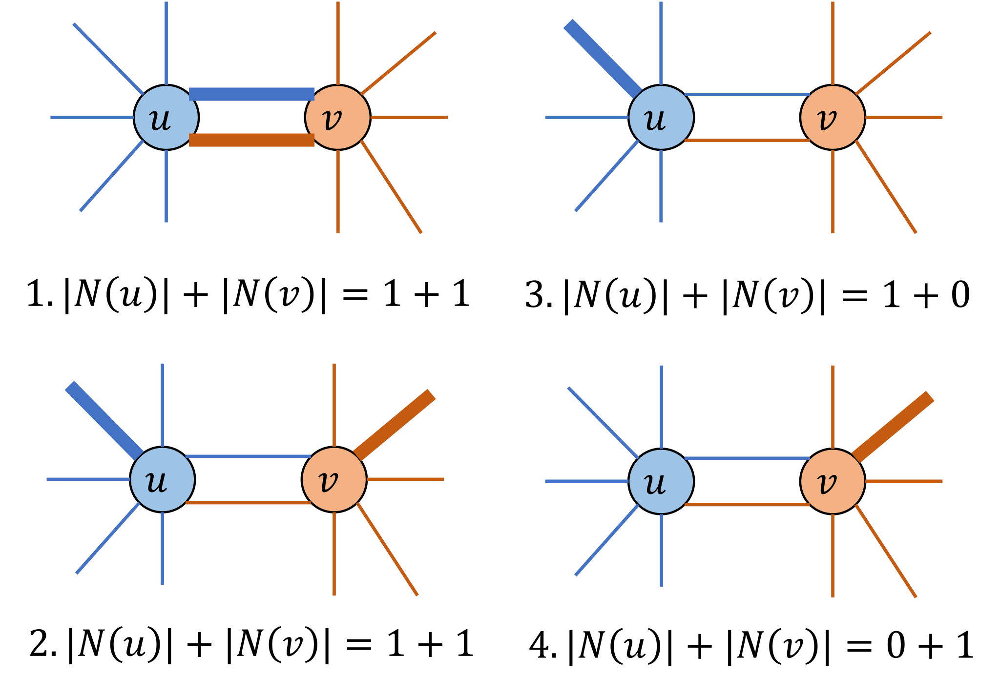

# 最小極大マッチング問題

無向グラフにおける**マッチング**とは、どの2辺も共通の端点を持たない辺の集合です。
**極大マッチング**とは、マッチング条件を崩さずにこれ以上辺を追加できないマッチングのことです。
無向グラフ $G=(V,E)$ が与えられたとき、最小極大マッチング問題は、辺数が最小の極大マッチング $S \subseteq E$ を求める問題です。

マッチングの極大性条件は、次のようにコンパクトに記述できます。
頂点 $u\in V$ に対して、$N(u)$ を $u$ に接続する $S$ 中の辺の集合とします。
このとき、$S$ が極大マッチングであるための必要十分条件は、すべての辺 $(u,v)\in E$ に対して以下が成り立つことです:

$$
 1 \leq |N(u)|+|N(v)| \leq 2
$$

この条件は $S$ が極大マッチングを構成する場合にのみ満たされます。$S$ が極大マッチングであることを保証するために、以下のケースがすべての場合を網羅します:

<p align="center">
  
</p>

最小極大マッチング問題は、上記の条件を満たし、かつ要素数が最小の部分集合 $S$ を見つける問題として定式化できます。

厳密な証明については、以下の論文を参照してください:

> **参考文献**:
> Nakahara, Y., Tsukiyama, S., Nakano, K., Parque, V., & Ito, Y. (2025). **A penalty-free QUBO formulation for the minimum maximal matching problem**. International Journal of Parallel, Emergent and Distributed Systems, 1--19. https://doi.org/10.1080/17445760.2025.2579546


## 最小極大マッチングの定式化
グラフが $n$ 個の頂点と $m$ 本の辺を持ち、辺に $0,1,\ldots,m-1$ のラベルが付いているとします。
$m$ 個のバイナリ変数 $x_0, x_1, \ldots, x_{m-1}$ を導入し、$x_i=1$ は辺 $i$ が選択されている（すなわち $S$ に属する）場合とします。
目的関数は、選択された辺の数を最小化することです:

$$
\begin{aligned}
\text{objective} &= \sum_{i=0}^{m-1} x_i .
\end{aligned}
$$

極大性条件は、各辺 $(u,v)\in E$ についての範囲の制約 $1 \leq |N(u)|+|N(v)| \leq 2$ です。
PyQBPP では、これを [`qbpp.cons()`](CONSTRAINTS) で囲んで制約として宣言し、目的関数と組み合わせて式 $f$ を次のように構成します:

$$
\begin{aligned}
f &= \text{objective} + 2\times\sum_{(u,v)\in E} \text{cons}(1 \leq |N(u)|+|N(v)| \leq 2).
\end{aligned}
$$

制約を破ると、違反量の2乗に重みを掛けた値がエネルギーに加わります。
違反量が1のとき、その値は1です。重みが1だと、制約を破った解のエネルギーが、辺を1本加えて制約を満たした解と同じになることがあり、制約を破った解が最適解に混ざります。
そこで重みを2にしています。

## PyQBPP プログラム
以下の PyQBPP プログラムは、$N=16$ 頂点、$M=27$ 辺の固定された無向グラフの最小極大マッチングを求めます:
```python
import pyqbpp as qbpp

N = 16
edges = [
    (0, 1),  (0, 2),  (1, 3),  (1, 4),  (2, 5),  (2, 6),  (3, 7),
    (3, 13), (4, 6),  (4, 7),  (4, 14), (5, 8),  (6, 8),  (6, 12),
    (6, 14), (7, 14), (8, 9),  (9, 10), (9, 12), (10, 11),(10, 12),
    (11, 13),(11, 15),(12, 14),(12, 15),(13, 15),(14, 15)]
M = len(edges)

adj = [[] for _ in range(N)]
for i in range(M):
    adj[edges[i][0]].append(i)
    adj[edges[i][1]].append(i)

x = qbpp.var("x", shape=M)

objective = qbpp.sum(x)

constraint = 0
for u, v in edges:
    t = 0
    for idx in adj[u]:
        t += x[idx]
    for idx in adj[v]:
        t += x[idx]
    constraint += qbpp.cons(t, between=(1, 2))

f = objective + 2 * constraint

f.simplify_as_binary()
solver = qbpp.ExhaustiveSolver(f)
sol = solver.search()

print(f"objective = {sol(objective)}")
print(f"violated constraints = {f.cons(sol)}")
print("Selected edges:", end="")
for i in range(M):
    if sol(x[i]) == 1:
        print(f" {edges[i]}", end="")
print()
```
まず `M` 個のバイナリ変数のベクトル `x` を定義し、上記の定式化に基づいて `objective`、`constraint`、`f` を定義します。
`qbpp.cons(t, between=(1, 2))` は、`t` が1以上2以下という範囲の制約です。
Exhaustive Solver を用いて `f` の最適解を求めます。
目的関数値と、破った制約の本数 `f.cons(sol)`、および選択された辺の一覧が出力されます。

このプログラムは以下の出力を生成します:
```
objective = 6
violated constraints = 0
Selected edges: (0, 2) (1, 3) (4, 7) (8, 9) (11, 15) (12, 14)
```
したがって、$S$ は6本の辺を含み、最小極大マッチングを形成しています。

## matplotlib による可視化
以下のコードは、最小極大マッチングの解を可視化します。$S$ 中の選択された辺と、それらの辺に接続するすべての頂点が赤でハイライトされます:
```python
import matplotlib.pyplot as plt
import networkx as nx

G = nx.Graph()
G.add_nodes_from(range(N))
G.add_edges_from(edges)
pos = nx.spring_layout(G, seed=42)

matched_nodes = set()
for i in range(M):
    if sol(x[i]) == 1:
        matched_nodes.add(edges[i][0])
        matched_nodes.add(edges[i][1])
colors = ["#e74c3c" if i in matched_nodes else "#d5dbdb" for i in range(N)]
edge_colors = ["#e74c3c" if sol(x[i]) == 1 else "#cccccc"
               for i in range(M)]
edge_widths = [2.5 if sol(x[i]) == 1 else 1.0 for i in range(M)]
nx.draw(G, pos, with_labels=True, node_color=colors, node_size=400,
        font_size=9, edge_color=edge_colors, width=edge_widths)
plt.title("Minimum Maximal Matching")
plt.savefig("minmax_matching.png", dpi=150, bbox_inches="tight")
plt.show()
```

結果の図では、$S$ 中の選択された辺と、それらの辺に接続するすべての頂点が赤でハイライトされます。
これ以上辺を追加できないことが確認でき、極大性条件が満たされています。

## チェス盤にドミノを置く
角を切らない 8×8 のチェス盤（64 マス、隣り合う 2 つのマスの組は 112 本）で、もう 1 枚もドミノを置けない状態を、最少の枚数で作ります。
もう置けないドミノの置き方は極大マッチングなので、その最少の枚数は最小極大マッチングの辺の数です。
マス $v$ を覆うドミノの数を $N(v)$ とすると、極大性条件は、隣り合うすべての 2 つのマス $(u, v)$ について $1 \le N(u) + N(v) \le 2$ です。
[最大マッチング](MAX_MATCHING)のページの「チェス盤にドミノを置く」のプログラム（角を切った盤）との違いは、2 つの隅を除く条件を消した盤と、制約 `qbpp.cons(N[u] + N[v], between=(1, 2))`、目的関数だけです：
```python
import pyqbpp as qbpp

# 8×8 の盤の 64 マス
cells = [(r, c) for r in range(8) for c in range(8)]
index = {cell: i for i, cell in enumerate(cells)}

# 隣り合う 2 マス（右隣と下隣）
edges = []
for r, c in cells:
    for cell in [(r, c + 1), (r + 1, c)]:
        if cell in index:
            edges.append((index[(r, c)], index[cell]))

x = qbpp.var("x", shape=len(edges))

# N[v]: マス v を覆うドミノの数
N = [0] * len(cells)
for i, (u, v) in enumerate(edges):
    N[u] += x[i]
    N[v] += x[i]

objective = qbpp.sum(x)

constraint = 0
for u, v in edges:
    constraint += qbpp.cons(N[u] + N[v], between=(1, 2))

f = objective + 2 * constraint
f.simplify_as_binary()

solver = qbpp.EasySolver(f)
sol = solver.search(time_limit=10)

print(f"dominoes = {sol(objective)}")
print(f"violated constraints = {f.cons(sol)}")
board = [[" "] * 8 for _ in range(8)]
for r, c in cells:
    board[r][c] = "."
for i, (u, v) in enumerate(edges):
    if sol(x[i]) == 1:
        (r1, c1), (r2, c2) = cells[u], cells[v]
        if r1 == r2:
            board[r1][c1], board[r2][c2] = "<", ">"
        else:
            board[r1][c1], board[r2][c2] = "^", "v"
for row in board:
    print(" ".join(row))
```
出力の例です：
```
dominoes = 22
violated constraints = 0
. ^ < > . < > .
^ v . < > ^ . ^
v . < > . v ^ v
. < > . < > v .
< > . < > . < >
. < > ^ . < > .
< > . v ^ . < >
. < > . v < > .
```
ドミノは 22 枚で、空いた 20 個のマスはどれも隣り合わないので、もうドミノは置けません。
22 枚が最小です。
できるだけ多く置くと 32 枚（各行に横向きに 4 枚ずつ）なので、それより 10 枚少ない枚数で置けなくなります。
置ける場所からランダムに 1 つ選んで置くことを置けなくなるまで繰り返すと、10 万回試してもすべて 25〜32 枚で止まり、22〜24 枚になることはありませんでした。



動画では、角を切った盤の最大マッチングと、角を切らない 8×8 の盤の最小極大マッチングを、同じ変数のプログラムで解きます。動画のプログラムと章ごとの説明は[動画：チェス盤にドミノを置く](VIDEO_DOMINOES)のページにあります。
