# オプティカルフロー

動画の連続する 2 枚の画像で、各画素がどちらへどれだけ動いたかを表すベクトルの集まりを**オプティカルフロー**（optical flow）といいます。
動画の圧縮、物体の追跡、自動運転などで使われます。
このページでは、各画素の動きを 25 通りの候補から 1 つずつ選ぶ問題として定式化し、QUBO++ で求めます。
最後に、$256 \times 256$ 画素の画像（変数 160 万個）を、粗い解をヒントにして 2 段階で解く方法も示します。

使う画像は、猫の写真を $20 \times 20$ 画素に縮めたもの（左）と、そこから作った 2 枚目（右）です。
2 枚目は、縮める前の写真（$256 \times 256$ 画素）の上で背景と顔のあたり（楕円の領域）を別々に平行移動し、同じように縮めて作りました。
動きを $20 \times 20$ の画素の単位で表すと、背景が左へ 1.15・上へ 0.2、顔が右へ 1.8・下へ 0.85 です。
縮める前に動かしているので、縮めた画像での動きは画素の整数倍ではなく、顔の縁の画素は顔と背景が混ざった値になります。
両方の画像には ±4 の一様なノイズを加えています。

<p align="center">
  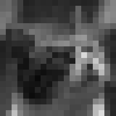
  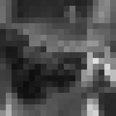
</p>

求めたいのは、次の図（左）の動きです。
動きは色で表します（右の凡例）。
横の動きは青（左向き）から黄色（右向き）、縦の動きは明るさ（上向きほど明るく、下向きほど暗い）です。
1 だけ違う動きは近い色になるので、少しのずれは少しの色の違いに見えます。
背景は左向きなので青みがかった灰色、顔は右下向きなので暗い黄色です。
真の動きは整数ではないので、凡例の色の間の色になっています。

<p align="center">
  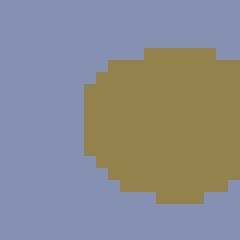
  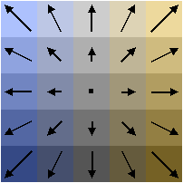
</p>

## 定式化

前の画像の画素値を $I_0(i,j)$、現在の画像の画素値を $I_1(i,j)$ とします（$i$ が行、$j$ が列）。
各画素の動き $(u, v)$（$u$ が横、$v$ が縦の成分、右と下が正）は、25 通りの候補 $u, v \in \lbrace -2, -1, 0, 1, 2 \rbrace$ から選びます。
候補に $k = 0, 1, \ldots, 24$ の番号を付け、$k$ 番目の候補を $u_k = (k \bmod 5) - 2$、$v_k = \lfloor k / 5 \rfloor - 2$ とします。
画素 $(i,j)$ で $k$ 番目の候補を選ぶとき 1、そうでないとき 0 になるバイナリ変数を $x_{i,j,k}$ とします。

画素 $(i,j)$ が $(u_k, v_k)$ だけ動いたなら、$I_1(i,j)$ は動く前の位置の画素値 $I_0(i - v_k, j - u_k)$ に近いはずです。
1 画素だけで比べるとノイズや似た明るさの画素に惑わされるので、周りの $3 \times 3$ 画素（**窓**）の差の絶対値の和で比べます:

$$
c_{i,j,k} = \sum_{s=-1}^{1} \sum_{t=-1}^{1} \bigl| I_1(i+s, j+t) - I_0(i+s-v_k,\ j+t-u_k) \bigr|
$$

画像の外の画素値は、いちばん近い端の画素の値とします。
画素 $(i,j)$ の動きの横成分と縦成分は、変数の 1 次式で表せます:

$$
u_{i,j} = \sum_{k=0}^{24} u_k\, x_{i,j,k}, \qquad v_{i,j} = \sum_{k=0}^{24} v_k\, x_{i,j,k}
$$

最小化する目的関数は次のとおりです:

$$
E(x) = \sum_{i,j} \sum_{k=0}^{24} c_{i,j,k}\, x_{i,j,k} + \alpha \sum_{\text{隣接する } (i,j),\,(i',j')} \bigl( |u_{i,j} - u_{i',j'}| + |v_{i,j} - v_{i',j'}| \bigr)
$$

制約は、各画素で候補をちょうど 1 つ選ぶことです（one-hot 制約）:

$$
\sum_{k=0}^{24} x_{i,j,k} = 1 \qquad (\text{すべての } (i,j))
$$

- **第 1 項（データ項）** は、選んだ動きで窓どうしがどれだけ食い違うかです。
- **第 2 項（平滑化項）** は、上下左右に隣り合う画素の動きの差の絶対値の和です。同じ物体の画素はふつう同じように動くので、隣どうしで動きがそろうほど小さくなります。
  ノイズや、模様が少なく窓だけでは動きが決まらない場所でも、周りの画素の動きに合わせられます。
  [ノイズ除去](DENOISING)と同じく差の 2 乗ではなく絶対値なので、顔と背景の境目のように動きが急に変わる場所を残せます。

以下では $\alpha = 27$ とします。隣と動きが 1 違うことを、窓の 9 画素で明るさが平均 3 ずつ違うことと同じ重さにしています。
one-hot 制約は [`qbpp.cons()`](CONSTRAINTS) で書き、重みは 4000 とします。
1 つの画素で制約を破って減らせる値は、データ項の最大値 $9 \times 255 = 2295$ と、4 つの隣との平滑化項の最大値 $4 \times 8\alpha = 864$ の和 3159 より小さいので、制約を破った解が得になることはありません。

## PyQBPP プログラム

入力の 2 枚の画像 [optical_flow_prev.pgm](../../images/optical_flow_prev.pgm) と [optical_flow_cur.pgm](../../images/optical_flow_cur.pgm)（PGM 形式、$20 \times 20$ 画素）を、実行するディレクトリに置いて実行します:


```python
import pyqbpp as qbpp

ALPHA = 27  # 平滑化項の重み
P = 4000    # one-hot 制約の重み


def read_pgm(file):
    # PGM 形式の画像を読み込む（画素値 0〜255）
    tok = open(file).read().split()
    W, H = int(tok[1]), int(tok[2])
    return [[int(tok[4 + i * W + j]) for j in range(W)] for i in range(H)]


def pixel(img, i, j):
    # 画素値（画像の外は、いちばん近い端の画素の値）
    i = min(max(i, 0), len(img) - 1)
    j = min(max(j, 0), len(img[0]) - 1)
    return img[i][j]


prev = read_pgm("optical_flow_prev.pgm")
cur = read_pgm("optical_flow_cur.pgm")
H, W = len(cur), len(cur[0])

# x[i][j][k]: 画素 (i, j) の動きが k 番目の候補 (k % 5 - 2, k // 5 - 2) なら 1
x = qbpp.var("x", H, W, 25)

f = 0
# 各画素の動きの横成分 u と縦成分 v
u = [[0] * W for _ in range(H)]
v = [[0] * W for _ in range(H)]
for i in range(H):
    for j in range(W):
        for k in range(25):
            uk, vk = k % 5 - 2, k // 5 - 2
            # データ項: 3x3 の窓で、現在の画像と動く前の位置の画素との差の絶対値の和
            c = sum(abs(pixel(cur, i + s, j + t) - pixel(prev, i + s - vk, j + t - uk))
                    for s in (-1, 0, 1) for t in (-1, 0, 1))
            f += c * x[i][j][k]
            u[i][j] += uk * x[i][j][k]
            v[i][j] += vk * x[i][j][k]
# one-hot 制約: 各画素で候補をちょうど 1 つ選ぶ
f += P * qbpp.cons(qbpp.vector_sum(x) == 1)
# 平滑化項: 右隣・下隣との動きの差の絶対値
for i in range(H):
    for j in range(W):
        if j + 1 < W:
            f += ALPHA * (qbpp.abs(u[i][j] - u[i][j + 1]) + qbpp.abs(v[i][j] - v[i][j + 1]))
        if i + 1 < H:
            f += ALPHA * (qbpp.abs(u[i][j] - u[i + 1][j]) + qbpp.abs(v[i][j] - v[i + 1][j]))
f.simplify_as_binary()

sol = qbpp.EasySolver(f).search(time_limit=10)
print("energy =", sol.energy)

# 動きを色で表した画像を PPM 形式で保存
# 横の動きを青（左）から黄色（右）、縦の動きを明るさ（上ほど明るい）で表す
with open("optical_flow_out.ppm", "w") as fp:
    fp.write(f"P3\n{W} {H}\n255\n")
    for i in range(H):
        for j in range(W):
            for k in range(25):
                if sol(x[i][j][k]):
                    uk, vk = k % 5 - 2, k // 5 - 2
                    fp.write(f"{145 + 16 * uk - 30 * vk} {145 + 6 * uk - 30 * vk} "
                             f"{145 - 24 * uk - 30 * vk}\n")
```


- `qbpp.var("x", H, W, 25)` で、画素ごとに 25 個のバイナリ変数を作ります（$20 \times 20 \times 25 = 10{,}000$ 個）。
- データ項の係数 $c_{i,j,k}$ はふつうの整数として計算し、変数 `x[i][j][k]` に掛けて足します。
  同じループで、動きの横成分 `u[i][j]` と縦成分 `v[i][j]` を変数の 1 次式として作ります。
- `qbpp.vector_sum(x)` は最後の次元についての和で、画素ごとに 25 個の変数の和を並べた $20 \times 20$ の配列です。
  `qbpp.cons(... == 1)` で、それぞれが 1 になる制約（400 本）をまとめて書けます。
- 平滑化項は、1 次式 `u[i][j] - u[i][j + 1]` などを `qbpp.abs` で包んで足します。
- `EasySolver` で 10 秒探索し、各画素で値が 1 の変数から動きを読み取って、凡例と同じ色で表した画像 `optical_flow_out.ppm` に保存します。

変数はちょうど 10,000 個なので、Trial ライセンス（10,000 変数まで）でも実行できます。

### 出力結果

プログラムの出力は、例えば次のようになります:

```
energy = 32766
```

`EasySolver` は乱択的なので、エネルギーの値は実行ごとに変わります。
式の構築は 1 秒ほどで、残りの 10 秒が探索です。

真の動き（左）と、求めた動き（右）:

<p align="center">
  
  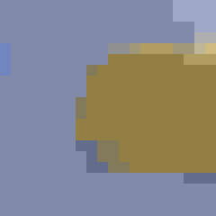
</p>

顔と背景が 2 つの領域にきれいに分かれました。
真の動きは整数ではないので、真の動きを四捨五入した候補と比べると、86.8% の画素で一致しています。
ずれた画素の多くは顔の縁です。

## 局所的な方法との比較

同じデータ項と平滑化項を使う、次の 2 つの方法と比べます。

- **各画素で最良の候補を選ぶ方法**: 平滑化項を使わず、画素ごとにデータ項 $c_{i,j,k}$ が最小の候補を選びます。
- **ICM**（Iterated Conditional Modes）: 上の結果から始めて、隣の画素の動きを固定したまま、各画素の動きを $E$ が最小になる候補に置き換えることを、変化がなくなるまで繰り返します。

左から、各画素で最良の候補を選ぶ方法、ICM、QUBO++ の結果です:

<p align="center">
  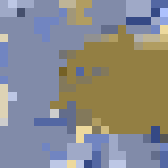
  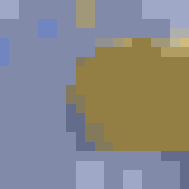
  
</p>

真の動きは整数ではないので、真の動きを四捨五入した候補と一致した画素の割合と、求めた動きと真の動きのベクトルの差の長さの平均（「平均のずれ」、単位は画素）で比べます。
候補が整数なので、真の動きを四捨五入しても平均のずれは 0.25 残ります。

| 方法 | エネルギー $E$ | 四捨五入した真の動きと一致した画素 | 平均のずれ |
|---|---:|---:|---:|
| 各画素で最良の候補 | 42,789 | 65.5% | 0.74 |
| ICM | 33,910 | 78.0% | 0.49 |
| QUBO++（`EasySolver`、10 秒） | 32,766 | 86.8% | 0.40 |
| 真の動きを四捨五入したもの | 34,513 | 100% | 0.25 |

各画素で最良の候補を選ぶと、模様の少ない場所やノイズの影響で、ばらばらの動きが出ます。
ICM は 1 画素ずつしか直さないので、まとまった誤りの領域を動かせずに止まり、誤りが点々と残ります。
QUBO++ は 3 つの方法の中で $E$ がいちばん小さく、誤りの多くが消えます。

### 最適解は真の動きではない

表で、真の動きを四捨五入したもののエネルギー（34,513）は、QUBO++ の解のエネルギー（32,766）よりも大きくなっています。
つまり、この目的関数の最小解は真の動きではなく、最適解を求めても真の動きそのものは得られません。
真の動きを四捨五入したものから ICM を始めても、$E$ が下がるにつれて画素の動きが変わり、真の動きのまま残るのは 91.8% です。

違いが出るのは、画像だけからは動きが決まらない画素です。
QUBO++ の解でずれた 53 画素の内訳は次のとおりです。

- **顔の縁（39 画素）**: $3 \times 3$ の窓が顔と背景にまたがると、窓の中で多数を占める側の動きのほうが差の和が小さくなることがあり、顔の縁が 1〜2 画素ずれます。
- **縦にのびた模様（右上の角、10 画素）**: 模様が縦方向にほとんど変わらないので、縦の動きが 0 でも −1 でも窓の差があまり変わりません（**開口問題**と呼ばれます）。真の縦の動き −0.2 に対して、−1 が選ばれています。
- **画像の左端（3 画素）など**: 窓の一部が画像の外に出るので、端の画素の値で補った部分が実際の画像と合いません。

このように、残っている誤りは探索の不足ではなく、目的関数（モデル）の限界によるものです。
QUBO++ を使えば、与えた目的関数をよく最小化できます。
それでも足りない精度は、目的関数を改良して上げることになります。

## 大きな画像（256×256 画素）

同じ場面を、縮めずに $256 \times 256$ 画素の画像で求めます。
動きは $256 \times 256$ の画素の単位で、背景が左へ 1.15・上へ 0.2、顔が右へ 1.8・下へ 0.85 です（数値は 20×20 の例と同じです）。
各画素の値は、画素を $4 \times 4$ の点に分け、それぞれの点で動く前の位置の明るさを元の写真から補間で読み、平均して作りました。
そのため顔の縁の画素は、顔と背景が混ざった値になります。
前の画像も同じように $4 \times 4$ の点の平均で作り、両方の画像に ±4 の一様なノイズを加えています。

左から、前の画像、現在の画像、真の動きです:

<p align="center">
  
  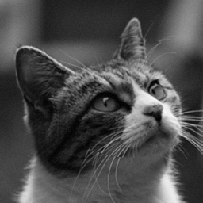
  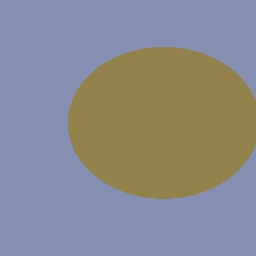
</p>

変数は $256 \times 256 \times 25 = 1{,}638{,}400$ 個で、Trial ライセンスの上限（10,000 変数）を超えます。

### そのまま解いた結果

上の PyQBPP プログラムで入力のファイル名を変え、探索時間を 60 秒にして解くと、エネルギーは 2,259,684 でした。
左から、各画素で最良の候補を選ぶ方法、ICM、QUBO++ でそのまま解いた結果です:

<p align="center">
  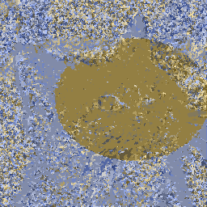
  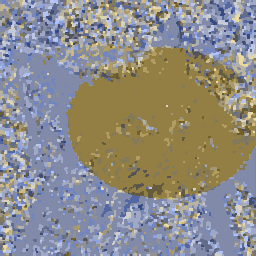
  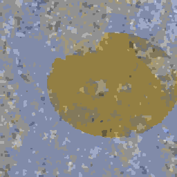
</p>

QUBO++ の解は ICM よりずっとエネルギーが小さいものの、真の動きを四捨五入したもののエネルギー（1,931,015）には届かず、誤った動きのまとまりが画像のあちこちに残っています。
まとまった誤りを直すには、その中の画素の動きをいっせいに変えなければなりません。
変数が 160 万個あると、60 秒の探索では、画像全体でそれをやりきれません。

### 2 段階で解く

そこで、まず粗く求めてから細かく求めます。
画像を $8 \times 8$ 画素のブロックに区切り、次の 2 段階で解きます:

1. **1 段目**: ブロックの中の画素はすべて同じ動きをするとして、ブロックごとの動きを求めます。ブロックは $32 \times 32$ 個なので、変数は 25,600 個です。
2. **2 段目**: 1 段目の解を画素に広げて[ヒント解](ABS3#solution-hint)として渡し、画素ごとの動きを求めます。

1 段目の問題も、20×20 の問題と同じ形の目的関数で書けます。
ブロックの動きを $k$ 番目の候補にすると、データ項はブロックの中の 64 画素の $c_{i,j,k}$ の和です。
平滑化項は、ブロックの中では隣どうしの動きが同じなので 0 です。
隣のブロックとの境目では 8 組の画素が隣り合い、どの組も同じ差になるので、重みは $8\alpha$ になります。
one-hot 制約の重みは $8^2 = 64$ 倍にします。1 つのブロックで制約を破って減らせる値も、1 つの画素の 64 倍を超えないからです。
こうすると、1 段目の解のエネルギーは、その解を画素に広げたときの $E$ と同じ値になります。

入力の 2 枚の画像 [optical_flow256_prev.pgm](../../images/optical_flow256_prev.pgm) と [optical_flow256_cur.pgm](../../images/optical_flow256_cur.pgm) を、実行するディレクトリに置いて実行します:


```python
import pyqbpp as qbpp

ALPHA = 27  # 平滑化項の重み
P = 4000    # one-hot 制約の重み
B = 8       # 1 段目のブロックの大きさ（B x B 画素）


def read_pgm(file):
    # PGM 形式の画像を読み込む（画素値 0〜255）
    tok = open(file).read().split()
    W, H = int(tok[1]), int(tok[2])
    return [[int(tok[4 + i * W + j]) for j in range(W)] for i in range(H)]


def pixel(img, i, j):
    # 画素値（画像の外は、いちばん近い端の画素の値）
    i = min(max(i, 0), len(img) - 1)
    j = min(max(j, 0), len(img[0]) - 1)
    return img[i][j]


def save_flow(file, sol, x, H, W):
    # 解 sol の各画素の動きを色で表した画像を PPM 形式で保存（色は 20x20 のプログラムと同じ）
    with open(file, "w") as fp:
        fp.write(f"P3\n{W} {H}\n255\n")
        for i in range(H):
            for j in range(W):
                for k in range(25):
                    if sol(x[i][j][k]):
                        uk, vk = k % 5 - 2, k // 5 - 2
                        fp.write(f"{145 + 16 * uk - 30 * vk} {145 + 6 * uk - 30 * vk} "
                                 f"{145 - 24 * uk - 30 * vk}\n")


def flow_expr(x, c, alpha, P):
    # データ項の係数 c、平滑化項の重み alpha、one-hot 制約の重み P から目的関数を作る
    H, W = len(c), len(c[0])
    f = 0
    # 各画素の動きの横成分 u と縦成分 v
    u = [[0] * W for _ in range(H)]
    v = [[0] * W for _ in range(H)]
    for i in range(H):
        for j in range(W):
            for k in range(25):
                f += c[i][j][k] * x[i][j][k]  # データ項
                u[i][j] += (k % 5 - 2) * x[i][j][k]
                v[i][j] += (k // 5 - 2) * x[i][j][k]
    # one-hot 制約: 各画素で候補をちょうど 1 つ選ぶ
    f += P * qbpp.cons(qbpp.vector_sum(x) == 1)
    # 平滑化項: 右隣・下隣との動きの差の絶対値
    for i in range(H):
        for j in range(W):
            if j + 1 < W:
                f += alpha * (qbpp.abs(u[i][j] - u[i][j + 1]) + qbpp.abs(v[i][j] - v[i][j + 1]))
            if i + 1 < H:
                f += alpha * (qbpp.abs(u[i][j] - u[i + 1][j]) + qbpp.abs(v[i][j] - v[i + 1][j]))
    f.simplify_as_binary()
    return f


prev = read_pgm("optical_flow256_prev.pgm")
cur = read_pgm("optical_flow256_cur.pgm")
H, W = len(cur), len(cur[0])

# データ項の係数: 3x3 の窓で、現在の画像と動く前の位置の画素との差の絶対値の和
c = [[[sum(abs(pixel(cur, i + s, j + t) - pixel(prev, i + s - (k // 5 - 2), j + t - (k % 5 - 2)))
           for s in (-1, 0, 1) for t in (-1, 0, 1))
       for k in range(25)] for j in range(W)] for i in range(H)]

# 1 段目: B x B 画素のブロックごとに 1 つの動きを選ぶ
cb = [[[0] * 25 for _ in range(W // B)] for _ in range(H // B)]
for i in range(H):
    for j in range(W):
        for k in range(25):
            cb[i // B][j // B][k] += c[i][j][k]
y = qbpp.var("y", H // B, W // B, 25)
g = flow_expr(y, cb, B * ALPHA, B * B * P)
sol1 = qbpp.EasySolver(g).search(time_limit=10)
print("stage 1: energy =", sol1.energy)

# 2 段目: 1 段目の解を画素に広げてヒントにし、画素ごとの動きを求める
x = qbpp.var("x", H, W, 25)
f = flow_expr(x, c, ALPHA, P)
hint = qbpp.Sol(f)
for i in range(H):
    for j in range(W):
        for k in range(25):
            hint.set(x[i][j][k], sol1(y[i // B][j // B][k]))
print("hint:    energy =", f(hint))
sol = qbpp.EasySolver(f).search(time_limit=60, hint=hint)
print("stage 2: energy =", sol.energy)

# 1 段目の解（ヒント）と 2 段目の解を画像で保存
save_flow("optical_flow256_stage1.ppm", hint, x, H, W)
save_flow("optical_flow256_out.ppm", sol, x, H, W)
```


- `flow_expr` は、20×20 のプログラムで目的関数を作る部分を関数にしたものです。データ項の係数 `c` と、平滑化項と制約の重みを引数で受け取ります。
- データ項の係数は `c[i][j][k]` に計算しておきます。1 段目では、`cb[i // B][j // B][k] += c[i][j][k]` でブロックの中の画素の係数を足し、平滑化項の重みを `B` 倍、制約の重みを `B * B` 倍にして、同じ `flow_expr` で式を作ります。
- 2 段目では、`qbpp.Sol(f)` で `f` の変数の解を作り、各画素にその画素を含むブロックの 1 段目の解を書き写して、`search()` の `hint=` 引数で渡します。`f(hint)` はヒント解のエネルギーです。
- `save_flow` は、解の動きを 20×20 のプログラムと同じ色で表した画像を保存します。1 段目の解は、画素に広げたヒント解を保存します。

### 出力結果

プログラムの出力は、例えば次のようになります:

```
stage 1: energy = 1973335
hint:    energy = 1973335
stage 2: energy = 1924950
```

1 段目の解のエネルギーと、それを画素に広げたヒント解のエネルギーは同じ値です。
`EasySolver` はヒント解より悪い解を返さないので、2 段目のエネルギーが 1 段目より大きくなることはありません。
何回か実行すると、2 段目のエネルギーは 1,924,289〜1,925,107 でした。
実行時間は全体で約 2 分（そのうち探索が 70 秒）、使ったメモリは約 4 GB です。

下の図と表は、1 段目のエネルギーが 1,973,598、2 段目のエネルギーが 1,925,107 になった実行の結果です。
左から、1 段目の解、2 段目の解、真の動きです:

<p align="center">
  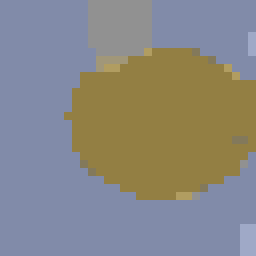
  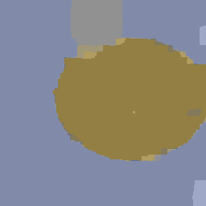
  
</p>

1 段目の解は、顔の縁がブロックの格子にそった階段になっています。
2 段目では、その縁が画素単位で直ります。

| 方法 | エネルギー $E$ | 四捨五入した真の動きと一致した画素 | 平均のずれ |
|---|---:|---:|---:|
| 各画素で最良の候補 | 5,798,810 | 40.5% | 1.15 |
| ICM | 3,179,052 | 49.9% | 0.90 |
| QUBO++、そのまま解く（60 秒） | 2,259,684 | 56.5% | 0.68 |
| QUBO++、1 段目（$8 \times 8$ 画素のブロック、10 秒） | 1,973,598 | 90.4% | 0.36 |
| QUBO++、2 段目（60 秒） | 1,925,107 | 90.8% | 0.34 |
| 真の動きを四捨五入したもの | 1,931,015 | 100% | 0.25 |

2 段階で解くと、そのまま解くよりエネルギーがずっと小さくなり、真の動きを四捨五入したものより小さくなります。
2 段目でエネルギーは約 48,000 下がりますが、動きが変わるのは顔の縁の近くの約 1,000 画素だけなので、一致した画素の割合はあまり変わりません。
ブロックの大きさを 4 や 16 にすると、2 段目のエネルギーはそれぞれ 1,940,761 と 1,942,853 で、8 のときより大きくなりました。

真の動きと違う画素（約 6,000 画素）は、主に次の場所です。

- **耳の間の背景とその下の顔の上端（上の中央、約 4,000 画素）**: 背景の横の動きが 0 になっています（真の動きは −1.15）。背景がぼけて模様がほとんどないので、動きを変えても窓の差はあまり変わりません。
- **右端の模様の少ない場所（約 900 画素）**: 背景は左へ動くので、右端の画素には前の画像の外から入ってきた部分が写っていて、そこから模様のない背景にそって誤った動きが広がっています。
- **顔の縁（約 900 画素）**: 20×20 の場合と同じく、窓が顔と背景にまたがる画素です。

上の中央と右端の誤りの領域を真の動きを四捨五入した候補に変えると、どちらも $E$ はかえって大きくなります。
これらは 20×20 の場合と同じく、目的関数（モデル）の限界による誤りです。

真の動きを四捨五入したものから ICM を始めると、99.2% の画素が真の動きのまま残り、$E$ は 1,923,751 になります。
これは QUBO++ の解よりわずかに（0.07%）小さい値です。
違いは主に顔の縁で、QUBO++ の解には縁が 1〜2 画素ずれている場所があります。
縁にそった帯の画素の動きをいっせいに変えれば $E$ が下がるので、この画像では探索で取り切れていない誤りも少し残っています。

大きな問題では、このように小さな問題の解をヒント解にすると、そのまま解くよりずっと良い解に届きます。
粗い解像度で求めてから細かい解像度で求める方法は、オプティカルフローの計算でもよく使われています。
