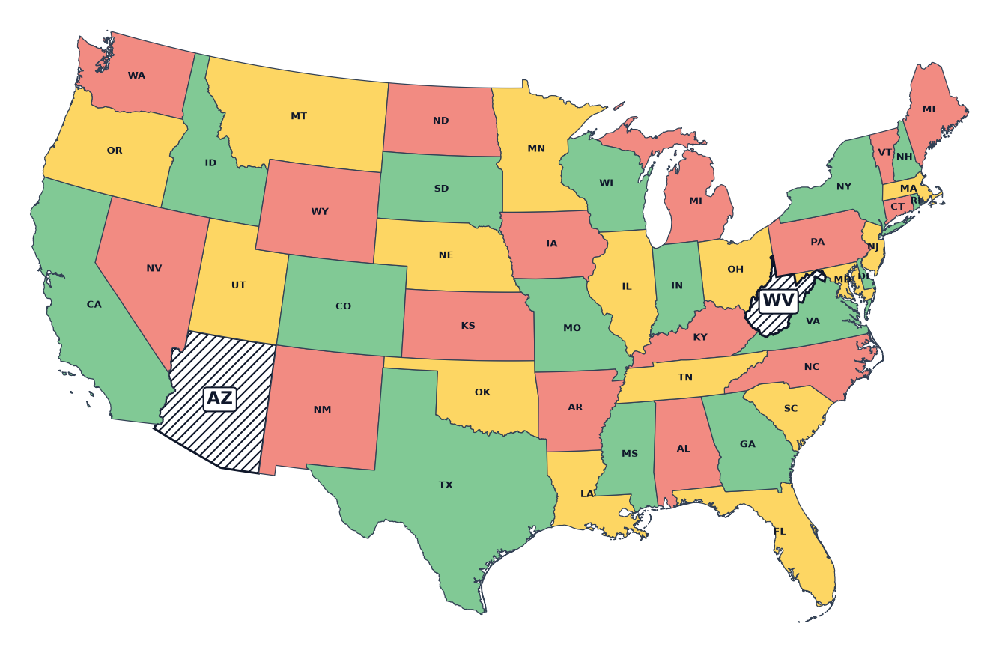
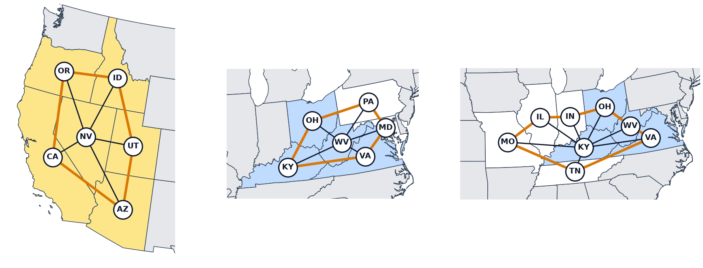

# 動画：アメリカ 48 州を 3 色で塗り分ける（Python）

動画「QUBO++ ケーススタディ アメリカ 48 州を 3 色で塗り分ける（Python）」の手引きです。
章ごとに、要点と動画に出てくるプログラム・出力、詳しい説明のページへのリンクをまとめています。
「▶ 動画の … から再生」をクリックすると、その場面から再生します。



この動画で扱うこと：

- アメリカ本土の 48 州は 4 色なら塗り分けられるが、3 色では塗り分けられないこと
- 邪魔な州を除いて残りを 3 色で塗る **3 彩色可能頂点削除問題**と、州 × 色のバイナリ変数 $x_{i,j}$
- 「各州の色は高々 1 つ」と「隣り合う州は違う色」の 2 つの制約をペナルティの式で書き、塗る州の数を最大にすること（重み 2 の理由）
- ABS3Solver で最良と同じエネルギーの解をすべて集め、除く 2 州の 24 組を求めること
- なぜ 2 州が必要で、なぜこの 24 組なのか（奇数個の州の輪が真ん中の州を囲む 3 つの形）

文章での説明は[3 彩色可能頂点削除](3COLOR_DELETION)のページにあります。[動画（ケーススタディ）](../VIDEO_CASE_STUDIES)の一覧に戻る

## 問題



- 地図の塗り分けは、グラフの彩色として考えます。州を頂点にし、境界線を共有する 2 つの州を辺で結ぶと、48 州では辺は 105 本です。フォーコーナーズで接するアリゾナとコロラドのように、1 点で接するだけの州どうしは辺で結びません。
- グラフの彩色では、辺の両端の頂点を違う色にします。四色定理により 4 色ならどんな地図も塗り分けられますが、48 州は 3 色では、どう塗っても同じ色の州が隣り合います。
- 州を除くことは、その頂点とつながる辺を取り除くことです。除く頂点をできるだけ少なくして、残りを 3 色で塗れるようにする問題を、**3 彩色可能頂点削除問題**といいます。

## 変数



- 州ごとに 3 つの色に対応する 3 つの変数を用意します。48 州で 144 個です。$x_{i,j} = 1$ なら州 $i$ を色 $j$ で塗ります。
- 表で見ると、行が州、列が色です。行の中の 1 の位置がその州の色で、行がすべて 0 の州は塗りません。塗らない州が、除く州です。

## 色は高々1つ



- 各州は 1 つの色で塗るか、塗らないかのどちらかなので、各行の 1 の個数は 0 か 1 です。州 $i$ の行の和を $s_i$ とすると、$s_i(s_i - 1)$ は $s_i = 0, 1$ で 0、$s_i = 2$ で 2、$s_i = 3$ で 6 です。

$$
\text{atmostone} = \sum_{i} s_i(s_i - 1)
$$

- どの項も 0 以上で、すべての $s_i$ が 0 か 1 のときだけ 0、そうでなければ 1 以上になります。展開すると、同じ行の 2 つの変数の積を 3 つ足して 2 倍したものです。

## 隣り合う州は違う色



- 辺ごとに、両端の州の同じ色の変数どうしを掛けて足します。両端が同じ色ならその積が 1 になります。105 本の辺の分を足したものが different です。

$$
\text{different} = \sum_{(u,v)\in E} \sum_{j=0}^{2} x_{u,j}\, x_{v,j}
$$

- 塗らない州の行はすべて 0 なので、除いた州につながる辺の項はすべて 0 になります。除いた州は、隣の州と色が同じかどうかを気にしなくてよいわけです。

## 塗る州の数と重み



- 各行の 1 は高々 1 つなので、塗る州の数は変数の和 colored です。除く州の数は 48 − colored なので、colored を最大にします。最小化する式は次のとおりです。

$$
f = -\text{colored} + 2\,(\text{atmostone} + \text{different})
$$

- 重み 2 の理由：制約を破っている解では、どこかの 1 を 1 つ 0 にすると違反が減ります。このとき colored は 1 減って $f$ は 1 増えますが、ペナルティは 1 以上減るので、重みを掛けると $f$ は 2 以上減ります。差し引きで $f$ は減るので、制約が優先されます。重みは 1 より大きければ十分です。

## 式のまとめ



- 変数は 48 州 × 3 色の 144 個の $x$、制約は atmostone と different の 2 つ、目的は colored の最大化です。$f$ が最小のとき、塗る州の数が最大、つまり除く州の数が最小になります。

## プログラム



州の名前と辺の一覧は [usa48.json](../../images/usa48.json) に入っています。このファイルを実行するディレクトリに置いて実行します。
動画のプログラムは atmostone を `qbpp.sum(s * (s - 1))` と書いています（文章のページでは `qbpp.constrain()` を使っています。式は同じです）。

```python
import json
import pyqbpp as qbpp

data = json.load(open("usa48.json"))
names, edges = data["names"], data["edges"]
n, m = len(names), 3

x = qbpp.var("x", shape=(n, m))

s = qbpp.vector_sum(x)
atmostone = qbpp.sum(s * (s - 1))
different = 0
for u, v in edges:
    different += qbpp.sum(x[u] * x[v])
colored = qbpp.sum(x)

f = -colored + 2 * (atmostone + different)

f.simplify_as_binary()
solver = qbpp.ABS3Solver(f)
sol = solver.search(time_limit=10, best_energy_sols=0)

print(f"colored = {sol(colored)}")

sets = {}
for t in sol.sols:
    key = tuple(names[i] for i in range(n) if t(s[i]) == 0)
    sets[key] = sets.get(key, 0) + 1
print(f"solutions = {len(sol.sols)}, deletion sets = {len(sets)}")
for key in sorted(sets):
    print(f"{' + '.join(key)}: {sets[key]}")
```

- `x` は 48 行 3 列の配列で、各行が州、各列が色です。`qbpp.vector_sum(x)` は各行の和を並べた配列 `s` で、`s * (s - 1)` は要素ごとに計算されます。
- `x[u] * x[v]` は州 `u` と州 `v` の行の要素ごとの積で、同じ色の変数どうしの積が 3 つ並びます。`qbpp.sum(x)` は全要素の和で、colored になります。
- `ABS3Solver` で 10 秒探索し、`best_energy_sols=0` で最良と同じエネルギーの解をすべて返します（`sol.sols`）。
- 解 `t` ごとに、行の和 `t(s[i])` が 0 の州（色のない州）の名前を `tuple` で組にしてキーとし、辞書 `sets` で組ごとの解の数を数えます。

## 実行結果



```
colored = 46
solutions = 1728, deletion sets = 24
Arizona + Kentucky: 48
Arizona + Ohio: 48
Arizona + Virginia: 24
Arizona + West Virginia: 72
California + Kentucky: 48
California + Ohio: 48
California + Virginia: 24
California + West Virginia: 72
Idaho + Kentucky: 96
Idaho + Ohio: 96
Idaho + Virginia: 48
Idaho + West Virginia: 144
Kentucky + Nevada: 96
Kentucky + Oregon: 96
Kentucky + Utah: 48
Nevada + Ohio: 96
Nevada + Virginia: 48
Nevada + West Virginia: 144
Ohio + Oregon: 96
Ohio + Utah: 48
Oregon + Virginia: 48
Oregon + West Virginia: 144
Utah + Virginia: 24
Utah + West Virginia: 72
```

- colored は 46 なので、除く州の最小数は 2 です。1 つの州を除くだけでは 3 色で塗れません。
- ABS3Solver は GPU を使い、最良と同じエネルギーの解 1728 個をすべて求めました。除く 2 つの州の組は 24 組です。1 つの組でも残りの 46 州の塗り方は何通りもあり、色を入れ替えるだけでも 6 通りになります。

## 除く2州の全24組



- 24 組は、西の 6 つの州から 1 つ、東の 4 つの州から 1 つを選んだ組です。マスの数は、その組での解の数です。

| 西 ＼ 東 | ケンタッキー | ウェストバージニア | オハイオ | バージニア |
|:---|---:|---:|---:|---:|
| ネバダ | 96 | 144 | 96 | 48 |
| カリフォルニア | 48 | 72 | 48 | 24 |
| オレゴン | 96 | 144 | 96 | 48 |
| アイダホ | 96 | 144 | 96 | 48 |
| ユタ | 48 | 72 | 48 | 24 |
| アリゾナ | 48 | 72 | 48 | 24 |

<p align="center">
  
</p>

## なぜ2州で24組か



- ネバダの隣の 5 つの州（カリフォルニア・オレゴン・アイダホ・ユタ・アリゾナ）は輪のようにつながっています。奇数個の州の輪は 2 色では交互に塗れないので 3 色すべてを使い、輪のすべての州と隣り合うネバダには 4 色目が必要です。
- このように奇数個の州の輪が真ん中の州を囲む形が、48 州に 3 つあります。西のネバダを 5 州が囲む形、東のウェストバージニアを 5 州（ケンタッキー・オハイオ・ペンシルベニア・メリーランド・バージニア）が囲む形、ケンタッキーを 7 州（イリノイ・インディアナ・オハイオ・ウェストバージニア・バージニア・テネシー・ミズーリ）が囲む形です。輪の州か真ん中の州を 1 つ除けば、その形はなくなります。

<p align="center">
  
</p>

- 西のネバダの形と東の 2 つの形は州を共有していないので、1 つの州では両方をなくせません。だから、少なくとも 2 つの州を除く必要があります。
- 西では、ネバダか輪の 5 つの州のどれか 1 つを除きます（6 通り）。東では、ケンタッキー・ウェストバージニア・オハイオ・バージニアの 4 州が 2 つの形の両方に入っているので、どれか 1 つを除けば東の形は両方なくなります（4 通り）。6 × 4 = 24 組で、ソルバーが求めた 24 組とぴったり一致します。

## まとめ



- 3 色で塗れない地図で、除く州の最小数を QUBO++ で求めました。制約は「各州の色は高々 1 つ」と「隣り合う州は違う色」の 2 つで、どちらもペナルティの式で書きました。
- 塗る州の数の符号を反転して足し、ペナルティには重み 2 を掛けました。ABS3Solver で最適解をすべて集め、除く 2 つの州の 24 組を求めました。
- 24 組は、奇数個の州の輪が作る 3 つの形から説明できます。
